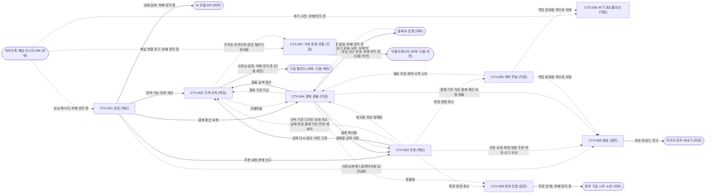

# 수제케이크 주문제작: 도메인 설계

상태: 1~9단계를 마쳤고(요구사항 버전 2~5에서 바뀐 규칙은 3-8에서 되돌림, 2026-11-15), 체크포인트 1~3을 2026-11-11에 통과했습니다. 1차(타임라인)는 14:03에(동희님 "추천은 모두 승인"), 2차(컨텍스트 경계)는 15:46에(동희님 "추천 모두 승인"), 3차(컨텍스트 표와 지도)는 17:11에(동희님 "추천 모두 승인") 통과했습니다. 컨텍스트는 CTX-001~009(3절), 용어는 TERM-001~074(7절)입니다. 마지막 체크포인트를 지났으므로 이제는 이 문서가 기준입니다. 바꿀 일이 생기면 이 문서를 먼저 고치고 보드를 고친 뒤, 무엇이 바뀌었는지 보드 댓글로 알립니다. 2026-11-11 20:17 02단계 범위 확정(동희님 결정 카드 '이대로 확정')에 따라 02단계가 정한 것을 이 문서에 되돌려 적었고(3-5), 열린 핫스팟은 모두 답했습니다(6절). 2026-11-12에는 동희님 결정(용어 대조표 82개 '추천대로 확정')에 따라 용어 이름을 업계 용어로 바꿨습니다(3-7).

이 문서는 CORTHEX 01단계(도메인 탐색)의 원본입니다. 사람이 보고 고치는 곳은 [이벤트 스토밍 보드](https://miro.com/app/board/uXjVEPLnid4=/)입니다. 체크포인트마다 보드를 읽어 이 문서에 옮기고, 읽은 시각을 위 `synced_at`에 적습니다. 지금 값(2026-11-12 10:05)은 보드를 마지막으로 읽어 대조한 시각이고, 그 뒤 이 문서에서 고친 것(3-7 용어 정리, 3-8과 2-1의 이벤트 63·64)은 보드와 다시 대조하지 않았습니다. 설계 재검토를 모두 고친 뒤 사람이 보는 곳을 맞출 때 보드에 옮기고 댓글로 알린 뒤 이 값을 고칩니다(설계 재검토 RA-22). 2026-11-15에 동희님 지시("미로보드 관련해서도 일단 깃에서 관리해")로 보드에는 옮기지 않았고, 보드는 2026-11-12 10:05에 맞춘 모습 그대로입니다. 그 뒤 바뀐 것은 저장소의 [보드에 옮길 단계 목록](miro-steps.md)이 원본이고, 보드에 언제 옮길지는 따로 정합니다.

제품 저장소는 이 저장소(kodonghui/siljang.ai)입니다(동희님 2026-11-11 17:44 "siljang에서 해야지"). 이 문서와 단계 기록(`.corthex/`)은 kakao-hack 저장소의 초안 [PR #10](https://github.com/kodonghui/kakao-hack/pull/10)에서 썼고, 같은 날 커밋 이력째 이 저장소로 옮겼습니다. 옮기기 전 마지막 커밋은 kakao-hack `3cbd39a`이고 옮긴 세 파일은 그 커밋과 같습니다.

## 0. 준비 (0단계)

### 0-1. 동희님 말 (원문)

| 언제·어디서 | 동희님 말 |
| --- | --- |
| 2026-11-06 11:34, 프로젝트 대화 '종합 기획서' | "손이 물리적으로 묶여 고객 응대를 못 하는 1인 서비스직 소상공인을 위한 버티컬 AX(AI 전환)" |
| 같은 글 | "단순 날짜 예약(네이버 예약)이 해결하지 못하는 [사전 맞춤 견적 상담 + 노쇼 방지 예약금 관리 + 장부(노션/구글시트) 자동 기록 + 픽업/시술 후 리뷰 마케팅] 4-in-1 파이프라인" |
| 같은 글 | "'상담 → 견적 계산 → 예약 확정 → 장부 저장'", "수제케이크의 도안/문구/사이즈별 옵션 계산 규칙", "모르는 질문은 '사장님께 확인 후 연락드리겠습니다'로 넘기고" |
| 2026-11-07 05:33, 프로젝트 대화 피벗 요청 | "1인 고관여 서비스직을 위한 글로벌 노코드 AI 예약·상담 플랫폼" |
| 같은 글 | "'사전 상담(견적·도안·컨셉·주의사항)'이 완료되어야만 예약이 성립", "[포트폴리오 탐색 -> AI 상담/견적 -> 캘린더 예약 -> 예약금 결제]" |
| 2026-11-11 12:47, 이 작업 대화 | "수제케이크집으로 해봐바" |
| 2026-11-11 14:03, 프로젝트 대화(1차 체크포인트 답) | "야 그 AI만들때, 참고로 ai 부분은 랭채인 랭그래프로 만들거다? 노션에 스터디 문서랑 회고 문서 상세하게 분석해봐", "추천은 모두 승인" |
| 2026-11-11 15:46, 이 작업 대화(2차 체크포인트 답) | "추천 모두 승인" |
| 2026-11-11 17:11, 프로젝트 대화(3차 체크포인트 답) | "추천 모두 승인", "지울건 지워" |
| 2026-11-11 17:44, 프로젝트 대화(작업 위치) | "야 너 어디서 작업중이야? siljang에서 해야지" |
| 2026-11-11 20:17, 02단계 작업 대화의 결정 카드(02단계 범위 확정) | '이대로 확정'을 고르심. 질문은 "핫스팟 추천을 포함해 02단계 범위를 이대로 확정할까요?" |

### 0-2. Claude가 다시 쓴 목적

혼자 케이크를 만드느라 손이 묶인 주문제작 케이크집 사장님 대신, AI가 밤낮없이 손님의 디자인·문구·크기 상담과 견적, 날짜 확인, 결제와 취소 규정 안내를 맡아 주문 요청까지 받아 둡니다. 사장님은 맞춤 디자인 수락과 결제 확인 같은 결정만 하고, 확정된 주문은 장부에 자동으로 남아 픽업 뒤 후기와 포트폴리오로 이어집니다. 한국에서 먼저 증명하고, 나라별 법·결제·언어는 패키지로 나눠 붙입니다(시장 순서 2026-11-07 결정).

### 0-3. 범위

| 넣음 | 이번 01단계에서 뺌 |
| --- | --- |
| 수제(주문제작·레터링) 케이크 가게 한 곳이 가게를 준비하고, 손님 문의에 상담·견적을 하고, 주문 요청을 받아 확정하고, 변경·취소·환불을 처리하고, 만들어 전달하고, 후기·포트폴리오를 남기는 플로우 | 다른 업종(브로우·에스테틱 등)의 플로우. 엔진을 함께 쓰는지는 7단계에서 봅니다 |
| 가게가 손님에게 받는 돈(결제·환불)의 플로우 | 우리 회사가 가게에 받는 구독료·세팅비 청구 |
| 손님에게 보내는 안내(견적·확정·전날 안내·후기 부탁) | 가게 모집·영업, 광고 메시지 |
| 법이 요구하는 기록(취소 제한 고지·동의, AI 고지)이 생기는 지점 | 재료·재고·원가 관리, 배달 대행 연동 |
| | 손님을 여러 가게로 모아 주는 노출·검색, 손님용 디자인 편집기(1차 체크포인트 질문 3에서 빼기로 정함, 2026-11-11 14:03) |
| | 화면·입력 필드 같은 요구사항 수준의 세부(02단계) |
| | 일본·미국 패키지의 세부(구조만 열어 둠) |

### 0-4. 입력

- 동희님 말: 위 0-1의 세 글
- 🔭 피벗 연구 보고서(2026-11-07, 핵심 주장 30개 PC 원문 대조): 운영규정 조문, 결정 엔진, 채널, 돈은 가게 명의 계정으로 바로 받는 구조
- 업종별 킬러 시나리오 문서(2026-11-06): 케이크 견적 규칙 23개, 장부 열(공통 24열과 케이크 7열). Claude가 쓴 가상 가게 기준이라 실제 관행으로 다시 확인했습니다.
- 첫 업종 비교 작업의 케이크 쟁점 메모(2026-11-11)
- 2026-11-11 13:05~13:23 동희님 PC의 Aside로 읽은 공개 원문(읽기 전용): 전자상거래법 제17조·시행령 제21조·통신판매 조문, 식품위생법 영업 신고 조문, 소비자분쟁해결기준과 한국소비자원 조정 사례, 실제 주문제작 케이크 가게 공지 6곳, 경쟁 도구 5곳. 요지와 출처는 프로젝트 공유 폴더 `research/cake-domain-2026-11/pc-check-2026-11-11.md`와 Notion 기록에 있습니다.
- kakao-hack 저장소(대회용 카톡 봇)의 코드는 재료로만 봅니다. 지금 만들어진 것에서 출발하지 않습니다.
- 2026-11-11 14:10~14:35에 읽은 Notion 회고 6개와 스터디 10개의 분석(동희님 14:03 요청), 14:15~14:42에 동희님 PC에서 읽기 전용으로 읽은 LangChain 수업 폴더(09_langchain, 노트북 38개, 14:09 요청 "참고만"). 결론은 다섯 항목입니다: 상담은 에이전트, 주문의 수명은 코드 상태 머신과 업무 DB / 규칙은 코드가 계산하고 AI는 설명 / 되돌릴 수 없는 일은 코드 검사와 사장님 / 같은 일이 두 번·늦게·순서 바뀌어 오는 것을 막기 / 사람이 끝까지 써 보기와 독립 평가. 2~9단계에서 AI가 맡는 명령과 사람이 정하는 명령, 집합체 규칙, 핫스팟 후보의 근거로 씁니다. 분석은 Notion 최근 업데이트 행 '스터디·회고 문서 분석 · LangChain·LangGraph 상담 엔진과 케이크 설계에 쓸 점 (11/11)'에, 메모는 프로젝트 공유 폴더 `research/cake-domain-2026-11/study-retro-notes-2026-11-11.md`와 `langchain09-pc-notes-2026-11-11.md`에 있습니다.

### 0-5. 일하는 방식과 보는 곳

- 일하는 방식: 초안 작성과 수정(draft and correct). Claude가 단계마다 초안을 작성하고 동희님이 고칩니다. 1-b, 7, 9단계 뒤에 멈춥니다. 동희님 말 "한 단계씩 끝날때마다 나한테 말해줘. 논의해가면서 하자"(2026-11-11 12:47)를 01단계의 세 체크포인트와 단계 끝마다 말씀드리는 것으로 읽었습니다.
- 보는 곳: [Miro 보드](https://miro.com/app/board/uXjVEPLnid4=/). 만들기 전에 확인 요청하게 되어 있어 2026-11-11 13:03에 확인을 요청했고, 동희님이 13:33 결정 카드에서 'Miro 보드 새로 만들기'를 고르셨습니다. 프레임마다 맨 위에 용어 메모가 있고, Claude가 작성한 것은 프레임 안내 줄에 'Claude 초안'으로 적었습니다.
- 범례: 이벤트 주황, 외부 시스템 분홍, 명령 파랑, 핫스팟 빨강(답한 핫스팟 초록), 액터 연노랑, 애그리거트 노랑, 정책 보라, 읽기 모델 연두. 7단계부터 컨텍스트는 색 테두리와 이름표(핵심·지원·일반)로 구분해 표시합니다.
- 확신 표시: Claude가 쓴 항목 끝에 [확실](동희님 말이나 문서가 뒷받침), [추론], [추측]을 붙입니다. [추측]은 모두 핫스팟입니다. 동희님이 고치거나 확인하면 표시를 뗍니다.
- 기술 제약: AI 부분은 LangChain·LangGraph로 만듭니다(동희님 2026-11-11 14:03). 01단계 모델은 기술과 상관없이 작성하고, 컨텍스트 표에 AI가 맡는 명령과 사람이 정하는 명령을 나눠 적어 04·06·11단계에서 LangGraph 그래프로 옮길 수 있게 합니다.

### 0-6. 1차 체크포인트 질문과 답

1. 사장님 수락은 어떤 주문에 필요할까요? (1) 모든 주문 (2) 참고 사진·2단·알레르기 같은 맞춤 주문만, 가게가 정한 기본 디자인은 AI가 바로 결제를 안내. 추천 (2). **답 (2)**: 동희님 2026-11-11 14:03 "추천은 모두 승인".
2. 결제는 어떻게 받을까요? (1) 주문 금액 전액을 확정 전에 받음(선결제) (2) 일부 예약금(11/06 시나리오의 50%)과 픽업 때 잔금. 추천 (1). **답 (1)**: 같은 답.
3. 실제 가게 공지·경쟁 도구·조정 사례와 견줘 '주문 내용 확인함', '맞춤 재료 주문함', '퀵으로 보냄'을 더하고, 여러 가게를 모아 보여 주는 노출·검색과 손님용 디자인 편집기는 뺐습니다. (1) 이대로 (2) 노출·편집기도 넣기. 추천 (1). **답 (1)**: 같은 답.

[추측]으로 둔 이벤트 4개(영업 신고 확인됨·가게 등록 보류됨, 문의 끊김, 완성 사진 보냄, 사진 게시 동의함)는 따로 답이 없었습니다. 답이 없는 것은 승인이 아니므로 [추측]으로 두고 2차 체크포인트에서 다시 확인을 요청했습니다.

## 1. 서비스 개요

수제 주문제작 케이크 가게가 손님 문의부터 픽업 뒤 후기까지를 AI 상담과 함께 처리하는 예약·상담 서비스입니다. 금액과 가능 여부는 가게의 가격표·운영규정으로 계산하고, AI는 손님 말에서 사실을 뽑고 규정을 인용해 설명합니다(피벗 보고서의 지킬 선).

- 손님: 문의하고, 참고 사진을 보내고, 견적을 받고, 주문 내용과 취소 규정을 확인해 주문을 요청하고, 결제하고, 변경·취소하고, 케이크를 받고, 후기를 남기고, 받은 케이크에 문제가 있으면 신고합니다 [확실]
- 사장님: 가격표·운영규정·영업 캘린더를 정하고, 에스컬레이션된 질문에 답하고, 맞춤 주문을 수락하고, 결제를 확인하고, 만들어 전달하고, 문제 신고의 보상을 정합니다 [확실]
- AI 상담: 가게를 대신해 손님과 대화하는 액터입니다. AI 상담이 내리는 명령은 셋(5단계의 주문서 초안 저장하기·견적 내기와 8단계에서 더한 신고 내용 모으기)이고, 수락·금액 변경·결제 확인·환불·보상·폐기는 하지 않습니다. 결제 확인은 결제사 알림이나 사장님이, 나머지는 사장님이 합니다 [추론]
- 외부 시스템: 카카오톡 채널(실제 가게 공지 6곳 중 5곳의 주문 경로), 인스타그램 DM, 결제사 결제 링크 또는 가게 계좌, 장부(구글 시트·노션), 손님이 부르는 퀵 기사, AI 모델 API 등을 2단계에서 관련 이벤트 위에 붙였습니다(스티커 18장, 2-4). 8단계에서 I 플로우에 카카오톡 채널 2장을 더했습니다.

## 2. 이벤트 스토밍

- 보드: https://miro.com/app/board/uXjVEPLnid4=/ (2026-11-11 14:06에 1차 체크포인트 답을 보려고 다시 읽음. 15:21에 2~7단계를 작성한 뒤 댓글을 다시 읽음: 새 댓글 0개. 15:47에 2차 체크포인트 답을 보려고 다시 읽음: 항목 1,472개, 사람이 더하거나 지운 항목과 새 댓글 0개. 16:43에 8·9단계를 작성한 뒤 다시 읽음: 항목 2,010개로 15:47의 1,472개에 Claude가 더한 538개(8단계 368개, 9단계 169개, 빈 프레임 1개)를 더한 수와 같아 사람이 더하거나 지운 항목 0개, 15:40 뒤 새 댓글 0개. 17:19에 3차 체크포인트 답을 보려고 다시 읽음: 항목 2,010개로 16:43과 같아 사람이 더하거나 지운 항목 0개, 16:30 뒤 새 댓글 0개. 17:40~17:43에 이 문서를 먼저 고친 뒤 보드에 옮김: 3차 체크포인트 박스를 통과로 바꾸고, 핫스팟 26·34를 답함(초록)으로, 9단계 프레임 아래에 '3차 답 반영' 박스(항목 9개)를 더하고, 빈 프레임을 지우고, 'AI:' 댓글 1개로 바뀐 것을 알림. 그 뒤 항목 2,018개, 프레임 12개. 17:52에 원본을 이 저장소로 옮긴 것에 맞춰 보드 맨 위 안내 줄의 저장소 이름만 kakao-hack에서 siljang.ai로 고치고 'AI:' 댓글로 알림(항목 수 그대로). 20:41에 02단계 범위 확정을 옮기기 전에 다시 읽음: 항목 2,018개로 17:52와 같아 사람이 더하거나 지운 항목 0개, 17:52 뒤 새 댓글 0개. 20:50~20:56에 이 문서를 먼저 고친 뒤(3-5) 보드에 옮김: 8단계 프레임에서 열린 핫스팟 26개를 답함(초록)으로 바꾸고 [추측]·[추론] 표시와 규칙·정책 스티커를 고침, 9단계 프레임에서 같은 행·규칙·핫스팟·메모 글을 고침, 9단계 프레임을 아래로 늘려 '02단계 범위 확정 반영' 박스(항목 28개)를 더하고, 'AI:' 댓글 1개로 알림. 지운 항목은 없고, 그 뒤 항목 2,046개, 프레임 12개. 글자만 고친 항목까지 하나하나 대조하지는 않았습니다)
- 프레임: [0단계 준비](https://miro.com/app/board/uXjVEPLnid4=/?moveToWidget=3458764690082371982), [범례](https://miro.com/app/board/uXjVEPLnid4=/?moveToWidget=3458764690082371983), [1-a 이벤트 모으기](https://miro.com/app/board/uXjVEPLnid4=/?moveToWidget=3458764690082457368), [1-b 타임라인과 1차 체크포인트](https://miro.com/app/board/uXjVEPLnid4=/?moveToWidget=3458764690082513336), [2 외부 시스템](https://miro.com/app/board/uXjVEPLnid4=/?moveToWidget=3458764690085209424), [3 명령](https://miro.com/app/board/uXjVEPLnid4=/?moveToWidget=3458764690085319686), [4 핫스팟](https://miro.com/app/board/uXjVEPLnid4=/?moveToWidget=3458764690085393216), [5 액터](https://miro.com/app/board/uXjVEPLnid4=/?moveToWidget=3458764690085470542), [6 애그리거트](https://miro.com/app/board/uXjVEPLnid4=/?moveToWidget=3458764690085572381), [7 컨텍스트 경계와 2차 체크포인트](https://miro.com/app/board/uXjVEPLnid4=/?moveToWidget=3458764690085702658), [8 정책·읽기 모델·컨텍스트 지도](https://miro.com/app/board/uXjVEPLnid4=/?moveToWidget=3458764690088204477), [9 컨텍스트 표와 3차 체크포인트](https://miro.com/app/board/uXjVEPLnid4=/?moveToWidget=3458764690089790013). 8단계 프레임 오른쪽에 Claude가 실수로 만든 빈 프레임('빈 프레임: AI가 잘못 만든 것')은 안이 비어 있음을 확인하고, 동희님 말 "지울건 지워"(2026-11-11 17:11 프로젝트 대화)에 따라 17:42에 지웠습니다.
- 일하는 방식: 초안 작성과 수정
- 체크포인트 기록: 3차(컨텍스트 표와 지도)는 2026-11-11 17:11 통과. 17:00에 확인을 요청했고, 동희님이 프로젝트 대화에서 "추천 모두 승인", "지울건 지워"라고 답하셔서 질문 1·2·3을 모두 (1)로 정했습니다(3-4). 17:19에 보드를 다시 읽었을 때 사람이 더하거나 지운 항목과 댓글은 0개였고 답은 대화에서만 왔습니다. 질문은 보드의 [3차 체크포인트 박스](https://miro.com/app/board/uXjVEPLnid4=/?moveToWidget=3458764690090121728)에 있고, 답을 받은 뒤 통과로 표시했습니다. [추측] 4개(핫스팟 1·12·17·18)는 3차에서도 따로 답이 없어 [추측]으로 두고, 02단계에서 정할 열린 질문으로 옮겼습니다(6절). 2차(컨텍스트 경계)는 2026-11-11 15:46 통과. 동희님이 이 작업 대화에서 "추천 모두 승인"이라고 답하셔서 질문 1·2·3을 모두 (1)로 정했습니다(3-3). 15:47에 보드를 다시 읽었을 때 사람이 더하거나 지운 항목과 댓글은 0개였고 답은 대화에서만 왔습니다. 질문은 보드의 [2차 체크포인트 박스](https://miro.com/app/board/uXjVEPLnid4=/?moveToWidget=3458764690085891976)에 있고, 답을 받은 뒤 통과로 표시했습니다. [추측] 4개는 2차에서도 따로 답이 없어 3차에서 다시 확인을 요청했습니다. 1차(타임라인)는 2026-11-11 14:03 통과. 동희님이 프로젝트 대화에서 "추천은 모두 승인"이라고 답하셔서 질문 1은 (2), 질문 2는 (1), 질문 3은 (1)로 정했습니다(0-6). 14:06에 보드를 다시 읽었을 때 사람이 고친 항목은 0개, 사람이 남긴 댓글은 0개였고 답은 대화에서만 왔습니다. 질문은 보드의 [1차 체크포인트 박스](https://miro.com/app/board/uXjVEPLnid4=/?moveToWidget=3458764690082513532)와 핫스팟 2·3 스티커, 'AI:' 댓글 3개로 확인을 요청했고, 답을 댓글에 달고 닫았습니다. [추측] 4개(핫스팟 1·12·17·18)는 따로 답이 없어 [추측]으로 두고 2차 체크포인트에서 다시 확인을 요청했습니다.
- 사람 수정·댓글 없이 받은 승인: 1·2·3차 체크포인트 모두 작성한 대로 승인(approved as drawn)입니다. 그래서 2·3차에서 승인된 컨텍스트별 규칙과 명령 행(9단계 컨텍스트 표 포함)은 6절에 '02단계에서 검토'로 옮겨, 요구사항을 쓸 때 다시 봅니다. 플로우마다 한 줄 이야기로 읽고 틀린 것만 짚는 10분 읽기는 1차 체크포인트 때 한 번 권했습니다(선택).

### 2-1. 1-a 이벤트 목록 (Claude 초안)

이벤트는 가게가 신경 쓰는 일이 일어나 데이터가 바뀐 것이고, 지난 일로 씁니다. 손님이 가격표를 보거나 빈 날짜를 확인하는 것처럼 읽기만 하는 일은 넣지 않았습니다(2-3). 근거의 '가게 A~F'는 2026-11-11에 읽은 실제 가게 공지입니다.

| 번호 | 이벤트 이름 | 넣을 자리 | 근거 | 확신 |
| --- | --- | --- | --- | --- |
| 1 | 가게 등록됨 | A 가게 준비 | 동희님 11/07 "가입 후 5분 만에 [업종 선택 -> 법조문 룰셋 체크 -> 캘린더 연동]" | [확실] |
| 2 | 영업 신고 확인됨 / 가게 등록 보류됨 | A 가게 준비 | 식품위생법 제37조④ 신고 의무와 제97조 벌칙(원문). 운영자가 신고증을 눈으로 확인함(동희님 2026-11-11 20:17 02단계 범위 확정, 핫스팟 1) | [확실] |
| 3 | 가격표 등록됨 | A 가게 준비 | 동희님 11/06 "도안/문구/사이즈별 옵션 계산 규칙", 견적 규칙 1~14 | [확실] |
| 4 | 도안 목록 등록됨 | A 가게 준비 | 견적 규칙 6 '가게 도안 목록' | [추론] |
| 5 | 운영규정 확정됨 | A 가게 준비 | 동희님 11/07 "법조문형 규정", 견적 규칙 15~23, 가게 A~F 주문 전 필독 공지 | [확실] |
| 6 | 영업 캘린더 정해짐 | A 가게 준비 | 동희님 11/07 "캘린더 연동", 견적 규칙 19·20 | [확실] |
| 7 | 예약 링크 발급됨 | A 가게 준비 | 동희님 11/07 "고유 AI 예약 링크 발급" | [확실] |
| 8 | 운영규정 바뀜 | A 가게 준비 | 피벗 보고서 '주문마다 규정 버전을 남김' | [추론] |
| 9 | 문의 들어옴 | B 상담·견적 | 동희님 11/06 "고객이 카톡에서 문의했을 때", 가게 5곳 카카오 채널 주문 | [확실] |
| 10 | AI 상담 고지됨 | B 상담·견적 | AI 기본법 제31조①(11/07 원문 확인) | [추론] |
| 11 | 참고 사진 받음 | B 상담·견적 | 가게 6곳 모두 참고 사진 요청, 장부 열 '도안 사진' | [확실] |
| 12 | 견적 안내됨 | B 상담·견적 | 동희님 11/06 '견적 계산' | [확실] |
| 13 | 사장님께 에스컬레이션됨 | B 상담·견적 | 동희님 11/06 "모르는 질문은 … 넘기고", 견적 규칙 21·22 | [확실] |
| 14 | 사장님 답 전달됨 | B 상담·견적 | 견적 규칙 21 '확인 후 연락' | [추론] |
| 15 | 문의 끊김 | B 상담·견적 | 동희님 11/07 "무응답 시 즉시 이탈", 가게 3곳 '답장이 늦을 수 있음' 고지. 마지막 메시지 뒤 24시간이면 닫음(동희님 2026-11-11 20:17 02단계 범위 확정, 핫스팟 12) | [확실] |
| 16 | 그날 주문 마감됨 | C 날짜·수량 마감 | 견적 규칙 19 '하루 최대 개수', 가게 E '조기 마감될 수 있음' | [확실] |
| 17 | 주문 마감 시각 지남 | C 날짜·수량 마감 | 가게 4곳 최소 주문 일수(2~5일 전), 가게 E '이틀 전 21시' | [확실] |
| 18 | 마감 뒤 주문 추가 수락 / 마감 뒤 주문 거절됨 | C 날짜·수량 마감 | 견적 규칙 18 '[가능] [불가]' | [확실] |
| 19 | 주문 내용 확인함 | D 주문 요청·확정 | 가게 D '주문확인서'(날짜·시간·문구 철자·색) 재확인, 주문서 오타는 수정·환불 불가 | [추론] |
| 20 | 취소·환불 규정 동의함 | D 주문 요청·확정 | 전자상거래법 시행령 제21조 '사전 별도 고지와 서면(전자문서) 동의'(원문), 견적 규칙 17 | [확실] |
| 21 | 주문 요청됨 | D 주문 요청·확정 | 장부 '접수 시각' | [확실] |
| 22 | 사장님 수락함 / 금액 변경 수락함 / 사장님 거절함 | D 주문 요청·확정 | 견적 규칙 7, 하이케이크 '입금 확인 뒤 수락', 카오르 '가격 확정 알림톡' | [확실] |
| 23 | 결제 안내됨 | D 주문 요청·확정 | 견적 규칙 15, 가게 A '결제 링크' | [확실] |
| 24 | 결제 확인됨 / 결제 기한 지남 | D 주문 요청·확정 | 가게 5곳 '입금 후 확정', 견적 규칙 16·23 | [확실] |
| 25 | 결제 기한을 연장하기로 함 / 결제 없어 취소됨 | D 주문 요청·확정 | 견적 규칙 16 '[취소] [결제 기한 연장]' | [확실] |
| 26 | 주문 확정됨 | D 주문 요청·확정 | 동희님 11/06 '예약 확정', 가게 F '입금 순서로 확정' | [확실] |
| 27 | 확정 안내 보냄 | D 주문 요청·확정 | 견적 규칙 23 | [확실] |
| 28 | 장부에 적힘 | D 주문 요청·확정 | 동희님 11/06 '장부 저장' | [확실] |
| 29 | 변경 요청됨 | E 변경 | 가게 B·C·E·F 변경 규정 | [확실] |
| 30 | 변경 수락됨 / 변경 거절됨 | E 변경 | 가게 B '3일 전까지 1회', 가게 E '전날 시간 변경 불가' | [확실] |
| 31 | 추가 금액 정해짐 | E 변경 | 가게 E '난이도·색 수·데코에 따라 가격이 달라짐'. 사장님이 정하고 차액 결제가 확인된 뒤에 변경을 수락함(동희님 2026-11-11 20:17 02단계 범위 확정, 핫스팟 13) | [확실] |
| 32 | 손님이 취소함 | F 취소·환불 | 견적 규칙 17, 가게 5곳 환불 규정 | [확실] |
| 33 | 가게가 취소함 | F 취소·환불 | 없음(재료·사고 같은 가게 사정) | [추론] |
| 34 | 전액 환불됨 / 일부 환불됨 / 환불 없이 취소됨 | F 취소·환불 | 가게 5곳 단계별 환불(예: 가게 A 7일 전 100%, 3~6일 전 70%, 2일 전 50%, 1일 전 0%) | [확실] |
| 35 | 맞춤 재료 주문함 | G 제작·전달 | 가게 D '포토·문구 토퍼는 입금 즉시 제작', 소비자원 조정 사례(제작 전 취소는 환급) | [추론] |
| 36 | 전날 안내 보냄 | G 제작·전달 | 견적 규칙 14, 장부 '전날 안내 보냄', 카오르 '픽업일 자동 알림톡' | [확실] |
| 37 | 제작 시작됨 | G 제작·전달 | 장부 '작업 상태: 준비 중', 소비자원 조정 사례 | [확실] |
| 38 | 완성됨 | G 제작·전달 | 장부 '작업 상태: 완료' | [확실] |
| 39 | 완성 사진 보냄 | G 제작·전달 | 가게가 켜면 픽업 전에 보냄(동희님 2026-11-11 20:17 02단계 범위 확정, 핫스팟 17) | [확실] |
| 40 | ~~잔금 받음~~ (뺌) | 1차 체크포인트 질문 2를 전액 선결제로 정해 뺌(2026-11-11 14:03) | 장부 '남은 금액'. 가게 6곳 중 일부 예약금 방식 0곳 | 뺌 |
| 41 | 픽업 완료됨 / 퀵으로 보냄 / 미수령됨 | G 제작·전달 | 장부 '전달 완료'·'노쇼', 가게 A·B·F '퀵은 손님이 부름' | [확실] |
| 42 | 미수령 케이크 폐기됨 | G 제작·전달 | 가게 A '미픽업 시 폐기, 환불 없음' | [확실] |
| 43 | 후기 부탁 보냄 | H 후기·포트폴리오 | 동희님 11/06 "픽업/시술 후 리뷰 마케팅", 장부 '후기 부탁 보냄' | [확실] |
| 44 | 후기 받음 | H 후기·포트폴리오 | 동희님 11/07 "실제 예약/시술 완료 고객의 포토 후기" | [확실] |
| 45 | 사진 게시 동의함 | H 후기·포트폴리오 | 기본 '동의 안 함', 주문 요청 때와 후기 때 받음(동희님 2026-11-11 20:17 02단계 범위 확정, 핫스팟 18) | [확실] |
| 46 | 포트폴리오에 올림 | H 후기·포트폴리오 | 동희님 11/07 "포트폴리오 아카이빙" | [확실] |
| 47 | 개인정보 지워짐 | H 후기·포트폴리오 | 장부 열 '도안 사진: 픽업 30일 뒤 지우는 것을 제안' | [추론] |
| 48 | 주문서 초안 저장됨 (2단계에서 더함) | B 상담·견적 | 스터디·회고 분석(2026-11-11)의 첫째 항목: 상담과 주문 사이의 약속은 AI가 대화로 채운 구조화된 주문서 초안. 동희님 11/06 "상담 → 견적 계산 → 예약 확정 → 장부 저장" | [추론] |
| 49 | 가예약됨 (8단계에서 더함) | C 날짜·수량 마감 | 동희님 2026-11-11 15:46 이 작업 대화 "추천 모두 승인"(2차 질문 2 (1) 결제 안내 때 결제 기한까지 잡아 둠), 견적 규칙 19 | [확실] |
| 50 | 가예약 해제됨 (8단계에서 더함) | C 날짜·수량 마감 | 같은 답(기한이 지나면 풂) | [확실] |
| 51 | 신고 내용 모아짐 (8단계에서 더함) | I 문제 신고·보상 | 동희님 2026-11-11 15:46 이 작업 대화 "추천 모두 승인"(2차 질문 1 (1) AI는 사진·설명·주문번호만 모음) | [추론] |
| 52 | 문제 신고됨 (8단계에서 더함) | I 문제 신고·보상 | 같은 답(받은 뒤 문제 신고 플로우를 넣음), 소비자분쟁해결기준 제빵류의 교환·환급 | [확실] |
| 53 | 보상 정해짐 (8단계에서 더함) | I 문제 신고·보상 | 같은 답(재제작·일부 환불 같은 보상은 사장님이 정함) | [확실] |
| 54 | 보상 안내 보냄 (8단계에서 더함) | I 문제 신고·보상 | 정한 보상을 손님에게 알림(확정 안내와 같은 방식) | [추론] |
| 55 | 사장님 알림 보냄 (8단계에서 더함) | B 상담·견적 | 2단계의 '카카오 먼저 보내기 (에스컬레이션할 때 사장님 알림)'를 이벤트로 세움, 동희님 11/06 "넘기고" | [추론] |
| 56 | 지연 안내 보냄 (3차 답으로 더함) | B 상담·견적 | 동희님 2026-11-11 17:11 프로젝트 대화 "추천 모두 승인"(3차 질문 3 (1) 가게가 정한 시간이 지나면 손님에게 한 번 알림), 가게 3곳 '답장이 늦을 수 있음' 공지 | [확실] |
| 57 | 결제 확인 요청됨 (02단계 범위 확정으로 더함) | D 주문 요청·확정 | 동희님 2026-11-11 20:17 02단계 범위 확정(REQ-080), 가게 D 공지(입금자 이름을 카톡으로) | [확실] |
| 58 | 환불 안내 보냄 (02단계 범위 확정으로 더함) | F 취소·환불 | 같은 결정(REQ-113) | [확실] |
| 59 | 채널 추가 권함 (02단계 범위 확정으로 더함) | B 상담·견적 | 같은 결정(REQ-121), 카카오 먼저 보내기는 채널 친구만(2026-11-06 기록) | [확실] |
| 60 | 사진 게시 동의 철회함 (02단계 범위 확정으로 더함) | H 후기·포트폴리오 | 같은 결정(REQ-098) | [확실] |
| 61 | 포트폴리오에서 내림 (02단계 범위 확정으로 더함) | H 후기·포트폴리오 | 같은 결정(REQ-098) | [확실] |
| 62 | 카카오톡 채널 연결됨 (02단계 범위 확정으로 더함) | A 가게 준비 | 같은 결정(REQ-104·105), 동희님 2026-11-06 15:55 결정 카드(오픈빌더) | [확실] |
| 63 | 결제 수단 등록됨 (요구사항 버전 4 되돌림으로 더함, 3-8) | A 가게 준비 | 요구사항 버전 4(REQ-164), 동희님 2026-11-12 14:01 06단계 확정 결정 카드 | [확실] |
| 64 | 결제 확인 취소됨 (요구사항 버전 5 되돌림으로 더함, 3-8) | D 주문 요청·확정 | 요구사항 버전 5(REQ-169), 동희님 2026-11-13 20:59 결정 카드 '추천안대로 (추천)' | [확실] |

### 2-2. 1-b 타임라인 (Claude 초안)

왼쪽에서 오른쪽으로 시간 순서이고, 플로우마다 한 행입니다. `또는`은 같은 자리에서 조건에 따라 갈리는 결과입니다. 1차 체크포인트 질문의 추천 답을 반영해 작성했고(잔금 받음은 빠짐), 2026-11-11 14:03에 작성한 대로 승인받았습니다. 그 뒤 2단계에서 B 플로우에 '주문서 초안 저장됨'(48번)을, 8단계에서 2차 체크포인트 답에 따라 C 플로우에 '가예약됨'·'가예약 해제됨'(49·50번), 새 I 플로우(51~54번), B 플로우에 '사장님 알림 보냄'(55번)을 더해 8단계 보드와 같게 했고, 3차 체크포인트 답에 따라 B 플로우에 '지연 안내 보냄'(56번)을 더했습니다. 56번은 보드에서 9단계 프레임의 '3차 답 반영' 박스에 있습니다. 02단계 범위 확정(2026-11-11 20:17)에 따라 57~62번을 A·B·D·F·H 플로우에 더했고, 보드에서는 9단계 프레임 아래 '02단계 범위 확정 반영' 박스에 있습니다. 9단계 프레임에는 보드가 너무 커져 타임라인을 옮기지 않았으니 플로우는 8단계 프레임에서 봅니다. 플로우 이야기 세 줄을 2~7단계 보드에서 다듬은 것은 2-5에 적었고, 8단계에서 고친 C와 더한 I 이야기는 아래에 있습니다.

- A 가게 준비: 사장님이 가입해 가격표·도안·운영규정·영업 캘린더를 정하면 손님에게 줄 예약 링크가 나옵니다.
- B 상담·견적: 손님이 카톡 채널 등으로 문의하면 AI가 고지하고, 참고 사진과 조건을 받아 견적을 안내하거나 모르는 것은 사장님께 에스컬레이션합니다. 사장님 답이 가게가 정한 시간 안에 오지 않으면 손님에게 늦어진다고 한 번 알리고 사장님께 다시 알립니다(3차 답으로 더함).
- C 날짜·수량 마감 (8단계에서 고침): 결제를 안내하기 직전에 그날 자리를 결제 기한까지 잡아 두고, 하루 최대 개수나 마감 시각에 닿으면 그날은 닫히고, 그 뒤 요청은 사장님이 받을지 정합니다. 결제 기한이 지나거나 주문이 취소되면 자리를 풉니다. 기한이 지난 주문의 결제 기한을 사장님이 연장하기로 하면, 그날 자리가 남아 있을 때 새 결제 기한까지 다시 잡고, 다 찼으면 사장님이 받을지 정합니다(3차 답으로 더함).
- D 주문 요청·확정: 손님이 주문 내용(날짜·문구 철자·색)과 취소 규정을 확인해 주문을 요청하고, 맞춤 주문이면 사장님이 수락하고, 결제가 확인되면 주문이 확정되어 장부에 남습니다.
- E 변경: 확정 뒤 손님이 디자인·문구·날짜를 바꾸려 하면 가게가 정한 시점 전에는 수락하고 금액이 바뀔 수 있습니다.
- F 취소·환불: 손님이나 가게가 취소하면 운영규정의 시점과 제작 여부에 따라 환불이 정해집니다.
- G 제작·전달: 맞춤 재료를 주문하고, 전날 안내를 보내고, 만들고, 매장에서 인도하거나 손님이 부른 퀵에 인도하거나 손님이 오지 않습니다.
- H 후기·포트폴리오: 픽업 뒤 후기를 부탁하고, 받은 후기와 사진을 포트폴리오에 올리고, 개인정보를 지웁니다.
- I 문제 신고·보상 (8단계에서 더함): 케이크를 받은 뒤 손님이 문제를 알리면 AI가 사진·설명·주문번호를 모으고, 손님이 신고하면 사장님이 재제작·일부 환불·전액 환불·보상 없음 가운데 정해 손님에게 알립니다. 환불과 재제작은 사장님이 F·G 플로우에서 합니다.

| 플로우 | 이벤트 |
| --- | --- |
| A 가게 준비 | 가게 등록됨 → 영업 신고 확인됨 또는 가게 등록 보류됨 → 가격표 등록됨 → 도안 목록 등록됨 → 운영규정 확정됨 → 영업 캘린더 정해짐 → 카카오톡 채널 연결됨 → 예약 링크 발급됨 → 운영규정 바뀜 |
| B 상담·견적 | 문의 들어옴 → AI 상담 고지됨 → 참고 사진 받음 → 주문서 초안 저장됨 → 견적 안내됨 또는 사장님께 에스컬레이션됨 → 채널 추가 권함 → 사장님 알림 보냄 → 지연 안내 보냄 → 사장님 답 전달됨 → 문의 끊김 |
| C 날짜·수량 마감 | 가예약됨 → 그날 주문 마감됨 또는 주문 마감 시각 지남 → 마감 뒤 주문 추가 수락 또는 마감 뒤 주문 거절됨 → 가예약 해제됨 |
| D 주문 요청·확정 | 주문 내용 확인함 → 취소·환불 규정 동의함 → 주문 요청됨 → 사장님 수락함 또는 금액 변경 수락함 또는 사장님 거절함 → 결제 안내됨 → 결제 확인 요청됨 → 결제 확인됨 또는 결제 기한 지남 → 주문 확정됨 또는 결제 기한을 연장하기로 함 또는 결제 없어 취소됨 → 확정 안내 보냄 → 장부에 적힘 |
| E 변경 | 변경 요청됨 → 추가 금액 정해짐(금액이 오를 때) → 변경 수락됨(금액이 오르면 차액 결제가 확인된 뒤) 또는 변경 거절됨 |
| F 취소·환불 | 손님이 취소함 또는 가게가 취소함 → 전액 환불됨 또는 일부 환불됨 또는 환불 없이 취소됨 → 환불 안내 보냄 |
| G 제작·전달 | 맞춤 재료 주문함 → 전날 안내 보냄 → 제작 시작됨 → 완성됨 → 완성 사진 보냄 → 픽업 완료됨 또는 퀵으로 보냄 또는 미수령됨 → 미수령 케이크 폐기됨 |
| H 후기·포트폴리오 | 후기 부탁 보냄 → 후기 받음 → 사진 게시 동의함 → 포트폴리오에 올림 → 사진 게시 동의 철회함 → 포트폴리오에서 내림 → 개인정보 지워짐 |
| I 문제 신고·보상 | 신고 내용 모아짐 → 문제 신고됨 → 보상 정해짐 → 보상 안내 보냄 |

합친 이름: 같은 뜻의 말은 한 이름으로 합치고, 다른 이름은 7절 용어 후보의 '금지어'에 남겼습니다(예: 예약 확정 → 주문 확정됨, 입금 확인·결제 완료 → 결제 확인됨, 주문확인서 → 주문 내용 확인함, 노쇼·미픽업 → 미수령됨, 도안 사진 → 참고 사진 받음, 클레임·컴플레인 → 문제 신고됨, 가예약·홀드 → 가예약됨).

### 2-3. 이 단계에서 뺀 것

- 읽기와 확인: 손님이 포트폴리오·가격표를 둘러봄, 빈 날짜를 확인함, 사장님이 장부를 엶. 데이터를 바꾸지 않아 이벤트가 아니고, 8단계 읽기 모델로 돌아옵니다.
- 로그인과 연결: 사장님 로그인, 채널 연결 화면. 2단계 외부 시스템과 02단계에서 봅니다.
- 범위 밖: 0-3의 '뺌' 열.

### 2-4. 2단계 외부 시스템 (Claude 초안)

우리 서비스 밖에 있으면서 이벤트를 보내거나 받는 시스템을 관련 이벤트 위에 붙였습니다. 같은 시스템이 여러 플로우에 나오면 플로우마다 붙였습니다. '카카오 먼저 보내기'는 손님이 말을 걸지 않았을 때 가게가 먼저 보내는 메시지로, 채널 친구에게만 갑니다(2026-11-06 결정). 플로우 C에는 외부 시스템이 없습니다.

| 외부 시스템 | 붙은 이벤트 | 플로우 자리 | 확신 |
| --- | --- | --- | --- |
| 식품안전나라 인허가 정보 | 영업 신고 확인됨(2) / 가게 등록 보류됨(2) | A 가게 준비 | [추측] |
| 구글 캘린더 (사장님 일정) | 영업 캘린더 정해짐(6) | A 가게 준비 | [추론] |
| 카카오톡 채널·인스타 프로필 (링크를 거는 곳) | 예약 링크 발급됨(7) | A 가게 준비 | [추론] |
| 카카오톡 채널 | 문의 들어옴(9) | B 상담·견적 | [확실] |
| 인스타그램 DM | 문의 들어옴(9) | B 상담·견적 | [추론] |
| AI 모델 API (LangChain으로 호출함) | 주문서 초안 저장됨(48) | B 상담·견적 | [확실] |
| 카카오 먼저 보내기 (사장님 알림) | 사장님 알림 보냄(55), 8단계에서 견적 안내됨(12)·사장님께 에스컬레이션됨(13) 위에서 옮김 | B 상담·견적 | [추론] |
| 결제사 결제 링크 또는 가게 계좌 | 결제 안내됨(23) | D 주문 요청·확정 | [추론] |
| 결제사 알림(웹훅)·입금 내역 | 결제 확인됨(24) / 결제 기한 지남(24) | D 주문 요청·확정 | [추론] |
| 카카오톡 채널 | 확정 안내 보냄(27) | D 주문 요청·확정 | [확실] |
| 장부 (구글 시트·노션) | 장부에 적힘(28) | D 주문 요청·확정 | [확실] |
| 카카오톡 채널 | 변경 요청됨(29) | E 변경 | [추론] |
| 결제사 환불 또는 계좌이체 | 전액 환불됨(34) / 일부 환불됨(34) / 환불 없이 취소됨(34) | F 취소·환불 | [추론] |
| 카카오 먼저 보내기 (채널 친구만) | 전날 안내 보냄(36) | G 제작·전달 | [확실] |
| 카카오 먼저 보내기 | 완성 사진 보냄(39) | G 제작·전달 | [추측] |
| 퀵 기사 (손님이 부름) | 픽업 완료됨(41) / 퀵으로 보냄(41) / 미수령됨(41) | G 제작·전달 | [확실] |
| 카카오 먼저 보내기 | 후기 부탁 보냄(43) | H 후기·포트폴리오 | [추론] |
| 카카오톡 채널 | 후기 받음(44) | H 후기·포트폴리오 | [추론] |
| 카카오톡 채널 | 신고 내용 모아짐(51) | I 문제 신고·보상 | [추론] |
| 카카오톡 채널 | 보상 안내 보냄(54) | I 문제 신고·보상 | [추론] |
| 카카오 먼저 보내기 (채널 친구만) | 지연 안내 보냄(56), 3차 답으로 더함 | B 상담·견적 | [추론] |

### 2-5. 3·5단계 명령과 액터 (Claude 초안)

명령은 이벤트를 일으키는 요청이라 '~하기'로 썼고(3단계), 명령을 내리는 쪽을 액터로 붙였습니다(5단계). 시간이 지나서 생기는 이벤트(주문 마감 시각 지남, 결제 기한 지남)에는 명령이 없습니다. '주문 요청하기'는 한 번에 이벤트 셋(19·20·21번)을 함께 남기는 트랜잭션 경계 후보로, 보드에 파란 점선 박스로 표시했습니다. 8단계에서 2차 체크포인트 답에 따라 명령 7개를 더해 표 끝에 적었고, 3차 체크포인트 답에 따라 '지연 안내 보내기'를 더했습니다.

- 액터는 손님, 사장님, AI 상담, 자동 (정책), 시간, 결제사 알림입니다. 로그인이나 권한이 다르면 다른 액터입니다.
- AI 상담이 내리는 명령은 셋(주문서 초안 저장하기, 견적 내기, 8단계에서 더한 신고 내용 모으기)뿐입니다. AI는 수락·금액 변경·결제 확인·환불·보상·폐기를 하지 않습니다. 결제 확인은 결제사 알림이나 사장님이, 나머지는 사장님이 합니다(스터디·회고 분석의 둘째·셋째 항목).
- '자동 (정책)'은 다른 이벤트가 일어나면 자동으로 내리는 명령이라 8단계에서 정책(보라)으로 바꿨습니다. 정책은 5-1에 있고, 아래 표는 5단계 보드대로 '자동 (정책)'으로 두며 8단계에서 더한 명령의 액터 열만 '정책'으로 적었습니다. '시간'은 정해진 시각이 되면 내리는 명령입니다.
- 플로우 이야기 세 줄을 다듬었습니다. B: '주문서 초안을 채우고'를 더함(48번). D: '사장님이 수락하고'를 '사장님이 답하고'로(수락·금액 변경 수락·거절 셋). F: '환불이 정해집니다'를 '환불 금액을 계산하고 사장님이 정합니다'로(계산은 코드, 결정은 사장님).

| 명령 | 액터 | 일으키는 이벤트 | 플로우 자리 | 확신 (명령 / 액터) |
| --- | --- | --- | --- | --- |
| 가게 등록하기 | 사장님 | 가게 등록됨(1) | A 가게 준비 | [확실] / [확실] |
| 영업 신고 확인하기 | 사장님 | 영업 신고 확인됨(2) / 가게 등록 보류됨(2) | A 가게 준비 | [추측] / [추측] |
| 가격표 올리기 | 사장님 | 가격표 등록됨(3) | A 가게 준비 | [확실] / [확실] |
| 도안 목록 올리기 | 사장님 | 도안 목록 등록됨(4) | A 가게 준비 | [추론] / [추론] |
| 운영규정 확정하기 | 사장님 | 운영규정 확정됨(5) | A 가게 준비 | [확실] / [확실] |
| 영업 캘린더 정하기 | 사장님 | 영업 캘린더 정해짐(6) | A 가게 준비 | [확실] / [확실] |
| 예약 링크 발급하기 | 자동 (정책) | 예약 링크 발급됨(7) | A 가게 준비 | [추론] / [추론] |
| 운영규정 고치기 | 사장님 | 운영규정 바뀜(8) | A 가게 준비 | [추론] / [추론] |
| 문의 보내기 | 손님 | 문의 들어옴(9) | B 상담·견적 | [확실] / [확실] |
| AI 상담 고지하기 | 자동 (정책) | AI 상담 고지됨(10) | B 상담·견적 | [추론] / [추론] |
| 참고 사진 보내기 | 손님 | 참고 사진 받음(11) | B 상담·견적 | [확실] / [확실] |
| 주문서 초안 저장하기 | AI 상담 | 주문서 초안 저장됨(48) | B 상담·견적 | [추론] / [추론] |
| 견적 내기 | AI 상담 | 견적 안내됨(12) / 사장님께 에스컬레이션됨(13) | B 상담·견적 | [확실] / [추론] |
| 에스컬레이션 건에 답하기 | 사장님 | 사장님 답 전달됨(14) | B 상담·견적 | [확실] / [확실] |
| 답 없는 상담 닫기 | 시간 | 문의 끊김(15) | B 상담·견적 | [추측] / [추측] |
| 그날 주문 마감하기 | 자동 (정책)·사장님 | 그날 주문 마감됨(16) | C 날짜·수량 마감 | [확실] / [추론] |
| 마감 뒤 주문 받을지 정하기 | 사장님 | 마감 뒤 주문 추가 수락(18) / 마감 뒤 주문 거절됨(18) | C 날짜·수량 마감 | [확실] / [확실] |
| 주문 요청하기 (내용 확인·규정 동의와 함께) | 손님 | 주문 내용 확인함(19) / 취소·환불 규정 동의함(20) / 주문 요청됨(21) | D 주문 요청·확정 | [확실] / [확실] |
| 맞춤 주문에 답하기 (수락·금액 변경 수락·거절) | 사장님 | 사장님 수락함(22) / 금액 변경 수락함(22) / 사장님 거절함(22) | D 주문 요청·확정 | [확실] / [확실] |
| 결제 안내하기 | 자동 (정책) | 결제 안내됨(23) | D 주문 요청·확정 | [확실] / [추론] |
| 결제 확인하기 | 결제사 알림·사장님 | 결제 확인됨(24) | D 주문 요청·확정 | [확실] / [추론] |
| 주문 확정하기 | 자동 (정책) | 주문 확정됨(26) | D 주문 요청·확정 | [확실] / [추론] |
| 기한 지난 주문 정하기 (결제 기한 연장·취소) | 사장님 | 결제 기한을 연장하기로 함(25) / 결제 없어 취소됨(25) | D 주문 요청·확정 | [확실] / [확실] |
| 확정 안내 보내기 | 자동 (정책) | 확정 안내 보냄(27) | D 주문 요청·확정 | [확실] / [추론] |
| 장부에 적기 | 자동 (정책) | 장부에 적힘(28) | D 주문 요청·확정 | [확실] / [추론] |
| 변경 요청하기 | 손님 | 변경 요청됨(29) | E 변경 | [확실] / [확실] |
| 변경에 답하기 | 사장님 | 변경 수락됨(30) / 변경 거절됨(30) | E 변경 | [확실] / [확실] |
| 추가 금액 정하기 | 사장님 | 추가 금액 정해짐(31) | E 변경 | [추론] / [추론] |
| 주문 취소하기 | 손님 | 손님이 취소함(32) | F 취소·환불 | [확실] / [확실] |
| 가게 사정으로 취소하기 | 사장님 | 가게가 취소함(33) | F 취소·환불 | [추론] / [추론] |
| 환불 결정 (계산값을 보고) | 사장님 | 전액 환불됨(34) / 일부 환불됨(34) / 환불 없이 취소됨(34) | F 취소·환불 | [확실] / [추론] |
| 맞춤 재료 주문하기 | 사장님 | 맞춤 재료 주문함(35) | G 제작·전달 | [추론] / [추론] |
| 전날 안내 보내기 | 시간 | 전날 안내 보냄(36) | G 제작·전달 | [확실] / [추론] |
| 제작 시작하기 | 사장님 | 제작 시작됨(37) | G 제작·전달 | [확실] / [확실] |
| 완성 표시하기 | 사장님 | 완성됨(38) | G 제작·전달 | [확실] / [확실] |
| 완성 사진 보내기 | 사장님 | 완성 사진 보냄(39) | G 제작·전달 | [추측] / [추측] |
| 케이크 인도 | 사장님 | 픽업 완료됨(41) / 퀵으로 보냄(41) | G 제작·전달 | [확실] / [확실] |
| 미수령 표시하기 | 사장님 | 미수령됨(41) | G 제작·전달 | [추론] / [추론] |
| 미수령 케이크 폐기하기 | 사장님 | 미수령 케이크 폐기됨(42) | G 제작·전달 | [확실] / [확실] |
| 후기 부탁 보내기 | 자동 (정책) | 후기 부탁 보냄(43) | H 후기·포트폴리오 | [확실] / [추론] |
| 후기 남기기 | 손님 | 후기 받음(44) | H 후기·포트폴리오 | [확실] / [확실] |
| 사진 게시에 동의하기 | 손님 | 사진 게시 동의함(45) | H 후기·포트폴리오 | [추측] / [추측] |
| 포트폴리오에 올리기 | 사장님 | 포트폴리오에 올림(46) | H 후기·포트폴리오 | [확실] / [추론] |
| 개인정보 지우기 | 시간 | 개인정보 지워짐(47) | H 후기·포트폴리오 | [추론] / [추론] |
| 가예약하기 (8단계에서 더함) | 정책 | 가예약됨(49) | C 날짜·수량 마감 | [확실] / [확실] |
| 가예약 해제하기 (8단계에서 더함) | 정책 | 가예약 해제됨(50) | C 날짜·수량 마감 | [확실] / [추론] |
| 사장님께 알리기 (8단계에서 더함) | 정책 | 사장님 알림 보냄(55) | B 상담·견적 | [추론] / [추론] |
| 신고 내용 모으기 (사진·설명·주문번호) (8단계에서 더함) | AI 상담 | 신고 내용 모아짐(51) | I 문제 신고·보상 | [확실] / [확실] |
| 문제 신고하기 (8단계에서 더함) | 손님 | 문제 신고됨(52) | I 문제 신고·보상 | [추론] / [추론] |
| 보상 정하기 (재제작·일부 환불·전액 환불·보상 없음) (8단계에서 더함) | 사장님 | 보상 정해짐(53) | I 문제 신고·보상 | [확실] / [확실] |
| 보상 안내 보내기 (8단계에서 더함) | 정책 | 보상 안내 보냄(54) | I 문제 신고·보상 | [추론] / [추론] |
| 지연 안내 보내기 (3차 답으로 더함) | 시간 | 지연 안내 보냄(56) | B 상담·견적 | [확실] / [추론] |

### 2-6. 4단계 핫스팟 (Claude 초안)

열린 질문·위험·추측을 모아 핫스팟 12개(20~31번)를 더했습니다. 스터디·회고 분석(2026-11-11)과 법 원문에서 나온 것이고, 풀지 않고 표시만 했습니다. 내용과 상태는 6절 표에 있고, 보드에서는 플로우마다 맨 아래 행의 관련 스티커 밑에 있습니다. 22번은 2차 체크포인트 질문 1, 27번은 질문 2입니다. 8단계에서 2차 답을 반영해 22·27번을 답함(초록)으로 바꾸고, 새 플로우에서 나온 32~34번을 더했습니다. 9단계에서 10·11·14·20·23·30번은 규칙 초안으로 옮겼고(4절), 3차에서 작성한 대로 승인됐지만 값과 조문은 02단계에서 정하므로 열림으로 둡니다. 34번은 3차 체크포인트 질문 2, 26번은 질문 3이었고, 2026-11-11 17:11 답(동희님 "추천 모두 승인")에 따라 둘 다 답함(초록)으로 바꿨습니다(8단계 프레임). 3차까지 따로 답이 없던 [추측] 1·12·17·18번은 02단계에서 정할 열린 질문으로 옮겼습니다.

### 2-7. 6단계 애그리거트와 규칙 (Claude 초안)

명령을 받고 규칙을 지키는 기록 묶음입니다. 6단계에서 12개를 작성했고, 8단계에서 2차 체크포인트 질문 1의 답에 따라 '문제 신고'를 더해 13개입니다. 규칙 끝의 표시는 확신이고, 규칙을 모르는 곳은 핫스팟으로 두었습니다(포트폴리오). 버전은 가격표·운영규정·주문이 바뀔 때마다 오르는 번호로, 주문이 어느 버전으로 계산됐는지 남깁니다. 아래 표는 8단계 보드와 같습니다. 컨텍스트 열은 2차 체크포인트 뒤 CTX ID로 바꿨고, 9단계에서 더하거나 옮긴 규칙은 4절 컨텍스트 표에 출처와 함께 있습니다. 3차 체크포인트 뒤에는 '가격표 (도안 포함)'를 용어집에 맞춰 '가격표'로 줄여 부르고 도안은 규칙으로 옮겼으며, 3차 답으로 더한 규칙과 명령을 '(3차 답)'으로 적었습니다(보드는 9단계 프레임의 '3차 답 반영' 박스).

| 애그리거트 | 규칙 | 받는 명령 | 컨텍스트 |
| --- | --- | --- | --- |
| 가게 | 예약 링크는 가격표·운영규정·영업 캘린더가 다 있어야 냄 [추론] 영업 신고 확인은 핫스팟 1 [추측] | 가게 등록하기, 영업 신고 확인하기, 예약 링크 발급하기 | CTX-007 가게 등록·연결 |
| 가격표 | 버전으로 남기고 이전 버전은 지우지 않음 [추론] 견적은 이 버전의 값과 옵션 규칙으로만 [확실] 도안 목록도 이 버전에 함께 담음 [추론] | 가격표 올리기, 도안 목록 올리기 | CTX-002 가게 규칙 |
| 운영규정 | 조문마다 조건과 효과 [확실] 바뀌어도 받은 주문은 그때 버전을 따름 [추론] | 운영규정 확정하기, 운영규정 고치기 | CTX-002 가게 규칙 |
| 영업 캘린더 | 휴무일 확정 0건, 하루 최대 개수를 넘겨 자리를 잡지 않음 [확실] 자리는 결제 안내 때 결제 기한까지 잡고, 기한 지남·취소면 풂 [확실] 마감 뒤 요청은 사장님만 추가 수락 [확실] 날짜를 바꾸면 새 날 자리를 잡고 옛 날 자리를 풂 [추론] 결제 기한을 연장하기로 한 주문은 자리가 남아 있으면 새 결제 기한까지 다시 잡고, 다 찼으면 사장님이 정함 [확실] (3차 답) | 영업 캘린더 정하기, 그날 주문 마감하기, 마감 뒤 주문 받을지 정하기, 가예약하기, 가예약 해제하기 | CTX-002 가게 규칙 |
| 상담 | 첫 답 전에 AI임을 알림 [추론] 금액·가능 여부는 가게 규칙의 판정만 말하고 모르면 에스컬레이션함 [확실] 주문 확정 전에는 '확정'이라 말하지 않음 [추론] | 문의 보내기, AI 상담 고지하기, 참고 사진 보내기, 주문서 초안 저장하기, 견적 내기, 에스컬레이션 건에 답하기, 답 없는 상담 닫기, 신고 내용 모으기 (사진·설명·주문번호) | CTX-001 상담 |
| 주문 | 확정은 결제 확인 뒤에만 [확실] 결제 안내 금액 = 수락한 버전의 금액 [추론] 규정 동의 기록 없이는 요청을 받지 않음 [확실] | 주문 요청하기 (내용 확인·규정 동의와 함께), 맞춤 주문에 답하기 (수락·금액 변경 수락·거절), 주문 확정하기, 기한 지난 주문 정하기 (결제 기한 연장·취소), 변경 요청하기, 변경에 답하기, 추가 금액 정하기, 주문 취소하기, 가게 사정으로 취소하기, 개인정보 지우기 | CTX-003 주문 |
| 문제 신고 (8단계에서 더함) | 보상은 사장님만 정함 [확실] AI는 사진·설명·주문번호만 모으고 원인·책임은 말하지 않음 [확실] 부패·변질·이물은 소비자분쟁해결기준(제빵류)이 교환·환급을 정함 [추론] 신고 기한은 핫스팟 32 | 문제 신고하기, 보상 정하기 (재제작·일부 환불·전액 환불·보상 없음) | CTX-003 주문 |
| 결제 | 결제 안내 하나에 확인된 결제는 하나(03단계 확정), 같은 결제 알림은 한 번만 [추론] 환불 합계는 받은 금액을 넘지 않음 [추론] | 결제 안내하기, 결제 확인하기, 환불 결정 (계산값을 보고) | CTX-004 결제·환불 |
| 제작 | 확정된 주문만 만듦 [추론] 맞춤 재료 주문·제작 시작 시각을 남김 (환불 근거) [추론] | 맞춤 재료 주문하기, 제작 시작하기, 완성 표시하기, 케이크 인도, 미수령 표시하기, 미수령 케이크 폐기하기 | CTX-005 제작·전달 |
| 알림 | 같은 주문의 같은 이벤트는 한 번만 보냄(03단계 확정) [추론] 먼저 보내기는 채널 친구에게만 [확실] 지연 안내는 에스컬레이션 건 하나에 한 번만 보내고, 보낸 뒤 사장님께 다시 알림 [확실] (3차 답) | 확정 안내 보내기, 전날 안내 보내기, 완성 사진 보내기, 후기 부탁 보내기, 보상 안내 보내기, 사장님께 알리기, 지연 안내 보내기 | CTX-008 알림 |
| 장부 행 | 주문 하나에 한 행, 같은 주문번호는 고쳐 씀 [추론] 원본이 어느 쪽인지는 핫스팟 29 | 장부에 적기 | CTX-009 장부 연결 |
| 후기 | 픽업 완료된 주문에만 받음 [추론] 사진 게시 동의는 핫스팟 18 [추측] | 후기 남기기, 사진 게시에 동의하기 | CTX-006 후기·포트폴리오 |
| 포트폴리오 | 규칙 모름: 동의한 사진만 올리는지 핫스팟 18 | 포트폴리오에 올리기 | CTX-006 후기·포트폴리오 |

## 3. 컨텍스트와 패키지

7단계 Claude 초안입니다(2026-11-11). 애그리거트와 그 명령·이벤트를 책임과 말뜻에 따라 9개로 묶었습니다. 2차 체크포인트를 2026-11-11 15:46에 통과해(동희님 "추천 모두 승인") CTX ID와 패키지 이름을 붙였습니다. 패키지는 코드에서 이 컨텍스트를 담을 폴더 이름입니다. 종류는 얼마나 깊게 설계할지입니다. 핵심은 우리만의 차이라 가장 깊게, 지원은 꼭 필요하지만 남과 비슷한 곳, 일반은 외부 서비스를 써도 되는 곳입니다.

### 3-1. 컨텍스트

| 컨텍스트 | 종류 | 맡는 일 | 애그리거트 | 패키지 |
| --- | --- | --- | --- | --- |
| CTX-001 상담 | 핵심 | AI가 손님과 대화하며 고지·참고 사진·주문서 초안·견적 안내·에스컬레이션·문제 신고 내용 모으기를 맡음 | 상담 | `consultation` |
| CTX-002 가게 규칙 | 핵심 | 가격표·도안·운영규정·영업 캘린더를 버전으로 남기고 견적·가능 여부·환불 금액을 계산하며, 그날 자리를 잡고 풂 | 가격표, 운영규정, 영업 캘린더 | `shop_rules` |
| CTX-003 주문 | 핵심 | 주문 요청부터 수락·확정·변경·취소까지 주문의 상태와 버전을 지키고, 받은 뒤 문제 신고와 보상을 남김 | 주문, 문제 신고 | `ordering` |
| CTX-004 결제·환불 | 지원 | 결제 안내·확인·기한·환불과 결제사·은행 연결 | 결제 | `payment` |
| CTX-005 제작·전달 | 지원 | 맞춤 재료·제작·완성·픽업·퀵·미수령 | 제작 | `production` |
| CTX-006 후기·포트폴리오 | 지원 | 후기, 사진 게시 동의, 포트폴리오 | 후기, 포트폴리오 | `reviews` |
| CTX-007 가게 등록·연결 | 지원 | 가입, 영업 신고, 채널 연결, 예약 링크 | 가게 | `shop_setup` |
| CTX-008 알림 | 일반 | 손님·사장님에게 먼저 보내는 안내의 중복 막기, 보내는 시간, 채널 제약 | 알림 | `notifications` |
| CTX-009 장부 연결 | 일반 | 확정된 주문을 사장님 장부(구글 시트·노션)에 옮겨 적음 | 장부 행 | `ledger_sync` |

### 3-2. 나눈 이유

- 상담은 AI가 순서를 정하는 대화이고, 주문은 코드가 순서를 정하는 상태 기록이라 따로 둡니다(스터디·회고 분석의 첫째 항목: 상담은 에이전트, 주문의 수명은 코드 상태 머신).
- 같은 말 '주문서'가 상담에서는 대화로 계속 바뀌는 초안, 주문에서는 버전이 붙은 기록이라 뜻이 갈리는 곳이 경계입니다(7절 '주문서 초안'과 '주문 내용').
- 견적·가능 여부·환불 금액은 상담과 주문이 같이 호출하는 계산이라 가게 규칙에 모았습니다(2차 체크포인트 질문 3, 15:46 승인). 규칙은 코드가 계산하고 AI는 설명합니다(둘째 항목).
- 확정·결제 안내·환불·외부 발송처럼 되돌릴 수 없는 일은 주문, 결제·환불, 알림 컨텍스트의 명령이고 AI 상담은 내리지 않습니다(셋째 항목).
- 알림과 장부 연결은 같은 안내나 같은 행이 두 번 가지 않게 막는 일이 중심이라 따로 둡니다(넷째 항목).
- LangGraph로 옮길 때 상담 컨텍스트가 대화 그래프가 되고, 주문의 상태는 그래프의 체크포인트가 아니라 주문 애그리거트에 남깁니다 [추론]. 04·06·11단계에서 다시 봅니다.

### 3-3. 2차 체크포인트 질문과 답

2026-11-11 15:30에 보드의 [2차 체크포인트 박스](https://miro.com/app/board/uXjVEPLnid4=/?moveToWidget=3458764690085891976)와 대화로 확인을 요청했고, 동희님이 15:46에 이 작업 대화에서 "추천 모두 승인"이라고 답하셨습니다. 15:47에 보드를 다시 읽어 사람이 더하거나 지운 항목과 댓글이 없음을 확인하고 CTX ID를 붙였습니다(3-1).

1. Claude가 [추측]으로 둔 것: 1차에서 넘어온 4개(영업 신고 확인 핫스팟 1, 문의 끊김 12, 완성 사진 보냄 17, 사진 게시 동의 18)와 그 명령(영업 신고 확인하기, 답 없는 상담 닫기, 완성 사진 보내기, 사진 게시에 동의하기), 식품안전나라 연결. 새로 더한 이벤트 '주문서 초안 저장됨'(48번)은 [추론]입니다. 2차에서도 따로 답이 없어 3차 체크포인트에서 다시 확인을 요청했습니다(3-4).
2. 확인 요청하는 것
   - 질문 1. 빠진 것 점검: 비슷한 서비스(카오르·하이케이크), 법(전자상거래법·식품위생법·개인정보보호법·AI 기본법), 관계자(손님·사장님·결제사·카카오·퀵 기사) 목록과 견주니 '받은 뒤 문제 신고(클레임)' 플로우가 없습니다(핫스팟 22). (1) 넣음: AI는 사진·설명·주문번호만 모으고 재제작·일부 환불 같은 보상은 사장님이 정함 (2) 01단계에서는 빼고 운영해 보고 넣음. 추천 (1). **답 (1)**: 동희님 2026-11-11 15:46 이 작업 대화 "추천 모두 승인".
   - 질문 2. 그날 자리(하루 최대 개수)를 언제 잡을까요(핫스팟 27)? (1) 결제 안내 때 결제 기한까지 잡아 두고, 기한이 지나면 풂 (2) 실제 가게처럼 입금 순서로 확정. 추천 (1): 두 손님이 마지막 자리에 함께 입금해 한 분께 환불하는 일을 막습니다. **답 (1)**: 같은 답.
   - 질문 3. 견적·가능 여부·환불 금액 계산을 '가게 규칙' 컨텍스트로 따로 둘까요? (1) 따로 둠: 상담과 주문이 같은 계산을 호출하고 주문에 규칙 버전이 남음 (2) 주문 안에 둠. 추천 (1). **답 (1)**: 같은 답.
3. 핵심 컨텍스트의 규칙
   - 상담: 첫 답 전에 AI임을 알림. 금액·가능 여부는 가게 규칙의 판정만 말하고 모르면 사장님께 에스컬레이션함. 주문 확정 전에는 '확정'이라 말하지 않음. AI가 쓰는 것은 주문서 초안과 에스컬레이션뿐.
   - 가게 규칙: 견적은 가격표 버전의 값과 옵션 규칙으로만 계산. 휴무일 확정 0건, 하루 최대 개수를 넘겨 확정하지 않음. 운영규정이 바뀌어도 받은 주문은 그때 버전을 따름.
   - 주문: 확정은 결제 확인 뒤에만. 결제 안내 금액은 수락한 버전의 금액과 같음. 취소·환불 규정 동의 기록 없이는 요청을 받지 않음. 변경은 운영규정의 변경 마감 전에만. 바뀔 때마다 버전이 오름.

### 3-4. 3차 체크포인트 질문과 답

2026-11-11 17:00에 보드의 [3차 체크포인트 박스](https://miro.com/app/board/uXjVEPLnid4=/?moveToWidget=3458764690090121728)와 대화로 확인을 요청했고, 동희님이 17:11에 프로젝트 대화에서 "추천 모두 승인", "지울건 지워"라고 답하셨습니다. 17:19에 보드를 다시 읽어 사람이 더하거나 지운 항목과 댓글이 없음을 확인했습니다. 답은 2·4·5·6절에 '(3차 답)'으로 옮겼고, 용어에 TERM ID를 붙였습니다(7절). "지울건 지워"에 따라 Claude가 실수로 만든 빈 프레임을 지웠습니다(2절).

1. Claude가 [추측]으로 둔 것: 1차부터 넘어온 4개와 그 명령·연결이 아직 [추측]입니다: 영업 신고 확인하기와 식품안전나라 연결(핫스팟 1, CTX-007), 답 없는 상담 닫기·문의 끊김(12, CTX-001), 완성 사진 보내기(17, CTX-008), 사진 게시에 동의하기(18, CTX-006). 넣을지 뺄지 말씀해 주시면 표시를 떼고, 답이 없으면 02단계에서 정할 열린 질문으로 옮깁니다. **답**: 따로 답이 없어 [추측]으로 두고, 02단계에서 정할 열린 질문으로 옮겼습니다(6절 1·12·17·18번).
2. 확인 요청하는 것
   - 질문 1. 경계 다시 보기: 주문·결제·환불·가게 규칙 사이에 정책과 선이 몰려 있습니다(주문↔결제·환불 3개, 가게 규칙↔결제·환불 3개, 가게 규칙↔주문 2개). 바로 묻기끼리 도는 고리는 없습니다. (1) 지금처럼 나눔: 결제 수단(핫스팟 8)이나 나라별 결제가 바뀌어도 주문의 상태 머신은 고치지 않음 (2) 결제·환불을 주문에 합침: 선은 줄지만 결제사가 바뀔 때 주문 코드도 고쳐야 함. 추천 (1). **답 (1)**: 동희님 2026-11-11 17:11 프로젝트 대화 "추천 모두 승인". 지금처럼 나눕니다(5절).
   - 질문 2. 결제 기한이 지나 자리를 푼 뒤 사장님이 '결제 기한 연장'을 고르면(핫스팟 34)? (1) 그날 자리가 남아 있으면 새 결제 기한까지 다시 잡고, 다 찼으면 하루 최대 개수를 초과해 받을지 사장님이 정함 (2) '결제 기한 연장'을 없애고 기한이 지나면 취소만 둠. 추천 (1): 실제 가게의 '[취소] [결제 기한 연장]'(견적 규칙 16)를 지키면서 한 자리에 두 손님이 입금하는 일을 막습니다. **답 (1)**: 같은 답. 4절 CTX-002와 5-1에 정책으로 적었습니다.
   - 질문 3. 사장님께 에스컬레이션 건에 답이 없으면(핫스팟 26)? (1) 가게가 정한 시간이 지나면 AI가 손님에게 '사장님 확인이 늦어지고 있어요'라고 한 번 알리고 사장님께 다시 알림 (2) 사장님 답이 올 때까지 손님에게 따로 말하지 않음. 추천 (1): 가게 3곳의 '답장이 늦을 수 있음' 공지처럼 기다림을 미리 알리고, 같은 안내가 두 번 가지 않게 합니다. **답 (1)**: 같은 답. 2-1의 56번 이벤트, 4절 CTX-008, 5-1에 적었습니다.
3. 핵심 컨텍스트의 규칙 (괄호는 출처)
   - 상담: 첫 답 전에 AI임을 알림(추론, AI 기본법 제31조①). 금액·가능 여부는 가게 규칙의 판정만 말하고 모르면 에스컬레이션함(동희님 11/06). 확정 전에는 '확정'이라 말하지 않음(추론). 견적에 버전과 유효 기한을 남김(추론, 핫스팟 20). 알레르기는 주문마다 묻고 먹어도 되는지 묻는 질문은 에스컬레이션함(추론, 핫스팟 10·23). 신고 때는 사진·설명·주문번호만 모음(동희님 11/11 15:46).
   - 가게 규칙: 견적은 가격표 버전의 값과 옵션 규칙으로만(동희님 11/06). 이전 버전은 지우지 않고 받은 주문은 그때 버전을 따름(추론). 하루 최대 개수를 넘겨 자리를 잡지 않음(견적 규칙 19·20). 자리는 결제 안내 때 결제 기한까지 잡고 기한 지남·취소면 풂(동희님 11/11 15:46). 결제가 확인된 자리는 픽업까지 남고, 날짜를 바꾸면 새 날을 잡고 옛 날을 풂(추론). 가게마다 다른 것은 운영규정 조문으로 둠(추론, 핫스팟 11·14·30).
   - 주문: 확정은 결제 확인 뒤에만(동희님 11/11 14:03). 맞춤 주문만 사장님이 수락(동희님 11/11 14:03). 결제 안내 금액은 수락한 버전의 금액(추론). 규정 동의 기록 없이는 요청을 받지 않음(시행령 제21조). 변경은 변경 마감 전에만, 바뀔 때마다 버전이 오름(추론). 문제 신고는 받은 주문에만, 보상은 사장님만 정함(동희님 11/11 15:46).

### 3-5. 02단계 범위 확정에서 되돌린 것

2026-11-11 19:29에 02단계 작업 대화에서 범위 확정을 요청했고, 동희님이 20:17에 결정 카드에서 '이대로 확정'을 고르셨습니다(질문: "핫스팟 추천을 포함해 02단계 범위를 이대로 확정할까요?"). 그래서 02단계 [요구사항 문서](../02-prd/requirements.md) 2절의 핫스팟 답(Claude 추천 8개와 기본값)이 동희님 결정이 되었고, 그 문서 6절에 적어 둔 대로 아래를 이 문서에 먼저 고친 뒤 보드에 옮겼습니다. 고친 행과 규칙에는 '02단계 범위 확정'이라고 적었습니다. 0·2·3절의 체크포인트 기록과 2-4·2-5·2-7의 단계별 표는 그때 모습대로 두어, 거기 남은 [추측]은 그 단계의 표시입니다. 지금 기준은 4~7절과 2-1·2-2입니다. 보드도 같은 방식으로, 1~7단계 프레임과 체크포인트 박스는 그때 모습대로 두고 8·9단계 프레임의 핫스팟·표시·글을 고친 뒤, 새로 생긴 이벤트·명령·정책·규칙을 9단계 프레임 아래 '02단계 범위 확정 반영' 박스에 모았습니다(2절 보드 기록).

1. 액터 '운영자'(우리 쪽 사람)를 TERM-074로 더하고(7-4), CTX-007 '영업 신고 확인하기'의 주는 쪽으로 둠.
2. 영업 캘린더(TERM-048)에 가게가 답하는 시간(기본 09:00~21:00)을 넣음. 사장님 답을 기다리는 시간은 이 안에서만 셈(CTX-002·CTX-008 규칙).
3. 견적(TERM-013)의 유효 기한은 기본 안내 뒤 72시간이고 견적은 자리를 잡지 않음. 결제 기한(TERM-030)은 기본 결제 안내 뒤 12시간(CTX-001·CTX-002·CTX-004 규칙).
4. CTX-004에 '결제 확인 요청하기'(57번 이벤트), CTX-008에 '환불 안내 보내기'(58번)와 '채널 추가 권하기'(59번) 행을 더하고, 5절 의존과 5-1 정책에 넣음.
5. CTX-003: 변경으로 금액이 오르면 사장님이 추가 금액을 정하고, 차액 결제가 확인된 뒤에만 변경을 수락함('추가 금액 정하기'와 31번 이벤트를 [확실]로).
6. 재제작(TERM-034)은 원래 주문에 연결된 결제 없는 주문이고, 새 픽업 날짜의 자리를 잡음(CTX-002 정책 행, CTX-003 규칙, 5-1 정책).
7. CTX-006: 사진 게시 동의는 기본 '동의 안 함'이고 주문 요청 때와 후기 때 받음. '사진 게시 동의 철회'(60번)와 그에 따른 '포트폴리오에서 내리기'(61번)를 더함.
8. CTX-007 '가게 등록하기': 영업 신고 번호·영업 종류·신고증 사진과 개인정보 처리 위탁·재위탁 동의를 받고, 예약 링크 페이지와 AI 상담 고지에 처리방침(국외 이전 다섯 항목 포함)을 넣음.
9. CTX-001: 마지막 메시지 뒤 24시간(가게가 바꿈)이면 문의 끊김으로 닫고 먼저 연락하지 않음. AI 답을 카카오 콜백 유효 시간 안에 못 만들면 사장님께 에스컬레이션함.
10. 핫스팟 1·12·17·18의 [추측]을 4·5절과 2-1 이벤트 목록에서 떼고, 6절의 열린 핫스팟 26개를 '답함'으로, '02단계에서 검토' 9행을 '검토함'으로 바꿈.
11. 그 밖에 맞춘 것: 예약 링크는 영업 신고가 확인되고 카카오톡 채널이 연결되어야 냄(CTX-007 '카카오톡 채널 연결하기' 행, 62번 이벤트, 5-1 정책). 01단계가 '02단계'로 미뤄 둔 규칙을 핫스팟 답대로 고침(CTX-002 운영규정 조문과 제작 전 취소, CTX-004 결제 수단, CTX-009 장부 원본).

### 3-6. 03단계 확정에서 되돌린 것

2026-11-12 09:13에 03단계 작업 대화의 결정 카드에서 동희님이 '추천대로 확정'을 고르셨습니다(질문: "사용자 흐름 14개와 새 요구사항 후보 7개를 추천대로 정할까요?"). 요구사항 버전 2([requirements.md](../02-prd/requirements.md) 8절)에 따라 아래 두 가지 뜻을 이 문서에서 고쳤습니다. 고친 곳에는 '03단계 확정'이라고 적었습니다.

1. 결제(TERM-049): 확인된 결제는 주문마다 하나가 아니라 결제 안내마다 하나입니다. 차액 결제가 확인된 뒤에 변경을 수락하므로(3-5의 5) 한 주문에 확인된 결제가 둘 이상일 수 있습니다(REQ-153, REQ-083 제외). 2-7 결제 행과 CTX-004 애그리거트 규칙을 함께 고쳤습니다.
2. 알림(TERM-054): 같은 주문·같은 종류가 아니라 같은 주문의 같은 이벤트에 대한 안내를 한 번만 보냅니다. 결제 기한 연장 뒤 새 결제 기한 안내와 차액 결제 안내가 같은 주문의 두 번째 결제 안내이기 때문입니다(REQ-154, REQ-119 제외). 2-7 알림 행, CTX-008 목적과 애그리거트 규칙을 함께 고쳤습니다.

### 3-7. 용어 정리(2026-11-12)

2026-11-12 15:46에 동희님이 07단계 결정 카드와 사이트맵 페이지를 보고 "화면 나무가 뭐야 … 어줍잔은 한국어 뭔데"라고 지적하셨습니다. 지어낸 우리말 대신 업계에서 흔히 쓰는 말을 쓰라는 뜻입니다. 동희님은 16:23에 결정 카드에서 '용어집부터 전부 바꿈'을, 17:30에 결정 카드(질문: "용어 대조표 82개를 추천대로 확정할까요?")에서 '추천대로 확정'을 고르셨습니다. 대조표는 Notion의 [용어 대조표](https://app.notion.com/p/416bf16cc3ec8149a1cacc395e33055c)에 있습니다. 그에 따라 01~07단계의 문서, 스키마, API 계약, 검사 스크립트를 함께 고쳤습니다.

1. 이름을 바꾼 용어(ID와 코드 이름은 그대로): TERM-005 판 번호 → 버전, TERM-006 한 거래 후보 → 트랜잭션 경계 후보, TERM-007 자리 잡기 → 가예약, TERM-008 넘긴 질문 → 에스컬레이션 건, TERM-018 넘기기 → 에스컬레이션, TERM-034 다시 만들기 → 재제작, TERM-036 늦어짐 안내 → 지연 안내, TERM-037 더 기다리기 → 결제 기한 연장, TERM-048 영업 달력 → 영업 캘린더, TERM-055 장부 줄 → 장부 행.
2. 금지어: 열 이름을 '피할 말'에서 '금지어'로 바꾸고, 위 용어의 예전 이름을 금지어에 넣었습니다. 정책(TERM-029)의 '자동·트리거·시스템', 제작(TERM-050)의 '작업', 알림(TERM-054)의 '메시지'는 일반 문장에서도 쓰는 표준어라 금지어에서 뺐습니다.
3. 용어집 밖의 말: 사건 → 도메인 이벤트, 행위자 → 액터, 상태 기계 → 상태 머신, 가리기 → 마스킹, 케이크 넘기기 → 인도, 흐름 → 플로우, 확인 지점 → 체크포인트, 정한 것 → 결정 사항, 까닭 → 사유·이유처럼 대조표의 나머지 행대로 바꿨습니다.
4. 대조표와 다르게 적은 곳 세 가지: SCR-006은 대조표의 '입금 확인 요청 카드' 대신 '결제 확인 요청 카드'로, 입금 대조 결과 '들어옴'은 '입금 확인' 대신 '입금됨'으로 적었습니다. '입금 확인'은 01단계에서 '결제 확인됨'으로 합친 말이라 검사 스크립트의 금지어이기 때문입니다. '첫 판'은 대조표의 '초안' 대신 '첫 버전'으로 적었습니다. 이 말이 쓰인 곳은 모두 첫 출시나 주문의 첫 내용을 가리켜 초안(draft)과 뜻이 다르기 때문입니다.

### 3-8. 요구사항 버전 2~5에서 되돌린 것

요구사항 버전 2~5([requirements.md](../02-prd/requirements.md) 8~11절)는 동희님 결정 카드(2026-11-12 09:13 '추천대로 확정', 09:57 '추천대로 확정', 14:01 06단계 확정 카드, 2026-11-13 20:59 '추천안대로 (추천)'·'모두 지금 고침 (추천)')로 정했지만, 그 뜻이 이 문서에 돌아오지 않아 두 원본이 서로 다른 규칙을 말했습니다(설계 재검토 지적 RA-12). 2026-11-13 20:59에 동희님이 고칠 범위 결정 카드에서 중간 묶음을 '모두 지금 고침 (추천)'으로 고르셨고, 그에 따라 2026-11-15에 아래를 이 문서에서 고쳤습니다. 고친 행과 규칙에는 '버전 N 되돌림'이라고 적었습니다. 0·2·3절의 체크포인트 기록과 2-4·2-5·2-7의 단계별 표는 3-5처럼 그때 모습대로 둡니다. 이벤트 보드(Miro)는 사람이 보는 뷰를 맞출 때 옮기므로 위 `synced_at`은 그대로입니다.

1. 가예약 해제(TERM-007, CTX-002 행과 규칙, 5절 의존, 5-1): 결제 기한이 지나도 손님이 기한 전에 입금했다고 알린 동안(그 결제 안내의 결제 기한 상한까지)과 사장님이 금액이 다르게 들어왔다고 표시해 맞추는 중인 동안은 자리를 풀지 않습니다(버전 3 REQ-161, 버전 5 REQ-222·REQ-223이 REQ-040·REQ-160을 바꿈).
2. 결제 기한(TERM-030, CTX-004 규칙): 결제 안내가 손님에게 전해진 때부터 세고, 첫 결제와 다시 낸 결제는 그 픽업 날짜의 주문 마감(이미 지났으면 픽업 일시), 차액 결제는 변경 마감을 넘지 않으며, 맞추는 중에는 멈춥니다(버전 3 REQ-161·REQ-162, 버전 5 REQ-218이 REQ-087을 바꿈).
3. 결제(CTX-004): 잘못 누른 결제 확인은 제작 시작 전에 취소해 결제 기다림으로 되돌립니다(명령 행과 64번 이벤트, 버전 5 REQ-169). 받은 금액은 확인된 결제와 사장님이 들어왔다고 표시한 금액의 합입니다(REQ-165). 보내지 않은 환불은 할 일 목록에 남고 24시간 뒤 한 번 다시 알립니다(REQ-173).
4. 예약 링크(CTX-007 목적·행·규칙, 63번 이벤트): 가게 명의 계좌(결제 수단)가 등록되어야 예약 링크를 냅니다(버전 4 REQ-164). 사장님은 카카오 로그인, 운영자는 따로 된 운영자 계정으로 들어옵니다(버전 3 REQ-158).
5. 알림(CTX-008 행·규칙, TERM-035·TERM-036): 지연 안내는 에스컬레이션 건뿐 아니라 맞춤 주문 요청·변경 요청·문제 신고(버전 2 REQ-156)와 결제 확인 요청·맞추는 중·환불 결정(버전 5 REQ-215)에도 한 번 보냅니다. 사장님이 변경에 답하거나 주문을 취소하거나 금액이 다르게 들어왔다고 표시하면 손님에게 결과를 알립니다(버전 2 REQ-152). 사장님이 정할 일의 종류는 04단계 [기능 명세](../04-functional-spec/spec.md) 1-9절 표를 따르고(TERM-059와 5-2 읽기 모델), 받은 금액이 있는 주문의 취소는 환불을 정할 일입니다(버전 5 REQ-168이 REQ-151을 바꿈). 사장님 알림은 사장님의 카카오 로그인 사용자 번호로 보냅니다(버전 5 REQ-183이 REQ-115를 바꾸고 설계 재검토 K1에서 같은 문장의 필수 REQ-260으로 바꿈).
6. 장부(CTX-009 행·규칙, 5-1): 인도·미수령도 장부 행에 적고(버전 2 REQ-157), 장부 적기가 24시간 계속 실패하거나 권한이 끊기면 사장님께 한 번 알립니다(버전 3 REQ-159).
7. 완성 표시하기(CTX-005 행): 따로 된 요구사항이 없습니다. 완성 사진 보내기를 켠 가게의 선택 기능(REQ-124·REQ-207)의 일부로 둡니다.
8. 상담(CTX-001 규칙): 가게의 하루 AI 비용 한도(버전 3 REQ-163), 마감된 날을 그래도 원하는 손님은 사장님께(버전 5 REQ-225), 문의 끊김의 조건과 상담 끝남(버전 5 REQ-189·REQ-211·REQ-212).
9. 버전 5에서 바뀐 용어: 맞춤 주문과 기본 디자인 주문(TERM-038·TERM-039)은 AI가 아니라 가게 규칙이 가격표 버전의 기본 디자인 범위로 가르고, 알레르기 답만으로는 맞춤이 아닙니다(REQ-228·REQ-229). 사진 게시 동의(CTX-006 행·규칙, TERM-051·TERM-052·TERM-071)는 주문 요청 때 묻지 않고 완성 사진 안내와 후기 사진에서 사진마다 받습니다(REQ-207~REQ-209가 REQ-096·REQ-097을 바꿈). 문제 신고(TERM-031·TERM-033, CTX-003 행·규칙)는 문제 종류를 사장님이 고르고 보상이 다섯 가지이며, 신고 기한으로 막지 않고, 그 주문을 요청한 카카오 사용자에게서만 받습니다(REQ-246~REQ-254가 REQ-062·REQ-063·REQ-073을 바꿈). 개인정보 지우기와 보관 기록(CTX-003 행·규칙)은 주문이 끝나고 30일 뒤 지우고 계약·결제 기록 5년, 문제 신고 기록 3년을 남깁니다(REQ-185·REQ-187·REQ-188). REQ-185의 '그 주문의 신고가 닫힘'은 보상인 재제작 주문이 끝남까지로 읽습니다(04·05단계와 같음, 요구사항 11절).
10. 설계 재검토 낮음(K1, 2026-11-15): AI 상담 고지는 손님마다가 아니라 상담마다 보냅니다(REQ-257, 4절 CTX-001의 Given–When–Then). 주문·결제 안내·동의의 상태를 바꾸는 손님 명령은 서버가 만든 확인 카드의 버튼으로만 받고(REQ-255), 카카오 스킬 요청은 그 가게 연결의 스킬 키로 확인합니다(REQ-256). 가예약된 주문이나 확정된 주문이 있는 날을 휴무로 바꾸거나 하루 최대 개수를 줄이기 전에 그 주문을 보이고 확인받고(REQ-261, CTX-002 규칙), 상담 하나의 AI 비용에 상한을 둡니다(REQ-262, CTX-001 규칙). 요구사항이 쓰는 말과 04단계가 만든 상태 이름은 7-5에 더했습니다.
11. 동희님 결정 반영(2026-11-15 14:19 결정 카드): 한 카카오 사용자의 같은 가게 결제 기다림 주문이 가게가 정한 한도(기본 2건, 0이면 한도 없음)에 닿으면 기본 디자인 주문 요청은 남기지 않고 사장님께 에스컬레이션하고, 사장님이 한도를 넘겨 받기를 고르면 24시간 동안 그 상담의 주문 요청 하나만 한도를 넘깁니다(REQ-263~265, CTX-003 규칙, '가게가 한도를 정함'). AI 모델 호출은 한 곳으로 모아 배포 설정으로 고른 한 회사(Anthropic·OpenAI 유료 API)를 부르고, 12단계 AI 평가를 지나는 모델 가운데 가장 싼 것을 씁니다(REQ-266, '둘 다 시험해 평가로 고름 (추천)'). 다른 카카오 사용자의 신고를 받는 규칙(REQ-251~253)은 '지금대로 둠 (추천)'을 고르셔서 확정했습니다.

## 4. 컨텍스트 표

9단계 Claude 초안입니다(2026-11-11). 컨텍스트마다 명령 하나를 한 행으로 적었고, 행 하나가 나중에 API 하나의 후보입니다. 주는 쪽은 명령을 내리는 사람·정책·다른 컨텍스트이고, 정책이 주는 명령은 '정책:'으로 시작합니다. 확신 열은 명령의 확신입니다. 핵심 컨텍스트(CTX-001~003)는 규칙과 Given–When–Then 예시까지, 지원·일반 컨텍스트도 명령·이벤트와 규칙을 적었습니다. 시간이 지나 생기는 이벤트(주문 마감 시각 지남, 결제 기한 지남)는 명령이 없어 행이 없고 메모에 적었습니다.

9단계에서 더한 것: 날짜를 바꿀 때 자리를 옮기는 정책, 결제가 확인된 자리는 픽업까지 남는 규칙, 핫스팟 10·11·14·20·23·30을 규칙 초안으로 옮김, 신고 때 AI가 말하지 않는 것 규칙을 명령(신고 내용 모으기)을 받는 상담 애그리거트로 옮김(8단계 보드에서는 문제 신고에 있었음). 보드는 [9 컨텍스트 표와 3차 체크포인트](https://miro.com/app/board/uXjVEPLnid4=/?moveToWidget=3458764690089790013) 프레임입니다.

3차 체크포인트를 2026-11-11 17:11에 통과해(동희님 "추천 모두 승인") 질문 2·3의 답을 행과 규칙으로 더하고 '3차 답'으로 표시했습니다: 결제 기한을 연장하기로 한 주문의 자리 다시 잡기(CTX-002), 지연 안내 보내기와 그 뒤 사장님께 다시 알리기(CTX-008). 나머지 행과 규칙은 작성한 대로 승인되어 6절에 '02단계에서 검토'로 남겼습니다. 02단계 범위 확정(2026-11-11 20:17) 뒤에는 3-5의 것을 행과 규칙에 옮기고 '02단계 범위 확정'으로 표시했습니다.

### CTX-001 상담

목적: 손님 문의에 AI가 먼저 AI임을 알리고, 참고 사진과 조건을 모아 주문서 초안을 채우고, 가게 규칙의 판정으로 견적을 안내하거나 모르는 것을 사장님께 에스컬레이션합니다. 받은 뒤 문제가 생기면 신고 내용을 모읍니다.

| 주는 쪽 | 읽기 모델 | 명령 | 애그리거트 | 이벤트 | 확신 |
| --- | --- | --- | --- | --- | --- |
| 손님 | 예약 링크 페이지 (포트폴리오·가격표·빈 날짜) | 문의 보내기 | 상담 | 문의 들어옴 | [확실] |
| 정책: 문의 들어옴이면 (첫 답 전에) |  | AI 상담 고지하기 | 상담 | AI 상담 고지됨 | [추론] |
| 손님 |  | 참고 사진 보내기 | 상담 | 참고 사진 받음 | [확실] |
| AI 상담 | 지금까지 채운 주문서 초안 | 주문서 초안 저장하기 | 상담 | 주문서 초안 저장됨 | [추론] |
| AI 상담 | 가게 규칙 판정 (금액·가능 여부·버전) | 견적 내기 | 상담 | 견적 안내됨, 또는 사장님께 에스컬레이션됨 | [확실] |
| 사장님 | 사장님 할 일 목록 (에스컬레이션 건·맞춤 주문·기한 지남·변경·신고) | 에스컬레이션 건에 답하기 | 상담 | 사장님 답 전달됨 | [확실] |
| 시간 (마지막 메시지 뒤 가게가 정한 시간, 기본 24시간, 02단계 범위 확정) |  | 답 없는 상담 닫기 | 상담 | 문의 끊김 | [확실] |
| AI 상담 |  | 신고 내용 모으기 (사진·설명·주문번호) | 상담 | 신고 내용 모아짐 | [확실] |

- 애그리거트 규칙:
  - 상담: 첫 답 전에 AI임을 알림 (추론: AI 기본법 제31조①, 2026-11-07 원문 확인)
  - 상담: 금액·가능 여부는 가게 규칙의 판정만 말하고, 모르면 사장님께 에스컬레이션함 (동희님 말 2026-11-06 "모르는 질문은 … 넘기고", 문서: 피벗 보고서의 지킬 선)
  - 상담: 주문 확정 전에는 '확정'이라 말하지 않음 (추론)
  - 상담: 견적 안내됨에 가격표 버전과 유효 기한(기본 안내 뒤 72시간)을 남기고, 견적이 그날 자리를 잡지 않는다고 함께 알림 (02단계 범위 확정: 핫스팟 20, REQ-007·008)
  - 상담: 알레르기는 주문마다 묻고, 먹어도 되는지 묻는 질문(알레르기·비건·색소·생화)에는 답하지 않고 에스컬레이션함 (02단계 범위 확정: 핫스팟 10·23, 견적 규칙 21, REQ-013·014)
  - 상담: 문제 신고 때는 사진·설명·주문번호만 모으고 원인·책임·보상은 말하지 않음 (동희님 말 2026-11-11 15:46 "추천 모두 승인"(2차 질문 1))
  - 상담: 손님의 마지막 메시지 뒤 가게가 정한 시간(기본 24시간) 동안 말이 없으면 문의 끊김으로 닫고, 주문서 초안은 남겨 다시 말을 걸면 이어감. 끊긴 손님에게 먼저 연락하지 않음 (02단계 범위 확정: 핫스팟 12, REQ-019~021)
  - 상담: AI 답을 카카오 콜백 유효 시간 안에 만들지 못하면 그 질문을 사장님께 에스컬레이션함 (02단계 범위 확정: REQ-022)
  - 상담: 원하는 날짜에 자리가 없으면 가까운 가능한 날짜를 최대 3개 알리고, 손님이 그래도 그날을 원하면 받을지 정할 일을 사장님께 넘김 (02단계 범위 확정: 핫스팟 24, REQ-018, 버전 5 되돌림: REQ-225)
  - 상담: 가게의 하루 AI 비용이 가게가 정한 한도(기본 5,000원)에 닿으면 그날 남은 손님 질문은 AI 답 없이 사장님께 에스컬레이션함 (버전 3 되돌림: REQ-163)
  - 상담: 한 상담의 AI 비용이 상담 하나의 상한(1,000원)에 닿으면 그 상담의 남은 손님 질문은 AI 없이 사장님께 에스컬레이션함 (버전 5 REQ-262)
  - 상담: 문의 끊김은 열린 에스컬레이션 건과 다룬 주문이 없을 때만 닫고, 닫혀도 주문과 에스컬레이션 건의 안내는 그대로 보냄. 다룬 주문이 모두 끝나고 가게가 정한 시간이 지나면 상담 끝남으로 닫아 다음 메시지를 AI 상담 고지부터 새 상담으로 받음 (버전 5 되돌림: REQ-189·211·212)
- Given–When–Then (AI 상담 고지하기): Given 새 상담의 첫 문의 들어옴이 있을 때, When 정책이 AI 상담 고지하기를 내리면, Then 첫 답보다 먼저 AI 상담 고지됨이 남습니다.
- Given–When–Then (견적 내기): Given 가격표 버전 3에 1호 생크림 35,000원이 있을 때, When AI 상담이 1호 생크림으로 견적 내기를 하면, Then 35,000원·버전 3·유효 기한이 담긴 견적 안내됨이 남고, 가격표에 없는 옵션이면 사장님께 에스컬레이션됨이 남습니다.
- Given–When–Then (신고 내용 모으기): Given 픽업 완료된 주문에 손님이 '케이크가 무너졌어요'라고 보냈을 때, When AI 상담이 신고 내용 모으기를 하면, Then 사진·설명·주문번호만 담긴 신고 내용 모아짐이 남고, AI는 원인과 보상을 말하지 않습니다.
- 외부 시스템: 카카오톡 채널·인스타그램 DM(손님 메시지가 들어옴, 부패 방지 층, 첫 버전은 카카오톡 채널만이고 인스타그램 DM은 다음 버전, 02단계 범위 확정), AI 모델 API(LangChain으로 호출함, 부패 방지 층)
- 연결: 가게 규칙(CTX-002)에 견적·가능 여부를 바로 묻기. 손님이 확인한 주문서 초안과 모은 신고 내용을 주문(CTX-003)에 바로 묻기로 전달함. 사장님께 에스컬레이션됨과 사장님 답 전달됨을 알림(CTX-008)에 이벤트 알림(답이 가게가 정한 시간 안에 오지 않으면 알림이 지연 안내를 보내고, 답이 오면 멈춤, 3차 답). 손님이 입금했다고 하면 결제·환불(CTX-004)에 결제 확인 요청을 바로 묻기로 전달함(02단계 범위 확정).
- 핫스팟: 9 ✓ 주문 경로, 10·23 ✓ 알레르기, 12 ✓ 문의 끊김, 20 ✓ 견적 유효 기한, 25 ✓ 대화를 보내는 범위(이상 02단계 범위 확정), 26 ✓ 사장님 답이 없을 때(3차 답)
- 메모: 답 없는 상담 닫기 행은 3차까지 [추측]이었고, 02단계 범위 확정(2026-11-11 20:17)으로 [확실]이 됨(핫스팟 12)

### CTX-002 가게 규칙

목적: 가게의 가격표(도안 포함)·운영규정·영업 캘린더를 버전으로 남기고, 상담·주문·결제·환불이 묻는 견적·가능 여부·금액·환불 금액을 계산합니다. 결제 안내 때 그날 자리를 결제 기한까지 잡고, 기한이 지나거나 취소되면 풉니다.

| 주는 쪽 | 읽기 모델 | 명령 | 애그리거트 | 이벤트 | 확신 |
| --- | --- | --- | --- | --- | --- |
| 사장님 |  | 가격표 올리기 | 가격표 | 가격표 등록됨 | [확실] |
| 사장님 |  | 도안 목록 올리기 | 가격표 | 도안 목록 등록됨 | [추론] |
| 사장님 |  | 운영규정 확정하기 | 운영규정 | 운영규정 확정됨 | [확실] |
| 사장님 |  | 운영규정 고치기 | 운영규정 | 운영규정 바뀜 | [추론] |
| 사장님 |  | 영업 캘린더 정하기 | 영업 캘린더 | 영업 캘린더 정해짐 | [확실] |
| 정책: 사장님 수락함·금액 변경 수락함·기본 디자인 주문 요청됨이면 (CTX-003, 결제 안내 직전) |  | 가예약하기 | 영업 캘린더 | 가예약됨 | [확실] |
| 정책: 변경 수락됨이면 (날짜를 바꿀 때 새 날, CTX-003, 9단계에서 더함) |  | 가예약하기 | 영업 캘린더 | 가예약됨 | [추론] |
| 정책: 결제 기한을 연장하기로 함이면 (CTX-003, 그날 자리가 남아 있을 때 새 결제 기한까지, 3차 답) |  | 가예약하기 | 영업 캘린더 | 가예약됨 | [확실] |
| 정책: 보상 정해짐(재제작)이면 (CTX-003, 새 픽업 날짜, 02단계 범위 확정) |  | 가예약하기 | 영업 캘린더 | 가예약됨 | [확실] |
| 정책: 가예약됨으로 하루 최대 개수에 닿으면 |  | 그날 주문 마감하기 | 영업 캘린더 | 그날 주문 마감됨 | [확실] |
| 사장님 | 날짜별 남은 자리와 마감 현황 | 그날 주문 마감하기 | 영업 캘린더 | 그날 주문 마감됨 | [확실] |
| 사장님 | 날짜별 남은 자리와 마감 현황 | 마감 뒤 주문 받을지 정하기 | 영업 캘린더 | 마감 뒤 주문 추가 수락, 또는 마감 뒤 주문 거절됨 | [확실] |
| 정책: 결제 기한 지남(CTX-004, 입금했다고 알린 동안과 맞추는 중은 빼고, 버전 5 되돌림)·손님이 취소함·가게가 취소함(CTX-003)이면 |  | 가예약 해제하기 | 영업 캘린더 | 가예약 해제됨 | [확실] |
| 정책: 변경 수락됨이면 (날짜를 바꿀 때 옛 날, CTX-003, 9단계에서 더함) |  | 가예약 해제하기 | 영업 캘린더 | 가예약 해제됨 | [추론] |

- 애그리거트 규칙:
  - 가격표: 견적은 이 버전의 값과 옵션 규칙으로만 계산함 (동희님 말 2026-11-06 "도안/문구/사이즈별 옵션 계산 규칙")
  - 가격표: 버전으로 남기고 이전 버전은 지우지 않음 (추론: 피벗 보고서 '주문마다 규정 버전을 남김')
  - 가격표: 도안 목록도 같은 버전에 함께 담음 (추론: 6단계 애그리거트 '가격표 (도안 포함)'을 3차 체크포인트 뒤 이름만 줄임)
  - 가격표: 견적은 운영규정의 견적 유효 기한(기본 안내 뒤 72시간)까지 쓰고, 그 전에 가격표 버전이 바뀌면 만료됨. 기한이 지났거나 버전이 바뀌었으면 주문 요청 전에 현재 버전으로 다시 계산함 (02단계 범위 확정: 핫스팟 20, REQ-034·035)
  - 운영규정: 조문마다 조건과 효과를 적음 (동희님 말 2026-11-07 "법조문형 규정")
  - 운영규정: 바뀌어도 이미 받은 주문은 그때 버전을 따름 (추론)
  - 운영규정: 가게마다 다른 것(다른 가게 디자인 주문, 날짜 바꾼 주문의 환불 기준일, 고정 취소 수수료, 가게 사정 취소의 보상, 문제 신고 기한, 견적 유효 기한, 결제 기한)은 조문 필드로 두고 값은 가게가 정함. 계산과 AI 안내는 그 조문을 읽음 (02단계 범위 확정: 핫스팟 11·14·20·30·32, REQ-258)
  - 운영규정: 템플릿에 '제작 전 취소' 조문을 기본으로 넣어, 맞춤 재료를 주문하기 전이고 제작을 시작하기 전인 취소는 취소 수수료만 빼고 전액 환불로 계산함. 가게가 이 환불을 낮추면 저장하기 전에 위험과 근거를 보임 (02단계 범위 확정: 핫스팟 5·6, REQ-031·032)
  - 영업 캘린더: 휴무일 확정 0건, 하루 최대 개수를 넘겨 자리를 잡지 않음 (문서: 견적 규칙 19·20)
  - 영업 캘린더: 자리는 결제 안내 때 결제 기한까지 잡고, 기한이 지나거나 취소되면 풂 (동희님 말 2026-11-11 15:46 "추천 모두 승인"(2차 질문 2))
  - 영업 캘린더: 결제 기한이 지나도 손님이 기한 전에 입금했다고 알린 동안은 사장님이 결제를 확인하거나 들어오지 않았다고 표시할 때까지(그 결제 안내의 결제 기한 상한까지), 사장님이 금액이 다르게 들어왔다고 표시한 동안은 맞춰졌다고 표시하거나 주문을 취소할 때까지 자리를 풀지 않음 (버전 3·5 되돌림: REQ-161·222·223이 REQ-040·160을 바꿈)
  - 영업 캘린더: 결제가 확인된 주문의 자리는 픽업까지 남고, 날짜를 바꾸면 새 날 자리를 잡고 옛 날 자리를 풂 (추론)
  - 영업 캘린더: 마감 뒤 요청은 사장님만 추가 수락 (문서: 견적 규칙 18)
  - 영업 캘린더: 사장님이 다 찬 날에 추가 수락한 주문이 있어도 그날은 다른 손님에게 계속 마감으로 보임 (02단계 범위 확정: 핫스팟 34, REQ-045)
  - 영업 캘린더: 결제 기한이 지나 사장님이 결제 기한을 연장하기로 한 주문은, 그날 자리가 남아 있으면 새 결제 기한까지 다시 잡고, 다 찼으면 하루 최대 개수를 초과해 받을지 사장님이 정함 (동희님 말 2026-11-11 17:11 "추천 모두 승인"(3차 질문 2))
  - 영업 캘린더: 가게가 답하는 시간(기본 09:00~21:00)을 담음. 사장님 답을 기다리는 시간은 이 안에서만 셈 (02단계 범위 확정: 핫스팟 26, REQ-259)
  - 영업 캘린더: 가예약된 주문이나 확정된 주문이 있는 날을 휴무로 바꾸거나 하루 최대 개수를 그날의 주문 수보다 낮추면 저장하기 전에 그 주문을 보이고 사장님 확인을 받음. 이미 있는 주문과 그 자리는 그대로 둠 (버전 5 REQ-261)
- Given–When–Then (가예약하기): Given 12월 24일 하루 최대 5개 가운데 4자리가 잡혀 있을 때, When 사장님 수락함으로 가예약하기를 하면, Then 마지막 자리가 결제 기한까지 잡혀 가예약됨이 남고, 정책이 그날 주문 마감하기를 내립니다.
- Given–When–Then (가예약 해제하기): Given 결제 기한(오후 6시)까지 잡힌 자리가 있을 때, When 결제 기한 지남으로 가예약 해제하기를 하면, Then 가예약 해제됨이 남고 그날 남은 자리가 하나 늘어납니다.
- Given–When–Then (가예약하기, 결제 기한 연장 뒤): Given 결제 기한이 지나 자리가 풀린 12월 24일 주문이 있고 그날 남은 자리가 1개일 때, When 사장님의 결제 기한을 연장하기로 함에 따라 정책이 가예약하기를 내리면, Then 새 결제 기한까지 가예약됨이 남고 결제 안내가 다시 나갑니다. 남은 자리가 0개면 자리를 잡지 않고, 사장님이 마감 뒤 주문 받을지 정하기로 정합니다.
- Given–When–Then (운영규정 고치기): Given 운영규정 버전 2로 받은 주문이 있을 때, When 사장님이 환불 비율을 바꿔 운영규정 고치기를 하면, Then 운영규정 바뀜(버전 3)이 남고, 그 주문의 환불은 계속 버전 2로 계산합니다.
- 외부 시스템: 구글 캘린더(사장님 일정, 부패 방지 층, 다음 버전: 02단계 1-2에서 뺌. 첫 버전은 사장님이 영업 캘린더를 직접 정함)
- 연결: 상담(CTX-001)의 견적·가능 여부, 주문(CTX-003)의 금액 다시 계산·버전, 결제·환불(CTX-004)의 환불 금액 계산에 답함(바로 묻기를 받음). 주문의 수락·기본 디자인 요청·취소·날짜 변경·결제 기한 연장(3차 답)·재제작(02단계 범위 확정)과 결제·환불의 결제 기한 지남을 듣고 자리를 잡거나 풂. 가예약됨을 결제·환불에, 가격표·운영규정·영업 캘린더 준비됨을 가게 등록·연결(CTX-007)에 알림.
- 핫스팟: 11·14·30 ✓ 운영규정 조문, 20 ✓ 견적 유효 기한, 24 ✓ 다른 날짜는 최대 3개(이상 02단계 범위 확정), 27 ✓ 가예약하는 때(2차 답), 34 ✓ 기한 지난 뒤 결제 기한 연장(3차 답, 마감 후 추가 수락은 02단계 범위 확정)
- 메모: 시간이 지나 생기는 이벤트: 주문 마감 시각 지남(명령 없음)

### CTX-003 주문

목적: 손님이 주문 내용과 취소 규정을 확인해 요청한 주문을 수락·확정·변경·취소까지 상태와 버전으로 지킵니다. 받은 뒤 문제 신고와 사장님이 정한 보상도 남깁니다.

| 주는 쪽 | 읽기 모델 | 명령 | 애그리거트 | 이벤트 | 확신 |
| --- | --- | --- | --- | --- | --- |
| 손님 (상담 대화에서, CTX-001) | 주문 내용 요약과 취소·환불 규정 (버전) | 주문 요청하기 (내용 확인·규정 동의와 함께) | 주문 | 주문 내용 확인함, 취소·환불 규정 동의함, 주문 요청됨 | [확실] |
| 사장님 | 맞춤 주문 요청 (참고 사진·견적 계산값·그날 남은 자리) | 맞춤 주문에 답하기 (수락·금액 변경 수락·거절) | 주문 | 사장님 수락함, 또는 금액 변경 수락함, 또는 사장님 거절함 | [확실] |
| 정책: 결제 확인됨이면 (CTX-004) |  | 주문 확정하기 | 주문 | 주문 확정됨 | [확실] |
| 사장님 | 결제 기한 지난 주문 | 기한 지난 주문 정하기 (결제 기한 연장·취소) | 주문 | 결제 기한을 연장하기로 함, 또는 결제 없어 취소됨 | [확실] |
| 손님 | 내 주문 (상태·변경 마감·환불 규정) | 변경 요청하기 | 주문 | 변경 요청됨 | [확실] |
| 사장님 | 변경 요청과 운영규정의 변경 마감 | 변경에 답하기 | 주문 | 변경 수락됨, 또는 변경 거절됨 | [확실] |
| 사장님 (변경으로 금액이 오를 때, 02단계 범위 확정) |  | 추가 금액 정하기 | 주문 | 추가 금액 정해짐 | [확실] |
| 손님 | 내 주문 (상태·변경 마감·환불 규정) | 주문 취소하기 | 주문 | 손님이 취소함 | [확실] |
| 사장님 |  | 가게 사정으로 취소하기 | 주문 | 가게가 취소함 | [추론] |
| 시간 (주문이 끝나고 30일, 버전 5 되돌림) |  | 개인정보 지우기 | 주문 | 개인정보 지워짐 | [확실] |
| 손님 (상담 대화에서, CTX-001, 그 주문을 요청한 카카오 사용자만, 버전 5 되돌림) | 내 주문 (상태·받은 시각) | 문제 신고하기 | 문제 신고 | 문제 신고됨 | [추론] |
| 사장님 (다른 카카오 사용자의 에스컬레이션 건에서, 버전 5 되돌림) |  | 문제 신고로 남기기 | 문제 신고 | 문제 신고됨 | [확실] |
| 사장님 | 문제 신고 (사진·설명·주문 내용 버전·결제 금액) | 보상 정하기 (문제 종류를 고르고 재제작·일부 환불·전액 환불·그 밖의 보상·보상 없음, 버전 5 되돌림) | 문제 신고 | 보상 정해짐 | [확실] |

- 애그리거트 규칙:
  - 주문: 확정은 결제 확인 뒤에만 (동희님 말 2026-11-11 14:03 "추천은 모두 승인"(1차 질문 2), 문서: 가게 5곳 '입금 후 확정')
  - 주문: 맞춤 주문만 사장님이 수락하고, 기본 디자인은 수락 없이 결제 안내로 감 (동희님 말 2026-11-11 14:03(1차 질문 1))
  - 주문: 결제 안내 금액은 수락한 버전의 금액과 같음 (추론)
  - 주문: 취소·환불 규정과 '주문제작이라 청약철회가 제한될 수 있음'을 주문 내용과 따로 보여 주고, 그 동의 기록(버전·시각) 없이는 요청을 받지 않음 (문서: 전자상거래법 시행령 제21조, 02단계 범위 확정: 핫스팟 4, REQ-052~055)
  - 주문: 변경은 운영규정의 변경 마감 전에만 받고, 바뀔 때마다 버전이 오름 (문서: 가게 B·E 변경 규정, 버전은 추론)
  - 주문: 변경으로 금액이 오르면 사장님이 정한 추가 금액의 차액 결제가 확인된 뒤에만 변경 수락됨 (02단계 범위 확정: 핫스팟 13, REQ-067)
  - 주문: 변경·취소·문제 신고는 그 주문을 요청한 같은 카카오 사용자에게서만 받음. 다른 카카오 사용자에게는 없는 주문번호와 같은 답을 주고, 그 사람이 사정(예: 선물로 받음)을 말하면 사장님께 에스컬레이션함 (02단계 범위 확정: 핫스팟 21, 버전 5 되돌림: REQ-251~253이 REQ-062·063을 바꿈)
  - 주문: 한 카카오 사용자의 같은 가게 결제 기다림 주문이 가게가 정한 한도(기본 2건, 0이면 한도 없음)에 닿으면 기본 디자인 주문 요청을 남기지 않고 받을지 정할 일을 사장님께 에스컬레이션함. 사장님이 한도를 넘겨 받으면 24시간 동안 그 상담의 주문 요청 하나만 넘김 (동희님 2026-11-15 14:19 결정 카드 '가게가 한도를 정함', 버전 5 REQ-263~265)
  - 주문: 가게 사정으로 취소하면 받은 금액 전액을 환불 계산값으로 냄 (02단계 범위 확정: 핫스팟 30, REQ-069)
  - 문제 신고: 받은 주문(픽업 완료됨·퀵으로 보냄)에만 받고, 보상은 사장님만 정함 (동희님 말 2026-11-11 15:46(2차 질문 1), 받은 주문에만은 추론)
  - 문제 신고: 부패·변질·이물은 소비자분쟁해결기준의 제빵류 기준(교환·환급)을 따름 (문서: 공정위 고시 제2025-14호 별표 Ⅱ 2. 식료품(제빵류), 케이크에 적용은 추론)
  - 문제 신고: 운영규정의 신고 기한(기본 받은 뒤 24시간) 뒤에 온 신고도 받아 '기한 뒤'로 표시함 (02단계 범위 확정: 핫스팟 32, REQ-072)
  - 문제 신고: 재제작으로 보상을 정하면 원래 주문에 연결된 결제 없는 재제작 주문을 새 픽업 일시로 남김 (02단계 범위 확정: 핫스팟 33, REQ-074)
  - 문제 신고: 보상은 재제작·일부 환불·전액 환불·그 밖의 보상·보상 없음 다섯 가지. 그 밖의 보상은 우리 서비스가 돈을 옮기지 않는 보상이라 사장님이 한 일(1~200자)과 금액(선택)만 남기고 환불과 장부 행을 만들지 않음 (버전 5 되돌림: REQ-246·249가 REQ-073을 바꿈)
  - 문제 신고: 문제 종류(상함·변질, 이물, 그 밖)는 사장님이 보상을 정할 때 고르고 손님·AI는 고르지 않음. 상함·변질이나 이물에 보상 없음을 고르면 저장 전에 소비자분쟁해결기준과 위험을 보이고 사유(1~200자)를 받음 (버전 5 되돌림: REQ-247·248)
  - 문제 신고: 운영규정의 신고 기한을 이유로 신고를 막거나 손님에게 권리가 없다고 말하지 않음. '기한 뒤'는 사장님 화면의 표시로만 씀 (버전 5 되돌림: REQ-250)
  - 문제 신고: 다른 카카오 사용자(예: 선물 받은 사람)의 에스컬레이션 건에서 사장님이 '문제 신고로 남기기'를 고르면 그 주문에 사장님이 남긴 문제 신고가 남고, 환불은 결제한 주문자에게 돌아감 (버전 5 되돌림: REQ-254)
  - 주문: 주문이 끝나고(인도·취소·환불과 그 주문의 신고·변경 요청·결제 안내가 모두 닫힘, 재제작 보상이면 그 재제작 주문이 끝남까지) 30일이 지나면 개인정보를 지우고, 계약·결제 기록은 5년, 문제 신고 기록은 3년 보관 기록으로 남긴 뒤 보관 기간이 끝나면 그 개인정보를 지움 (버전 5 되돌림: REQ-185·187·188)
- Given–When–Then (주문 요청하기): Given AI가 채운 주문서 초안과 운영규정 버전 2가 있을 때, When 손님이 내용 확인·규정 동의와 함께 주문 요청하기를 하면, Then 주문 내용 확인함·취소·환불 규정 동의함·주문 요청됨이 함께 남고, 동의가 빠지면 셋 다 남지 않습니다.
- Given–When–Then (주문 확정하기): Given 결제 기한 안에 결제 확인됨이 온 주문이 있을 때, When 정책이 주문 확정하기를 내리면, Then 주문 확정됨이 남고, 결제 확인 없이는 확정되지 않습니다.
- Given–When–Then (보상 정하기): Given 사진 2장이 붙은 문제 신고됨이 있을 때, When 사장님이 일부 환불로 보상 정하기를 하면, Then 보상 정해짐이 남고, 환불 금액은 결제·환불에서 사장님이 정합니다. AI는 보상을 정하지 않습니다.
- 외부 시스템: 없음(손님 메시지는 상담, 안내는 알림을 거침)
- 연결: 상담(CTX-001)에서 주문 요청·문제 신고를 받음. 가게 규칙(CTX-002)에 금액 다시 계산·버전을 바로 묻기. 결제·환불(CTX-004)이 결제할 금액·버전을 바로 물음. 결제 확인됨을 듣고 확정. 수락·기본 디자인 요청·취소·날짜 변경·결제 기한 연장을 가게 규칙에, 취소·보상 정해짐을 결제·환불에, 확정·변경·취소를 제작·전달(CTX-005)과 장부 연결(CTX-009)에, 확정·맞춤 주문·변경·신고·보상을 알림(CTX-008)에 알림.
- 핫스팟: 4 ✓ 취소 제한 고지·동의, 13 ✓ 추가 금액 변경, 21 ✓ 본인 확인(이상 02단계 범위 확정), 22 ✓ 문제 신고 플로우(2차 답), 30 ✓ 가게 사정 취소의 보상, 31 ✓ 개인정보 보관 기간, 32 ✓ 신고 기한, 33 ✓ 재제작(이상 02단계 범위 확정), 34 ✓ 기한 지난 뒤 결제 기한 연장(3차 답)
- 메모: '주문 요청하기'는 이벤트 셋을 함께 남기는 트랜잭션 경계 후보

### CTX-004 결제·환불

목적: 그날 자리가 잡히면 결제를 안내하고, 결제사 알림이나 사장님 확인으로 결제를 확인하고, 사장님이 계산값을 보고 환불을 정합니다.

| 주는 쪽 | 읽기 모델 | 명령 | 애그리거트 | 이벤트 | 확신 |
| --- | --- | --- | --- | --- | --- |
| 정책: 가예약됨이면 (CTX-002, 결제 기한까지) |  | 결제 안내하기 | 결제 | 결제 안내됨 | [확실] |
| 손님 (상담 대화에서 입금했다고 말함, CTX-001, 02단계 범위 확정) |  | 결제 확인 요청하기 | 결제 | 결제 확인 요청됨 | [확실] |
| 결제사 알림·사장님 | 입금 대조 (안내 금액·입금자·결제 기한) | 결제 확인하기 | 결제 | 결제 확인됨 | [확실] |
| 사장님 (잘못 누른 결제 확인을 제작 시작 전에, 버전 5 되돌림) | 입금 대조 (안내 금액·입금자·결제 기한) | 결제 확인 취소하기 | 결제 | 결제 확인 취소됨 | [확실] |
| 사장님 | 환불 계산값 (운영규정 버전·취소 시각·맞춤 재료·제작 시작 시각) | 환불 결정 (계산값을 보고) | 결제 | 전액 환불됨, 또는 일부 환불됨, 또는 환불 없이 취소됨 | [확실] |

- 애그리거트 규칙:
  - 결제: 결제 안내 하나에 확인된 결제는 하나이고(03단계 확정), 같은 결제 알림은 한 번만 처리함 (추론)
  - 결제: 환불 합계는 받은 금액(확인된 결제와 사장님이 들어왔다고 표시한 금액의 합)을 넘지 않음 (추론, 받은 금액의 뜻은 버전 5 되돌림: REQ-165)
  - 결제: 안내 금액은 주문에 물어 수락한 버전의 금액으로 정함 (추론)
  - 결제: 첫 버전은 가게 명의 계좌로 안내하고 사장님이 입금 대조로 확인함. 가게가 등록한 가게 명의 카드 결제 링크는 결제 안내에 함께 넣음. 우리는 손님 돈을 받거나 보관하지 않음 (02단계 범위 확정: 핫스팟 8, REQ-077~079)
  - 결제: 손님이 입금했다고 하면 사장님께 결제 확인을 요청하고, 사장님이 안내 금액과 다르게 들어왔다고 표시하면 확정하지 않음. 그 동안(맞추는 중)은 사장님이 맞춰졌다고 표시하거나 주문을 취소할 때까지 결제 기한을 멈추고 그날 자리를 지킴 (02단계 범위 확정: 핫스팟 28, REQ-080·082, 버전 3 되돌림: REQ-161)
  - 결제: 결제 기한은 결제 안내가 손님에게 전해진 때부터 운영규정의 조문(기본 12시간)으로 세되, 첫 결제와 다시 낸 결제는 그 픽업 날짜의 주문 마감(이미 지났으면 픽업 일시)을, 차액 결제는 변경 마감을 넘지 않음 (02단계 범위 확정: REQ-087, 버전 3·5 되돌림: REQ-162, REQ-218이 REQ-087을 바꿈)
  - 결제: 사장님이 잘못 누른 결제 확인은 제작 시작 전에만 취소하고, 사유와 시각을 남기고 주문을 결제 기다림으로 되돌리고 손님에게 정정 안내를 보냄 (버전 5 되돌림: REQ-169)
  - 결제: 돌려줄 금액이 있는 환불을 보냈다고 표시하지 않은 동안 그 환불을 사장님 할 일 목록에 남기고, 정한 뒤 24시간이 지나면 사장님께 한 번 다시 알림 (버전 5 되돌림: REQ-173)
- 외부 시스템: 결제사 결제 링크 또는 가게 계좌, 결제사 알림(웹훅)·입금 내역, 결제사 환불 또는 계좌이체(모두 부패 방지 층). 첫 버전은 가게 계좌와 사장님 확인이고, 결제사 연동과 결제 알림은 다음 버전(02단계 범위 확정)
- 연결: 가예약됨(CTX-002)을 듣고 결제 안내. 주문(CTX-003)에 결제할 금액·버전을, 가게 규칙(CTX-002)에 환불 금액을 바로 묻기. 결제 확인됨을 주문에, 결제 기한 지남을 가게 규칙·알림에, 환불을 장부 연결에 알림. 주문의 취소·보상 정해짐과 제작·전달의 재료 주문·제작 시작 시각을 들음. 상담(CTX-001)에서 결제 확인 요청을 받고, 결제 확인 요청됨과 환불을 알림(CTX-008)에 알림(02단계 범위 확정).
- 핫스팟: 3 ✓ 전액 선결제(1차 답), 5 ✓ 제작 전 취소 환급, 6 ✓ 과한 위약금 위험, 8 ✓ 결제 수단(이상 02단계 범위 확정), 15 ✓ 일부 환불(가게 공지), 28 ✓ 다르게 입금됨(02단계 범위 확정)
- 메모: 시간이 지나 생기는 이벤트: 결제 기한 지남(명령 없음)

### CTX-005 제작·전달

목적: 확정된 주문의 맞춤 재료를 주문하고, 만들고, 매장에서 인도하거나 손님이 부른 퀵에 인도하고, 오지 않은 주문을 처리합니다.

| 주는 쪽 | 읽기 모델 | 명령 | 애그리거트 | 이벤트 | 확신 |
| --- | --- | --- | --- | --- | --- |
| 사장님 | 날짜별 제작 목록 (확정 주문) | 맞춤 재료 주문하기 | 제작 | 맞춤 재료 주문함 | [추론] |
| 사장님 | 날짜별 제작 목록 (확정 주문) | 제작 시작하기 | 제작 | 제작 시작됨 | [확실] |
| 사장님 (요구 없음: 완성 사진 보내기를 켠 가게의 선택 기능의 일부, REQ-124·207, 버전 5 되돌림) |  | 완성 표시하기 | 제작 | 완성됨 | [확실] |
| 사장님 | 오늘 픽업 목록 | 케이크 인도 | 제작 | 픽업 완료됨, 또는 퀵으로 보냄 | [확실] |
| 사장님 |  | 미수령 표시하기 | 제작 | 미수령됨 | [추론] |
| 사장님 |  | 미수령 케이크 폐기하기 | 제작 | 미수령 케이크 폐기됨 | [확실] |

- 애그리거트 규칙:
  - 제작: 확정된 주문만 만듦 (추론)
  - 제작: 맞춤 재료 주문·제작 시작 시각을 남겨 환불 근거로 씀 (추론, 문서: 한국소비자원 조정 사례)
- 외부 시스템: 퀵 기사(손님이 부르고, 우리와 주고받는 데이터는 없음)
- 연결: 주문(CTX-003)의 확정·변경·취소를 들음. 맞춤 재료 주문·제작 시작 시각을 결제·환불(CTX-004)에, 픽업 완료됨·퀵으로 보냄을 알림(CTX-008)과 후기·포트폴리오(CTX-006)에 알림.
- 핫스팟: 16 ✓ 미수령은 폐기, 33 ✓ 재제작(02단계 범위 확정)

### CTX-006 후기·포트폴리오

목적: 받은 주문의 후기와 사진을 받고, 손님이 동의한 사진을 포트폴리오에 올리고, 동의를 철회하면 내립니다.

| 주는 쪽 | 읽기 모델 | 명령 | 애그리거트 | 이벤트 | 확신 |
| --- | --- | --- | --- | --- | --- |
| 손님 |  | 후기 남기기 | 후기 | 후기 받음 | [확실] |
| 손님 (완성 사진 안내 때나 후기에 사진을 붙일 때 사진마다, 기본은 '동의 안 함', 주문 요청 때는 묻지 않음, 02단계 범위 확정, 버전 5 되돌림) |  | 사진 게시에 동의하기 | 후기 | 사진 게시 동의함 | [확실] |
| 사장님 | 후기 사진과 게시 동의 여부 | 포트폴리오에 올리기 | 포트폴리오 | 포트폴리오에 올림 | [확실] |
| 손님 (02단계 범위 확정) |  | 사진 게시 동의 철회 | 후기 | 사진 게시 동의 철회함 | [확실] |
| 정책: 사진 게시 동의 철회이면 (02단계 범위 확정) |  | 포트폴리오에서 내리기 | 포트폴리오 | 포트폴리오에서 내림 | [확실] |

- 애그리거트 규칙:
  - 후기: 받은 주문(픽업 완료됨·퀵으로 보냄)에만 받음 (추론, REQ-095)
  - 후기: 사진 게시 동의는 기본값이 '동의 안 함'인 선택 항목으로 사진마다 받음. 완성 사진 보내기를 켠 가게는 완성 사진 안내 때, 손님이 후기에 사진을 붙이면 그때 묻고, 주문 요청 때는 묻지 않음 (02단계 범위 확정: 핫스팟 18, 버전 5 되돌림: REQ-207·208이 REQ-096을 바꿈)
  - 포트폴리오: 손님 주문에서 나온 사진(완성 사진·후기 사진)은 손님이 그 사진의 게시에 동의하고 철회하지 않은 동안에만 올리고, 동의를 철회하면 내림. 가게가 도안으로 올린 견본 사진은 동의 없이 가격표에 보임 (02단계 범위 확정: 핫스팟 18, REQ-098, 버전 5 되돌림: REQ-209·210, REQ-209가 REQ-097을 바꿈)
- 외부 시스템: 카카오톡 채널(손님이 후기 스킬로 후기·사진을 남기는 곳, 부패 방지 층, 5절)
- 연결: 제작·전달(CTX-005)의 픽업 완료됨·퀵으로 보냄을 들음. 카카오톡 채널의 후기 스킬 요청을 받음(5절).
- 핫스팟: 18 ✓ 사진 게시 동의(02단계 범위 확정)
- 메모: 사진 게시에 동의하기 행은 3차까지 [추측]이었고, 02단계 범위 확정(2026-11-11 20:17)으로 [확실]이 됨(핫스팟 18). 주문 요청 때 받는 동의를 주문과 후기 가운데 어디에 남길지는 05단계(ERD)에서 정함

### CTX-007 가게 등록·연결

목적: 사장님이 가입하고(처리 위탁 동의 포함), 운영자가 영업 신고를 확인하고, 가격표·운영규정·영업 캘린더가 다 정해지고 카카오톡 채널이 연결되고 결제 수단(가게 명의 계좌)이 등록되면 손님에게 줄 예약 링크를 냅니다.

| 주는 쪽 | 읽기 모델 | 명령 | 애그리거트 | 이벤트 | 확신 |
| --- | --- | --- | --- | --- | --- |
| 사장님 |  | 가게 등록하기 | 가게 | 가게 등록됨 | [확실] |
| 운영자 (우리 쪽 사람이 신고증을 눈으로, 02단계 범위 확정) |  | 영업 신고 확인하기 | 가게 | 영업 신고 확인됨, 또는 가게 등록 보류됨 | [확실] |
| 사장님 (02단계 범위 확정) |  | 카카오톡 채널 연결하기 | 가게 | 카카오톡 채널 연결됨 | [확실] |
| 사장님 (가게 명의 계좌, 버전 4 되돌림) |  | 결제 수단 등록하기 | 가게 | 결제 수단 등록됨 | [확실] |
| 정책: 가격표·운영규정·영업 캘린더가 다 정해지고 영업 신고 확인됨·카카오톡 채널 연결됨·결제 수단 등록됨이면 (CTX-002, 02단계 범위 확정, 결제 수단은 버전 4 되돌림) |  | 예약 링크 발급하기 | 가게 | 예약 링크 발급됨 | [확실] |

- 애그리거트 규칙:
  - 가게: 예약 링크는 가격표·운영규정·영업 캘린더가 다 있고, 영업 신고가 확인되고, 카카오톡 채널이 연결되고, 결제 수단(가게 명의 계좌)이 등록되어야 냄 (02단계 범위 확정: 핫스팟 1, REQ-103·105, 결제 수단은 버전 4 되돌림: REQ-164)
  - 가게: 등록 때 영업 신고 번호·영업 종류·신고증 사진을 받고, 운영자가 눈으로 확인하기 전에는 예약 링크를 내지 않으며, 확인할 수 없으면 등록을 보류함. 영업 신고 없는 집 베이킹은 첫 버전에서 받지 않음 (02단계 범위 확정: 핫스팟 1, REQ-100~102)
  - 가게: 등록 때 개인정보 처리 위탁 조건(AI 모델 회사·서버 회사에 다시 맡기는 것 포함)에 대한 사장님 동의를 받고, 예약 링크 페이지와 AI 상담 고지에 가게의 개인정보 처리방침(국외 이전 다섯 항목 포함) 링크를 넣음 (02단계 범위 확정: 핫스팟 25, REQ-107·140·141)
  - 가게: 예약 링크 페이지에 가게의 상호·대표자·연락처·사업자등록번호·통신판매업 신고번호(또는 면제 사유)를 보임 (02단계 범위 확정: 핫스팟 7, REQ-106)
  - 가게: 사장님은 카카오 로그인으로, 운영자는 따로 된 운영자 계정으로 들어옴 (버전 3 되돌림: REQ-158)
- 외부 시스템: 식품안전나라 인허가 정보(부패 방지 층, 자동 조회는 다음 버전, 02단계 범위 확정), 카카오톡 채널(연결해 손님 메시지를 받고 예약 링크를 거는 곳. 연결 확인은 부패 방지 층, 5절)·인스타 프로필(예약 링크를 거는 곳. 사장님이 직접 걸어 우리와 오가는 데이터 없음)
- 연결: 가게 규칙(CTX-002)의 가격표·운영규정·영업 캘린더 준비됨을 들음.
- 핫스팟: 1 ✓ 영업 신고, 7 ✓ 통신판매업 신고·중개자(이상 02단계 범위 확정, 중개자 여부는 법률 검토)
- 메모: 영업 신고 확인하기 행과 식품안전나라 연결은 3차까지 [추측]이었고, 02단계 범위 확정(2026-11-11 20:17)으로 운영자가 확인하는 행은 [확실]이 되고 식품안전나라 자동 조회는 다음 버전으로 미룸(핫스팟 1)

### CTX-008 알림

목적: 손님과 사장님에게 먼저 보내는 안내를 같은 주문의 같은 이벤트는 한 번만(03단계 확정), 채널 친구에게만 보냅니다. 관계 방식: 카카오 먼저 보내기의 규칙(채널 친구만)을 그대로 따릅니다(준수).

| 주는 쪽 | 읽기 모델 | 명령 | 애그리거트 | 이벤트 | 확신 |
| --- | --- | --- | --- | --- | --- |
| 정책: 주문 확정됨이면 (CTX-003) |  | 확정 안내 보내기 | 알림 | 확정 안내 보냄 | [확실] |
| 시간 | 내일 픽업 주문 | 전날 안내 보내기 | 알림 | 전날 안내 보냄 | [확실] |
| 사장님 (완성 표시 때 올린 사진, 완성 사진 보내기를 켠 가게만, 02단계 범위 확정) |  | 완성 사진 보내기 | 알림 | 완성 사진 보냄 | [확실] |
| 정책: 픽업 완료됨·퀵으로 보냄이면 (CTX-005, 다음 날) |  | 후기 부탁 보내기 | 알림 | 후기 부탁 보냄 | [확실] |
| 정책: 보상 정해짐이면 (CTX-003) |  | 보상 안내 보내기 | 알림 | 보상 안내 보냄 | [추론] |
| 정책: 사장님이 정할 일이 생기면 (CTX-001·003·004·007·009, 종류는 04단계 기능 명세 1-9절 표, 버전 5 되돌림) |  | 사장님께 알리기 | 알림 | 사장님 알림 보냄 | [추론] |
| 시간 (에스컬레이션 건·맞춤 주문 요청·변경 요청·문제 신고·결제 확인 요청·맞추는 중·환불 결정에 가게가 정한 시간 안에 사장님 답이나 처리가 없으면, 3차 답, 넓힌 범위는 버전 2·5 되돌림) |  | 지연 안내 보내기 | 알림 | 지연 안내 보냄 | [확실] |
| 정책: 지연 안내 보냄이면 (사장님께 다시, 3차 답) |  | 사장님께 알리기 | 알림 | 사장님 알림 보냄 | [확실] |
| 정책: 전액 환불됨·일부 환불됨·환불 없이 취소됨이면 (CTX-004, 02단계 범위 확정) |  | 환불 안내 보내기 | 알림 | 환불 안내 보냄 | [확실] |
| 정책: 사장님께 에스컬레이션됨(CTX-001)·주문 요청됨(CTX-003)이고 손님이 채널 친구가 아니면 (02단계 범위 확정) |  | 채널 추가 권하기 | 알림 | 채널 추가 권함 | [확실] |

- 애그리거트 규칙:
  - 알림: 같은 주문의 같은 이벤트는 한 번만 보냄 (03단계 확정, 추론)
  - 알림: 먼저 보내기는 채널 친구에게만 (동희님 결정 2026-11-06)
  - 알림: 에스컬레이션 건에 가게가 정한 시간 안에 사장님 답이 없으면 손님에게 지연 안내를 한 번만 보내고, 보낸 뒤 사장님께 다시 알림. 그 전에 사장님 답이 전달되면 보내지 않음 (동희님 말 2026-11-11 17:11 "추천 모두 승인"(3차 질문 3), 기다리는 시간은 가게가 정함)
  - 알림: 지연 안내는 에스컬레이션 건뿐 아니라 맞춤 주문 요청·변경 요청·문제 신고(버전 2 되돌림: REQ-156)와 결제 확인 요청·맞추는 중·환불 결정(버전 5 되돌림: REQ-215)에도 같은 꼴로 한 번 보내고, 사장님께 한 번 다시 알림
  - 알림: 사장님이 변경 요청에 답하거나 주문을 취소하거나 결제가 다르게 들어왔다고 표시하면 손님에게 그 결과를 알림 (버전 2 되돌림: REQ-152)
  - 알림: 사장님이 정할 일(04단계 기능 명세 1-9절 표의 종류)이 생기면 사장님께 알림. 받은 금액이 있는 주문을 손님이 취소하면 환불을 정할 일을 알림 (버전 5 되돌림: REQ-168이 REQ-151을 바꿈)
  - 알림: 기다리는 시간은 기본 2시간이고, 가게가 답하는 시간(영업 캘린더, 기본 09:00~21:00) 안에서만 셈. 사장님 알림은 우리 서비스의 카카오톡 채널에서 그 사장님의 카카오 로그인 사용자 번호로 보냄 (02단계 범위 확정: 핫스팟 26, REQ-116·REQ-259(REQ-118을 필수로 바꿈), 버전 5 되돌림: REQ-260(REQ-183이 REQ-115를 바꾼 것을 필수로 바꿈))
  - 알림: 채널 친구가 아니어서 못 보낸 안내는 손님이 다음에 말을 걸 때 먼저 전함. 그래서 에스컬레이션할 때와 주문 요청 때 채널 친구가 아니면 채널 추가를 권함 (02단계 범위 확정: REQ-121·122)
  - 알림: 완성 사진은 '완성 사진 보내기'를 켠 가게만(기본 끔) 픽업 전에 보내고, 그 안내에서 사진마다 게시 동의를 물음 (02단계 범위 확정: 핫스팟 17, REQ-124, 게시 동의는 버전 5 되돌림: REQ-207)
- Given–When–Then (지연 안내 보내기): Given 가게가 기다리는 시간을 2시간으로 정했고 오후 3시에 사장님께 에스컬레이션됨이 남았을 때, When 오후 5시까지 사장님 답 전달됨이 없어 시간이 지연 안내 보내기를 내리면, Then 손님에게 지연 안내 보냄이 한 번 남고 정책이 사장님께 알리기를 다시 내립니다. 같은 에스컬레이션 건에는 지연 안내를 다시 보내지 않습니다.
- 외부 시스템: 카카오 먼저 보내기(준수), 카카오톡 채널
- 연결: 상담·주문·결제·환불·제작·전달의 이벤트를 듣고 보냄. 상담(CTX-001)의 사장님께 에스컬레이션됨과 사장님 답 전달됨으로 지연 안내를 보낼지 정함(3차 답). 결제·환불(CTX-004)의 환불과 결제 확인 요청됨을 듣고, 상담의 사장님께 에스컬레이션됨과 주문의 주문 요청됨 때 채널 추가를 권함(02단계 범위 확정).
- 핫스팟: 17 ✓ 완성 사진(02단계 범위 확정), 26 ✓ 사장님 답이 없을 때(3차 답, 기다리는 시간의 기본값은 02단계 범위 확정)
- 메모: 완성 사진 보내기 행은 3차까지 [추측]이었고, 02단계 범위 확정(2026-11-11 20:17)으로 [확실]이 됨(핫스팟 17)

### CTX-009 장부 연결

목적: 확정·변경·취소·환불된 주문을 사장님 장부에 한 행으로 옮겨 적습니다. 관계 방식: 우리 말을 장부 열로 바꿔 적는 부패 방지 층입니다.

| 주는 쪽 | 읽기 모델 | 명령 | 애그리거트 | 이벤트 | 확신 |
| --- | --- | --- | --- | --- | --- |
| 정책: 주문 확정됨·변경 수락됨·취소(CTX-003)·환불(CTX-004)·픽업 완료됨·퀵으로 보냄·미수령됨(CTX-005, 버전 2 되돌림)이면 |  | 장부에 적기 | 장부 행 | 장부에 적힘 | [확실] |

- 애그리거트 규칙:
  - 장부 행: 주문 하나에 한 행, 같은 주문번호는 고쳐 씀 (추론)
  - 장부 행: 우리 기록이 원본이고, 장부에서는 우리가 쓰는 열만 고치며 장부의 값을 우리 기록으로 거꾸로 옮기지 않음. 첫 버전은 구글 시트 (02단계 범위 확정: 핫스팟 29, REQ-125~128)
  - 장부 행: 케이크를 인도하거나 미수령이 표시되면 그 결과를 그 주문 행에 적음 (버전 2 되돌림: REQ-157)
  - 장부 행: 장부 적기가 24시간 동안 계속 실패하거나 장부 권한이 끊기면 사장님께 한 번 알림 (버전 3 되돌림: REQ-159)
- 외부 시스템: 장부(구글 시트·노션, 부패 방지 층)
- 연결: 주문(CTX-003)의 확정·변경·취소와 결제·환불(CTX-004)의 환불을 들음. 제작·전달(CTX-005)의 인도·미수령도 들음(버전 2 되돌림).
- 핫스팟: 29 ✓ 장부를 직접 고치면(02단계 범위 확정)

## 5. 컨텍스트 사이 의존

8단계 Claude 초안입니다(2026-11-11). 종류의 '바로 묻기'는 답을 기다리는 호출, '이벤트 알림'은 듣고 나중에 처리하는 알림입니다. 패턴은 외부 시스템과 붙는 방식으로, 부패 방지 층은 외부 말을 우리 말로 바꾸는 층이고 준수는 외부 규칙을 그대로 따르는 것입니다. 퀵 기사는 손님이 부르고 우리와 주고받는 데이터가 없어 넣지 않았습니다. 바로 묻기 여섯 행(CTX-001→002, CTX-001→003, CTX-001→004, CTX-003→002, CTX-004→003, CTX-004→002)은 도는 고리가 없습니다. CTX-001→004(결제 확인 요청)는 02단계 범위 확정(2026-11-11 20:17)으로 더했습니다. 선이 몰린 곳은 주문↔결제·환불 3개, 가게 규칙↔결제·환불 3개, 가게 규칙↔주문 2개로, 3차 체크포인트 질문 1로 확인을 요청했고 2026-11-11 17:11에 지금처럼 나누기로 정했습니다(동희님 "추천 모두 승인").

| 어디서 | 어디로 | 종류 | 패턴 | 사유 | 오가는 것 |
| --- | --- | --- | --- | --- | --- |
| 카카오톡 채널·인스타그램 DM | CTX-001 | 이벤트 알림 | 부패 방지 층 | 손님이 문의하면 상담이 시작됨 | 손님 메시지·사진 |
| CTX-001 | AI 모델 API | 바로 묻기 | 부패 방지 층 | 대화에서 사실을 뽑고 답을 쓰게 함(LangChain으로 호출함) | 대화 일부 |
| CTX-001 | CTX-002 | 바로 묻기 |  | 견적·가능 여부는 가게 규칙의 판정만 말함 | 주문서 초안 항목 → 금액·가능 여부·버전 |
| CTX-001 | CTX-003 | 바로 묻기 |  | 손님이 확인한 주문서 초안을 주문 요청으로, 모은 신고 내용을 문제 신고로 전달함 | 주문 요청·문제 신고 |
| CTX-001 | CTX-004 | 바로 묻기 |  | 손님이 상담에서 입금했다고 하면 결제 확인 요청을 남김(02단계 범위 확정) | 결제 확인 요청 |
| CTX-001 | CTX-008 | 이벤트 알림 |  | 에스컬레이션 건을 사장님께 알리고, 답이 늦으면 손님에게 지연 안내를 보내고 답이 오면 멈춤(3차 답). 손님이 채널 친구가 아니면 채널 추가를 권함(02단계 범위 확정) | 사장님께 에스컬레이션됨·사장님 답 전달됨 |
| CTX-003 | CTX-002 | 바로 묻기 |  | 요청·변경 때 금액을 다시 계산하고 주문에 버전을 남김 | 금액 다시 계산·버전 |
| CTX-003 | CTX-002 | 이벤트 알림 |  | 결제 안내 직전에 그날 자리를 잡고, 취소·날짜 변경이면 풀거나 옮기고, 결제 기한 연장이면 자리가 남을 때 다시 잡음(3차 답). 재제작이면 새 픽업 날짜의 자리를 잡음(02단계 범위 확정) | 수락·기본 디자인 주문 요청·취소·날짜 변경·결제 기한을 연장하기로 함·보상 정해짐(재제작) |
| CTX-002 | CTX-004 | 이벤트 알림 |  | 자리가 잡혀야 결제를 안내함 | 가예약됨(결제 기한) |
| CTX-004 | CTX-003 | 바로 묻기 |  | 결제 안내 금액은 수락한 버전의 금액 | 결제할 금액·버전 |
| CTX-004 | CTX-003 | 이벤트 알림 |  | 결제가 확인되면 주문을 확정함 | 결제 확인됨 |
| CTX-004 | CTX-002 | 이벤트 알림 |  | 결제 기한이 지나면 자리를 풂(입금했다고 알린 동안과 맞추는 중은 지킴, 버전 5 되돌림) | 결제 기한 지남 |
| CTX-004 | CTX-002 | 바로 묻기 |  | 환불 금액은 그 주문의 운영규정 버전으로 계산함 | 환불 금액 계산(버전·취소 시각·제작 시각) |
| CTX-003 | CTX-004 | 이벤트 알림 |  | 취소·보상이면 사장님이 환불을 정할 수 있게 함 | 손님이 취소함·가게가 취소함·보상 정해짐 |
| CTX-003 | CTX-005 | 이벤트 알림 |  | 확정된 주문만 만들고 바뀐 내용을 따름 | 주문 확정됨·변경 수락됨·취소 |
| CTX-005 | CTX-004 | 이벤트 알림 |  | 맞춤 재료·제작 시작 시각이 환불 근거 | 맞춤 재료 주문함·제작 시작됨(시각) |
| CTX-003 | CTX-008 | 이벤트 알림 |  | 확정 안내와 사장님 알림을 보내고, 주문 요청 때 손님이 채널 친구가 아니면 채널 추가를 권함(02단계 범위 확정) | 주문 요청됨·주문 확정됨·맞춤 주문 요청·변경·문제 신고·보상 정해짐 |
| CTX-004 | CTX-008 | 이벤트 알림 |  | 결제 기한이 지나거나 손님이 결제 확인을 요청하면 사장님께 알리고, 환불이 정해지면 손님에게 환불 안내를 보냄(02단계 범위 확정) | 결제 기한 지남·결제 확인 요청됨·전액 환불됨·일부 환불됨·환불 없이 취소됨 |
| CTX-005 | CTX-008 | 이벤트 알림 |  | 받은 다음 날 후기 부탁을 보냄 | 픽업 완료됨·퀵으로 보냄 |
| CTX-005 | CTX-006 | 이벤트 알림 |  | 받은 주문에만 후기를 받음 | 픽업 완료됨·퀵으로 보냄 |
| CTX-003 | CTX-009 | 이벤트 알림 |  | 장부에 주문 한 행을 적거나 고침 | 주문 확정됨·변경 수락됨·취소 |
| CTX-004 | CTX-009 | 이벤트 알림 |  | 환불을 장부에 적음 | 전액 환불됨·일부 환불됨·환불 없이 취소됨 |
| CTX-002 | CTX-007 | 이벤트 알림 |  | 가격표·운영규정·영업 캘린더가 다 있으면 예약 링크를 냄 | 가격표 등록됨·운영규정 확정됨·영업 캘린더 정해짐 |
| CTX-004 | 결제사·은행 | 바로 묻기 | 부패 방지 층 | 결제 링크를 만들고 환불을 요청함 | 결제 링크·환불 요청 |
| 결제사·은행 | CTX-004 | 이벤트 알림 | 부패 방지 층 | 결제 알림(웹훅)·입금 내역으로 결제를 확인함 | 결제 알림 |
| CTX-008 | 카카오 먼저 보내기 | 바로 묻기 | 준수 | 카카오 규칙(채널 친구만)을 그대로 따름 | 안내 메시지 |
| CTX-009 | 장부 (구글 시트·노션) | 바로 묻기 | 부패 방지 층 | 사장님 장부 열로 바꿔 적음 | 주문 한 행 |
| CTX-002 | 구글 캘린더 | 바로 묻기 | 부패 방지 층 | 사장님 일정을 영업 캘린더에 반영함(다음 버전. 첫 버전은 사장님이 영업 캘린더를 직접 정함, 02단계 1-2) | 사장님 일정 |
| CTX-007 | 식품안전나라 | 바로 묻기 | 부패 방지 층 | 영업 신고 번호를 확인함(다음 버전. 첫 버전은 운영자가 눈으로 확인, 02단계 범위 확정) | 영업 신고 번호 |
| 카카오톡 채널 | CTX-006 | 이벤트 알림 | 부패 방지 층 | 손님이 후기 스킬로 남긴 후기·사진이 들어옴(받은 주문에만, 설계 재검토 RA-20) | 후기 글·사진 |
| 카카오톡 채널 | CTX-007 | 이벤트 알림 | 부패 방지 층 | 사장님이 채널의 오픈빌더에 우리 스킬 주소와 스킬 키를 넣고 연결 확인을 시작하면, 그 채널 대화창에서 온 일회용 연결 문구로 그 가게의 채널 연결을 확인함. 예약 링크는 사장님이 채널과 인스타 프로필에 직접 걺(설계 재검토 RA-20) | 연결 문구 |

### 5-1. 정책 (8단계)

어떤 이벤트가 일어나면 자동으로 명령을 내리는 규칙입니다(보라). '~이면, ~하기'로 읽고, 5단계의 '자동 (정책)' 액터를 이것으로 바꿨습니다. 13번째 행은 9단계에서, 14·15번째 행은 3차 체크포인트 답으로, 마지막 네 행은 02단계 범위 확정(2026-11-11 20:17)으로 더했고, 첫째·셋째 행도 그때 고쳤습니다.

| 정책 | 듣는 이벤트 | 내리는 명령 | 확신 |
| --- | --- | --- | --- |
| 가격표·운영규정·영업 캘린더가 다 정해지고 영업 신고가 확인되고 카카오톡 채널이 연결되면, 예약 링크 발급하기 (02단계 범위 확정으로 고침) | 가격표 등록됨·운영규정 확정됨·영업 캘린더 정해짐 (CTX-002), 영업 신고 확인됨·카카오톡 채널 연결됨 (CTX-007) | 예약 링크 발급하기 (CTX-007) | [확실] |
| 문의 들어옴이면 (첫 답 전에), AI 상담 고지하기 | 문의 들어옴 (CTX-001) | AI 상담 고지하기 (CTX-001) | [추론] |
| 사장님이 정할 일이 생기면 (에스컬레이션됨·맞춤 주문·결제 기한 지남·결제 확인 요청·변경·문제 신고), 사장님께 알리기 (결제 확인 요청은 02단계 범위 확정으로 더함) | 사장님께 에스컬레이션됨 (CTX-001), 맞춤 주문 요청·변경 요청됨·문제 신고됨 (CTX-003), 결제 기한 지남·결제 확인 요청됨 (CTX-004) | 사장님께 알리기 (CTX-008) | [추론] |
| 사장님 수락함·기본 디자인 주문 요청됨이면 (결제 안내 직전), 가예약하기 | 사장님 수락함·금액 변경 수락함·주문 요청됨(기본 디자인) (CTX-003) | 가예약하기 (CTX-002) | [확실] |
| 가예약됨으로 하루 최대 개수에 닿으면, 그날 주문 마감하기 (사장님도 직접 마감) | 가예약됨 (CTX-002) | 그날 주문 마감하기 (CTX-002) | [추론] |
| 결제 기한 지남(입금했다고 알린 동안과 맞추는 중은 빼고, 버전 5 되돌림)·주문 취소됨이면, 가예약 해제하기 | 결제 기한 지남 (CTX-004), 손님이 취소함·가게가 취소함 (CTX-003) | 가예약 해제하기 (CTX-002) | [추론] |
| 가예약됨이면, 결제 안내하기 (결제 기한까지) | 가예약됨 (CTX-002) | 결제 안내하기 (CTX-004) | [확실] |
| 결제 확인됨이면, 주문 확정하기 | 결제 확인됨 (CTX-004) | 주문 확정하기 (CTX-003) | [확실] |
| 주문 확정됨이면, 확정 안내 보내기 | 주문 확정됨 (CTX-003) | 확정 안내 보내기 (CTX-008) | [추론] |
| 주문 확정됨·변경 수락됨·취소·환불·인도·미수령이면, 장부에 적기 (인도·미수령은 버전 2 되돌림) | 주문 확정됨·변경 수락됨·취소 (CTX-003), 환불 (CTX-004), 픽업 완료됨·퀵으로 보냄·미수령됨 (CTX-005) | 장부에 적기 (CTX-009) | [추론] |
| 픽업 완료됨·퀵으로 보냄이면 (다음 날), 후기 부탁 보내기 | 픽업 완료됨·퀵으로 보냄 (CTX-005) | 후기 부탁 보내기 (CTX-008) | [추론] |
| 보상 정해짐이면, 보상 안내 보내기 | 보상 정해짐 (CTX-003) | 보상 안내 보내기 (CTX-008) | [추론] |
| 변경 수락됨(날짜 변경)이면, 새 날 가예약하기와 옛 날 가예약 해제하기 (9단계에서 더함) | 변경 수락됨 (CTX-003) | 가예약하기·가예약 해제하기 (CTX-002) | [추론] |
| 결제 기한을 연장하기로 함이면, 가예약하기 (그날 자리가 남아 있을 때 새 결제 기한까지, 다 찼으면 사장님이 정함, 3차 답으로 더함) | 결제 기한을 연장하기로 함 (CTX-003) | 가예약하기 (CTX-002) | [확실] |
| 지연 안내 보냄이면, 사장님께 알리기 (다시, 3차 답으로 더함) | 지연 안내 보냄 (CTX-008) | 사장님께 알리기 (CTX-008) | [확실] |
| 보상 정해짐(재제작)이면, 새 픽업 날짜의 가예약하기 (02단계 범위 확정으로 더함) | 보상 정해짐 (CTX-003) | 가예약하기 (CTX-002) | [확실] |
| 환불이 정해지면, 환불 안내 보내기 (02단계 범위 확정으로 더함) | 전액 환불됨·일부 환불됨·환불 없이 취소됨 (CTX-004) | 환불 안내 보내기 (CTX-008) | [확실] |
| 사장님께 에스컬레이션됨·주문 요청됨이고 손님이 채널 친구가 아니면, 채널 추가 권하기 (02단계 범위 확정으로 더함) | 사장님께 에스컬레이션됨 (CTX-001), 주문 요청됨 (CTX-003) | 채널 추가 권하기 (CTX-008) | [확실] |
| 사진 게시 동의 철회이면, 포트폴리오에서 내리기 (02단계 범위 확정으로 더함) | 사진 게시 동의 철회함 (CTX-006) | 포트폴리오에서 내리기 (CTX-006) | [확실] |

### 5-2. 읽기 모델 (8단계)

명령을 내리기 전에 보는 정보입니다(연두). 데이터를 바꾸지 않아 이벤트가 아닙니다(2-3).

| 읽기 모델 | 보여 주는 것 | 보는 쪽 | 쓰는 명령 | 확신 |
| --- | --- | --- | --- | --- |
| 예약 링크 페이지 (포트폴리오·가격표·빈 날짜) | 가게 소개와 포트폴리오, 현재 버전의 가격표, 앞으로 빈 날짜 | 손님 | 문의 보내기 (CTX-001) | [추론] |
| 지금까지 채운 주문서 초안 | 대화로 채운 날짜·시간·크기·맛·문구·참고 사진과 아직 빈 항목 | AI 상담 | 주문서 초안 저장하기 (CTX-001) | [추론] |
| 가게 규칙 판정 (금액·가능 여부·버전) | 가게 규칙이 계산한 금액·가능 여부와 근거 조문, 가격표 버전 | AI 상담 | 견적 내기 (CTX-001) | [추론] |
| 사장님 할 일 목록 (에스컬레이션 건·맞춤 주문·기한 지남·변경·신고) | 사장님이 정해야 할 일을 모은 목록(지금 종류는 04단계 기능 명세 1-9절 표, 버전 5 되돌림) | 사장님 | 에스컬레이션 건에 답하기 (CTX-001)와 할 일마다의 명령 | [추론] |
| 날짜별 남은 자리와 마감 현황 | 날짜마다 하루 최대 개수, 잡힌 자리, 마감 여부 | 사장님 | 그날 주문 마감하기, 마감 뒤 주문 받을지 정하기 (CTX-002) | [추론] |
| 주문 내용 요약과 취소·환불 규정 (버전) | 확인할 주문 내용(날짜·시간·문구 철자·색)과 그 버전의 취소·환불 규정 | 손님 | 주문 요청하기 (CTX-003) | [확실] |
| 맞춤 주문 요청 (참고 사진·견적 계산값·그날 남은 자리) | 맞춤 주문의 참고 사진, 가게 규칙의 계산값, 그날 남은 자리 | 사장님 | 맞춤 주문에 답하기 (CTX-003) | [추론] |
| 입금 대조 (안내 금액·입금자·결제 기한) | 안내한 금액·입금자 이름·결제 기한과 들어온 입금 | 사장님 | 결제 확인하기 (CTX-004) | [추론] |
| 결제 기한 지난 주문 | 결제 기한이 지나 자리가 풀린 주문과 그날 남은 자리 | 사장님 | 기한 지난 주문 정하기 (CTX-003) | [추론] |
| 내 주문 (상태·변경 마감·환불 규정) | 손님 주문의 상태, 변경 마감 시각, 지금 취소하면 받는 환불 | 손님 | 변경 요청하기, 주문 취소하기 (CTX-003) | [추론] |
| 변경 요청과 운영규정의 변경 마감 | 손님이 바꾸려는 내용과 그 버전의 변경 마감 | 사장님 | 변경에 답하기 (CTX-003) | [추론] |
| 환불 계산값 (운영규정 버전·취소 시각·맞춤 재료·제작 시작 시각) | 가게 규칙이 계산한 환불 금액과 그 근거 | 사장님 | 환불 결정 (CTX-004) | [추론] |
| 날짜별 제작 목록 (확정 주문) | 날짜마다 만들 확정 주문과 맞춤 재료 | 사장님 | 맞춤 재료 주문하기, 제작 시작하기 (CTX-005) | [확실] |
| 오늘 픽업 목록 | 오늘 받으러 올 주문과 시각, 퀵 여부 | 사장님 | 케이크 인도 (CTX-005) | [추론] |
| 내일 픽업 주문 | 내일 받을 주문과 안내를 보낼 채널 | 시간 | 전날 안내 보내기 (CTX-008) | [추론] |
| 후기 사진과 게시 동의 여부 | 후기 사진과 손님이 게시에 동의했는지 | 사장님 | 포트폴리오에 올리기 (CTX-006) | [추론] |
| 내 주문 (상태·받은 시각) | 받은 주문과 받은 시각 | 손님 | 문제 신고하기 (CTX-003) | [추론] |
| 문제 신고 (사진·설명·주문 내용 버전·결제 금액) | 신고 사진·설명과 그 주문의 내용 버전·결제 금액 | 사장님 | 보상 정하기 (CTX-003) | [추론] |

## 6. 핫스팟

컨텍스트 열은 2차 체크포인트 뒤 CTX ID로 바꿨습니다. 상태 '02단계에서 검토'는 사람 수정 없이 작성한 대로 승인된 규칙과 명령 행이라, 요구사항을 쓸 때 다시 본다는 뜻입니다. 3차 체크포인트(2026-11-11 17:11)에서 26·34번을 답함으로 바꿨고, 따로 답이 없던 [추측] 1·12·17·18번은 02단계에서 정할 열린 질문으로 옮겼습니다. 02단계 범위 확정(2026-11-11 20:17, 동희님 결정 카드 '이대로 확정')으로 열려 있던 26개(1·4~14·17~21·23~25·28~33)를 모두 답함으로 바꾸고, 답과 그 답을 담은 02단계 요구사항(REQ)을 적었습니다. '02단계에서 검토' 9행은 '검토함'으로 바꿨습니다.

02단계 전에 답이 필요했던 6(과한 위약금 위험)·8(결제 수단)·20(견적 유효 기한)·25(대화를 보내는 범위)와 [추측]이던 1·12·17·18에는 02단계 요구사항 문서 2절에서 Claude가 추천을 냈고, 나머지에는 같은 문서 2-3에서 기본값을 두었습니다. 동희님이 2026-11-11 20:17 범위 확정에서 둘 다 정하셨습니다. 법률 검토가 남은 것(7의 중개자 여부, 31의 보존 기간 등)은 02단계 문서 5-2에 모았습니다.

| 핫스팟 | 컨텍스트 | 상태 | 답이나 다음 할 일 |
| --- | --- | --- | --- |
| 1. 영업 신고를 하지 않은 집 베이킹을 받을지, 가게 등록 때 신고를 확인할지 | CTX-007 가게 등록·연결 | 답함 | 가게 등록 때 신고 번호·영업 종류·신고증 사진을 받고, 운영자가 눈으로 확인하기 전에는 예약 링크를 내지 않음. 확인할 수 없으면 등록 보류, 신고 없는 집 베이킹은 첫 버전에서 받지 않음, 식품안전나라 자동 조회는 다음 버전. 근거는 식품위생법 제37조④·제97조(원문). 동희님 2026-11-11 20:17 02단계 범위 확정(02단계 2-2, REQ-100~103·105) |
| 2. 사장님 수락이 모든 주문에 필요한지, 맞춤 주문에만 필요한지 | CTX-003 주문 | 답함 | 맞춤 주문(참고 사진·2단·알레르기 등)만 사장님이 수락하고, 가게가 정한 기본 디자인은 AI가 바로 결제를 안내. 동희님 2026-11-11 14:03 "추천은 모두 승인"(질문 1 (2)) |
| 3. 결제를 전액 선결제로 받을지, 일부 예약금과 잔금으로 받을지 | CTX-004 결제·환불 | 답함 | 주문 금액 전액을 확정 전에 받음(선결제). 동희님 2026-11-11 14:03 "추천은 모두 승인"(질문 2 (1)). 가게 6곳 중 일부 예약금 0곳 |
| 4. 주문제작 케이크의 청약철회 제한을 쓰려면 무엇을 미리 알리고 어떻게 동의를 받는지 | CTX-003 주문 | 답함 | 주문 요청 때 취소·환불 규정과 '주문제작이라 청약철회가 제한될 수 있음'을 주문 내용과 따로 보여 주고, 동의를 버전·시각과 함께 남김. 동의가 없으면 요청을 받지 않음. 근거는 시행령 제21조(원문). 동희님 2026-11-11 20:17 02단계 범위 확정(02단계 2-3, REQ-052~055) |
| 5. 고지·동의를 받아도 제작 전 취소는 환급하라는 조정 사례가 있음. 환불 규정을 '며칠 전'만이 아니라 제작·맞춤 재료 주문 여부와 함께 봐야 하는지 | CTX-004 결제·환불 | 답함 | 핫스팟 6의 '제작 전 취소' 조문과 환불 계산 근거(버전·취소 시각·맞춤 재료 주문 시각·제작 시작 시각)로 다루고, 마지막 환불은 사장님이 정함. 동희님 2026-11-11 20:17 02단계 범위 확정(02단계 2-3, REQ-031·049·084) |
| 6. 가게들의 '2일 전부터 0%' 같은 규정이 약관규제법상 과한 위약금으로 무효가 될 위험 | CTX-004 결제·환불 | 답함 | 운영규정 템플릿에 '제작 전 취소' 조문을 기본으로 넣어, 맞춤 재료 주문과 제작 시작 전의 취소는 취소 수수료만 빼고 전액 환불로 계산함. 단계별 환불은 가게가 정하고, 제작 전 취소의 환불을 낮추면 저장 전에 위험과 근거를 보임. 무엇이 과중한지는 법률 검토(02단계 5-2 질문 3). 동희님 2026-11-11 20:17 02단계 범위 확정(02단계 2-1, REQ-031·032·049·084) |
| 7. 가게의 통신판매업 신고와, 우리 플랫폼이 통신판매중개자인지 | CTX-007 가게 등록·연결 | 답함 | 예약 링크 페이지에 가게의 상호·대표자·연락처·사업자등록번호·통신판매업 신고번호(또는 면제 사유)를 보임. 우리가 통신판매중개자인지는 법률 검토(02단계 5-2 질문 2). 동희님 2026-11-11 20:17 02단계 범위 확정(02단계 2-3, REQ-106) |
| 8. 결제 수단: 계좌이체와 사장님 확인으로 시작할지, 가게 명의 카드 결제 링크(PG)로 시작할지 | CTX-004 결제·환불 | 답함 | 첫 버전은 가게 명의 계좌로 안내하고 사장님이 입금 대조로 확인함. 가게 명의 카드 결제 링크를 등록한 가게는 결제 안내에 함께 넣음. 결제사 연동과 결제 알림 자동 확인은 다음 버전이고, 우리는 손님 돈을 받거나 보관하지 않음. 동희님 2026-11-11 20:17 02단계 범위 확정(02단계 2-1, REQ-077~082) |
| 9. 주문 경로 우선순위: 가게 6곳 중 5곳이 카카오 채널로 주문받고 인스타 DM을 안 받는 곳도 있음. 인스타 중심 가정과 다름 | CTX-001 상담 | 답함 | 첫 버전은 카카오톡 채널(오픈빌더) 하나로 받고, 인스타그램 DM은 뺌(다음 버전). 동희님 2026-11-11 20:17 02단계 범위 확정(02단계 2-3, REQ-024·104) |
| 10. 알레르기·비건·글루텐 질문은 AI가 답하지 않고 늘 에스컬레이션하는지. 알레르기 표기 1곳, 색소 착색 안내 3곳, 생화 장식은 비식용 꽃 주의(소비자원) | CTX-001 상담 | 답함 | 01단계 규칙 그대로: 알레르기는 주문마다 묻고, 먹어도 되는지 묻는 질문(알레르기·비건·색소·생화)은 답하지 않고 에스컬레이션함. 동희님 2026-11-11 20:17 02단계 범위 확정(02단계 2-3, REQ-013·014) |
| 11. 다른 가게 시그니처·캐릭터·로고 디자인 주문을 어떻게 다룰지(가게 A·B·F는 거절) | CTX-001 상담, CTX-002 가게 규칙 | 답함 | 운영규정에 조문 필드만 두고 값은 가게가 정함. AI는 그 조문을 인용해 답함. 동희님 2026-11-11 20:17 02단계 범위 확정(02단계 2-3, REQ-017·033) |
| 12. 문의 끊김을 이벤트로 남길지(심야 이탈을 재려면 필요) | CTX-001 상담 | 답함 | 이벤트로 남김: 손님의 마지막 메시지 뒤 가게가 정한 시간(기본 24시간) 동안 말이 없으면 '문의 끊김'으로 닫고, 주문서 초안은 남겨 다시 말을 걸면 이어감. 끊긴 손님에게 먼저 연락하지 않음(정보통신망법 제50조). 동희님 2026-11-11 20:17 02단계 범위 확정(02단계 2-2, REQ-019~021·143) |
| 13. 추가 금액이 생기는 변경을 어떻게 받는지(다시 견적, 차액 결제) | CTX-003 주문 | 답함 | 사장님이 추가 금액을 정하고, 차액 결제가 확인된 뒤에만 변경을 수락함. 동희님 2026-11-11 20:17 02단계 범위 확정(02단계 2-3, REQ-067) |
| 14. 날짜를 바꾼 주문의 환불 기준일(가게 A는 처음 예약일 기준), 고정 취소 수수료(가게 B·F 5,000원) | CTX-002 가게 규칙, CTX-003 주문 | 답함 | 날짜를 바꾼 주문의 환불 기준일과 고정 취소 수수료는 운영규정 조문 필드로 두고 값은 가게가 정함. 동희님 2026-11-11 20:17 02단계 범위 확정(02단계 2-3, REQ-033) |
| 15. 일부 환불을 둘지 | CTX-004 결제·환불 | 답함 | 가게 5곳이 단계별 환불을 둠(2026-11-11 공지 확인). 비율은 가게 설정 |
| 16. 미수령 케이크 처리 | CTX-005 제작·전달 | 답함 | 가게 A '미픽업 시 폐기, 환불 없음'(2026-11-11 공지 확인). 보관 시간은 확인 못 함 |
| 17. 완성 사진을 픽업 전에 보내는지 | CTX-008 알림 | 답함 | 가게가 '완성 사진 보내기'를 켜면 사장님이 완성 표시 때 올린 사진을 픽업 전에 보냄(채널 친구만). 기본은 끔. 동희님 2026-11-11 20:17 02단계 범위 확정(02단계 2-2, REQ-124) |
| 18. 포트폴리오에 올릴 때 손님 동의가 필요한지(문구 속 이름, 얼굴 사진) | CTX-006 후기·포트폴리오 | 답함 | 필요함: 사진 게시 동의는 기본 '동의 안 함'인 선택 항목으로 주문 요청 때와 후기 때 받고, 동의한 사진만 올리며 동의를 철회하면 내림. 동의 방식은 법률 검토(02단계 5-2 질문 6). 동희님 2026-11-11 20:17 02단계 범위 확정(02단계 2-2, REQ-096~098) |
| 19. 레터링 케이크용 주문 관리 도구가 이미 있음(카오르 월 9,900~55,000원, 하이케이크 무료·월 2만원). 우리 차이와 가격 가설 | 전체 (02단계 검토) | 답함 (가설로 둠) | AI가 밤에도 대화로 상담·견적·결제 안내까지 해 사장님이 직접 쓰는 답장을 줄이는 것이 차이라는 가설로 두고, 첫 버전에서 잼(02단계 1-4). 목표 숫자는 첫 가게에서 기준값을 잰 뒤 정함. 동희님 2026-11-11 20:17 02단계 범위 확정(02단계 2-3, REQ-150) |
| 20. 견적은 언제까지 유효한가(가격표·휴무·수량이 바뀐 뒤) | CTX-001 상담 | 답함 | 안내 뒤 72시간(가게가 바꿈)까지 유효하고, 그 전에 가격표 버전이 바뀌면 만료됨. 견적은 그날 자리를 잡지 않는다고 함께 알리고, 지났거나 버전이 바뀌었으면 주문 요청 전에 다시 계산함. 동희님 2026-11-11 20:17 02단계 범위 확정(02단계 2-1, REQ-007·008·034·035·056) |
| 21. 변경·취소 전에 본인 확인을 무엇으로 하나(전화번호 뒷자리만으로는 부족) | CTX-003 주문 | 답함 | 그 주문을 요청한 같은 카카오 사용자에게서만 변경·취소를 받고, 다르면 사장님께 에스컬레이션함. 동희님 2026-11-11 20:17 02단계 범위 확정(02단계 2-3, REQ-062·063) |
| 22. 받은 뒤 문제 신고(클레임) 플로우가 없음. 보상은 누가 정하나 | CTX-003 주문 | 답함 | 넣음: AI는 사진·설명·주문번호만 모으고, 재제작·일부 환불 같은 보상은 사장님이 정함. 동희님 2026-11-11 15:46 이 작업 대화 "추천 모두 승인"(2차 질문 1 (1)). 8단계에서 I 플로우와 문제 신고 애그리거트로 표시함 |
| 23. 알레르기를 주문마다 다시 묻나, 교차 오염 안내 | CTX-001 상담 | 답함 | 핫스팟 10과 같음: 주문마다 묻고, 먹어도 되는지 묻는 질문은 에스컬레이션함. 동희님 2026-11-11 20:17 02단계 범위 확정(02단계 2-3, REQ-013·014) |
| 24. 날짜가 안 될 때 다른 날짜를 몇 번까지 권하나 | CTX-002 가게 규칙 | 답함 | 가까운 가능한 날짜를 최대 3개 권함. 동희님 2026-11-11 20:17 02단계 범위 확정(02단계 2-3, REQ-018) |
| 25. 대화를 AI 모델·추적 도구로 보내는 범위(국외 이전, 추적은 기본값 끄기) | CTX-001 상담 | 답함 | AI 모델에는 상담에 필요한 대화만 보내고 전화·계좌·카드 번호는 마스킹함. 운영 중에는 추적 도구로 보내지 않음(개발·평가는 합성 대화). 모델 회사로 보내는 것은 처리위탁(국외 이전)으로 보고 처리방침에 적으며, 가게 등록 때 재위탁 동의를 받음. 계약 전 상담에도 맞는지는 법률 검토(02단계 5-2 질문 5). 동희님 2026-11-11 20:17 02단계 범위 확정(02단계 2-1, REQ-107·136~143) |
| 26. 사장님이 에스컬레이션 건에 답이 없으면 손님에게 언제 무엇을 말하나 | CTX-001 상담, CTX-008 알림 | 답함 | 가게가 정한 시간 안에 사장님 답이 없으면 손님에게 지연 안내를 한 번 보내고 사장님께 다시 알림. 동희님 2026-11-11 17:11 프로젝트 대화 "추천 모두 승인"(3차 질문 3 (1)). 56번 이벤트, CTX-008의 행과 규칙, 5-1 정책으로 적음. 기다리는 시간은 기본 2시간을 가게의 답하는 시간(기본 09:00~21:00) 안에서만 셈(동희님 2026-11-11 20:17 02단계 범위 확정, 02단계 2-3, REQ-116·118) |
| 27. 그날 자리를 언제 잡나(결제 안내 때 기한까지, 또는 입금 순서) | CTX-002 가게 규칙, CTX-004 결제·환불 | 답함 | 결제 안내 때 결제 기한까지 잡고, 기한이 지나거나 취소되면 풂. 동희님 2026-11-11 15:46 이 작업 대화 "추천 모두 승인"(2차 질문 2 (1)). 8단계에서 정책과 이벤트 49·50번으로 표시함 |
| 28. 안내 금액과 다르게 입금되면 | CTX-004 결제·환불 | 답함 | 사장님이 '금액 불일치'를 고르면 확정하지 않음. 동희님 2026-11-11 20:17 02단계 범위 확정(02단계 2-3, REQ-082) |
| 29. 장부(시트)를 사장님이 직접 고치면 어느 쪽이 맞나 | CTX-009 장부 연결 | 답함 | 우리 기록이 원본이고, 장부에서는 우리가 쓰는 열만 고치며 장부의 값을 거꾸로 옮기지 않음. 첫 버전은 구글 시트. 동희님 2026-11-11 20:17 02단계 범위 확정(02단계 2-3, REQ-125~128) |
| 30. 가게 사정으로 취소할 때 환불 말고 보상도 하나 | CTX-002 가게 규칙, CTX-003 주문 | 답함 | 가게 사정 취소는 받은 금액 전액을 환불 계산값으로 내고, 그 밖의 보상은 운영규정 조문을 따름(값은 가게가 정함). 동희님 2026-11-11 20:17 02단계 범위 확정(02단계 2-3, REQ-033·069) |
| 31. 개인정보 보관 기간, 상담 대화도 지우나 | CTX-003 주문 | 답함 | 주문 없이 종료된 상담은 30일 뒤 지우고, 주문 기록은 법정 보존 기간 뒤 개인정보를 지움. 보존 기간은 법률 검토(02단계 5-2 질문 7). 동희님 2026-11-11 20:17 02단계 범위 확정(02단계 2-3, REQ-143·144) |
| 32. 문제 신고는 받은 뒤 언제까지 받나(당일, 정한 시간 안) | CTX-003 주문 | 답함 | 운영규정 조문(기본 받은 뒤 24시간)으로 두고, 기한 뒤 신고도 받아 '기한 뒤'로 표시함. 동희님 2026-11-11 20:17 02단계 범위 확정(02단계 2-3, REQ-033·072) |
| 33. 재제작은 새 주문으로 받나, 같은 주문에 연결하나(결제 없이 새 픽업 날짜) | CTX-003 주문, CTX-005 제작·전달 | 답함 | 원래 주문에 연결된 결제 없는 재제작 주문으로 받고, 새 픽업 날짜의 그날 자리를 잡음. 상태 머신은 04단계. 동희님 2026-11-11 20:17 02단계 범위 확정(02단계 2-3, REQ-050·074) |
| 34. 결제 기한이 지나 자리를 푼 뒤 '결제 기한 연장'이면 자리를 다시 잡나(그날이 찼으면) | CTX-002 가게 규칙, CTX-003 주문 | 답함 | 그날 자리가 남아 있으면 새 결제 기한까지 다시 잡고, 다 찼으면 하루 최대 개수를 초과해 받을지 사장님이 정함. 동희님 2026-11-11 17:11 프로젝트 대화 "추천 모두 승인"(3차 질문 2 (1)). CTX-002의 정책 행·규칙과 5-1 정책으로 적음. 다 찬 날을 추가 수락하면 그날은 다른 손님에게 계속 마감으로 보임(동희님 2026-11-11 20:17 02단계 범위 확정, 02단계 2-3, REQ-045) |
| 상담의 애그리거트 규칙과 명령 행(2-7, 3-1) | CTX-001 상담 | 검토함 | 02단계 요구사항 3-1(REQ-001~024)로 옮기며 다시 봄. 문의 끊김 24시간, 콜백 시간 초과 때 에스컬레이션, 견적 유효 기한, 다른 날짜 3개를 더함(3-5의 3·9). 동희님 2026-11-11 20:17 02단계 범위 확정 |
| 가게 규칙의 애그리거트 규칙과 명령 행(2-7, 3-1) | CTX-002 가게 규칙 | 검토함 | 02단계 요구사항 3-2(REQ-025~050)로 옮기며 다시 봄. 답하는 시간, 운영규정 조문 필드, 제작 전 취소 조문, 마감 후 추가 수락, 재제작의 가예약을 더함(3-5의 2·6·11). 동희님 2026-11-11 20:17 02단계 범위 확정 |
| 주문의 애그리거트 규칙과 명령 행(2-7, 3-1) | CTX-003 주문 | 검토함 | 02단계 요구사항 3-3(REQ-051~074)로 옮기며 다시 봄. 추가 금액 변경 순서, 본인 확인, 신고 기한, 재제작 주문을 더함(3-5의 5·6). 동희님 2026-11-11 20:17 02단계 범위 확정 |
| 결제·환불의 애그리거트 규칙과 명령 행(2-7, 3-1) | CTX-004 결제·환불 | 검토함 | 02단계 요구사항 3-4(REQ-075~087)로 옮기며 다시 봄. 결제 확인 요청하기 행과 결제 수단·결제 기한 규칙을 더함(3-5의 3·4·11). 동희님 2026-11-11 20:17 02단계 범위 확정 |
| 제작·전달의 애그리거트 규칙과 명령 행(2-7, 3-1) | CTX-005 제작·전달 | 검토함 | 02단계 요구사항 3-5(REQ-088~094)로 옮기며 다시 봄. 행과 규칙은 바꾸지 않음. 동희님 2026-11-11 20:17 02단계 범위 확정 |
| 후기·포트폴리오의 애그리거트 규칙과 명령 행(2-7, 3-1) | CTX-006 후기·포트폴리오 | 검토함 | 02단계 요구사항 3-6(REQ-095~098)로 옮기며 다시 봄. 사진 게시 동의를 [확실]로 하고 동의 철회를 더함(3-5의 7). 동희님 2026-11-11 20:17 02단계 범위 확정 |
| 가게 등록·연결의 애그리거트 규칙과 명령 행(2-7, 3-1) | CTX-007 가게 등록·연결 | 검토함 | 02단계 요구사항 3-7(REQ-099~107)로 옮기며 다시 봄. 운영자의 영업 신고 확인, 처리 위탁 동의·처리방침, 카카오톡 채널 연결을 더함(3-5의 1·8·11). 동희님 2026-11-11 20:17 02단계 범위 확정 |
| 알림의 애그리거트 규칙과 명령 행(2-7, 3-1) | CTX-008 알림 | 검토함 | 02단계 요구사항 3-8(REQ-108~124)로 옮기며 다시 봄. 완성 사진을 [확실]로 하고 환불 안내·채널 추가 권하기와 기다리는 시간 규칙을 더함(3-5의 2·4). 동희님 2026-11-11 20:17 02단계 범위 확정 |
| 장부 연결의 애그리거트 규칙과 명령 행(2-7, 3-1) | CTX-009 장부 연결 | 검토함 | 02단계 요구사항 3-9(REQ-125~129)로 옮기며 다시 봄. 장부 원본 규칙을 고침(3-5의 11). 동희님 2026-11-11 20:17 02단계 범위 확정 |

## 7. 용어집

3차 체크포인트(2026-11-11 17:11)를 통과해 TERM ID를 붙였습니다. 7-1은 업무 용어, 7-2는 애그리거트 가운데 7-1에 없는 것, 7-3은 읽기 모델입니다. 애그리거트(3-1)와 읽기 모델(5-2)은 이름 그대로 한 행씩 있어 나중 단계가 이름으로 찾아갈 수 있습니다. 같은 말이 컨텍스트마다 뜻이 다르면 행을 나눴습니다(주문서 → 주문서 초안·주문 내용, 장부 → 장부 행). 코드 이름은 Claude 제안이고 05·06단계(ERD·API)에서 정합니다. 5단계 액터 이름 '자동 (정책)'은 8단계에서 '정책'으로 바꿔 ID를 주지 않고 '정책'의 금지어에 남겼다가, 2026-11-12 용어 정리(3-7)에서 금지어에서 뺐습니다. 후보 36개 가운데 35개에 ID를 주었고, 3차 답으로 더한 '지연 안내'·'결제 기한 연장'과 이미 합의된 말 가운데 후보에 없던 맞춤 주문·기본 디자인 주문·취소·환불 규정 동의·AI 상담 고지·예약 링크·손님·사장님·AI 상담을 더했습니다. 02단계 범위 확정(2026-11-11 20:17) 뒤 액터 '운영자'를 TERM-074로 더하고(7-4), 그때 정한 값을 TERM-013·030·034·048·052·053의 뜻에 넣었습니다. 2026-11-12 용어 정리(3-7)에서 TERM-005·006·007·008·018·034·036·037·048·055의 이름을 업계 용어로 바꾸고 예전 이름을 금지어에 넣었습니다. ID와 코드 이름은 그대로입니다.

### 7-1. 업무 용어

| ID | 용어 | 뜻 | 컨텍스트 | 코드 이름 | 금지어 | 근거 |
| --- | --- | --- | --- | --- | --- | --- |
| TERM-001 | 주문 | 손님이 정한 픽업 일시에 케이크를 만들어 달라고 한 것. 주문 요청부터 확정·변경·취소와 받은 뒤 문제 신고까지 상태와 버전을 가짐(주문 컨텍스트의 애그리거트) | CTX-003 | `Order` | 예약(케이크에서는), 오더 | [추론] 다른 업종의 '예약'과 나눔 |
| TERM-002 | 주문서 | 주문에 필요한 항목(날짜·시간·크기·맛·문구·참고 사진)을 모은 것을 부르는 일상 말. 7단계에서 뜻이 둘로 갈려 상담에서는 '주문서 초안', 주문에서는 '주문 내용'으로 나눠 씀 | CTX-001, CTX-003 | 쓰지 않음(나눈 두 이름을 씀) | 주문 양식 | [확실] 가게 A·B·C 주문서 양식, 7단계 경계 |
| TERM-003 | 주문서 초안 | 상담에서 AI가 대화로 채우는 주문 항목. 손님 말에 따라 계속 바뀌고 버전이 없음. 주문 요청하기 때 주문 내용이 됨 | CTX-001 | `OrderDraft` | 임시 주문, 장바구니 | [추론] 48번 이벤트, 스터디·회고 분석의 첫째 항목 |
| TERM-004 | 주문 내용 | 주문 요청 뒤 주문에 붙은 항목과 금액. 바뀔 때마다 버전이 오름 | CTX-003 | `OrderDetails` | 주문서(주문 쪽에서) | [추론] 7단계 경계 |
| TERM-005 | 버전 | 가격표·운영규정·주문이 바뀔 때마다 오르는 번호. 주문이 어느 버전으로 계산됐는지 남김 | CTX-002, CTX-003 | `version` | 판 번호, 리비전 | [추론] 피벗 보고서 '주문마다 규정 버전을 남김', 6단계 |
| TERM-006 | 트랜잭션 경계 후보 | 명령 하나가 이벤트 여럿을 함께 남겨 모두 남거나 모두 안 남아야 하는 곳(예: 주문 요청하기 → 19·20·21번) | CTX-003 | 쓰지 않음(04·06단계에서 저장 단위로 정함) | 한 거래 후보 | [추론] 3단계 |
| TERM-007 | 가예약 | 그날 하루 최대 개수 가운데 한 자리를 한 주문에 묶어 두는 것. 결제 안내 때 결제 기한까지 잡고, 기한이 지나거나 취소되면 풂(가예약 해제). 결제 기한이 지나도 손님이 입금했다고 알린 동안(결제 기한 상한까지)과 금액이 달라 맞추는 중인 동안은 풀지 않음. 결제가 확인된 자리는 픽업까지 남음. 결제 기한을 연장하기로 한 주문은 자리가 남아 있으면 새 결제 기한까지 다시 잡음 | CTX-002 | `SlotHold` | 자리 잡기, 홀드 | [확실] 동희님 2026-11-11 15:46(2차 질문 2)·17:11(3차 질문 2), 픽업까지 남는 것은 [추론], 풀지 않는 동안은 요구사항 버전 3·5(REQ-161·222·223, 3-8) |
| TERM-008 | 에스컬레이션 건 | AI가 답하지 않고 사장님께 에스컬레이션한 손님 질문. 사장님 답이 손님에게 전달되면 닫히고, 가게가 정한 시간 안에 답이 없으면 지연 안내를 한 번 보냄 | CTX-001 | `Handoff` | 넘긴 질문, 문의 티켓 | [추론] 13·14번 이벤트, 지연 안내는 [확실] 동희님 2026-11-11 17:11(3차 질문 3) |
| TERM-009 | 주문 내용 확인 | 손님이 날짜·시간·문구 철자·색을 다시 확인하는 것 | CTX-003 | `DetailsConfirmation` | 주문확인서 | [추론] 가게 D |
| TERM-010 | 주문 요청 | 손님이 주문 내용과 취소 규정을 확인하고 보낸, 아직 확정되지 않은 주문 | CTX-003 | `requested` (주문 상태) | 예약 신청, 접수 | [확실] 견적 규칙 17 |
| TERM-011 | 수락 | 사장님이 맞춤 주문 요청의 내용과 금액을 수락한 것. 확정이 아님 | CTX-003 | `accepted` (주문 상태) | 승인, 확정 | [확실] 견적 규칙 7, 맞춤 주문만은 동희님 2026-11-11 14:03(1차 질문 1) |
| TERM-012 | 주문 확정 | 결제가 확인되어 가게가 만들기로 한 상태 | CTX-003 | `confirmed` (주문 상태) | 예약 확정, 결제 완료 | [확실] 동희님 11/06 '예약 확정' |
| TERM-013 | 견적 | 가격표와 옵션 규칙으로 계산한 금액과 그 근거. 확정·부터·범위로 표시하고, 가격표 버전과 유효 기한(기본 안내 뒤 72시간, 그 전에 버전이 바뀌면 만료됨)을 남김. 그날 자리를 잡지 않음 | CTX-001, CTX-002 | `Quote` | 가격 안내, 금액 계산 | [확실] 견적 규칙, 장부 '금액 표시', 유효 기한과 자리를 잡지 않음은 동희님 2026-11-11 20:17 02단계 범위 확정(핫스팟 20) |
| TERM-014 | 선결제 | 주문 확정 전에 주문 금액 전액을 받는 것(계좌이체 또는 카드) | CTX-004 | `Prepayment` | 선입금(이체만 뜻함), 결제 완료 | [확실] 동희님 2026-11-11 14:03, 1차 체크포인트 질문 2 |
| TERM-015 | 예약금 | 주문 확정 전에 받는 총액의 일부. 케이크 주문에서는 쓰지 않음(1차 체크포인트 질문 2를 전액 선결제로 정함). 다른 업종에서 다시 봄 | CTX-004 | `Deposit` | 계약금, 보증금, 디파짓 | [확실] 견적 규칙 15, 동희님 2026-11-11 14:03 |
| TERM-016 | 취소 수수료 | 환불할 때 먼저 빼는 정해진 금액 | CTX-002, CTX-004 | `CancellationFee` | 위약금(비율로 정할 때와 구분) | [확실] 가게 B·F |
| TERM-017 | 운영규정 | 가게가 정한 조건과 효과의 조문(마감·수량·결제·환불·변경·에스컬레이션하는 일). 버전으로 남기고, 받은 주문은 그때 버전을 따름(가게 규칙 컨텍스트의 애그리거트) | CTX-002 | `OperatingRules` | 정책, 룰셋 | [확실] 동희님 11/07 "법조문형 규정" |
| TERM-018 | 에스컬레이션 | AI가 답하지 않고 사장님께 보내는 것 | CTX-001 | `hand_off` | 넘기기, 상담원 연결 | [확실] 동희님 11/06 "넘기고" |
| TERM-019 | 참고 사진 | 손님이 원하는 디자인을 보여 주려고 보낸 사진 | CTX-001 | `ReferencePhoto` | 도안 사진 | [확실] 가게 6곳 |
| TERM-020 | 도안 | 가게가 그릴 수 있게 정해 둔 그림 목록의 한 항목. 가격표 버전에 함께 담음 | CTX-002 | `Design` | 디자인 시안 | [추론] 견적 규칙 6 |
| TERM-021 | 문구 | 케이크 윗면·옆면에 쓰는 글 | CTX-001, CTX-003 | `Lettering` | 레터링 문구 | [확실] 동희님 11/06 '문구' |
| TERM-022 | 맞춤 재료 | 그 주문만을 위해 미리 사거나 만드는 것(포토·문구 토퍼 등). 주문한 시각이 환불 근거가 됨 | CTX-005 | `CustomMaterial` | 부자재 | [추론] 가게 D |
| TERM-023 | 픽업 일시 | 손님이 케이크를 받는 날짜와 시각 | CTX-003, CTX-005 | `pickup_at` | 이용 일시, 수령일 | [확실] 동희님 11/06 '픽업일시' |
| TERM-024 | 퀵 | 손님이 불러 매장에서 케이크를 받아 가게 하는 배송 기사. 가게 배달이 아님 | CTX-005 | `Courier` | 배송, 배달 | [확실] 가게 A·B·F |
| TERM-025 | 미수령 | 픽업 일시가 지나도 손님이 찾아가지 않은 것 | CTX-005 | `NoPickup` | 노쇼(케이크에서는), 미픽업 | [추론] |
| TERM-026 | 하루 최대 개수 | 가게가 하루에 받을 수 있는 주문 수 | CTX-002 | `daily_capacity` | 일일 한정, 캐파 | [확실] 견적 규칙 19 |
| TERM-027 | 주문 마감 | 픽업일 기준으로 주문을 받지 않는 시각 | CTX-002 | `order_cutoff` | 예약 마감 | [확실] 견적 규칙 18, 가게 4곳 |
| TERM-028 | 장부 | 가게의 주문 기록 표(구글 시트·노션). 우리 밖의 시스템이고, 우리 쪽에서 장부에 옮겨 적는 기록은 '장부 행' | CTX-009 | `Ledger` | DB, 시트 | [확실] 동희님 11/06 '장부' |
| TERM-029 | 정책 | '~이면, ~하기'처럼 어떤 이벤트가 일어나면 자동으로 명령을 내리는 규칙. 가게의 운영규정과 다름. 5단계 액터 이름 '자동 (정책)'을 8단계에서 이것으로 바꿈 | 전체 | `Policy` | 없음 | [추론] 8단계, 5-1 |
| TERM-030 | 결제 기한 | 결제 안내가 손님에게 전해진 뒤 손님이 결제해야 하는 시각(기본 12시간, 가게가 바꿈). 첫 결제와 다시 낸 결제는 그 픽업 날짜의 주문 마감(이미 지났으면 픽업 일시), 차액 결제는 변경 마감을 넘지 않음(상한). 맞추는 중에는 멈춤. 지나면 그날 자리가 풀리고(입금했다고 알린 동안과 맞추는 중은 빼고) 사장님이 결제 기한을 연장할지 취소할지 정함. 결제 기한을 연장하면 새 결제 기한을 둠 | CTX-004 | `payment_due_at` | 입금 기한(이체만 뜻함) | [확실] 견적 규칙 16, 2차 질문 2, 3차 질문 2, 기본 12시간은 동희님 2026-11-11 20:17 02단계 범위 확정, 상한·멈춤은 요구사항 버전 3·5(REQ-161·162·218·222, 3-8) |
| TERM-031 | 문제 신고 | 받은 케이크에 문제가 있다고 그 주문을 요청한 손님이 알린 것, 또는 다른 카카오 사용자(예: 선물 받은 사람)의 에스컬레이션 건에서 사장님이 남긴 것. AI는 사진·설명·주문번호만 모으고 신고 기한을 이유로 막지 않음. 문제 종류(상함·변질, 이물, 그 밖)와 보상은 사장님이 정함(주문 컨텍스트의 애그리거트) | CTX-003 | `IssueReport` | 클레임, 컴플레인, 불만 접수 | [확실] 동희님 2026-11-11 15:46(2차 질문 1), 문제 종류·본인 확인·사장님이 남긴 신고는 요구사항 버전 5(REQ-247·250·251·254, 3-8) |
| TERM-032 | 신고 내용 | 문제 신고 전에 AI가 대화로 모은 사진·설명·주문번호 | CTX-001 | `IssueDetails` | 클레임 접수 내용 | [추론] 51번 이벤트 |
| TERM-033 | 보상 | 문제 신고에 사장님이 정한 처리: 재제작, 일부 환불, 전액 환불, 그 밖의 보상(사장님이 직접 처리, 환불·장부 행 없음), 보상 없음(상함·변질·이물이면 사유를 받음) | CTX-003 | `Compensation` | 배상, 보상금 | [확실] 2차 질문 1, 그 밖의 보상과 사유는 요구사항 버전 5(REQ-246·248·249, 3-8) |
| TERM-034 | 재제작 | 보상으로 같은 케이크를 결제 없이 재제작해 주는 것. 원래 주문에 연결된 결제 없는 재제작 주문으로 남기고, 새 픽업 날짜의 그날 자리를 잡음 | CTX-003, CTX-005 | `Remake` | 다시 만들기, 리메이크 | [확실] 동희님 2026-11-11 20:17 02단계 범위 확정(핫스팟 33) |
| TERM-035 | 사장님 알림 | 사장님이 정할 일(종류는 04단계 기능 명세 1-9절 표: 에스컬레이션 건·맞춤 주문·변경 요청·문제 신고·결제 확인 요청·맞추는 중·결제 기한 지남·환불 결정 등)이 생기거나, 지연 안내를 보냈거나, 보내지 않은 환불이 정한 뒤 24시간 남았을 때 사장님께 보내는 안내. 우리 서비스의 카카오톡 채널에서 사장님의 카카오 로그인 사용자 번호로 보냄 | CTX-008 | `OwnerAlert` | 관리자 알림, 푸시 | [추론] 55번 이벤트, 지연 안내 뒤 다시 알림은 [확실] 3차 질문 3, 종류와 받는 곳은 요구사항 버전 5(REQ-168·173·183, 3-8) |
| TERM-036 | 지연 안내 | 에스컬레이션 건·맞춤 주문 요청·변경 요청·문제 신고·결제 확인 요청·맞추는 중·환불 결정에 가게가 정한 시간 안에 사장님 답이나 처리가 없을 때 손님에게 한 번 보내는 '사장님 확인이 늦어지고 있어요' 안내 (3차 답으로 더함) | CTX-008 | `DelayNotice` | 늦어짐 안내, 지연 공지, 대기 안내 | [확실] 동희님 2026-11-11 17:11(3차 질문 3), 넓힌 범위는 요구사항 버전 2·5(REQ-156·215, 3-8) |
| TERM-037 | 결제 기한 연장 | 결제 기한이 지난 주문을 바로 취소하지 않고 사장님이 결제 기한을 연장하기로 정하는 것. 그날 자리가 남아 있으면 새 결제 기한까지 다시 잡고, 다 찼으면 사장님이 받을지 정함 | CTX-003, CTX-002 | `extend_due` | 더 기다리기, 유예 | [확실] 견적 규칙 16 '[취소] [결제 기한 연장]', 동희님 2026-11-11 17:11(3차 질문 2) |
| TERM-038 | 맞춤 주문 | 가게 규칙이 견적의 가격표 버전에 남은 기본 디자인 범위로 가른 주문 가운데, 범위 밖 옵션·도안이나 참고 사진·빼야 할 재료가 하나라도 있거나 견적의 표시 방식이 '부터'·'범위'인 주문. 사장님 수락이 필요함. AI가 가르지 않고, 알레르기 답만으로는 맞춤이 아님 | CTX-003 | `custom` (주문 종류) | 특주, 커스텀 | [확실] 동희님 2026-11-11 14:03(1차 질문 1), 가르는 기준은 요구사항 버전 5(REQ-228·229, 3-8) |
| TERM-039 | 기본 디자인 주문 | 견적의 옵션·도안이 모두 가격표 버전의 기본 디자인 범위 안이고 참고 사진·빼야 할 재료가 없으며 견적의 표시 방식이 '부터'·'범위'가 아닌 주문. 사장님 수락 없이 결제 안내로 감 | CTX-003 | `standard` (주문 종류) | 기성 케이크 | [확실] 동희님 2026-11-11 14:03(1차 질문 1), 가르는 기준은 요구사항 버전 5(REQ-229, 3-8) |
| TERM-040 | 취소·환불 규정 동의 | 주문 요청 때 손님이 그 버전의 취소·환불 규정을 따로 보고 동의한 기록. 이 기록 없이는 주문 요청을 받지 않음 | CTX-003 | `RefundTermsConsent` | 약관 동의(다른 동의와 헷갈림) | [확실] 전자상거래법 시행령 제21조(원문), 견적 규칙 17 |
| TERM-041 | AI 상담 고지 | 첫 답보다 먼저 손님에게 AI가 상담한다고 알리는 것 | CTX-001 | `AiDisclosure` | 봇 안내 | [추론] AI 기본법 제31조①(2026-11-07 원문 확인) |
| TERM-042 | 예약 링크 | 가게마다 하나씩 주는 손님용 주소. 손님은 이 링크에서 포트폴리오·가격표·빈 날짜를 보고 문의를 시작함. 주문을 '예약'이라 부르지 않는 것과 별개로, 이 이름은 동희님 말대로 씀 | CTX-007 | `booking_link` | 가게 링크, 예약 페이지 주소 | [확실] 동희님 11/07 "고유 AI 예약 링크 발급" |
| TERM-043 | 손님 | 케이크를 주문하고 받는 사람. 카카오톡 채널·인스타그램 DM·예약 링크로 가게와 대화함 | 전체 | `Customer` | 고객, 회원, 구매자 | [확실] 동희님 11/06·11/07 글 |
| TERM-044 | 사장님 | 가게를 혼자 운영하며 가격표·운영규정·영업 캘린더를 정하고, 에스컬레이션 건에 답하고, 맞춤 주문 수락·환불·보상을 정하는 사람 | 전체 | `Owner` | 관리자, 판매자, 셀러 | [확실] 동희님 11/06 "사장님께 확인 후" |
| TERM-045 | AI 상담 | 가게를 대신해 손님과 대화하는 액터. 주문서 초안 저장하기·견적 내기·신고 내용 모으기만 하고, 수락·금액 변경·결제 확인·환불·보상·폐기는 하지 않음 | CTX-001 | `ConsultationAgent` | 챗봇, 봇, 상담원 | [추론] 1절, 스터디·회고 분석의 셋째 항목 |

### 7-2. 애그리거트 (TERM-046~055)

| ID | 용어 | 뜻 | 컨텍스트 | 코드 이름 | 금지어 | 근거 |
| --- | --- | --- | --- | --- | --- | --- |
| TERM-046 | 상담 | 손님 한 사람과 가게의 대화 하나. AI 상담 고지·참고 사진·주문서 초안·견적·에스컬레이션 건·신고 내용을 담음 | CTX-001 | `Consultation` | 채팅방, 문의 건 | [추론] 6단계 |
| TERM-047 | 가격표 | 크기·맛·디자인 옵션별 값과 옵션 규칙, 도안 목록을 버전으로 묶은 것. 견적은 이 버전으로만 계산함. 6단계 이름 '가격표 (도안 포함)'을 3차 체크포인트 뒤 줄임 | CTX-002 | `PriceList` | 메뉴판, 가격 정책 | [확실] 동희님 11/06 "도안/문구/사이즈별 옵션 계산 규칙" |
| TERM-048 | 영업 캘린더 | 날짜별 휴무·하루 최대 개수·주문 마감과 잡힌 자리, 가게가 답하는 시간(기본 09:00~21:00)을 담음 | CTX-002 | `BusinessCalendar` | 영업 달력, 스케줄 | [확실] 동희님 11/07 "캘린더 연동", 견적 규칙 19·20, 답하는 시간은 동희님 2026-11-11 20:17 02단계 범위 확정(핫스팟 26) |
| TERM-049 | 결제 | 한 주문의 결제 안내·확인·환불을 담음. 확인된 결제는 결제 안내마다 하나(차액 결제가 있으면 한 주문에 둘 이상, 03단계 확정) | CTX-004 | `Payment` | 입금(이체만 뜻함), 거래 | [추론] 6단계 |
| TERM-050 | 제작 | 확정된 주문 하나의 제작부터 인도까지(맞춤 재료·제작 시작·완성·픽업·퀵·미수령·폐기)를 담음 | CTX-005 | `Production` | 생산 | [추론] 6단계, 장부 '작업 상태' |
| TERM-051 | 후기 | 받은 주문에 손님이 남긴 글·사진과 사진마다의 게시 동의를 담음 | CTX-006 | `Review` | 리뷰 | [확실] 동희님 11/07 "실제 예약/시술 완료 고객의 포토 후기", 사진마다는 요구사항 버전 5(REQ-208, 3-8) |
| TERM-052 | 포트폴리오 | 가게가 손님에게 보여 주는 완성 케이크 사진 모음. 손님 주문에서 나온 사진(완성 사진·후기 사진)은 손님이 그 사진의 게시에 동의하고 철회하지 않은 동안에만 올리고, 동의를 철회하면 내림. 가게가 도안으로 올린 견본 사진은 동의 없이 가격표에 보임 | CTX-006 | `Portfolio` | 갤러리, 작품집 | [확실] 동희님 11/07 "포트폴리오 아카이빙", 동의한 사진만은 동희님 2026-11-11 20:17 02단계 범위 확정(핫스팟 18), 완성 사진과 견본 사진은 요구사항 버전 5(REQ-209·210, 3-8) |
| TERM-053 | 가게 | 우리 서비스에 등록한 케이크 가게 하나. 운영자가 확인한 영업 신고, 처리 위탁 동의, 카카오톡 채널 연결과 예약 링크를 담음 | CTX-007 | `Shop` | 매장(지점과 헷갈림), 업체, 테넌트 | [확실] 동희님 11/07 "가입 후 5분 만에", 영업 신고 확인·위탁 동의는 동희님 2026-11-11 20:17 02단계 범위 확정(핫스팟 1·25) |
| TERM-054 | 알림 | 손님·사장님에게 먼저 보내는 안내 하나. 같은 주문의 같은 이벤트는 한 번만(03단계 확정), 채널 친구에게만 보냄 | CTX-008 | `Notification` | 푸시 | [추론] 6단계, 채널 친구만은 [확실] 동희님 결정 2026-11-06 |
| TERM-055 | 장부 행 | 장부에 옮겨 적는 주문 한 행을 우리 쪽에서 담음. 주문 하나에 한 행, 같은 주문번호는 고쳐 씀 | CTX-009 | `LedgerRow` | 장부 줄, 레코드 | [추론] 6단계 |

### 7-3. 읽기 모델 (TERM-056~073)

| ID | 용어 | 뜻 | 컨텍스트 | 코드 이름 | 금지어 | 근거 |
| --- | --- | --- | --- | --- | --- | --- |
| TERM-056 | 예약 링크 페이지 (포트폴리오·가격표·빈 날짜) | 손님이 예약 링크로 들어와 문의하기 전에 보는 가게 소개·포트폴리오·현재 버전의 가격표·앞으로 빈 날짜 | CTX-001 | `BookingPage` | 랜딩 페이지, 가게 홈 | [추론] 5-2 |
| TERM-057 | 지금까지 채운 주문서 초안 | AI 상담이 초안을 저장하기 전에 보는, 대화로 채운 날짜·시간·크기·맛·문구·참고 사진과 아직 빈 항목 | CTX-001 | `DraftProgress` | 없음 | [추론] 5-2 |
| TERM-058 | 가게 규칙 판정 (금액·가능 여부·버전) | AI 상담이 견적 때 보는 가게 규칙의 금액·가능 여부와 근거 조문, 가격표 버전 | CTX-001 | `RulesVerdict` | AI 판단 | [추론] 5-2 |
| TERM-059 | 사장님 할 일 목록 (에스컬레이션 건·맞춤 주문·기한 지남·변경·신고) | 사장님이 정해야 할 일을 모은 목록. 이름의 괄호는 처음 정한 다섯 종류이고, 지금 종류는 04단계 기능 명세 1-9절 표를 따름(보내지 않은 환불 포함) | CTX-001 | `OwnerTodoList` | 관리자 대시보드 | [추론] 5-2, 지금 종류는 요구사항 버전 5(REQ-173, 3-8) |
| TERM-060 | 날짜별 남은 자리와 마감 현황 | 사장님이 마감할지 정할 때 보는 날짜별 하루 최대 개수·잡힌 자리·마감 여부 | CTX-002 | `SlotAvailability` | 재고 | [추론] 5-2 |
| TERM-061 | 주문 내용 요약과 취소·환불 규정 (버전) | 손님이 주문 요청 전에 확인하는 주문 내용(날짜·시간·문구 철자·색)과 그 버전의 취소·환불 규정 | CTX-003 | `OrderReviewSheet` | 주문확인서 | [확실] 5-2 |
| TERM-062 | 맞춤 주문 요청 (참고 사진·견적 계산값·그날 남은 자리) | 사장님이 맞춤 주문에 답할 때 보는 참고 사진·가게 규칙의 계산값·그날 남은 자리 | CTX-003 | `CustomOrderReview` | 없음 | [추론] 5-2 |
| TERM-063 | 입금 대조 (안내 금액·입금자·결제 기한) | 사장님이 결제를 확인할 때 보는 안내 금액·입금자 이름·결제 기한과 들어온 입금 | CTX-004 | `PaymentMatching` | 입금 확인표 | [추론] 5-2 |
| TERM-064 | 결제 기한 지난 주문 | 사장님이 결제 기한을 연장할지 취소할지 정할 때 보는, 결제 기한이 지나 자리가 풀린 주문과 그날 남은 자리 | CTX-003 | `OverdueOrders` | 미입금 목록 | [추론] 5-2 |
| TERM-065 | 내 주문 (상태·변경 마감·환불 규정) | 손님이 바꾸거나 취소하기 전에 보는 주문 상태·변경 마감 시각·지금 취소하면 받는 환불 | CTX-003 | `MyOrder` | 없음 | [추론] 5-2 |
| TERM-066 | 변경 요청과 운영규정의 변경 마감 | 사장님이 변경에 답할 때 보는, 손님이 바꾸려는 내용과 그 버전의 변경 마감 | CTX-003 | `ChangeRequestReview` | 없음 | [추론] 5-2 |
| TERM-067 | 환불 계산값 (운영규정 버전·취소 시각·맞춤 재료·제작 시작 시각) | 사장님이 환불을 정할 때 보는, 가게 규칙이 계산한 환불 금액과 그 근거 | CTX-004 | `RefundCalculation` | 환불 견적 | [추론] 5-2 |
| TERM-068 | 날짜별 제작 목록 (확정 주문) | 사장님이 재료를 주문하고 만들 때 보는 날짜별 확정 주문과 맞춤 재료 | CTX-005 | `ProductionSchedule` | 작업표 | [확실] 5-2 |
| TERM-069 | 오늘 픽업 목록 | 사장님이 케이크를 인도할 때 보는 오늘 받으러 올 주문·시각·퀵 여부 | CTX-005 | `TodayPickups` | 없음 | [추론] 5-2 |
| TERM-070 | 내일 픽업 주문 | 전날 안내를 보낼 때 쓰는 내일 받을 주문과 보낼 채널 | CTX-008 | `TomorrowPickups` | 없음 | [추론] 5-2 |
| TERM-071 | 후기 사진과 게시 동의 여부 | 사장님이 포트폴리오에 올릴 때 보는 후기 사진·완성 사진과 사진마다의 게시 동의 여부 | CTX-006 | `ReviewPhotoConsent` | 없음 | [추론] 5-2, 완성 사진은 요구사항 버전 5(REQ-207, 3-8) |
| TERM-072 | 내 주문 (상태·받은 시각) | 손님이 문제를 신고할 때 보는 받은 주문과 받은 시각 | CTX-003 | `MyReceivedOrder` | 없음 | [추론] 5-2 |
| TERM-073 | 문제 신고 (사진·설명·주문 내용 버전·결제 금액) | 사장님이 보상을 정할 때 보는 신고 사진·설명과 그 주문의 내용 버전·결제 금액 | CTX-003 | `IssueReportReview` | 클레임 화면 | [추론] 5-2 |

### 7-4. 02단계 범위 확정으로 더한 용어 (TERM-074)

| ID | 용어 | 뜻 | 컨텍스트 | 코드 이름 | 금지어 | 근거 |
| --- | --- | --- | --- | --- | --- | --- |
| TERM-074 | 운영자 | 우리 서비스 쪽 사람. 가게 등록 때 영업 신고증을 눈으로 확인해 영업 신고 확인됨이나 가게 등록 보류됨을 남김 | CTX-007 | `Operator` | 어드민, 관리자(사장님 쪽 말과 헷갈림) | [확실] 동희님 2026-11-11 20:17 02단계 범위 확정(핫스팟 1, REQ-101·102) |

### 7-5. 설계 재검토로 더한 용어 (TERM-075~TERM-086)

설계 재검토(2026-11-13)의 RA-21·RB-21대로, 요구사항(02단계)이 뜻을 가진 말로 쓰지만 용어집에 없던 여섯(TERM-075~080)과 기능 명세(04단계)가 만든 번호·상태·카드 이름 여섯(TERM-081~086)을 더했습니다(2026-11-15). 이미 쓰는 문서가 갑자기 어긋나지 않게 새 금지어는 두지 않았습니다. 04단계 행이 '수락됨'이라 부르던 주문 상태는 상태 머신의 이름 '결제 기다림 (가예약됨)'으로 맞췄습니다. TERM-007 '가예약'을 요구사항 행이 '그날 자리를 잡다·풀다'로 쓰는 것은 다음 요구사항 버전에서 맞춥니다.

| ID | 용어 | 뜻 | 컨텍스트 | 코드 이름 | 금지어 | 근거 |
| --- | --- | --- | --- | --- | --- | --- |
| TERM-075 | 문의 끊김 | 다룬 주문과 열린 에스컬레이션 건이 없는 상담에서 손님의 마지막 메시지 뒤 가게가 정한 시간(기본 24시간)이 지나 상담이 닫힌 것. 끊김을 이유로 다시 상담하라고 먼저 권하지 않음 | CTX-001 | `Consultation.status = dropped` | 없음 | [확실] 02단계 핫스팟 12, REQ-211·REQ-212, 04단계 1-1 |
| TERM-076 | 변경 마감 | 확정된 주문의 변경 요청을 받는 마지막 때. 가게가 운영규정에 픽업 일시 몇 시간 전으로 정함 | CTX-002, CTX-003 | `change_deadline_hours` | 없음 | [확실] 04단계 SPEC-041, TERM-066 |
| TERM-077 | 채널 친구 | 카카오톡 채널을 친구로 추가한 사람. 손님은 그 가게 채널, 사장님은 우리 서비스 채널(사장님 알림을 받는 곳). 친구가 아니면 먼저 보내는 안내가 가지 않아 다음 대화 때 전함 | CTX-001, CTX-008 | `Customer.channel_friend`, `Owner.alert_channel_friend` | 없음 | [확실] REQ-104·REQ-122·REQ-219·REQ-260 |
| TERM-078 | 결제 안내 | 손님에게 결제할 금액·가게 계좌(또는 결제 링크)·결제 기한을 알리는 안내. 첫 결제·다시 낸 결제·차액 결제의 세 종류가 있고, 확인된 결제는 결제 안내마다 하나 | CTX-004 | `PaymentRequest` | 없음 | [확실] REQ-075, 04단계 1-3, 3-8의 1~3 |
| TERM-079 | 차액 결제 | 변경으로 금액이 오를 때 사장님이 정한 추가 금액을 손님이 내는 결제 안내. 확인된 뒤에 변경이 반영됨 | CTX-003, CTX-004 | `PaymentRequest.kind = difference` | 없음 | [확실] 핫스팟 13, REQ-067, 04단계 1-5 |
| TERM-080 | 답하는 시간 | 가게가 영업 캘린더에 정한, 사장님이 답하는 시간(기본 09:00~21:00). 사장님 답을 기다리는 시간은 이 안에서만 셈 | CTX-002, CTX-008 | `BusinessCalendar.reply_start`·`reply_end` | 없음 | [확실] 핫스팟 26, REQ-259 |
| TERM-081 | 주문번호 | 손님에게 보이는 주문의 유일한 번호. 가게 안에서 겹치지 않는 무작위 값이라 주문 수가 드러나지 않음. 형식은 04단계 SPEC-029 | CTX-003 | `Order.order_no` | 없음 | [확실] 04단계 G6·SPEC-029 |
| TERM-082 | 입금 알리기 | 손님이 결제했다고 알리는 확인 카드. 손님이 버튼을 눌러야 그 결제 안내가 확인 요청됨이 됨(AI가 말로 받지 않음) | CTX-001, CTX-004 | `ConfirmCard.kind = payment_claim` | 없음 | [확실] 04단계 SPEC-033·SPEC-069, REQ-224·REQ-255 |
| TERM-083 | 확인 요청됨 | 손님이 결제했다고 알려 사장님의 결제 확인을 기다리는 결제 안내의 상태 | CTX-004 | `PaymentRequest.status = claimed` | 없음 | [확실] 04단계 1-3, REQ-224 |
| TERM-084 | 맞추는 중 | 들어온 금액이 결제 안내와 달라 사장님이 맞추는 동안의 결제 안내 상태(차액 결제는 '차액 맞추는 중'). 결제 기한을 멈추고 그날 자리를 지킴 | CTX-004 | `PaymentRequest.status = mismatch` | 없음 | [확실] 04단계 1-3·1-5, REQ-082·REQ-161 |
| TERM-085 | 대조 완료 | 맞추는 중인 결제 안내를 사장님이 들어온 금액과 맞춰 끝내는 선택. 결제 확인과 같고, 더 들어온 금액은 돌려줄 금액으로 셈 | CTX-004 | `reconcilePaymentRequest`(06단계) | 없음 | [확실] 04단계 SPEC-035·SPEC-016 |
| TERM-086 | 다시 낸 결제 | 결제 기한 연장(TERM-037)으로 다시 보낸 결제 안내 | CTX-004 | `PaymentRequest.kind = reissue` | 없음 | [확실] 04단계 1-3, SPEC-038 |
