# FL-001 가게 등록하고 예약 링크 받기

채우는 요구사항: REQ-023, REQ-025, REQ-026, REQ-029, REQ-031, REQ-032, REQ-033, REQ-034, REQ-036, REQ-077, REQ-078, REQ-099, REQ-100, REQ-101, REQ-102, REQ-103, REQ-104, REQ-105, REQ-106, REQ-107, REQ-118, REQ-124, REQ-125, REQ-134, REQ-140, REQ-141, REQ-180, REQ-181, REQ-183, REQ-184, REQ-191, REQ-197, REQ-206, REQ-218, REQ-228, REQ-237, REQ-238

| 항목 | 내용 |
| --- | --- |
| 액터 | 사장님, 운영자, 우리 서비스 |
| 컨텍스트 | CTX-007 가게 등록·연결, CTX-002 가게 규칙, CTX-004 결제·환불, CTX-008 알림, CTX-009 장부 연결 |
| 시작 | 사장님이 가입 화면을 엶 |
| 끝 | 예약 링크가 나와 사장님이 가게 채널과 인스타그램 소개에 검 / 등록 안 됨 / 보류된 채 예약 링크 없음 |
| 연결 플로우 | FL-002 가게 규칙 바꾸기, FL-003 상담하고 견적 받기 |

```mermaid
flowchart TD
  S(["시작: 사장님이 가입 화면을 엶"])
  A1["가게 이름·연락처·사업자 정보를 넣음<br/>REQ-099"]
  A2["영업 신고 번호·영업 종류·신고증 사진을 올림<br/>REQ-100"]
  D1{"개인정보 처리 위탁·재위탁<br/>조건에 동의하나?<br/>REQ-107"}
  E0(["끝: 가게 등록 안 됨"])
  A3["가게 등록됨, 예약 링크는 아직 없음<br/>사장님은 자기 가게 기록만 봄<br/>REQ-103, REQ-134"]
  D2{"운영자가 신고증으로 영업 신고와<br/>결제 계좌의 예금주(대표자·상호와 같은지)를<br/>확인할 수 있나?"}
  A4["영업 신고 확인됨,<br/>예금주를 확인한 운영자·시각을 남김<br/>REQ-101, REQ-197"]
  W2["결제 계좌가 등록될 때까지<br/>확인됨을 남기지 않음<br/>REQ-197"]
  A5["가게 등록 보류, 이유를 사장님께 알림<br/>REQ-102, REQ-103 (Claude 판단 R1)"]
  D3{"사장님이 신고증을 다시 올리거나<br/>결제 계좌를 바꾸나?"}
  E1(["끝: 보류된 채 예약 링크 없음<br/>REQ-103"])
  B1["우리 서비스 카카오톡 채널을 친구 추가<br/>(사장님 알림을 카카오 로그인<br/>사용자 번호로 받는 곳)<br/>REQ-183"]
  B2["가격표와 도안 목록을 올림, 버전이 붙음,<br/>옵션·도안마다 기본 디자인 범위 안팎을 정함<br/>('부터'·'범위' 값은 범위에 넣지 못함)<br/>REQ-025, REQ-026, REQ-228"]
  B3["운영규정 템플릿을 채움: 제작 전 취소 기본값과 조문 필드,<br/>견적 유효 기한(기본 72시간), 결제 기한(결제 안내가<br/>전해진 때부터 기본 12시간)<br/>REQ-031, REQ-033, REQ-034, REQ-218"]
  D4{"제작 전 취소 환불을<br/>전액보다 낮췄나?"}
  B4["저장하기 전에 위험과 근거를 보여 줌<br/>REQ-032"]
  D5{"그래도 낮춘 채<br/>저장하나?"}
  B5["운영규정 확정: 조문마다 조건·효과·버전,<br/>취소·환불 조문이 주문 요청 카드에 들어가야 저장<br/>REQ-029, REQ-184"]
  B6["결제 받을 가게 명의 계좌와<br/>(있으면) 가게 명의 카드 결제 링크를 등록,<br/>계좌번호는 암호화해 저장<br/>REQ-077, REQ-078, REQ-191"]
  B7["영업 캘린더: 날짜별 휴무·하루 최대 개수·주문 마감,<br/>답하는 시간(기본 09:00~21:00)<br/>REQ-036, REQ-118"]
  B8["가게 카카오톡 채널을 연결: 봇 ID와 버튼 블록 ID 다섯을 넣고<br/>한 번만 보이는 스킬 키를 옮긴 뒤 화면의 연결 문구를<br/>채널에 보내고 시험 버튼으로 확인<br/>REQ-104, REQ-206, REQ-237, REQ-238"]
  D6{"메시지와 버튼 블록 다섯이<br/>모두 닿았나?"}
  B9["안 된 사유(닿지 않은 블록 포함)를 보여 주고<br/>다시 연결하게 함<br/>REQ-104, REQ-206"]
  B11["채널 연결됨. 가게 채널로 시험 안내를 한 번 먼저 보내<br/>닿았는지 보여 줌. 안 되면 손님 안내는 다음 대화 때 전함<br/>REQ-180, REQ-181"]
  B10["고를 것: 구글 시트 장부 연결,<br/>완성 사진 보내기 켜기<br/>REQ-125, REQ-124 (Claude 판단 R3)"]
  D7{"가격표·운영규정·영업 캘린더가 정해지고<br/>영업 신고가 확인되고 채널이 연결됐나?<br/>REQ-105"}
  W1["빠진 것을 사장님께 보여 줌<br/>REQ-105"]
  C1["가게의 개인정보 처리방침을 만듦<br/>(국외 이전 다섯 항목 포함)<br/>REQ-141"]
  C2["예약 링크 발급됨<br/>REQ-105"]
  C3["예약 링크 페이지: 포트폴리오·현재 버전 가격표·빈 날짜,<br/>가게 신원 정보, 처리방침 링크<br/>REQ-023, REQ-106, REQ-140"]
  E2(["끝: 사장님이 예약 링크를<br/>가게 채널과 인스타그램 소개에 검"])

  S --> A1 --> A2 --> D1
  D1 -->|"동의 안 함"| E0
  D1 -->|"동의함"| A3
  A3 --> D2
  D2 -->|"확인됨"| A4
  D2 -->|"결제 계좌 없음"| W2
  W2 -.->|"등록하면 다시 봄"| D2
  D2 -->|"확인할 수 없음"| A5 --> D3
  D3 -->|"다시 올림·바꿈"| D2
  D3 -->|"안 올림"| E1
  A3 --> B1 --> B2 --> B3 --> D4
  D4 -->|"낮춤"| B4 --> D5
  D5 -->|"저장"| B5
  D5 -->|"다시 고침"| B3
  D4 -->|"그대로"| B5
  B5 --> B6 --> B7 --> B8 --> D6
  D6 -->|"안 됨"| B9 --> B8
  D6 -->|"됨"| B11 --> B10 --> D7
  A4 --> D7
  D7 -->|"아직"| W1
  W1 -.->|"채우면 다시 봄"| D7
  D7 -->|"다 됨"| C1 --> C2 --> C3 --> E2

  classDef owner fill:#fff3e0,stroke:#e65100,color:#3e2000
  classDef op fill:#eceff1,stroke:#455a64,color:#1c2a30
  classDef svc fill:#e8f5e9,stroke:#2e7d32,color:#0f3313
  classDef term fill:#fafafa,stroke:#757575,color:#212121
  class A1,A2,D1,D3,B1,B2,B3,D5,B6,B7,B8,B10 owner
  class D2,A4,A5 op
  class A3,W2,D4,B4,B5,D6,B9,B11,D7,W1,C1,C2,C3 svc
  class S,E0,E1,E2 term
```

## 기본 경로

1. 사장님이 가게 정보와 영업 신고 번호·신고증 사진을 넣고 개인정보 처리 위탁·재위탁 조건에 동의하면 가게가 등록됩니다. 이때는 예약 링크가 없습니다.
2. 운영자가 신고증을 눈으로 확인하고, 결제 받을 계좌의 예금주가 신고증의 대표자나 상호와 같은지 확인해 '영업 신고 확인됨'을 남깁니다. 결제 계좌가 등록되기 전에는 확인됨을 남기지 않습니다(REQ-197).
3. 그동안 사장님은 우리 서비스 채널을 친구로 추가하고, 가격표·도안(옵션·도안마다 기본 디자인 범위 안팎, REQ-228), 운영규정, 결제 받을 계좌, 영업 캘린더를 정하고, 가게 카카오톡 채널을 연결합니다. 장부 연결과 완성 사진 보내기는 고를 수 있습니다.
4. 가격표·운영규정·영업 캘린더가 정해지고 영업 신고가 확인되고 채널이 연결되면, 우리 서비스가 가게의 개인정보 처리방침을 만들고 예약 링크를 냅니다.

## 예외 경로

- 처리 위탁·재위탁 조건에 동의하지 않으면 가게가 등록되지 않습니다(REQ-107).
- 운영자가 영업 신고를 확인할 수 없으면 등록을 보류하고 이유를 알립니다. 신고증을 다시 올리면 다시 확인하고, 올리지 않으면 예약 링크가 나오지 않습니다(REQ-102, REQ-103).
- 예금주가 신고증의 대표자·상호와 다르면 운영자가 보고 확인하거나 보류합니다. 보류된 가게에서 결제 계좌를 바꾸면 다시 확인합니다(REQ-197).
- 사장님이 제작 전 취소 환불을 전액보다 낮추면 저장하기 전에 위험과 근거를 보여 줍니다(REQ-032).
- 채널 연결이 안 되면 사유(스킬 주소·헤더 값·배포·연결 문구·닿지 않은 버튼 블록)를 보여 주고 다시 연결하게 합니다(REQ-104, REQ-206).
- 스킬 키(헤더 값)는 저장할 때와 바꿀 때 한 번만 보입니다. 바꾸면 옛 키는 24시간 받고, 키가 새어 나갔으면 바로 끊습니다(REQ-237). '연결 확인'을 누르면 화면에 그 확인 동안만 쓰는 연결 문구가 보이고, 사장님이 그 채널 대화창에 그 문구를 보내야 시험 버튼이 옵니다. '연결 확인 중' 선점은 마지막 저장이나 확인 시작 뒤 30분이 지나면 다른 가게가 같은 봇을 넣을 때 풀립니다(REQ-238).
- 시험 안내가 닿지 않으면 연결은 그대로 두고 사유를 보여 주며, 그 가게의 손님 안내는 손님이 다음에 말을 걸 때 먼저 전합니다(REQ-180, REQ-181).
- 취소·환불 조문이 주문 요청 확인 카드에 다 들어가지 않으면 운영규정을 저장하지 않고 넘친 조문을 보여 줍니다(REQ-184).
- 조건이 하나라도 빠지면 예약 링크를 내지 않고 빠진 것을 보여 줍니다(REQ-105).

## 요구사항 해석 (Claude 판단)

- R1 등록을 보류하면 이유를 사장님께 알리고 신고증을 다시 올리게 합니다. REQ-102는 보류만 정합니다.
- R2 사장님이 들어오는 방법(로그인)은 요구사항이 없어(REQ-134만 있음) 04·06단계에서 정합니다.
- R3 장부 연결은 예약 링크를 내는 조건(REQ-105)에 없으므로 고를 수 있게 표시했습니다. 연결하지 않은 가게는 장부에 적지 않습니다(FL-013).

## 빈 곳 (새 요구사항 후보)

없음.

<!-- 07-sitemap:start · '화면'·'화면 없음 사유' 열이 원본, 나머지 열은 build_sitemap.py가 생성 -->
## 화면 (07단계)

노드마다 그 시점에 사람이 보는 화면을 적었습니다. 화면이 없으면 사유를 적었습니다(분기·서버 처리·외부·종료, 정의는 `docs/07-sitemap/README.md` 3절). 다른 플로우로 연결되는 노드는 해당 플로우의 표에 있습니다. 화면 목록은 `docs/07-sitemap/sitemap.yaml`.

| 노드 | 내용 | 화면 | 화면 없음 사유 |
| --- | --- | --- | --- |
| S | 시작: 사장님이 가입 화면을 엶 | SCR-014 사장님 로그인 |  |
| A1 | 가게 이름·연락처·사업자 정보를 넣음 | SCR-015 가게 등록 |  |
| A2 | 영업 신고 번호·영업 종류·신고증 사진을 올림 | SCR-015 가게 등록 |  |
| D1 | 개인정보 처리 위탁·재위탁 조건에 동의하나? | SCR-015 가게 등록 |  |
| E0 | 끝: 가게 등록 안 됨 |  | 종료 |
| A3 | 가게 등록됨, 예약 링크는 아직 없음 사장님은 자기 가게 기록만 봄 | SCR-016 할 일 목록 |  |
| D2 | 운영자가 신고증으로 영업 신고와 결제 계좌의 예금주(대표자·상호와 같은지)를 확인할 수 있나? | SCR-048 영업 신고 확인 |  |
| A4 | 영업 신고 확인됨, 예금주를 확인한 운영자·시각을 남김 | SCR-048 영업 신고 확인, SCR-035 영업 신고 |  |
| W2 | 결제 계좌가 등록될 때까지 확인됨을 남기지 않음 | SCR-048 영업 신고 확인 |  |
| A5 | 가게 등록 보류, 이유를 사장님께 알림 | SCR-048 영업 신고 확인, SCR-019 사장님 알림, SCR-035 영업 신고 |  |
| D3 | 사장님이 신고증을 다시 올리거나 결제 계좌를 바꾸나? | SCR-035 영업 신고 |  |
| E1 | 끝: 보류된 채 예약 링크 없음 |  | 종료 |
| B1 | 우리 서비스 카카오톡 채널을 친구 추가 (사장님 알림을 카카오 로그인 사용자 번호로 받는 곳) | SCR-016 할 일 목록, SCR-019 사장님 알림 |  |
| B2 | 가격표와 도안 목록을 올림, 버전이 붙음, 옵션·도안마다 기본 디자인 범위 안팎을 정함 ('부터'·'범위' 값은 범위에 넣지 못함) | SCR-036 가격표와 도안 |  |
| B3 | 운영규정 템플릿을 채움: 제작 전 취소 기본값과 조문 필드, 견적 유효 기한(기본 72시간), 결제 기한(결제 안내가 전해진 때부터 기본 12시간) | SCR-038 운영규정 |  |
| D4 | 제작 전 취소 환불을 전액보다 낮췄나? |  | 분기 |
| B4 | 저장하기 전에 위험과 근거를 보여 줌 | SCR-038 운영규정 |  |
| D5 | 그래도 낮춘 채 저장하나? | SCR-038 운영규정 |  |
| B5 | 운영규정 확정: 조문마다 조건·효과·버전, 취소·환불 조문이 주문 요청 카드에 들어가야 저장 | SCR-038 운영규정 |  |
| B6 | 결제 받을 가게 명의 계좌와 (있으면) 가게 명의 카드 결제 링크를 등록, 계좌번호는 암호화해 저장 | SCR-040 결제 수단 |  |
| B7 | 영업 캘린더: 날짜별 휴무·하루 최대 개수·주문 마감, 답하는 시간(기본 09:00~21:00) | SCR-033 영업 캘린더 설정, SCR-032 영업 캘린더 |  |
| B8 | 가게 카카오톡 채널을 연결: 봇 ID와 버튼 블록 ID 다섯을 넣고 한 번만 보이는 스킬 키를 옮긴 뒤 화면의 연결 문구를 채널에 보내고 시험 버튼으로 확인 | SCR-041 카카오톡 채널 연결 |  |
| D6 | 메시지와 버튼 블록 다섯이 모두 닿았나? |  | 분기 |
| B9 | 안 된 사유(닿지 않은 블록 포함)를 보여 주고 다시 연결하게 함 | SCR-041 카카오톡 채널 연결 |  |
| B11 | 채널 연결됨. 가게 채널로 시험 안내를 한 번 먼저 보내 닿았는지 보여 줌. 안 되면 손님 안내는 다음 대화 때 전함 | SCR-041 카카오톡 채널 연결 |  |
| B10 | 고를 것: 구글 시트 장부 연결, 완성 사진 보내기 켜기 | SCR-042 장부 연결, SCR-034 가게 설정 |  |
| D7 | 가격표·운영규정·영업 캘린더가 정해지고 영업 신고가 확인되고 채널이 연결됐나? |  | 분기 |
| W1 | 빠진 것을 사장님께 보여 줌 | SCR-043 예약 링크, SCR-016 할 일 목록 |  |
| C1 | 가게의 개인정보 처리방침을 만듦 (국외 이전 다섯 항목 포함) | SCR-002 가게 개인정보 처리방침 |  |
| C2 | 예약 링크 발급됨 | SCR-043 예약 링크 |  |
| C3 | 예약 링크 페이지: 포트폴리오·현재 버전 가격표·빈 날짜, 가게 신원 정보, 처리방침 링크 | SCR-001 예약 링크 페이지 |  |
| E2 | 끝: 사장님이 예약 링크를 가게 채널과 인스타그램 소개에 검 | SCR-043 예약 링크 |  |
<!-- 07-sitemap:end -->
