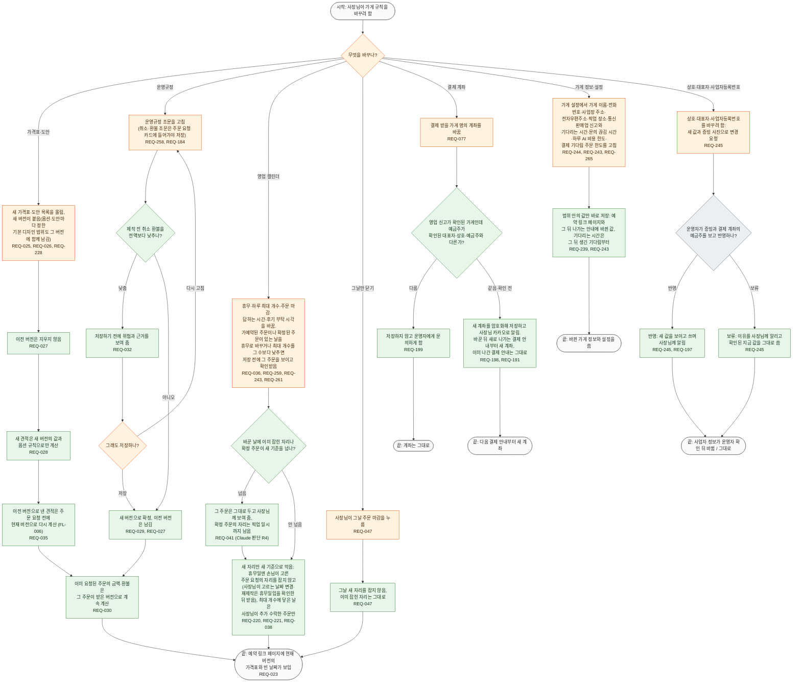

# FL-002 가게 규칙 바꾸기

채우는 요구사항: REQ-023, REQ-025, REQ-026, REQ-027, REQ-028, REQ-029, REQ-030, REQ-032, REQ-035, REQ-036, REQ-038, REQ-041, REQ-047, REQ-077, REQ-184, REQ-191, REQ-197, REQ-198, REQ-199, REQ-220, REQ-221, REQ-228, REQ-239, REQ-243, REQ-244, REQ-245, REQ-258, REQ-259, REQ-261, REQ-265

| 항목 | 내용 |
| --- | --- |
| 액터 | 사장님, 운영자, 우리 서비스 |
| 컨텍스트 | CTX-002 가게 규칙, CTX-001 상담, CTX-004 결제·환불, CTX-008 알림 |
| 시작 | 사장님이 가격표·운영규정·영업 캘린더·결제 계좌·가게 정보와 설정·사업자 정보를 바꾸거나 그날을 닫으려 함 |
| 끝 | 예약 링크 페이지에 현재 버전의 가격표와 빈 날짜가 보임 / 다음 결제 안내부터 새 계좌 / 계좌는 그대로 / 바뀐 가게 정보와 설정을 씀 / 사업자 정보가 운영자 확인 뒤 바뀜 |
| 연결 플로우 | FL-003 상담하고 견적 받기, FL-006 주문 요청하기 |

## 기본 경로

1. 사장님이 새 가격표나 도안을 올리면 새 버전이 붙고 이전 버전은 남습니다. 옵션·도안마다 정한 기본 디자인 범위도 그 버전에 함께 남아, 이미 낸 견적과 요청된 주문은 그 버전의 범위로 주문 종류를 가릅니다(REQ-228). 새 견적은 새 버전으로만 계산하고, 이전 버전으로 낸 견적은 주문 요청 전에 다시 계산합니다.
2. 운영규정을 고치면 새 버전으로 확정하고 이전 버전은 남깁니다. 이미 요청된 주문은 그 주문이 받은 버전으로 금액과 환불을 계속 계산합니다.
3. 영업 캘린더를 바꾸면 새 기준은 새 자리에만 씁니다.
4. 가게 설정에서 가게 이름·전화번호·사업장 주소·전자우편주소·픽업 장소·통신판매업 신고와 기다리는 시간·문의 끊김 시간·하루 AI 비용 한도·한 손님의 결제 기다림 주문 한도(기본 2건, 0이면 한도 없음, REQ-265)를 고치면 범위 안의 값만 바로 저장하고 예약 링크 페이지와 그 뒤 안내에 바뀐 값을 씁니다(REQ-244, REQ-243). 기다리는 시간은 그 뒤 생긴 기다림부터 씁니다.
5. 상호·대표자·사업자등록번호는 새 값과 증빙 사진으로 변경 요청을 남기고, 운영자가 증빙과 결제 계좌의 예금주를 보고 반영해야 바뀝니다. 그때까지는 확인된 지금 값을 보이고 씁니다(REQ-245).
4. 그날 주문 마감을 누르면 그날은 새 자리를 잡지 않습니다.
5. 결제 받을 계좌를 바꾸면 새 계좌를 암호화해 저장하고 사장님 카카오로 알립니다. 바꾼 뒤 새로 나가는 결제 안내부터 새 계좌를 쓰고, 이미 나간 결제 안내는 그대로 둡니다(REQ-198).

## 예외 경로

- 제작 전 취소 환불을 전액보다 낮추려 하면 저장하기 전에 위험과 근거를 보여 주고, 사장님이 그래도 저장할지 고칠지 정합니다(REQ-032).
- 휴무로 바꾸거나 하루 최대 개수를 줄인 날에 이미 잡힌 자리나 확정 주문이 있으면 그대로 두고 사장님께 보여 줍니다(R4).
- 영업 신고가 확인된 가게에서 새 계좌의 예금주가 확인된 대표자·상호나 운영자가 확인한 예금주와 다르면 저장하지 않고 운영자에게 문의하게 합니다(REQ-199). 확인 전 가게는 영업 신고 확인 때 운영자가 봅니다(FL-001, REQ-197).

## 요구사항 해석 (Claude 판단)

- R4 휴무로 바꾸거나 하루 최대 개수를 줄인 날의 잡힌 자리와 확정 주문은 그대로 두고 사장님께 보여 줍니다. 새 기준은 새 자리에만 씁니다. 받은 주문은 그때 버전을 따른다는 REQ-030과 같은 생각입니다.

## 빈 곳 (새 요구사항 후보)

없음.

## 확정한 뒤 고친 것

2026-11-14 설계 독립 재검토의 묶음 M11(RA-05)·M14(RB-12)를 동희님 2026-11-13 20:59 결정 카드 '모두 지금 고침 (추천)'에 따라 고쳤습니다(02단계 11절, 버전 5). 가게 정보·설정(G1·G2, REQ-243·244)과 사업자 정보 변경 요청(B1·D5·B2·B3, REQ-245) 가지를 더하고, C1에 후기 부탁 시각을 더했습니다. 등록 뒤 고치는 동작이 없던 것(RB-12)을 메웠습니다.

2026-11-15 14:19 동희님 결정 카드('가게가 한도를 정함')을 반영했습니다(02단계 11절, 버전 5). G1: 가게 설정에 한 손님의 결제 기다림 주문 한도(0~10건, 기본 2건, 0이면 한도 없음)를 더했습니다(REQ-265). 저장한 때부터 새 주문 요청에 씁니다(FL-006의 D14).

<!-- 07-sitemap:start · '화면'·'화면 없음 사유' 열이 원본, 나머지 열은 build_sitemap.py가 생성 -->
## 화면 (07단계)

노드마다 그 시점에 사람이 보는 화면을 적었습니다. 화면이 없으면 사유를 적었습니다(분기·서버 처리·외부·종료, 정의는 `docs/07-sitemap/README.md` 3절). 다른 플로우로 연결되는 노드는 해당 플로우의 표에 있습니다. 화면 목록은 `docs/07-sitemap/sitemap.yaml`.

| 노드 | 내용 | 화면 | 화면 없음 사유 |
| --- | --- | --- | --- |
| S | 시작: 사장님이 가게 규칙을 바꾸려 함 | SCR-034 가게 설정 |  |
| D0 | 무엇을 바꾸나? | SCR-034 가게 설정, SCR-032 영업 캘린더 |  |
| P1 | 새 가격표·도안 목록을 올림, 새 버전이 붙음(옵션·도안마다 정한 기본 디자인 범위도 그 버전에 함께 남김) | SCR-036 가격표와 도안 |  |
| P2 | 이전 버전은 지우지 않음 | SCR-037 가격표 버전 이력 |  |
| P3 | 새 견적은 새 버전의 값과 옵션 규칙으로만 계산 |  | 서버 처리 |
| P4 | 이전 버전으로 낸 견적은 주문 요청 전에 현재 버전으로 다시 계산 (FL-006) |  | 서버 처리 |
| U1 | 운영규정 조문을 고침 (취소·환불 조문은 주문 요청 카드에 들어가야 저장) | SCR-038 운영규정 |  |
| D1 | 제작 전 취소 환불을 전액보다 낮추나? |  | 분기 |
| U2 | 저장하기 전에 위험과 근거를 보여 줌 | SCR-038 운영규정 |  |
| D2 | 그래도 저장하나? | SCR-038 운영규정 |  |
| U3 | 새 버전으로 확정, 이전 버전은 남김 | SCR-038 운영규정, SCR-039 운영규정 버전 이력 |  |
| K1 | 이미 요청된 주문의 금액·환불은 그 주문이 받은 버전으로 계속 계산 |  | 서버 처리 |
| C1 | 휴무·하루 최대 개수·주문 마감· 답하는 시간·후기 부탁 시각을 바꿈. 가예약된 주문이나 확정된 주문이 있는 날을 휴무로 바꾸거나 최대 개수를 그 수보다 낮추면 저장 전에 그 주문을 보이고 확인받음 | SCR-033 영업 캘린더 설정, SCR-032 영업 캘린더 |  |
| D3 | 바꾼 날에 이미 잡힌 자리나 확정 주문이 새 기준을 넘나? |  | 분기 |
| C2 | 그 주문은 그대로 두고 사장님께 보여 줌, 확정 주문의 자리는 픽업 일시까지 남음 | SCR-033 영업 캘린더 설정, SCR-032 영업 캘린더, SCR-016 할 일 목록 |  |
| C3 | 새 자리만 새 기준으로 막음: 휴무일엔 손님이 고른 주문 요청의 자리를 잡지 않고(사장님이 고르는 날짜 변경· 재제작은 휴무일임을 확인한 뒤 받음), 최대 개수에 닿은 날은 사장님이 추가 수락한 주문만 |  | 서버 처리 |
| M1 | 사장님이 그날 주문 마감을 누름 | SCR-032 영업 캘린더 |  |
| M2 | 그날 새 자리를 잡지 않음, 이미 잡힌 자리는 그대로 | SCR-032 영업 캘린더 |  |
| E1 | 끝: 예약 링크 페이지에 현재 버전의 가격표와 빈 날짜가 보임 | SCR-001 예약 링크 페이지 |  |
| A1 | 결제 받을 가게 명의 계좌를 바꿈 | SCR-040 결제 수단 |  |
| D4 | 영업 신고가 확인된 가게인데 예금주가 확인된 대표자·상호·예금주와 다른가? |  | 분기 |
| W1 | 저장하지 않고 운영자에게 문의하게 함 | SCR-040 결제 수단 |  |
| A2 | 새 계좌를 암호화해 저장하고 사장님 카카오로 알림. 바꾼 뒤 새로 나가는 결제 안내부터 새 계좌, 이미 나간 결제 안내는 그대로 | SCR-040 결제 수단, SCR-019 사장님 알림 |  |
| E2 | 끝: 다음 결제 안내부터 새 계좌 | SCR-040 결제 수단 |  |
| E3 | 끝: 계좌는 그대로 | SCR-040 결제 수단 |  |
| G1 | 가게 설정에서 가게 이름·전화번호·사업장 주소· 전자우편주소·픽업 장소·통신판매업 신고와 기다리는 시간·문의 끊김 시간·하루 AI 비용 한도· 결제 기다림 주문 한도를 고침 | SCR-034 가게 설정 |  |
| G2 | 범위 안의 값만 바로 저장: 예약 링크 페이지와 그 뒤 나가는 안내에 바뀐 값, 기다리는 시간은 그 뒤 생긴 기다림부터 | SCR-034 가게 설정 |  |
| B1 | 상호·대표자·사업자등록번호를 바꾸려 함: 새 값과 증빙 사진으로 변경 요청 | SCR-035 영업 신고 |  |
| D5 | 운영자가 증빙과 결제 계좌의 예금주를 보고 반영하나? | SCR-048 영업 신고 확인 |  |
| B2 | 반영: 새 값을 보이고 쓰며 사장님께 알림 | SCR-019 사장님 알림, SCR-035 영업 신고 |  |
| B3 | 보류: 이유를 사장님께 알리고 확인된 지금 값을 그대로 씀 | SCR-019 사장님 알림, SCR-035 영업 신고 |  |
| E4 | 끝: 바뀐 가게 정보와 설정을 씀 |  | 종료 |
| E5 | 끝: 사업자 정보가 운영자 확인 뒤 바뀜 / 그대로 |  | 종료 |
<!-- 07-sitemap:end -->
