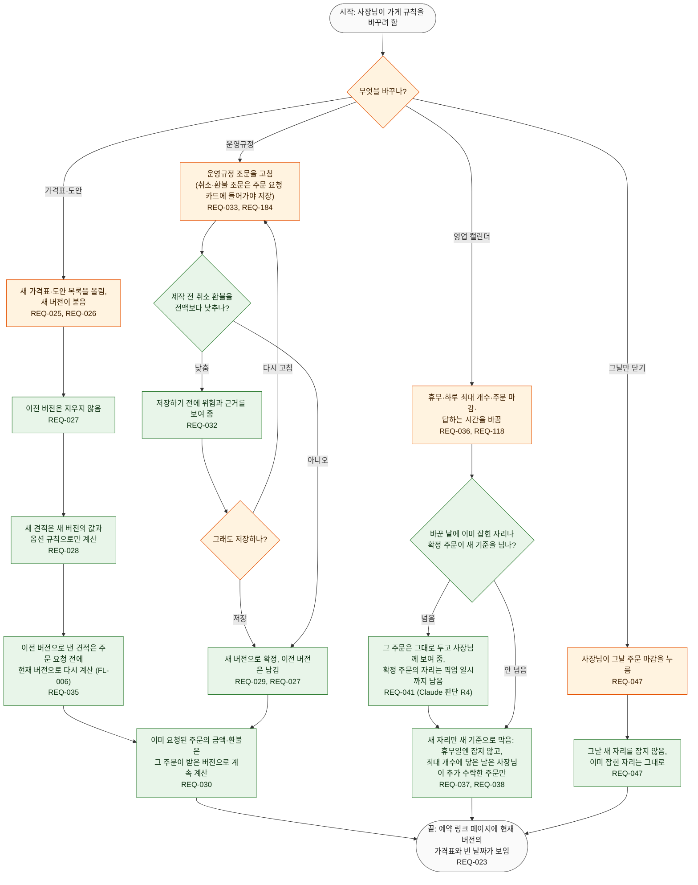

# FL-002 가게 규칙 바꾸기

채우는 요구사항: REQ-023, REQ-025, REQ-026, REQ-027, REQ-028, REQ-029, REQ-030, REQ-032, REQ-033, REQ-035, REQ-036, REQ-037, REQ-038, REQ-041, REQ-047, REQ-118, REQ-184

| 항목 | 내용 |
| --- | --- |
| 액터 | 사장님, 우리 서비스 |
| 컨텍스트 | CTX-002 가게 규칙, CTX-001 상담 |
| 시작 | 사장님이 가격표·운영규정·영업 캘린더를 바꾸거나 그날을 닫으려 함 |
| 끝 | 예약 링크 페이지에 현재 버전의 가격표와 빈 날짜가 보임 |
| 연결 플로우 | FL-003 상담하고 견적 받기, FL-006 주문 요청하기 |

## 기본 경로

1. 사장님이 새 가격표나 도안을 올리면 새 버전이 붙고 이전 버전은 남습니다. 새 견적은 새 버전으로만 계산하고, 이전 버전으로 낸 견적은 주문 요청 전에 다시 계산합니다.
2. 운영규정을 고치면 새 버전으로 확정하고 이전 버전은 남깁니다. 이미 요청된 주문은 그 주문이 받은 버전으로 금액과 환불을 계속 계산합니다.
3. 영업 캘린더를 바꾸면 새 기준은 새 자리에만 씁니다.
4. 그날 주문 마감을 누르면 그날은 새 자리를 잡지 않습니다.

## 예외 경로

- 제작 전 취소 환불을 전액보다 낮추려 하면 저장하기 전에 위험과 근거를 보여 주고, 사장님이 그래도 저장할지 고칠지 정합니다(REQ-032).
- 휴무로 바꾸거나 하루 최대 개수를 줄인 날에 이미 잡힌 자리나 확정 주문이 있으면 그대로 두고 사장님께 보여 줍니다(R4).

## 요구사항 해석 (Claude 판단)

- R4 휴무로 바꾸거나 하루 최대 개수를 줄인 날의 잡힌 자리와 확정 주문은 그대로 두고 사장님께 보여 줍니다. 새 기준은 새 자리에만 씁니다. 받은 주문은 그때 버전을 따른다는 REQ-030과 같은 생각입니다.

## 빈 곳 (새 요구사항 후보)

없음.

<!-- 07-sitemap:start · '화면'·'화면 없음 사유' 열이 원본, 나머지 열은 build_sitemap.py가 생성 -->
## 화면 (07단계)

노드마다 그 시점에 사람이 보는 화면을 적었습니다. 화면이 없으면 사유를 적었습니다(분기·서버 처리·외부·종료, 정의는 `docs/07-sitemap/README.md` 3절). 다른 플로우로 연결되는 노드는 해당 플로우의 표에 있습니다. 화면 목록은 `docs/07-sitemap/sitemap.yaml`.

| 노드 | 내용 | 화면 | 화면 없음 사유 |
| --- | --- | --- | --- |
| S | 시작: 사장님이 가게 규칙을 바꾸려 함 | SCR-034 가게 설정 |  |
| D0 | 무엇을 바꾸나? | SCR-034 가게 설정, SCR-032 영업 캘린더 |  |
| P1 | 새 가격표·도안 목록을 올림, 새 버전이 붙음 | SCR-036 가격표와 도안 |  |
| P2 | 이전 버전은 지우지 않음 | SCR-037 가격표 버전 이력 |  |
| P3 | 새 견적은 새 버전의 값과 옵션 규칙으로만 계산 |  | 서버 처리 |
| P4 | 이전 버전으로 낸 견적은 주문 요청 전에 현재 버전으로 다시 계산 (FL-006) |  | 서버 처리 |
| U1 | 운영규정 조문을 고침 (취소·환불 조문은 주문 요청 카드에 들어가야 저장) | SCR-038 운영규정 |  |
| D1 | 제작 전 취소 환불을 전액보다 낮추나? |  | 분기 |
| U2 | 저장하기 전에 위험과 근거를 보여 줌 | SCR-038 운영규정 |  |
| D2 | 그래도 저장하나? | SCR-038 운영규정 |  |
| U3 | 새 버전으로 확정, 이전 버전은 남김 | SCR-038 운영규정, SCR-039 운영규정 버전 이력 |  |
| K1 | 이미 요청된 주문의 금액·환불은 그 주문이 받은 버전으로 계속 계산 |  | 서버 처리 |
| C1 | 휴무·하루 최대 개수·주문 마감· 답하는 시간을 바꿈 | SCR-033 영업 캘린더 설정, SCR-032 영업 캘린더 |  |
| D3 | 바꾼 날에 이미 잡힌 자리나 확정 주문이 새 기준을 넘나? |  | 분기 |
| C2 | 그 주문은 그대로 두고 사장님께 보여 줌, 확정 주문의 자리는 픽업 일시까지 남음 | SCR-033 영업 캘린더 설정, SCR-032 영업 캘린더, SCR-016 할 일 목록 |  |
| C3 | 새 자리만 새 기준으로 막음: 휴무일엔 잡지 않고, 최대 개수에 닿은 날은 사장님이 추가 수락한 주문만 |  | 서버 처리 |
| M1 | 사장님이 그날 주문 마감을 누름 | SCR-032 영업 캘린더 |  |
| M2 | 그날 새 자리를 잡지 않음, 이미 잡힌 자리는 그대로 | SCR-032 영업 캘린더 |  |
| E1 | 끝: 예약 링크 페이지에 현재 버전의 가격표와 빈 날짜가 보임 | SCR-001 예약 링크 페이지 |  |
<!-- 07-sitemap:end -->
