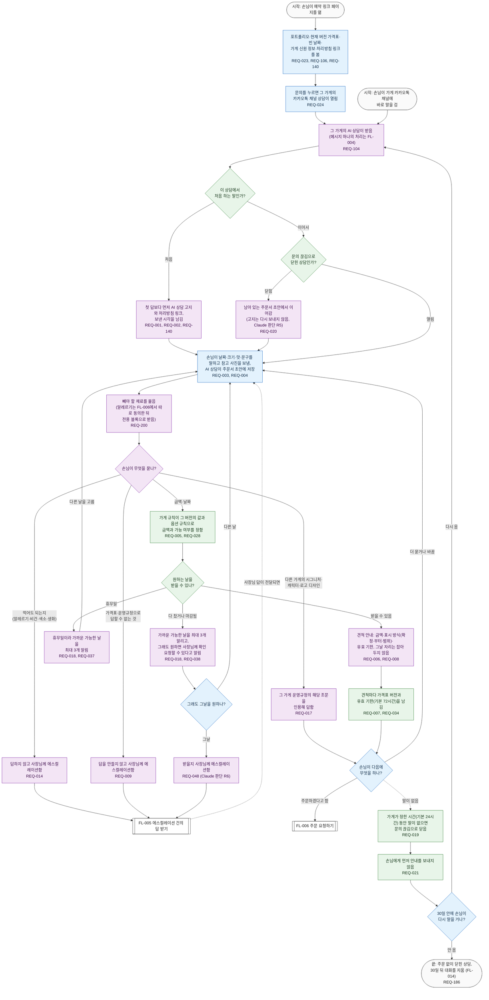

# FL-003 상담하고 견적 받기

채우는 요구사항: REQ-001, REQ-002, REQ-003, REQ-004, REQ-005, REQ-006, REQ-007, REQ-008, REQ-009, REQ-014, REQ-017, REQ-018, REQ-019, REQ-020, REQ-021, REQ-023, REQ-024, REQ-028, REQ-034, REQ-037, REQ-038, REQ-048, REQ-104, REQ-106, REQ-140, REQ-186, REQ-200

| 항목 | 내용 |
| --- | --- |
| 액터 | 손님, AI 상담, 우리 서비스 |
| 컨텍스트 | CTX-001 상담, CTX-002 가게 규칙, CTX-007 가게 등록·연결 |
| 시작 | 손님이 예약 링크 페이지를 엶 / 손님이 가게 카카오톡 채널에 바로 말을 검 |
| 끝 | 주문하겠다고 함(FL-006) / 에스컬레이션 건(FL-005) / 주문 없이 종료된 상담을 30일 뒤 지움 |
| 연결 플로우 | FL-004 손님 메시지 하나에 답하기, FL-005 에스컬레이션 건의 답 받기, FL-006 주문 요청하기 |

## 기본 경로

1. 손님이 예약 링크 페이지에서 포트폴리오·가격표·빈 날짜를 보고 문의를 누르거나, 가게 채널에 바로 말을 겁니다. 그 가게의 AI 상담이 받습니다.
2. 첫 말이면 답보다 먼저 AI 상담 고지를 보냅니다.
3. 손님이 날짜·크기·맛·문구와 참고 사진을 주면 주문서 초안에 저장하고, 빼야 할 재료를 묻습니다. 알레르기는 주문을 요청할 때 따로 동의를 받은 뒤 AI를 거치지 않는 전용 블록으로 받습니다(FL-006).
4. 금액과 날짜를 물으면 가게 규칙이 그 버전으로 금액과 가능 여부를 정하고, AI 상담은 그 계산값으로 견적을 안내합니다. 견적은 버전과 유효 기한을 남기고, 그날 자리는 잡아 두지 않습니다.
5. 손님이 주문하겠다고 하면 FL-006으로 갑니다.

## 예외 경로

- 먹어도 되는지(알레르기·비건·색소·생화)를 물으면 답하지 않고 에스컬레이션합니다(REQ-014).
- 가격표나 운영규정으로 답할 수 없는 질문은 답을 만들지 않고 에스컬레이션합니다(REQ-009).
- 다른 가게 디자인을 원하면 운영규정 조문을 인용해 답합니다(REQ-017).
- 휴무일이면 가까운 날을 권하고, 다 찼거나 마감된 날이면 가까운 날을 권한 뒤 그래도 원할 때 사장님께 에스컬레이션합니다(REQ-018, REQ-048, R6).
- 가게가 정한 시간 동안 말이 없으면 문의 끊김으로 닫고 먼저 연락하지 않습니다. 다시 말을 걸면 남은 주문서 초안에서 이어가고, 오지 않으면 30일 뒤 대화를 지웁니다(REQ-019~REQ-021, REQ-186).

## 요구사항 해석 (Claude 판단)

- R5 AI 상담 고지는 상담마다 한 번입니다. 문의 끊김 뒤 이어가는 상담(REQ-020)에는 다시 보내지 않습니다. 다룬 주문이 모두 끝나 상담이 끝난 뒤(REQ-189) 다시 오는 말은 새 상담이라 다시 보냅니다.
- R6 REQ-048의 '주문 마감이 지난 날'을 마감된 날 전체로 읽습니다. 주문 마감 시각이 지난 날, 사장님이 마감한 날(REQ-047), 다 차서 마감된 날(REQ-046)을 손님이 그래도 원하면 사장님께 에스컬레이션합니다. 휴무일(REQ-037)은 에스컬레이션하지 않고 다른 날을 권합니다. 01단계 C 플로우의 "그 뒤 요청은 사장님이 받을지 정합니다"와 같습니다.

## 빈 곳 (새 요구사항 후보)

없음.

## 확정한 뒤 고친 것

2026-11-13 설계 독립 재검토의 묶음 H3(RB-09, RC-02, RA-06, RC-04, RC-03)을 동희님 2026-11-13 20:59 결정 카드 '추천안대로 (추천)'에 따라 고쳤습니다. E1의 30일 지우기를 REQ-143에서 REQ-186(닫히고 30일이 지나고 다룬 주문이 모두 보관 기록이 된 상담을 지움, FL-014)으로 바꿨습니다. 30일은 잠정, 5-2 질문 7의 답으로 다시 봄.

같은 결정 카드로 묶음 H5(RA-02)도 고쳤습니다. B2에서 AI 상담은 빼야 할 재료만 묻고, 알레르기는 FL-006에서 알레르기 정보에 따로 동의한 뒤 전용 블록으로 받습니다(REQ-013을 '제외'로 두고 REQ-200). 잠정, 5-2 질문 4의 답으로 다시 봄. D3의 먹어도 되는지 묻기(알레르기 포함)는 그대로 에스컬레이션합니다(REQ-014).

<!-- 07-sitemap:start · '화면'·'화면 없음 사유' 열이 원본, 나머지 열은 build_sitemap.py가 생성 -->
## 화면 (07단계)

노드마다 그 시점에 사람이 보는 화면을 적었습니다. 화면이 없으면 사유를 적었습니다(분기·서버 처리·외부·종료, 정의는 `docs/07-sitemap/README.md` 3절). 다른 플로우로 연결되는 노드는 해당 플로우의 표에 있습니다. 화면 목록은 `docs/07-sitemap/sitemap.yaml`.

| 노드 | 내용 | 화면 | 화면 없음 사유 |
| --- | --- | --- | --- |
| S1 | 시작: 손님이 예약 링크 페이지를 엶 | SCR-001 예약 링크 페이지 |  |
| S2 | 시작: 손님이 가게 카카오톡 채널에 바로 말을 검 | SCR-003 가게 채널 상담 |  |
| A1 | 포트폴리오·현재 버전 가격표·빈 날짜· 가게 신원 정보·처리방침 링크를 봄 | SCR-001 예약 링크 페이지, SCR-002 가게 개인정보 처리방침 |  |
| A2 | 문의를 누르면 그 가게의 카카오톡 채널 상담이 열림 | SCR-001 예약 링크 페이지, SCR-003 가게 채널 상담 |  |
| A3 | 그 가게의 AI 상담이 받음 (메시지 하나의 처리는 FL-004) | SCR-003 가게 채널 상담 |  |
| D1 | 이 상담에서 처음 하는 말인가? |  | 분기 |
| A4 | 첫 답보다 먼저 AI 상담 고지와 처리방침 링크, 보낸 시각을 남김 | SCR-003 가게 채널 상담, SCR-002 가게 개인정보 처리방침 |  |
| D2 | 문의 끊김으로 닫힌 상담인가? |  | 분기 |
| A5 | 남아 있는 주문서 초안에서 이어감 (고지는 다시 보내지 않음, Claude 판단 R5) | SCR-003 가게 채널 상담 |  |
| B1 | 손님이 날짜·크기·맛·문구를 말하고 참고 사진을 보냄, AI 상담이 주문서 초안에 저장 | SCR-003 가게 채널 상담 |  |
| B2 | 빼야 할 재료를 물음 (알레르기는 FL-006에서 따로 동의한 뒤 전용 블록으로 받음) | SCR-003 가게 채널 상담 |  |
| D3 | 손님이 무엇을 묻나? |  | 분기 |
| H1 | 답하지 않고 사장님께 에스컬레이션함 | SCR-003 가게 채널 상담 |  |
| H2 | 답을 만들지 않고 사장님께 에스컬레이션함 | SCR-003 가게 채널 상담 |  |
| G1 | 그 가게 운영규정의 해당 조문을 인용해 답함 | SCR-003 가게 채널 상담 |  |
| Q1 | 가게 규칙이 그 버전의 값과 옵션 규칙으로 금액과 가능 여부를 정함 |  | 서버 처리 |
| D4 | 원하는 날을 받을 수 있나? |  | 분기 |
| Q2 | 견적 안내: 금액·표시 방식(확정·부터·범위)· 유효 기한, 그날 자리는 잡아 두지 않음 | SCR-003 가게 채널 상담 |  |
| Q3 | 견적마다 가격표 버전과 유효 기한(기본 72시간)을 남김 |  | 서버 처리 |
| Q4 | 휴무일이라 가까운 가능한 날을 최대 3개 알림 | SCR-003 가게 채널 상담 |  |
| Q5 | 가까운 가능한 날을 최대 3개 알리고, 그래도 원하면 사장님께 확인 요청할 수 있다고 알림 | SCR-003 가게 채널 상담 |  |
| D5 | 그래도 그날을 원하나? | SCR-003 가게 채널 상담 |  |
| H3 | 받을지 사장님께 에스컬레이션함 | SCR-003 가게 채널 상담 |  |
| D6 | 손님이 다음에 무엇을 하나? | SCR-003 가게 채널 상담 |  |
| X1 | 가게가 정한 시간(기본 24시간) 동안 말이 없으면 문의 끊김으로 닫음 |  | 서버 처리 |
| X2 | 손님에게 먼저 안내를 보내지 않음 |  | 서버 처리 |
| D7 | 30일 안에 손님이 다시 말을 거나? | SCR-003 가게 채널 상담 |  |
| E1 | 끝: 주문 없이 닫힌 상담, 30일 뒤 대화를 지움 (FL-014) |  | 종료 |
<!-- 07-sitemap:end -->
