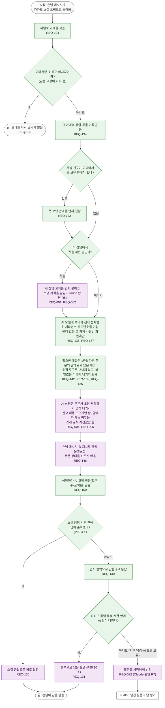

# FL-004 손님 메시지 하나에 답하기

채우는 요구사항: REQ-001, REQ-002, REQ-004, REQ-005, REQ-022, REQ-104, REQ-122, REQ-130, REQ-131, REQ-132, REQ-134, REQ-135, REQ-136, REQ-137, REQ-138, REQ-142, REQ-146, REQ-150

| 항목 | 내용 |
| --- | --- |
| 행위자 | 손님, AI 상담, 우리 서비스 |
| 컨텍스트 | CTX-001 상담, CTX-007 가게 등록·연결, CTX-008 알림 |
| 시작 | 손님 메시지가 카카오 스킬 요청으로 들어옴 |
| 끝 | 손님이 답을 받음 / 같은 카카오 메시지라 다시 남기지 않음 / 넘긴 질문(FL-005) |
| 이어지는 흐름 | FL-003 상담하고 견적 받기의 걸음마다 이 흐름을 지남 |

이 흐름은 FL-003·FL-006·FL-008·FL-009·FL-011에서 손님이 말할 때마다 지나는 길입니다. 성능·보안·개인정보 요구사항이 여기에 걸립니다.

## 주 경로

1. 카카오가 손님 메시지를 스킬 요청으로 보내면 채널로 가게를 찾고, 그 가게의 기록만 씁니다.
2. 채널 친구가 아니어서 못 보낸 안내가 있으면 먼저 전하고, 상담의 첫 말이면 AI 상담 고지를 붙입니다.
3. AI 모델에는 번호를 가린 필요한 대화만 보내고, AI 상담은 정해진 세 가지 일만 하며 금액과 가능 여부는 가게 규칙 계산값만 씁니다.
4. 스킬 응답 시간 안에 답이 준비되면 바로 답하고, 아니면 콜백으로 답합니다.

## 실패 길

- 같은 카카오 메시지가 다시 오면 결과를 다시 남기지 않습니다(REQ-132).
- 손님 메시지 속 지시로 금액·운영규정·주문 상태를 바꾸지 않습니다(REQ-146).
- 콜백 유효 시간 안에 답을 만들지 못하거나 AI 모델이 답을 내지 못하면 질문을 사장님께 넘깁니다(REQ-022, R7).

## 읽은 방식 (Claude 판단)

- R5 AI 상담 고지는 상담마다 한 번입니다(FL-003과 같음).
- R7 AI 모델이 오류로 답을 내지 못한 때도 콜백 시간을 넘긴 때(REQ-022)처럼 사장님께 넘깁니다.

## 빈 곳 (새 요구사항 후보)

없음. 손님이 내리는 명령은 FL-006의 R9를 봅니다.
