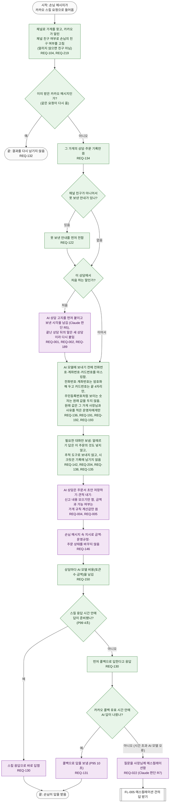

# FL-004 손님 메시지 하나에 답하기

채우는 요구사항: REQ-001, REQ-002, REQ-004, REQ-005, REQ-022, REQ-104, REQ-122, REQ-130, REQ-131, REQ-132, REQ-134, REQ-135, REQ-136, REQ-138, REQ-142, REQ-146, REQ-150, REQ-189, REQ-191, REQ-192, REQ-193, REQ-204, REQ-219

| 항목 | 내용 |
| --- | --- |
| 액터 | 손님, AI 상담, 우리 서비스 |
| 컨텍스트 | CTX-001 상담, CTX-007 가게 등록·연결, CTX-008 알림 |
| 시작 | 손님 메시지가 카카오 스킬 요청으로 들어옴 |
| 끝 | 손님이 답을 받음 / 같은 카카오 메시지라 다시 남기지 않음 / 에스컬레이션 건(FL-005) |
| 연결 플로우 | FL-003 상담하고 견적 받기의 스텝마다 이 플로우를 지남 |

이 플로우는 FL-003·FL-006·FL-008·FL-009·FL-011에서 손님이 말할 때마다 지나는 길입니다. 성능·보안·개인정보 요구사항이 여기에 걸립니다.

## 기본 경로

1. 카카오가 손님 메시지를 스킬 요청으로 보내면 채널로 가게를 찾고, 그 가게의 기록만 씁니다.
2. 채널 친구가 아니어서 못 보낸 안내가 있으면 먼저 전하고, 상담의 첫 말이면 AI 상담 고지를 붙입니다.
3. AI 모델에는 번호를 마스킹한 필요한 대화만 보내고, AI 상담은 정해진 세 가지 일만 하며 금액과 가능 여부는 가게 규칙 계산값만 씁니다.
4. 스킬 응답 시간 안에 답이 준비되면 바로 답하고, 아니면 콜백으로 답합니다.

## 예외 경로

- 같은 카카오 메시지가 다시 오면 결과를 다시 남기지 않습니다(REQ-132).
- 손님 메시지 속 지시로 금액·운영규정·주문 상태를 바꾸지 않습니다(REQ-146).
- 콜백 유효 시간 안에 답을 만들지 못하거나 AI 모델이 답을 내지 못하면 질문을 사장님께 에스컬레이션합니다(REQ-022, R7).

## 요구사항 해석 (Claude 판단)

- R5 AI 상담 고지는 상담마다 한 번입니다(FL-003과 같음). 다룬 주문이 모두 끝나 상담이 끝난 뒤(REQ-189)의 말은 새 상담이라 고지를 다시 붙입니다.
- R7 AI 모델이 오류로 답을 내지 못한 때도 콜백 시간을 초과한 때(REQ-022)처럼 사장님께 에스컬레이션합니다.

## 빈 곳 (새 요구사항 후보)

없음. 손님이 내리는 명령은 FL-006의 R9를 봅니다.

## 확정한 뒤 고친 것

2026-11-13 설계 독립 재검토의 묶음 H3(RC-02)을 동희님 2026-11-13 20:59 결정 카드 '추천안대로 (추천)'에 따라 고쳤습니다. K4에 '끝난 상담 뒤의 말은 새 상담이라 다시 붙임'(REQ-189)을 더했습니다. 상담은 다룬 주문이 모두 끝나고 가게가 정한 시간 동안 말이 없으면 끝나고(04단계 SPEC-025), 그 뒤의 말은 D3에서 '처음'으로 갑니다.

같은 결정 카드로 묶음 H4(RC-10, RC-09)도 고쳤습니다. K5의 원래 값은 전화번호·계좌번호만 암호화해 두고 카드번호는 끝 4자리만, 주민등록번호처럼 보이는 숫자는 원래 값을 두지 않으며, 사유를 적은 운영자도 열 수 있습니다(REQ-137을 '제외'로 두고 REQ-193, REQ-191, REQ-192).

같은 결정 카드로 묶음 H5(RA-02)도 고쳤습니다. K6에서 알레르기 답은 다른 주문의 것만이 아니라 이 주문의 것도 AI 모델에 보내지 않습니다(REQ-204). 알레르기 답은 FL-006에서 AI를 거치지 않는 전용 블록으로 받습니다. 손님이 대화에 스스로 적은 알레르기 말은 대화라 AI로 갑니다.

같은 결정 카드로 묶음 M2(RD-07)도 고쳤습니다. K1에서 스킬 요청의 채널 친구 표시(`isFriend`)가 없으면 그 손님을 친구 아님으로 고칩니다(REQ-219). 친구가 아니게 된 손님에게 먼저 보내지 않고 다음 대화 때 전합니다.

<!-- 07-sitemap:start · '화면'·'화면 없음 사유' 열이 원본, 나머지 열은 build_sitemap.py가 생성 -->
## 화면 (07단계)

노드마다 그 시점에 사람이 보는 화면을 적었습니다. 화면이 없으면 사유를 적었습니다(분기·서버 처리·외부·종료, 정의는 `docs/07-sitemap/README.md` 3절). 다른 플로우로 연결되는 노드는 해당 플로우의 표에 있습니다. 화면 목록은 `docs/07-sitemap/sitemap.yaml`.

| 노드 | 내용 | 화면 | 화면 없음 사유 |
| --- | --- | --- | --- |
| S | 시작: 손님 메시지가 카카오 스킬 요청으로 들어옴 | SCR-003 가게 채널 상담 |  |
| K1 | 채널로 가게를 찾고, 카카오가 알린 채널 친구 여부로 손님의 친구 여부를 고침 (알리지 않으면 친구 아님) |  | 서버 처리 |
| D1 | 이미 받은 카카오 메시지인가? (같은 요청이 다시 옴) |  | 분기 |
| E0 | 끝: 결과를 다시 남기지 않음 |  | 종료 |
| K2 | 그 가게의 상담·주문 기록만 씀 |  | 서버 처리 |
| D2 | 채널 친구가 아니어서 못 보낸 안내가 있나? |  | 분기 |
| K3 | 못 보낸 안내를 먼저 전함 | SCR-011 손님 알림, SCR-005 결제 안내 |  |
| D3 | 이 상담에서 처음 하는 말인가? |  | 분기 |
| K4 | AI 상담 고지를 먼저 붙이고 보낸 시각을 남김 , 끝난 상담 뒤의 말은 새 상담이라 다시 붙임 | SCR-003 가게 채널 상담 |  |
| K5 | AI 모델에 보내기 전에 전화번호·계좌번호·카드번호를 마스킹함. 전화번호·계좌번호는 암호화해 두고 카드번호는 끝 4자리만, 주민등록번호처럼 보이는 숫자는 원래 값을 두지 않음. 원래 값은 그 가게 사장님과 사유를 적은 운영자에게만 | SCR-018 상담 대화 |  |
| K6 | 필요한 대화만 보냄: 알레르기 답은 이 주문의 것도 넣지 않고, 추적 도구로 보내지 않고, 시크릿은 기록에 남기지 않음 |  | 서버 처리 |
| K7 | AI 상담은 주문서 초안 저장하기·견적 내기· 신고 내용 모으기만 함, 금액과 가능 여부는 가게 규칙 계산값만 씀 |  | 서버 처리 |
| K8 | 손님 메시지 속 지시로 금액·운영규정· 주문 상태를 바꾸지 않음 |  | 서버 처리 |
| K9 | 상담마다 AI 모델 비용(토큰 수·금액)을 남김 |  | 서버 처리 |
| D4 | 스킬 응답 시간 안에 답이 준비됐나? (P99 4초) |  | 분기 |
| K10 | 스킬 응답으로 바로 답함 | SCR-003 가게 채널 상담 |  |
| K11 | 먼저 콜백으로 답한다고 응답 | SCR-003 가게 채널 상담 |  |
| D5 | 카카오 콜백 유효 시간 안에 AI 답이 나왔나? |  | 분기 |
| K12 | 콜백으로 답을 보냄 (P95 10초) | SCR-003 가게 채널 상담 |  |
| K13 | 질문을 사장님께 에스컬레이션함 | SCR-003 가게 채널 상담 |  |
| E1 | 끝: 손님이 답을 받음 | SCR-003 가게 채널 상담 |  |
<!-- 07-sitemap:end -->
