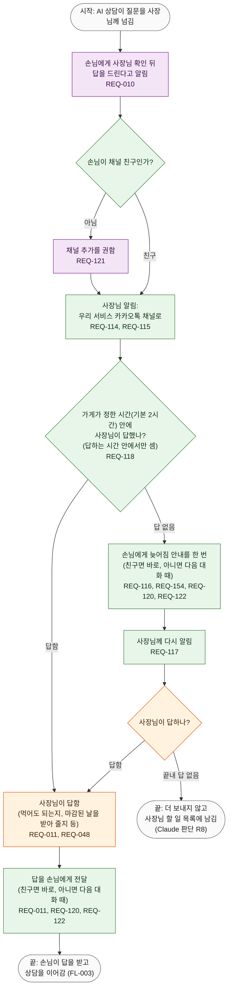

# FL-005 넘긴 질문의 답 받기

채우는 요구사항: REQ-010, REQ-011, REQ-048, REQ-114, REQ-115, REQ-116, REQ-117, REQ-118, REQ-120, REQ-121, REQ-122, REQ-154

| 항목 | 내용 |
| --- | --- |
| 행위자 | 손님, 사장님, AI 상담, 우리 서비스 |
| 컨텍스트 | CTX-001 상담, CTX-008 알림, CTX-002 가게 규칙 |
| 시작 | AI 상담이 질문을 사장님께 넘김 |
| 끝 | 손님이 사장님 답을 받고 상담을 이어감 / 끝내 답이 없어 사장님 할 일 목록에 남음 |
| 이어지는 흐름 | FL-003 상담하고 견적 받기 |

넘기는 곳: FL-003(먹어도 되는지, 답할 수 없는 질문, 마감된 날), FL-004(콜백 시간을 넘김), FL-006(마감된 날), FL-008·FL-009(다른 카카오 사용자의 변경·취소), FL-010·FL-011(받기 전 문제).

## 주 경로

1. AI 상담이 질문을 넘기면 손님에게 사장님 확인 뒤 답을 드린다고 알리고, 채널 친구가 아니면 채널 추가를 권합니다.
2. 우리 서비스 채널로 사장님께 알립니다.
3. 사장님이 답하면 손님에게 전달합니다. 채널 친구면 바로 보내고, 아니면 손님이 다음에 말을 걸 때 먼저 전합니다.

## 실패 길

- 가게가 정한 시간(기본 2시간, 답하는 시간 안에서만 셈) 안에 사장님 답이 없으면 손님에게 늦어짐 안내를 한 번 보내고 사장님께 다시 알립니다(REQ-116~REQ-118).
- 채널 친구가 아닌 손님에게는 먼저 보낼 수 없어, 늦어짐 안내와 사장님 답을 다음 대화 때 먼저 전합니다(REQ-120, REQ-122).
- 그 뒤에도 답이 없으면 더 보내지 않고 사장님 할 일 목록에 남깁니다(R8).

## 읽은 방식 (Claude 판단)

- R8 늦어짐 안내와 다시 알림 뒤에도 답이 없으면 더 보내지 않고 사장님 할 일 목록에 남깁니다. 같은 사건의 안내는 한 번이라는 REQ-154(2판, 1판 REQ-119를 바꿈)를 따릅니다.

## 2판에 더한 요구사항 (03단계 확정, 2026-11-12)

이 흐름에 더한 것은 없습니다. 같은 안내를 한 번만 보내는 기준은 REQ-119에서 REQ-154(같은 주문의 같은 사건)로 바뀌었습니다. 맞춤 주문 요청·변경 요청·문제 신고의 늦어짐 안내는 REQ-156입니다(FL-006, FL-008, FL-011).

<!-- 07-sitemap:start · '화면'·'화면이 없는 까닭' 칸이 원본, 나머지는 build_sitemap.py가 그림 -->
## 화면 (07단계)

상자마다 그 순간 사람이 보는 화면을 적었습니다. 화면이 없으면 까닭을 적었습니다(가름·안에서·밖에서·흐름 끝, 뜻은 `docs/07-sitemap/README.md` 3절). 다른 흐름으로 잇는 상자는 그 흐름의 표에 있습니다. 화면 목록은 `docs/07-sitemap/sitemap.yaml`.

| 상자 | 내용 | 화면 | 화면이 없는 까닭 |
| --- | --- | --- | --- |
| S | 시작: AI 상담이 질문을 사장님께 넘김 |  | 안에서 |
| H1 | 손님에게 사장님 확인 뒤 답을 드린다고 알림 | SCR-003 가게 채널 상담 |  |
| D1 | 손님이 채널 친구인가? |  | 가름 |
| H2 | 채널 추가를 권함 | SCR-003 가게 채널 상담 |  |
| H3 | 사장님 알림: 우리 서비스 카카오톡 채널로 | SCR-019 사장님 알림, SCR-016 할 일 목록 |  |
| D2 | 가게가 정한 시간(기본 2시간) 안에 사장님이 답했나? (답하는 시간 안에서만 셈) |  | 가름 |
| H4 | 손님에게 늦어짐 안내를 한 번 (친구면 바로, 아니면 다음 대화 때) | SCR-011 손님에게 가는 알림 |  |
| H5 | 사장님께 다시 알림 | SCR-019 사장님 알림, SCR-016 할 일 목록 |  |
| D3 | 사장님이 답하나? | SCR-017 넘긴 질문 |  |
| E0 | 끝: 더 보내지 않고 사장님 할 일 목록에 남김 | SCR-016 할 일 목록 |  |
| H6 | 사장님이 답함 (먹어도 되는지, 마감된 날을 받아 줄지 등) | SCR-017 넘긴 질문 |  |
| H7 | 답을 손님에게 전달 (친구면 바로, 아니면 다음 대화 때) | SCR-011 손님에게 가는 알림 |  |
| E1 | 끝: 손님이 답을 받고 상담을 이어감 (FL-003) | SCR-003 가게 채널 상담 |  |
<!-- 07-sitemap:end -->
