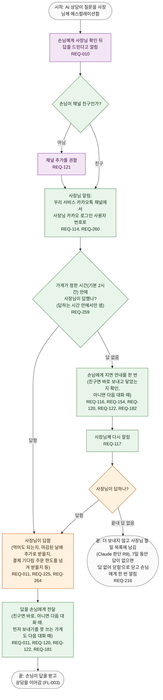

# FL-005 에스컬레이션 건의 답 받기

채우는 요구사항: REQ-010, REQ-011, REQ-114, REQ-116, REQ-117, REQ-120, REQ-121, REQ-122, REQ-154, REQ-181, REQ-182, REQ-216, REQ-225, REQ-259, REQ-260, REQ-264

| 항목 | 내용 |
| --- | --- |
| 액터 | 손님, 사장님, AI 상담, 우리 서비스 |
| 컨텍스트 | CTX-001 상담, CTX-008 알림, CTX-002 가게 규칙 |
| 시작 | AI 상담이 질문을 사장님께 에스컬레이션함 |
| 끝 | 손님이 사장님 답을 받고 상담을 이어감 / 끝내 답이 없어 사장님 할 일 목록에 남음 |
| 연결 플로우 | FL-003 상담하고 견적 받기 |

에스컬레이션하는 곳: FL-003(먹어도 되는지, 답할 수 없는 질문, 마감된 날), FL-004(콜백 시간을 넘김), FL-006(마감된 날, 결제 기다림 주문 한도), FL-008·FL-009(다른 카카오 사용자의 변경·취소), FL-010·FL-011(받기 전 문제).

## 기본 경로

1. AI 상담이 질문을 에스컬레이션하면 손님에게 사장님 확인 뒤 답을 드린다고 알리고, 채널 친구가 아니면 채널 추가를 권합니다.
2. 우리 서비스 채널로 사장님께 알립니다.
3. 사장님이 답하면 손님에게 전달합니다. 채널 친구면 바로 보내고, 아니면 손님이 다음에 말을 걸 때 먼저 전합니다.

## 예외 경로

- 가게가 정한 시간(기본 2시간, 답하는 시간 안에서만 셈) 안에 사장님 답이 없으면 손님에게 지연 안내를 한 번 보내고 사장님께 다시 알립니다(REQ-116~REQ-259).
- 채널 친구가 아닌 손님에게는 먼저 보낼 수 없어, 지연 안내와 사장님 답을 다음 대화 때 먼저 전합니다(REQ-120, REQ-122).
- 그 뒤에도 답이 없으면 더 보내지 않고 사장님 할 일 목록에 남깁니다(R8). 7일 동안 답이 없으면 그 건을 '답 없어 닫힘'으로 닫고 손님에게 다시 물어 달라고 한 번 알려, 상담이 문의 끊김으로 닫히고 30일 뒤 지워질 수 있게 합니다(REQ-216, 버전 5).

## 요구사항 해석 (Claude 판단)

- R8 지연 안내와 다시 알림 뒤에도 답이 없으면 더 보내지 않고 사장님 할 일 목록에 남깁니다. 같은 이벤트의 안내는 한 번이라는 REQ-154(버전 2, 버전 1 REQ-119를 바꿈)를 따릅니다.

## 버전 2에 더한 요구사항 (03단계 확정, 2026-11-12)

이 플로우에 더한 것은 없습니다. 같은 안내를 한 번만 보내는 기준은 REQ-119에서 REQ-154(같은 주문의 같은 이벤트)로 바뀌었습니다. 맞춤 주문 요청·변경 요청·문제 신고의 지연 안내는 REQ-156입니다(FL-006, FL-008, FL-011).

## 확정한 뒤 고친 것

2026-11-15 14:19 동희님 결정 카드('가게가 한도를 정함')을 반영했습니다(02단계 11절, 버전 5). H6: 결제 기다림 주문 한도로 넘어온 건이면 사장님이 한도를 넘겨 받을지 고르고, 넘겨 받으면 그 상담의 주문 요청 하나만 24시간 동안 한도를 넘깁니다(REQ-264). 에스컬레이션하는 곳에 FL-006의 결제 기다림 주문 한도를 더했습니다.

<!-- 07-sitemap:start · '화면'·'화면 없음 사유' 열이 원본, 나머지 열은 build_sitemap.py가 생성 -->
## 화면 (07단계)

노드마다 그 시점에 사람이 보는 화면을 적었습니다. 화면이 없으면 사유를 적었습니다(분기·서버 처리·외부·종료, 정의는 `docs/07-sitemap/README.md` 3절). 다른 플로우로 연결되는 노드는 해당 플로우의 표에 있습니다. 화면 목록은 `docs/07-sitemap/sitemap.yaml`.

| 노드 | 내용 | 화면 | 화면 없음 사유 |
| --- | --- | --- | --- |
| S | 시작: AI 상담이 질문을 사장님께 에스컬레이션함 |  | 서버 처리 |
| H1 | 손님에게 사장님 확인 뒤 답을 드린다고 알림 | SCR-003 가게 채널 상담 |  |
| D1 | 손님이 채널 친구인가? |  | 분기 |
| H2 | 채널 추가를 권함 | SCR-003 가게 채널 상담 |  |
| H3 | 사장님 알림: 우리 서비스 카카오톡 채널에서 사장님 카카오 로그인 사용자 번호로 | SCR-019 사장님 알림, SCR-016 할 일 목록 |  |
| D2 | 가게가 정한 시간(기본 2시간) 안에 사장님이 답했나? (답하는 시간 안에서만 셈) |  | 분기 |
| H4 | 손님에게 지연 안내를 한 번 (친구면 바로 보내고 닿았는지 확인, 아니면 다음 대화 때) | SCR-011 손님 알림 |  |
| H5 | 사장님께 다시 알림 | SCR-019 사장님 알림, SCR-016 할 일 목록 |  |
| D3 | 사장님이 답하나? | SCR-017 에스컬레이션 건 |  |
| E0 | 끝: 더 보내지 않고 사장님 할 일 목록에 남김 , 7일 동안 답이 없으면 '답 없어 닫힘'으로 닫고 손님에게 한 번 알림 | SCR-016 할 일 목록 |  |
| H6 | 사장님이 답함 (먹어도 되는지, 마감된 날에 추가로 받을지, 결제 기다림 주문 한도를 넘겨 받을지 등) | SCR-017 에스컬레이션 건 |  |
| H7 | 답을 손님에게 전달 (친구면 바로, 아니면 다음 대화 때. 먼저 보내기를 못 쓰는 가게도 다음 대화 때) | SCR-011 손님 알림 |  |
| E1 | 끝: 손님이 답을 받고 상담을 이어감 (FL-003) | SCR-003 가게 채널 상담 |  |
<!-- 07-sitemap:end -->
