# FL-006 주문 요청하기

채우는 요구사항: REQ-004, REQ-005, REQ-012, REQ-013, REQ-018, REQ-035, REQ-037, REQ-038, REQ-039, REQ-045, REQ-046, REQ-051, REQ-052, REQ-053, REQ-054, REQ-055, REQ-056, REQ-057, REQ-058, REQ-059, REQ-096, REQ-114, REQ-121, REQ-132, REQ-156

| 항목 | 내용 |
| --- | --- |
| 행위자 | 손님, AI 상담, 사장님, 우리 서비스 |
| 컨텍스트 | CTX-003 주문, CTX-001 상담, CTX-002 가게 규칙, CTX-006 후기·포트폴리오, CTX-008 알림 |
| 시작 | 손님이 견적을 받고 주문하겠다고 함 |
| 끝 | 그날 자리가 잡혀 결제 안내로 감(FL-007) / 주문 요청을 받지 않음 / 주문 거절됨 / 다른 날로 다시 |
| 이어지는 흐름 | FL-007 결제하고 주문 확정받기 |

```mermaid
flowchart TD
  S(["시작: 손님이 견적을 받고<br/>주문하겠다고 함 (FL-003)"])
  O1["AI 상담이 빈 칸을 마저 물음: 날짜·시간·<br/>크기·맛·문구, 알레르기·빼야 할 재료<br/>REQ-004, REQ-013"]
  D1{"견적 유효 기한이 지났거나<br/>가격표 판이 바뀌었나?"}
  O2["지금 판으로 금액을 다시 정함<br/>REQ-035"]
  D2{"다시 정한 금액이<br/>받은 견적과 다른가?"}
  O3["새 금액으로 다시 확인받음<br/>REQ-056"]
  D3{"손님이 새 금액을<br/>받아들이나?"}
  E0(["끝: 주문 요청 없이 상담을 이어감 (FL-003)"])
  D4{"가게 규칙으로 보아<br/>그날 받을 수 있나?<br/>REQ-005, REQ-037, REQ-038"}
  F3[["FL-003 날짜 고르기<br/>(다른 날 권하기, 마감된 날은 사장님께)"]]
  O5["주문 내용 요약을 보여 확인받음:<br/>날짜·시간·문구 철자·색·금액<br/>REQ-051"]
  O6["그 판의 취소·환불 규정과 '주문제작이라<br/>청약철회가 제한될 수 있음'을 따로 알림<br/>REQ-052"]
  O7["사진 게시 동의를 물음<br/>(기본 '동의 안 함')<br/>REQ-096"]
  D5{"취소·환불 규정에<br/>동의하나?"}
  E1(["끝: 주문 요청을 받지 않음<br/>REQ-053"])
  O8["손님이 주문 요청을 누름: 주문 내용 확인·<br/>규정 동의(판 번호·시각)·주문 요청을 함께 남김<br/>REQ-054, REQ-055, REQ-132 (Claude 판단 R9)"]
  O9["결제가 확인돼야 확정된다고 알림,<br/>확정되었다고 말하지 않음<br/>REQ-012"]
  D6{"손님이 채널 친구인가?"}
  O10["채널 추가를 권함<br/>REQ-121"]
  D7{"가게 규칙이 가른<br/>주문 종류는?"}
  O11["사장님 수락 없이 결제 안내로<br/>REQ-057"]
  O12["사장님 알림: 참고 사진·견적 계산값·<br/>그날 남은 자리를 보고 답함<br/>REQ-114, REQ-058"]
  D8{"사장님 답은?"}
  G6["가게가 정한 시간(기본 2시간) 안에 답이 없으면<br/>손님에게 늦어짐 안내 한 번<br/>REQ-156"]
  O13["손님에게 거절을 알림<br/>REQ-059"]
  E2(["끝: 주문 거절됨"])
  O14["결제 안내 전에 그날 자리를<br/>결제 기한까지 잡음<br/>REQ-039"]
  D9{"그날 남은 자리가 있나?<br/>REQ-038"}
  O15["그날 자리 잡힘, 하루 최대 개수에<br/>닿으면 그날 주문 마감<br/>REQ-046"]
  F7[["FL-007 결제하고 주문 확정받기"]]
  D10{"맞춤 주문인가?"}
  D11{"사장님이 다 찬 날에<br/>받아 주나?<br/>(Claude 판단 R10)"}
  O16["넘겨 잡고 다른 손님에게는<br/>계속 마감으로 보임<br/>REQ-045"]
  O17["요청을 닫고 자리가 없다고 알리며<br/>가까운 날을 권함 (Claude 판단 R11)<br/>REQ-018"]
  E3(["끝: 손님이 다른 날로<br/>다시 요청 (FL-003)"])

  S --> O1 --> D1
  D1 -->|"예"| O2 --> D2
  D1 -->|"아니오"| D4
  D2 -->|"다름"| O3 --> D3
  D2 -->|"같음"| D4
  D3 -->|"아니오"| E0
  D3 -->|"예"| D4
  D4 -->|"받을 수 없음<br/>(휴무·다 참·마감됨)"| F3
  D4 -->|"받을 수 있음<br/>(사장님이 받아 준 날 포함)"| O5
  O5 --> O6 --> O7 --> D5
  D5 -->|"동의 안 함"| E1
  D5 -->|"동의함"| O8 --> O9 --> D6
  D6 -->|"아님"| O10 --> D7
  D6 -->|"친구"| D7
  D7 -->|"기본 디자인 주문"| O11 --> O14
  D7 -->|"맞춤 주문"| O12 --> D8
  D8 -->|"거절"| O13 --> E2
  D8 -->|"수락, 금액 바꿔 수락"| O14
  D8 -.->|"답 없음"| G6
  G6 -.-> D8
  O14 --> D9
  D9 -->|"있음"| O15 --> F7
  D9 -->|"없음"| D10
  D10 -->|"맞춤 주문"| D11
  D11 -->|"받아 줌"| O16 --> F7
  D11 -->|"안 받음"| O13
  D10 -->|"기본 디자인 주문"| O17 --> E3

  classDef cust fill:#e3f2fd,stroke:#1565c0,color:#0d2a4a
  classDef ai fill:#f3e5f5,stroke:#7b1fa2,color:#3b0a4a
  classDef owner fill:#fff3e0,stroke:#e65100,color:#3e2000
  classDef svc fill:#e8f5e9,stroke:#2e7d32,color:#0f3313
  classDef gap fill:#fffde7,stroke:#f9a825,stroke-dasharray:5 5,color:#4a3b00
  classDef flow fill:#ffffff,stroke:#424242,color:#212121
  classDef term fill:#fafafa,stroke:#757575,color:#212121
  class D3,D5,O8 cust
  class O1,O3,O5,O6,O7,O9,O10,O17 ai
  class D8,D11 owner
  class D1,O2,D2,D4,D6,D7,O11,O12,O13,O14,D9,O15,D10,O16 svc
  class G6 svc
  class F3,F7 flow
  class S,E0,E1,E2,E3 term
```

## 주 경로

1. AI 상담이 주문서 초안의 빈 칸과 알레르기를 마저 묻습니다.
2. 견적 유효 기한이 지났거나 판이 바뀌었으면 지금 판으로 금액을 다시 정하고, 다르면 다시 확인받습니다.
3. 주문 내용 요약을 확인받고, 그 판의 취소·환불 규정과 청약철회 제한을 따로 알리고, 사진 게시 동의를 묻습니다.
4. 손님이 규정에 동의하고 주문 요청을 누르면 확인·동의·요청을 함께 남깁니다. 결제가 확인돼야 확정된다고 알리고, 채널 친구가 아니면 채널 추가를 권합니다.
5. 기본 디자인 주문은 바로, 맞춤 주문은 사장님이 수락하거나 금액을 바꿔 수락한 뒤 그날 자리를 결제 기한까지 잡고 결제 안내로 갑니다.

## 실패 길

- 다시 정한 금액을 손님이 받아들이지 않으면 주문 요청 없이 상담을 이어갑니다(REQ-056).
- 그날을 받을 수 없으면 FL-003의 날짜 고르기로 돌아갑니다. 마감된 날을 그래도 원하면 사장님께 넘깁니다(REQ-048, R6).
- 취소·환불 규정에 동의하지 않으면 주문 요청을 받지 않습니다(REQ-053).
- 사장님이 맞춤 주문을 거절하면 손님에게 알립니다(REQ-059).
- 그 사이 그날이 다 찼으면, 맞춤 주문은 사장님이 다 찬 날에 받아 줄지 정하고(R10), 기본 디자인 주문은 요청을 닫고 가까운 날을 권합니다(R11).
- 사장님이 맞춤 주문에 답하지 않고 오래 두면 손님에게 늦어짐 안내를 한 번 보냅니다(REQ-156, 2판).

## 읽은 방식 (Claude 판단)

- R9 손님이 내리는 명령(주문 요청·변경 요청·취소·문제 신고)은 AI 상담이 말을 알아듣고 확인 버튼을 보여 주고, 손님이 눌러야 내려집니다. AI 상담이 내리는 명령은 주문서 초안 저장하기·견적 내기·신고 내용 모으기 셋뿐입니다(TERM-045). FL-008·FL-009·FL-011도 같습니다.
- R10 맞춤 주문을 수락하거나 날짜 변경을 받아들일 때 그날 자리가 없으면, 사장님이 '다 찬 날 받아 주기'로 정한 것으로 봅니다(REQ-038, REQ-045). 사장님은 맞춤 주문 요청 화면에서 그날 남은 자리를 봅니다(REQ-058).
- R11 기본 디자인 주문이 요청된 순간 그 사이 그날이 다 차 자리를 잡지 못하면, 요청을 닫고 가까운 날을 권합니다. 드문 동시 요청이라 04단계 상태 기계에서 다시 봅니다.

## 2판에 더한 요구사항 (03단계 확정, 2026-11-12)

- REQ-156 (권장, CTX-008, 후보 N6) 맞춤 주문 요청·변경 요청·문제 신고에 가게가 정한 시간(기본 2시간) 안에 사장님 답이 없으면, 시스템은 손님에게 늦어짐 안내를 한 번 보내야 한다. 늦어짐 안내 뒤 사장님께 다시 알리는 것은 REQ-117이 정합니다.

<!-- 07-sitemap:start · '화면'·'화면 없음 사유' 열이 원본, 나머지 열은 build_sitemap.py가 생성 -->
## 화면 (07단계)

노드마다 그 시점에 사람이 보는 화면을 적었습니다. 화면이 없으면 사유를 적었습니다(분기·서버 처리·외부·종료, 정의는 `docs/07-sitemap/README.md` 3절). 다른 플로우로 연결되는 노드는 해당 플로우의 표에 있습니다. 화면 목록은 `docs/07-sitemap/sitemap.yaml`.

| 노드 | 내용 | 화면 | 화면 없음 사유 |
| --- | --- | --- | --- |
| S | 시작: 손님이 견적을 받고 주문하겠다고 함 (FL-003) | SCR-003 가게 채널 상담 |  |
| O1 | AI 상담이 빈 칸을 마저 물음: 날짜·시간· 크기·맛·문구, 알레르기·빼야 할 재료 | SCR-003 가게 채널 상담 |  |
| D1 | 견적 유효 기한이 지났거나 가격표 판이 바뀌었나? |  | 분기 |
| O2 | 지금 판으로 금액을 다시 정함 |  | 서버 처리 |
| D2 | 다시 정한 금액이 받은 견적과 다른가? |  | 분기 |
| O3 | 새 금액으로 다시 확인받음 | SCR-003 가게 채널 상담 |  |
| D3 | 손님이 새 금액을 받아들이나? | SCR-003 가게 채널 상담 |  |
| E0 | 끝: 주문 요청 없이 상담을 이어감 (FL-003) | SCR-003 가게 채널 상담 |  |
| D4 | 가게 규칙으로 보아 그날 받을 수 있나? |  | 분기 |
| O5 | 주문 내용 요약을 보여 확인받음: 날짜·시간·문구 철자·색·금액 | SCR-004 주문 요청 카드 |  |
| O6 | 그 판의 취소·환불 규정과 '주문제작이라 청약철회가 제한될 수 있음'을 따로 알림 | SCR-004 주문 요청 카드 |  |
| O7 | 사진 게시 동의를 물음 (기본 '동의 안 함') | SCR-004 주문 요청 카드 |  |
| D5 | 취소·환불 규정에 동의하나? | SCR-004 주문 요청 카드 |  |
| E1 | 끝: 주문 요청을 받지 않음 |  | 종료 |
| O8 | 손님이 주문 요청을 누름: 주문 내용 확인· 규정 동의(판 번호·시각)·주문 요청을 함께 남김 | SCR-004 주문 요청 카드 |  |
| O9 | 결제가 확인돼야 확정된다고 알림, 확정되었다고 말하지 않음 | SCR-004 주문 요청 카드 |  |
| D6 | 손님이 채널 친구인가? |  | 분기 |
| O10 | 채널 추가를 권함 | SCR-003 가게 채널 상담 |  |
| D7 | 가게 규칙이 가른 주문 종류는? |  | 분기 |
| O11 | 사장님 수락 없이 결제 안내로 |  | 서버 처리 |
| O12 | 사장님 알림: 참고 사진·견적 계산값· 그날 남은 자리를 보고 답함 | SCR-019 사장님 알림, SCR-016 할 일 목록, SCR-022 맞춤 주문 답하기 |  |
| D8 | 사장님 답은? | SCR-022 맞춤 주문 답하기 |  |
| G6 | 가게가 정한 시간(기본 2시간) 안에 답이 없으면 손님에게 늦어짐 안내 한 번 | SCR-011 손님 알림 |  |
| O13 | 손님에게 거절을 알림 | SCR-011 손님 알림 |  |
| E2 | 끝: 주문 거절됨 |  | 종료 |
| O14 | 결제 안내 전에 그날 자리를 결제 기한까지 잡음 |  | 서버 처리 |
| D9 | 그날 남은 자리가 있나? |  | 분기 |
| O15 | 그날 자리 잡힘, 하루 최대 개수에 닿으면 그날 주문 마감 |  | 서버 처리 |
| D10 | 맞춤 주문인가? |  | 분기 |
| D11 | 사장님이 다 찬 날에 받아 주나? | SCR-022 맞춤 주문 답하기 |  |
| O16 | 넘겨 잡고 다른 손님에게는 계속 마감으로 보임 | SCR-001 예약 링크 페이지, SCR-032 영업 달력 |  |
| O17 | 요청을 닫고 자리가 없다고 알리며 가까운 날을 권함 | SCR-004 주문 요청 카드 |  |
| E3 | 끝: 손님이 다른 날로 다시 요청 (FL-003) | SCR-003 가게 채널 상담 |  |
<!-- 07-sitemap:end -->
