# FL-006 주문 요청하기

채우는 요구사항: REQ-004, REQ-005, REQ-012, REQ-018, REQ-035, REQ-038, REQ-039, REQ-045, REQ-046, REQ-051, REQ-052, REQ-053, REQ-054, REQ-055, REQ-056, REQ-057, REQ-058, REQ-059, REQ-114, REQ-121, REQ-132, REQ-156, REQ-175, REQ-178, REQ-200, REQ-201, REQ-202, REQ-203, REQ-204, REQ-205, REQ-213, REQ-220, REQ-221, REQ-225, REQ-226, REQ-229, REQ-230, REQ-240, REQ-255, REQ-263, REQ-264

| 항목 | 내용 |
| --- | --- |
| 액터 | 손님, AI 상담, 사장님, 우리 서비스 |
| 컨텍스트 | CTX-003 주문, CTX-001 상담, CTX-002 가게 규칙, CTX-008 알림 |
| 시작 | 손님이 견적을 받고 주문하겠다고 함 |
| 끝 | 그날 자리가 잡혀 결제 안내로 감(FL-007) / 주문 요청을 받지 않음 / 주문 거절됨 / 다른 날로 다시 / 결제 기다림 주문 한도에 닿아 사장님께 넘어감(FL-005) |
| 연결 플로우 | FL-007 결제하고 주문 확정받기, FL-005 에스컬레이션 건의 답 받기 |

```mermaid
flowchart TD
  S(["시작: 손님이 견적을 받고<br/>주문하겠다고 함 (FL-003)"])
  O1["AI 상담이 빈 항목을 마저 물음: 날짜·시간·<br/>크기·맛·문구, 빼야 할 재료<br/>(알레르기는 AI가 묻지 않음)<br/>REQ-004, REQ-200"]
  D1{"견적 유효 기한이 지났거나<br/>가격표 버전이 바뀌었나?"}
  O2["현재 버전으로 금액을 다시 정함<br/>REQ-035"]
  D2{"다시 정한 금액이<br/>받은 견적과 다른가?"}
  O3["새 금액으로 다시 확인받음<br/>REQ-056"]
  D3{"손님이 새 금액을<br/>수락하나?"}
  E0(["끝: 주문 요청 없이 상담을 이어감 (FL-003)"])
  D4{"가게 규칙으로 보아<br/>그날 받을 수 있나?<br/>REQ-005, REQ-220, REQ-038"}
  F3[["FL-003 날짜 고르기<br/>(다른 날 권하기, 마감된 날은 사장님께)"]]
  D12{"알레르기 정보 동의<br/>단계가 켜져 있나?<br/>REQ-205"}
  O18["알레르기를 묻기 전에 따로 동의를 물음:<br/>쓰는 목적·받는 항목·보는 사람·지우는 때,<br/>동의하지 않을 수 있음과 그 결과<br/>(잠정, 5-2 질문 4) REQ-201"]
  D13{"알레르기 정보에<br/>동의하나?"}
  O19["알레르기 답을 AI를 거치지 않는<br/>전용 블록으로 받음('없음'도 답),<br/>AI 모델에 보내지 않음<br/>REQ-202, REQ-204"]
  O20["알레르기는 묻지 않고 빼야 할 재료만으로 이어감,<br/>제작 목록에 '알레르기 정보 동의 안 함'<br/>REQ-203"]
  O5["주문자 이름·연락처를 AI 없이 받은 뒤<br/>주문 내용 요약을 보여 확인받음:<br/>날짜·시간·문구 철자·색·금액,<br/>알레르기 답이나 '동의 안 함'<br/>REQ-051, REQ-175, REQ-178"]
  O6["그 버전의 취소·환불 규정과 '주문제작이라<br/>청약철회가 제한될 수 있음', 미성년자 계약 취소<br/>고지를 따로 알림<br/>REQ-052, REQ-240"]
  D5{"취소·환불 규정에<br/>동의하나?"}
  E1(["끝: 주문 요청을 받지 않음<br/>REQ-053"])
  D14{"기본 디자인 주문이고 이 카카오 사용자의<br/>이 가게 결제 기다림 주문이 가게가 정한<br/>한도(기본 2건, 0이면 한도 없음)에 닿았나?<br/>REQ-263"}
  O21["주문 요청을 남기지 않고(자리도 잡지 않음)<br/>'사장님이 확인한 뒤 알려 드릴게요'를 보내고<br/>받을지 정할 일을 사장님께 에스컬레이션함<br/>REQ-263"]
  F5[["FL-005 에스컬레이션 건의 답 받기<br/>(한도를 넘겨 받으면 24시간 동안<br/>그 상담의 주문 요청 하나, REQ-264)"]]
  O8["손님이 주문 요청을 누름: 주문 내용 확인·<br/>규정 동의(버전·시각)·주문 요청을 함께 남김<br/>REQ-054, REQ-055, REQ-132, REQ-255 (Claude 판단 R9)"]
  O9["결제가 확인돼야 확정된다고 알림,<br/>확정되었다고 말하지 않음<br/>REQ-012"]
  D6{"손님이 채널 친구인가?"}
  O10["채널 추가를 권함<br/>REQ-121"]
  D7{"가게 규칙이 기본 디자인 범위로<br/>가른 주문 종류는?<br/>REQ-229"}
  O11["사장님 수락 없이 결제 안내로<br/>REQ-057"]
  O12["사장님 알림: 참고 사진·견적 계산값·<br/>그날 남은 자리를 보고 답함,<br/>'부터'·'범위' 견적은 최종 금액을 넣어야 수락<br/>(아래 끝보다 낮게 정하지 못함)<br/>REQ-114, REQ-058, REQ-230"]
  D8{"사장님 답은?"}
  G6["가게가 정한 시간(기본 2시간) 안에 답이 없으면<br/>손님에게 지연 안내 한 번, 그날 주문 마감까지<br/>답이 없으면 '답 없어 닫힘'으로 닫고 손님에게 알림<br/>REQ-156, REQ-213"]
  O13["손님에게 거절을 알림<br/>REQ-059"]
  E2(["끝: 주문 거절됨"])
  O14["결제 안내 전에 그날 자리를<br/>결제 기한까지 잡음(휴무일이면<br/>사장님이 확인한 뒤)<br/>REQ-039, REQ-221"]
  D9{"그날 남은 자리가 있나?<br/>REQ-038"}
  O15["가예약됨, 하루 최대 개수에<br/>닿으면 그날 주문 마감<br/>REQ-046"]
  F7[["FL-007 결제하고 주문 확정받기"]]
  D10{"맞춤 주문인가?"}
  D11{"사장님이 마감 후<br/>추가 수락하나?<br/>(Claude 판단 R10)<br/>REQ-226"}
  O16["추가 수락하고 다른 손님에게는<br/>계속 마감으로 보임<br/>REQ-045"]
  O17["주문 요청을 남기지 않고 그 사이 그날이<br/>다 찼다고 알리며 가까운 날(최대 3개)을 권함,<br/>그래도 그날을 원하면 FL-003에서 사장님께<br/>(Claude 판단 R11)<br/>REQ-018, REQ-225"]
  E3(["끝: 손님이 다른 날로<br/>다시 요청 (FL-003)"])

  S --> O1 --> D1
  D1 -->|"예"| O2 --> D2
  D1 -->|"아니오"| D4
  D2 -->|"다름"| O3 --> D3
  D2 -->|"같음"| D4
  D3 -->|"아니오"| E0
  D3 -->|"예"| D4
  D4 -->|"받을 수 없음<br/>(휴무·다 참·마감됨)"| F3
  D4 -->|"받을 수 있음<br/>(사장님이 추가 수락한 날 포함)"| D12
  D12 -->|"켜짐"| O18 --> D13
  D12 -->|"꺼짐(동의 필요 없음)"| O19
  D13 -->|"동의함"| O19
  D13 -->|"동의 안 함"| O20
  O19 --> O5
  O20 --> O5
  O5 --> O6 --> D5
  D5 -->|"동의 안 함"| E1
  D5 -->|"동의함"| D14
  D14 -->|"아니오(맞춤 주문, 한도 밑,<br/>한도를 넘겨 받은 24시간 안)"| O8 --> O9 --> D6
  D14 -->|"예"| O21 --> F5
  D6 -->|"아님"| O10 --> D7
  D6 -->|"친구"| D7
  D7 -->|"기본 디자인 주문"| O11 --> O14
  D7 -->|"맞춤 주문"| O12 --> D8
  D8 -->|"거절"| O13 --> E2
  D8 -->|"수락, 금액 변경 수락"| O14
  D8 -.->|"답 없음"| G6
  G6 -.-> D8
  O14 --> D9
  D9 -->|"있음"| O15 --> F7
  D9 -->|"없음"| D10
  D10 -->|"맞춤 주문"| D11
  D11 -->|"추가 수락"| O16 --> F7
  D11 -->|"안 받음"| O13
  D10 -->|"기본 디자인 주문"| O17 --> E3

  classDef cust fill:#e3f2fd,stroke:#1565c0,color:#0d2a4a
  classDef ai fill:#f3e5f5,stroke:#7b1fa2,color:#3b0a4a
  classDef owner fill:#fff3e0,stroke:#e65100,color:#3e2000
  classDef svc fill:#e8f5e9,stroke:#2e7d32,color:#0f3313
  classDef gap fill:#fffde7,stroke:#f9a825,stroke-dasharray:5 5,color:#4a3b00
  classDef flow fill:#ffffff,stroke:#424242,color:#212121
  classDef term fill:#fafafa,stroke:#757575,color:#212121
  class D3,D5,D13,O8 cust
  class O1,O3,O5,O6,O9,O10,O17 ai
  class D8,D11 owner
  class D1,O2,D2,D4,D12,O18,O19,O20,D6,D7,O11,O12,O13,O14,D9,O15,D10,O16,D14,O21 svc
  class G6 svc
  class F3,F5,F7 flow
  class S,E0,E1,E2,E3 term
```

## 기본 경로

1. AI 상담이 주문서 초안의 빈 항목과 빼야 할 재료를 마저 묻습니다. 알레르기는 AI가 묻지 않습니다.
2. 견적 유효 기한이 지났거나 버전이 바뀌었으면 현재 버전으로 금액을 다시 정하고, 다르면 다시 확인받습니다.
3. 알레르기를 묻기 전에 알레르기 정보 동의를 따로 묻고, 동의하면 알레르기 답을 AI를 거치지 않는 전용 블록으로 받습니다(잠정, 5-2 질문 4). 주문자 이름·연락처를 받은 뒤 주문 내용 요약을 확인받고, 그 버전의 취소·환불 규정과 청약철회 제한을 따로 알립니다. 사진 게시 동의는 여기서 묻지 않고 완성 사진(FL-010)과 후기 사진(FL-012)마다 묻습니다.
4. 손님이 규정에 동의하고 주문 요청을 누르면 확인·동의·요청을 함께 남깁니다. 결제가 확인돼야 확정된다고 알리고, 채널 친구가 아니면 채널 추가를 권합니다.
5. 기본 디자인 주문은 바로, 맞춤 주문은 사장님이 수락하거나 금액을 정하거나 바꿔 수락한 뒤('부터'·'범위' 견적은 최종 금액을 넣어야 수락) 그날 자리를 결제 기한까지 잡고 결제 안내로 갑니다. 사장님이 손님이 본 금액보다 높게 정했으면 결제 안내에서 손님이 새 금액을 먼저 확인합니다(FL-007).

## 예외 경로

- 다시 정한 금액을 손님이 수락하지 않으면 주문 요청 없이 상담을 이어갑니다(REQ-056).
- 그날을 받을 수 없으면 FL-003의 날짜 고르기로 돌아갑니다. 마감된 날을 그래도 원하면 사장님께 에스컬레이션합니다(REQ-225, R6).
- 알레르기 정보에 동의하지 않으면 알레르기는 묻지 않고 빼야 할 재료만으로 이어가고, 제작 목록에 '알레르기 정보 동의 안 함'을 보입니다(REQ-203). 동의 단계를 끈 동안에는 동의를 묻지 않고 알레르기 답 블록을 바로 엽니다(REQ-205).
- 취소·환불 규정에 동의하지 않으면 주문 요청을 받지 않습니다(REQ-053).
- 기본 디자인 주문인데 이 카카오 사용자의 이 가게 결제 기다림 주문이 가게가 정한 한도(기본 2건, 0이면 한도 없음)에 닿았으면, 주문 요청을 남기지 않고 손님에게 사장님이 확인한 뒤 알려 드린다고 한 뒤 사장님께 에스컬레이션합니다(REQ-263). 사장님이 한도를 넘겨 받으면 24시간 동안 그 상담의 주문 요청 하나만 받습니다(REQ-264, FL-005). 맞춤 주문은 사장님이 수락할 때 보므로 한도를 보지 않습니다.
- 사장님이 맞춤 주문을 거절하면 손님에게 알립니다(REQ-059).
- 그 사이 그날이 다 찼으면, 맞춤 주문은 사장님이 마감 후 추가 수락할지 정하고(R10), 기본 디자인 주문은 주문 요청을 남기지 않고 가까운 날을 권합니다(R11).
- 사장님이 맞춤 주문에 답하지 않고 오래 두면 손님에게 지연 안내를 한 번 보냅니다(REQ-156, 버전 2).

## 요구사항 해석 (Claude 판단)

- R9 손님이 내리는 명령(주문 요청·변경 요청·취소·문제 신고)은 AI 상담이 말을 알아듣고 확인 버튼을 보여 주고, 손님이 눌러야 내려집니다. AI 상담이 내리는 명령은 주문서 초안 저장하기·견적 내기·신고 내용 모으기 셋뿐입니다(TERM-045). FL-008·FL-009·FL-011도 같습니다.
- R10 맞춤 주문을 수락하거나 날짜 변경을 수락할 때 그날 자리가 없으면, 사장님이 '마감 후 추가 수락'으로 정한 것으로 봅니다(REQ-038, REQ-045). 사장님은 맞춤 주문 요청 화면에서 그날 남은 자리를 봅니다(REQ-058). 버전 5에서는 하루 최대 개수를 초과해 받을지 사장님께 묻고 확인받은 뒤에만 잡습니다(REQ-226).
- R11 기본 디자인 주문이 요청된 순간 그 사이 그날이 다 차 자리를 잡지 못하면, 요청을 닫고 가까운 날을 권합니다. 드문 동시 요청이라 04단계 상태 머신에서 다시 봅니다. 04단계에서 자리를 잡는 트랜잭션이 실패하면 주문 요청도 남기지 않기로 정했고(SPEC-029의 동시 예외), 설계 재검토 M8에서 O17의 글을 그대로 맞췄습니다.

## 버전 2에 더한 요구사항 (03단계 확정, 2026-11-12)

- REQ-156 (권장, CTX-008, 후보 N6) 맞춤 주문 요청·변경 요청·문제 신고에 가게가 정한 시간(기본 2시간) 안에 사장님 답이 없으면, 시스템은 손님에게 지연 안내를 한 번 보내야 한다. 지연 안내 뒤 사장님께 다시 알리는 것은 REQ-117이 정합니다.

## 확정한 뒤 고친 것

2026-11-13 설계 독립 재검토의 묶음 H11(RB-02)을 동희님 2026-11-13 20:59 결정 카드 '추천안대로 (추천)'에 따라 고쳤습니다. O5 앞에서 주문자 이름·연락처를 AI를 거치지 않는 전용 블록으로 받고(둘 다 필수, REQ-175), 그 값은 AI 모델에 보내지 않습니다(REQ-178). 04단계 SPEC-072가 이 단계를 맡습니다.

같은 결정 카드로 묶음 H5(RA-02)와 H10(RE-01, RA-14, RB-16)도 고쳤습니다. O1에서 AI 상담은 알레르기를 묻지 않고 빼야 할 재료만 묻습니다(REQ-013을 '제외'로 두고 REQ-200). 새 D12·O18·D13·O19·O20: 알레르기를 묻기 전에 알레르기 정보 동의를 따로 묻고, 동의하면 알레르기 답을 AI를 거치지 않는 전용 블록으로 받아 AI 모델에 보내지 않으며, 동의하지 않으면 빼야 할 재료만으로 이어갑니다(REQ-201~205). 잠정, 5-2 질문 4의 답으로 다시 봄: 답이 '민감정보 아님'이면 D12에서 동의 단계를 끕니다. O5의 요약에 알레르기 답이나 '동의 안 함'을 더했습니다. O7(주문 요청 때의 사진 게시 동의)은 지웠습니다: 그때는 사진이 없어 동의의 대상이 없고, 사진 게시 동의는 완성 사진을 보낼 때(FL-010)와 후기 때(FL-012) 사진마다 묻습니다(REQ-096을 '제외'로 두고 REQ-207, REQ-208). 잠정, 5-2 질문 6의 답으로 다시 봄. 그래서 컨텍스트에서 CTX-006을 뺐습니다. 04단계 SPEC-075가 알레르기 정보 단계를 맡습니다.

같은 결정 카드로 묶음 M1(RB-03, RA-17)과 M3(RB-04, RA-11)도 고쳤습니다. G6: 맞춤 주문 요청에 그날 주문 마감까지 사장님 답이 없으면 '답 없어 닫힘'으로 닫고 손님에게 한 번 알립니다(REQ-213). D4의 휴무일은 손님이 고른 날짜라 막고(REQ-220), O14는 사장님이 휴무일을 확인한 뒤 잡고(REQ-221), D11은 다 찬 날에 초과해 받을지 묻습니다(REQ-226). O17은 그래도 그날을 원하는 손님을 FL-003의 에스컬레이션으로 보냅니다(REQ-225).

같은 결정 카드의 '모두 지금 고침 (추천)'대로 묶음 M6(RA-07, RB-18)도 고쳤습니다. D7의 주문 종류는 가게 규칙이 그 가격표 버전의 기본 디자인 범위로 가른 값입니다(REQ-229). O12: '부터'·'범위' 견적의 맞춤 주문은 사장님이 최종 금액을 넣어야 수락되고 아래 끝보다 낮게 정하지 못합니다(REQ-230). 손님이 본 금액보다 높게 정한 주문은 FL-007에서 손님이 새 금액을 확인한 뒤 계좌를 받습니다(REQ-232).

2026-11-14 설계 독립 재검토의 묶음 M11(RA-05)·M14(RB-12)를 동희님 2026-11-13 20:59 결정 카드 '모두 지금 고침 (추천)'에 따라 고쳤습니다(02단계 11절, 버전 5). O6의 규정 글 끝에 '미성년자가 법정대리인의 동의 없이 한 주문은 본인이나 법정대리인이 취소할 수 있어요' 한 줄을 더했습니다(REQ-240, 전자상거래법 제13조③, 잠정, 5-2 질문 2).

2026-11-15 설계 독립 재검토의 묶음 M8(RB-10)을 동희님 2026-11-13 20:59 결정 카드 '모두 지금 고침 (추천)'에 따라 고쳤습니다. 버전 3~5 요구사항을 04단계 SPEC으로만 잇지 않고 다이어그램에 넣었습니다(03단계 README 2절·8절).

| 노드 | 바뀐 동작 | 요구사항·SPEC |
| --- | --- | --- |
| O17 | '요청을 닫고'를 '주문 요청을 남기지 않고'로: 자리를 잡지 못하면 주문 요청도 남지 않음 | REQ-018, REQ-225, SPEC-029, SPEC-030 |

2026-11-15 14:19 동희님 결정 카드('가게가 한도를 정함')을 반영했습니다(02단계 11절, 버전 5). 새 D14·O21·F5: 기본 디자인 주문의 주문 요청 전에 이 카카오 사용자의 이 가게 결제 기다림 주문이 가게가 정한 한도에 닿았는지 보고, 닿았으면 주문 요청을 남기지 않고(자리도 잡지 않음) 사장님께 에스컬레이션합니다(REQ-263). 사장님이 한도를 넘겨 받으면 24시간 동안 그 상담의 주문 요청 하나만 받습니다(REQ-264, FL-005의 H6).

<!-- 07-sitemap:start · '화면'·'화면 없음 사유' 열이 원본, 나머지 열은 build_sitemap.py가 생성 -->
## 화면 (07단계)

노드마다 그 시점에 사람이 보는 화면을 적었습니다. 화면이 없으면 사유를 적었습니다(분기·서버 처리·외부·종료, 정의는 `docs/07-sitemap/README.md` 3절). 다른 플로우로 연결되는 노드는 해당 플로우의 표에 있습니다. 화면 목록은 `docs/07-sitemap/sitemap.yaml`.

| 노드 | 내용 | 화면 | 화면 없음 사유 |
| --- | --- | --- | --- |
| S | 시작: 손님이 견적을 받고 주문하겠다고 함 (FL-003) | SCR-003 가게 채널 상담 |  |
| O1 | AI 상담이 빈 항목을 마저 물음: 날짜·시간· 크기·맛·문구, 빼야 할 재료 (알레르기는 AI가 묻지 않음) | SCR-003 가게 채널 상담 |  |
| D1 | 견적 유효 기한이 지났거나 가격표 버전이 바뀌었나? |  | 분기 |
| O2 | 현재 버전으로 금액을 다시 정함 |  | 서버 처리 |
| D2 | 다시 정한 금액이 받은 견적과 다른가? |  | 분기 |
| O3 | 새 금액으로 다시 확인받음 | SCR-003 가게 채널 상담 |  |
| D3 | 손님이 새 금액을 수락하나? | SCR-003 가게 채널 상담 |  |
| E0 | 끝: 주문 요청 없이 상담을 이어감 (FL-003) | SCR-003 가게 채널 상담 |  |
| D4 | 가게 규칙으로 보아 그날 받을 수 있나? |  | 분기 |
| D12 | 알레르기 정보 동의 단계가 켜져 있나? |  | 분기 |
| O18 | 알레르기를 묻기 전에 따로 동의를 물음: 쓰는 목적·받는 항목·보는 사람·지우는 때, 동의하지 않을 수 있음과 그 결과 (잠정, 5-2 질문 4) | SCR-004 주문 요청 카드 |  |
| D13 | 알레르기 정보에 동의하나? | SCR-004 주문 요청 카드 |  |
| O19 | 알레르기 답을 AI를 거치지 않는 전용 블록으로 받음('없음'도 답), AI 모델에 보내지 않음 | SCR-004 주문 요청 카드 |  |
| O20 | 알레르기는 묻지 않고 빼야 할 재료만으로 이어감, 제작 목록에 '알레르기 정보 동의 안 함' | SCR-004 주문 요청 카드 |  |
| O5 | 주문자 이름·연락처를 AI 없이 받은 뒤 주문 내용 요약을 보여 확인받음: 날짜·시간·문구 철자·색·금액, 알레르기 답이나 '동의 안 함' | SCR-004 주문 요청 카드 |  |
| O6 | 그 버전의 취소·환불 규정과 '주문제작이라 청약철회가 제한될 수 있음', 미성년자 계약 취소 고지를 따로 알림 | SCR-004 주문 요청 카드 |  |
| D5 | 취소·환불 규정에 동의하나? | SCR-004 주문 요청 카드 |  |
| E1 | 끝: 주문 요청을 받지 않음 |  | 종료 |
| D14 | 기본 디자인 주문이고 이 카카오 사용자의 이 가게 결제 기다림 주문이 가게가 정한 한도(기본 2건, 0이면 한도 없음)에 닿았나? |  | 분기 |
| O21 | 주문 요청을 남기지 않고(자리도 잡지 않음) '사장님이 확인한 뒤 알려 드릴게요'를 보내고 받을지 정할 일을 사장님께 에스컬레이션함 | SCR-004 주문 요청 카드 |  |
| O8 | 손님이 주문 요청을 누름: 주문 내용 확인· 규정 동의(버전·시각)·주문 요청을 함께 남김 | SCR-004 주문 요청 카드 |  |
| O9 | 결제가 확인돼야 확정된다고 알림, 확정되었다고 말하지 않음 | SCR-004 주문 요청 카드 |  |
| D6 | 손님이 채널 친구인가? |  | 분기 |
| O10 | 채널 추가를 권함 | SCR-003 가게 채널 상담 |  |
| D7 | 가게 규칙이 기본 디자인 범위로 가른 주문 종류는? |  | 분기 |
| O11 | 사장님 수락 없이 결제 안내로 |  | 서버 처리 |
| O12 | 사장님 알림: 참고 사진·견적 계산값· 그날 남은 자리를 보고 답함, '부터'·'범위' 견적은 최종 금액을 넣어야 수락 (아래 끝보다 낮게 정하지 못함) | SCR-019 사장님 알림, SCR-016 할 일 목록, SCR-022 맞춤 주문 검토 |  |
| D8 | 사장님 답은? | SCR-022 맞춤 주문 검토 |  |
| G6 | 가게가 정한 시간(기본 2시간) 안에 답이 없으면 손님에게 지연 안내 한 번, 그날 주문 마감까지 답이 없으면 '답 없어 닫힘'으로 닫고 손님에게 알림 | SCR-011 손님 알림 |  |
| O13 | 손님에게 거절을 알림 | SCR-011 손님 알림 |  |
| E2 | 끝: 주문 거절됨 |  | 종료 |
| O14 | 결제 안내 전에 그날 자리를 결제 기한까지 잡음(휴무일이면 사장님이 확인한 뒤) |  | 서버 처리 |
| D9 | 그날 남은 자리가 있나? |  | 분기 |
| O15 | 가예약됨, 하루 최대 개수에 닿으면 그날 주문 마감 |  | 서버 처리 |
| D10 | 맞춤 주문인가? |  | 분기 |
| D11 | 사장님이 마감 후 추가 수락하나? | SCR-022 맞춤 주문 검토 |  |
| O16 | 추가 수락하고 다른 손님에게는 계속 마감으로 보임 | SCR-001 예약 링크 페이지, SCR-032 영업 캘린더 |  |
| O17 | 주문 요청을 남기지 않고 그 사이 그날이 다 찼다고 알리며 가까운 날(최대 3개)을 권함, 그래도 그날을 원하면 FL-003에서 사장님께 | SCR-004 주문 요청 카드 |  |
| E3 | 끝: 손님이 다른 날로 다시 요청 (FL-003) | SCR-003 가게 채널 상담 |  |
<!-- 07-sitemap:end -->
