# FL-007 결제하고 주문 확정받기

채우는 요구사항: REQ-041, REQ-043, REQ-044, REQ-045, REQ-060, REQ-061, REQ-075, REQ-076, REQ-077, REQ-078, REQ-079, REQ-081, REQ-082, REQ-114, REQ-120, REQ-122, REQ-125, REQ-132, REQ-152, REQ-153, REQ-154, REQ-161, REQ-169, REQ-176, REQ-215, REQ-217, REQ-218, REQ-221, REQ-222, REQ-223, REQ-224, REQ-231, REQ-232, REQ-233, REQ-242, REQ-255

| 항목 | 내용 |
| --- | --- |
| 액터 | 손님, 사장님, 우리 서비스 |
| 컨텍스트 | CTX-004 결제·환불, CTX-003 주문, CTX-002 가게 규칙, CTX-008 알림, CTX-009 장부 연결, CTX-005 제작·전달 |
| 시작 | 가예약됨(FL-006) |
| 끝 | 주문 확정되어 제작으로 감(FL-010) / 결제 없어 취소됨 / 다르게 들어와 맞추던 주문을 가게 사정으로 취소함(FL-009) / 손님이 새 금액을 받지 않아 취소됨 |
| 연결 플로우 | FL-010 케이크 제작·인도, FL-013 장부 자동 기록, FL-009 주문 취소하고 환불받기 |

```mermaid
flowchart TD
  S(["시작: 가예약됨 (FL-006)"])
  P1["결제 안내를 만듦: 금액(수락한 버전, 기본 디자인은 요청한 버전)·<br/>가게 명의 계좌·카드 결제 링크·결제 기한(전해진 때부터 기본 12시간,<br/>그날 주문 마감까지)<br/>REQ-075, REQ-076, REQ-077, REQ-078, REQ-218<br/>사장님이 금액을 정하거나 바꿔 수락했으면 요청한 금액(견적의<br/>표시 그대로)과 정한 금액·사유를 함께: REQ-231"]
  P2["결제 안내를 전함: 대화 중이면 답으로, 아니면 친구에게<br/>먼저 보내고, 친구가 아니면 다음 대화 때.<br/>전해진 때부터 결제 기한을 셈<br/>REQ-120, REQ-122, REQ-218 (Claude 판단 R12)"]
  P3["손님이 가게 계좌로 보내거나 카드 결제 링크로 냄,<br/>돈은 가게로 바로 가고 우리는 받지 않음<br/>REQ-079"]
  D1{"손님이 입금했다고<br/>말하나?"}
  P4["손님이 확인 카드의 버튼을 누르면<br/>입금자 이름을 AI 없이 받고(따로 넣지 않으면 주문자 이름)<br/>사장님께 결제 확인을 요청, 가게가 정한 시간<br/>(기본 2시간) 안에 확인이 없으면 다시 알리고<br/>손님에게 지연 안내 한 번<br/>REQ-224, REQ-114, REQ-176, REQ-215, REQ-255"]
  P5["사장님이 입금 대조 화면에서 안내 금액·입금자·<br/>결제 기한과 들어온 입금을 봄<br/>REQ-081"]
  D2{"안내 금액대로<br/>들어왔나?"}
  P6["결제 확인됨<br/>(결제 안내 하나에 하나, 같은 확인이 여러 번 와도 한 번)<br/>REQ-081, REQ-153, REQ-132"]
  P7["주문 확정<br/>REQ-060"]
  P8["그날 자리를 픽업 일시까지 남김<br/>REQ-041"]
  P9["확정 안내 한 번: 주문 내용·픽업 일시·결제가 확인된 금액·<br/>취소·환불 규정·가게 신원(상호·대표자·주소·전화번호)<br/>(친구면 바로, 아니면 다음 대화 때)<br/>REQ-242, REQ-154, REQ-120, REQ-122"]
  P10["장부에 그 주문 한 행 (FL-013)<br/>REQ-125"]
  F10[["FL-010 케이크 제작·인도"]]
  P11["확정하지 않음: 맞추는 중<br/>(결제 기한을 멈추고 그날 자리를 지킴,<br/>가게가 정한 시간 안에 대조가 없으면<br/>다시 알림과 지연 안내 한 번)<br/>REQ-082, REQ-161, REQ-215 (Claude 판단 R15)"]
  G2a["손님에게 결과를 알림<br/>REQ-152"]
  D8{"사장님이 손님과 정한 뒤<br/>무엇을 고르나?<br/>REQ-161"}
  E1(["끝: 가게 사정으로 취소함<br/>(받은 금액 전액 환불, FL-009)"])
  P14["결제 확인 취소: 사유와 시각을 남기고<br/>결제 기다림으로 되돌리고 픽업까지 남긴 자리를<br/>결제 기한까지 잡힌 자리로 바꿈,<br/>손님에게 정정 안내 한 번, 장부를 고침<br/>REQ-169"]
  T1["결제 기한 지남: 가예약 해제됨<br/>(확인 요청은 결제 기한 상한인<br/>그날 주문 마감까지 지킴)<br/>REQ-222, REQ-223 (Claude 판단 R14)"]
  T2["사장님 알림: 결제 기한 연장과 취소 가운데 고름<br/>(픽업 일시까지 고르지 않으면 결제 없어 취소)<br/>REQ-061, REQ-114, REQ-217"]
  D3{"사장님 선택은?"}
  T3["결제 없어 취소됨<br/>REQ-061"]
  G2b["손님에게 취소를 알림<br/>REQ-152"]
  E2(["끝: 주문 취소됨,<br/>장부 행을 적거나 고침<br/>REQ-125"])
  D4{"그날 자리가<br/>남아 있나?"}
  T4["새 결제 기한까지 자리를 다시 잡고<br/>새 결제 기한을 안내 (Claude 판단 R13).<br/>휴무일이면 사장님이 확인한 뒤<br/>REQ-043, REQ-075, REQ-154, REQ-221"]
  T5["하루 최대 개수를 초과해 받을지<br/>사장님께 물음<br/>REQ-044"]
  D5{"추가로 받나?"}
  T6["추가 수락하고 다른 손님에게는<br/>계속 마감으로 보임<br/>REQ-045"]
  D6{"손님이 본 금액보다 높고<br/>아직 확인받지 않은 금액인가?<br/>REQ-232"}
  P12["계좌 대신 새 금액 확인 카드를 전함<br/>(요청한 금액·정한 금액·사유),<br/>확인하면 계좌를 보이고 그때부터 결제 기한을 셈,<br/>확인 전에는 결제 기한 상한이 기한<br/>REQ-232, REQ-218"]
  D7{"손님이 새 금액을<br/>받나?"}
  P13["손님 취소로 둠: 결제 안내를 닫고<br/>그날 자리를 바로 풀고 사장님께 알림<br/>REQ-233"]
  E3(["끝: 주문 취소됨<br/>(손님이 새 금액을 받지 않음)"])

  S --> P1 --> D6
  D6 -->|"아니오"| P2 --> P3 --> D1
  D6 -->|"예"| P12 --> D7
  D7 -->|"받음"| P3
  D7 -->|"안 받음"| P13 --> E3
  D7 -.->|"답 없음<br/>(결제 기한 상한)"| T1
  D1 -->|"말함"| P4 --> P5
  D1 -->|"말없이 냄"| P5
  P5 --> D2
  D2 -->|"금액대로"| P6 --> P7 --> P8 --> P9 --> P10 --> F10
  D2 -->|"금액 불일치"| P11 --> G2a --> D8
  D8 -->|"대조 완료<br/>(모자란 금액이 들어옴·<br/>더 들어온 금액은 환불)"| P6
  D8 -->|"주문 취소"| E1
  P7 -.->|"잘못 누른 확인<br/>(제작 시작 전)"| P14 --> D1
  P2 -.->|"결제 기한까지 확인 없음"| T1 --> T2 --> D3
  D3 -->|"취소"| T3 --> G2b --> E2
  D3 -->|"결제 기한 연장<br/>(픽업 일시 전)"| D4
  D4 -->|"남음"| T4 --> D6
  D4 -->|"다 참"| T5 --> D5
  D5 -->|"추가로 받음"| T6 --> T4
  D5 -->|"안 받음"| D3

  classDef cust fill:#e3f2fd,stroke:#1565c0,color:#0d2a4a
  classDef owner fill:#fff3e0,stroke:#e65100,color:#3e2000
  classDef svc fill:#e8f5e9,stroke:#2e7d32,color:#0f3313
  classDef gap fill:#fffde7,stroke:#f9a825,stroke-dasharray:5 5,color:#4a3b00
  classDef flow fill:#ffffff,stroke:#424242,color:#212121
  classDef term fill:#fafafa,stroke:#757575,color:#212121
  class P3,D1,D7 cust
  class P5,D2,D3,D5,D8,P14 owner
  class P1,P2,P4,P6,P7,P8,P9,P10,P11,T1,T2,T3,D4,T4,T5,T6,G2a,G2b,D6,P12,P13 svc
  class F10 flow
  class S,E1,E2,E3 term
```

## 기본 경로

1. 그날 자리가 잡히면 금액·가게 명의 계좌(와 카드 결제 링크)·결제 기한을 담은 결제 안내를 손님에게 전합니다. 사장님이 손님이 본 금액보다 높게 정했으면 계좌 대신 새 금액 확인 카드를 먼저 전하고, 손님이 확인하면 계좌를 보이고 그때부터 결제 기한을 셉니다(REQ-232).
2. 손님이 가게로 바로 돈을 냅니다. 우리는 돈을 받지 않습니다.
3. 손님이 입금했다고 말하면 사장님께 결제 확인을 요청합니다. 사장님은 입금 대조 화면에서 안내 금액대로 들어온 것을 확인합니다.
4. 결제가 확인되면 주문을 확정하고, 자리를 픽업 일시까지 남기고, 확정 안내를 한 번 보내고, 장부에 적고, 제작 목록에 올립니다.

## 예외 경로

- 사장님이 안내 금액과 다르게 들어왔다고 표시하면 확정하지 않습니다(REQ-082). 손님에게 결과를 알립니다(REQ-152, 버전 2). 맞추는 동안은 결제 기한을 멈추고 그날 자리를 지킵니다(REQ-161, 버전 3). 사장님은 손님과 정한 뒤 '대조 완료'로 확정하거나(더 들어온 금액은 환불로) 가게 사정으로 취소해 받은 금액을 전액 환불합니다(SPEC-035).
- 사장님이 결제 확인을 잘못 눌렀으면 제작 시작 전에 취소합니다. 사유와 시각을 남기고 결제 기다림으로 되돌리고, 손님에게 정정 안내를 한 번 보내고 장부를 고칩니다(REQ-169, 버전 5, SPEC-070).
- 결제 기한까지 확인되지 않으면 그날 자리를 풀고 사장님이 결제 기한 연장과 취소 가운데 고릅니다(REQ-222, REQ-061). 픽업 일시까지 고르지 않으면 결제 없어 취소합니다(REQ-217).
- 결제 기한을 연장하기로 하면 자리가 남을 때 새 결제 기한까지 다시 잡고 안내합니다. 다 찼으면 하루 최대 개수를 초과해 받을지 묻고, 추가로 받지 않으면 고르는 화면으로 돌아갑니다(REQ-043~REQ-045). 픽업 일시가 지난 주문은 연장하지 않고 취소만 고릅니다.
- 취소하면 '결제 없어 취소됨'이 되고 장부 행을 적거나 고치고, 손님에게 취소를 알립니다(REQ-152, 버전 2).
- 손님이 새 금액을 받지 않으면 손님 취소로 두어 결제 안내를 닫고 그날 자리를 바로 풀고 사장님께 알립니다. 답이 없으면 결제 기한 상한에 결제 기한 지남으로 갑니다(REQ-233).

## 요구사항 해석 (Claude 판단)

- R12 결제 기한은 결제 안내를 낸 때부터 셉니다(REQ-087). 채널 친구가 아닌 손님은 안내를 다음 대화 때 받으므로, 주문 요청 때 채널 추가를 권합니다(REQ-121). 버전 5에서 결제 기한을 결제 안내가 손님에게 전해진 때부터 세되 그날 주문 마감(이미 지났으면 픽업 일시)을 넘지 않게 바꿨습니다(REQ-087을 '제외'로 두고 REQ-218).
- R13 REQ-075의 '그날 자리가 잡히면'을 결제 전 주문의 자리(REQ-039, REQ-043)로 읽습니다. 날짜 변경으로 옮긴 자리(REQ-042)와 재제작 자리(REQ-050)에는 결제 안내를 보내지 않고, 차액 결제(REQ-067)는 결제 안내와 같은 형식으로 보냅니다. 04단계에서 상태 머신으로 다시 봅니다.
- R14 결제 기한이 지나 자리가 풀린 뒤 입금이 확인되면, 사장님이 먼저 '결제 기한 연장'으로 자리를 다시 잡고(다 찼으면 추가로 받기) 결제를 확인합니다(REQ-043, REQ-044). 기한 전에 입금했다고 말한 손님의 자리를 지켜 줄지는 04단계에서 다시 봅니다. 04단계에서 지켜 주기로 했고(REQ-160), 버전 5에서 결제 기한 상한(그날 주문 마감)까지만 지키게 바꿨습니다(REQ-223).
- R15 다르게 들어온 결제는 확정하지 않고(REQ-082), 그 뒤(더 받기·반환)는 사장님이 손님과 정합니다. 04단계에서 상태를 정합니다. 04단계에서 맞추는 동안 결제 기한을 멈추고 자리를 지키기로 했고(REQ-161), 끝은 '대조 완료'나 주문 취소입니다(SPEC-035). 설계 재검토 M8에서 이를 D8로 다이어그램에 넣었습니다.

## 버전 2에 더한 요구사항 (03단계 확정, 2026-11-12)

- REQ-152 (필수, CTX-008, 후보 N2) 결제가 다르게 들어왔다는 표시와 결제 없어 취소된 주문을 손님에게 알립니다.
- REQ-153 (필수, CTX-004, 후보 N3) 결제 안내 하나에 확인된 결제 하나. REQ-083(한 주문에 확인된 결제 하나)이 REQ-067(차액 결제가 확인된 뒤 변경)과 충돌해 REQ-083을 '제외'로 두고 바꿨습니다.
- REQ-154 (필수, CTX-008, 후보 N4) 같은 주문의 같은 이벤트에 대한 안내는 한 번. 결제 기한 연장 뒤 새 결제 기한을 알리는 결제 안내가 REQ-119(같은 종류 안내는 한 번)에 걸려 REQ-119를 '제외'로 두고 바꿨습니다.
- REQ-155 (권장, CTX-004, 후보 N5) 사장님이 금액을 바꿔 수락하면 결제 안내에 요청한 금액과 바뀐 금액을 함께 보입니다. 버전 5에서 필수인 REQ-231로 바꿨습니다(요청한 금액은 견적의 표시 그대로, 정한 금액·사유와 함께).

## 확정한 뒤 고친 것

2026-11-13 설계 독립 재검토의 묶음 H11(RB-02, RD-16)을 동희님 2026-11-13 20:59 결정 카드 '추천안대로 (추천)'에 따라 고쳤습니다. P4에서 입금자 이름을 AI를 거치지 않는 전용 블록으로 받아(따로 넣지 않으면 주문자 이름, REQ-176) P5의 입금 대조 화면이 보이는 입금자 이름의 출처를 정했습니다.

같은 결정 카드로 묶음 M1(RB-03), M2(RB-08, RE-08, RA-10), M3(RA-04, RA-11, RB-04, RB-05)도 고쳤습니다. P1·P2: 결제 기한은 결제 안내가 손님에게 전해진 때부터 세고 그날 주문 마감(이미 지났으면 픽업 일시)을 넘지 않습니다(REQ-087을 '제외'로 두고 REQ-218). 전해지기 전에는 그 상한이 결제 기한이라, 친구가 아닌 손님이 말을 걸지 않아도 자리가 그날 주문 마감 뒤까지 묶이지 않습니다. P4·P11: 결제 확인 요청과 맞추는 중에도 가게가 정한 시간 안에 처리가 없으면 사장님 다시 알림과 손님 지연 안내를 한 번씩 보냅니다(REQ-215), P4의 결제 확인 요청은 필수로(REQ-080을 '제외'로 두고 REQ-224). T1: 확인 요청된 결제 안내의 자리는 결제 기한 상한까지만 지킵니다(REQ-040·REQ-160을 '제외'로 두고 REQ-222·REQ-223). T2: 사장님이 픽업 일시까지 고르지 않으면 결제 없어 취소합니다(REQ-217). D5의 '안 받음'은 SPEC-038처럼 D3(사장님 선택)으로 돌아가고, 결제 기한 연장은 픽업 일시 전에만 고를 수 있습니다(주문 마감이 지난 날은 경고만). T4는 휴무일이면 사장님이 확인한 뒤 잡습니다(REQ-221).

같은 결정 카드의 '모두 지금 고침 (추천)'대로 묶음 M5(RA-08)·M6(RB-18)도 고쳤습니다. P1: 요청한 금액은 견적의 표시 그대로('50,000원부터')이고 사장님이 정한 금액·사유와 함께 보입니다(REQ-155를 '제외'로 두고 REQ-231). 새 D6·P12·D7·P13·E3: 사장님이 손님이 본 금액보다 높게 정했으면 계좌 대신 새 금액 확인 카드를 전하고, 손님이 확인하면 계좌를 보이고 그때부터 결제 기한을 셉니다(REQ-232). 받지 않으면 손님 취소로 두어 자리를 바로 풀고 사장님께 알리고(REQ-233), 답이 없으면 결제 기한 상한에 T1로 갑니다. T4의 다시 낸 결제도 아직 확인받지 않은 높은 금액이면 D6을 거칩니다.

2026-11-14 설계 독립 재검토의 묶음 M11(RA-05)·M14(RB-12)를 동희님 2026-11-13 20:59 결정 카드 '모두 지금 고침 (추천)'에 따라 고쳤습니다(02단계 11절, 버전 5). P9의 확정 안내에 결제가 확인된 금액과 가게 신원(상호·대표자·사업장 주소·전화번호)을 더했습니다(REQ-108을 바꾼 REQ-242, 전자상거래법 제13조②, 잠정, 5-2 질문 3).

2026-11-15 설계 독립 재검토의 묶음 M8(RB-10)을 동희님 2026-11-13 20:59 결정 카드 '모두 지금 고침 (추천)'에 따라 고쳤습니다. 버전 3~5 요구사항을 04단계 SPEC으로만 잇지 않고 다이어그램에 넣었습니다(03단계 README 2절·8절).

| 노드 | 바뀐 동작 | 요구사항·SPEC |
| --- | --- | --- |
| P11 | 맞추는 동안 결제 기한을 멈추고 그날 자리를 지킴 | REQ-161(버전 3), SPEC-035 |
| 새 D8 | 사장님이 손님과 정한 뒤 '대조 완료'(→ P6 결제 확인됨)나 주문 취소를 고름 | REQ-161, SPEC-035 |
| E1 | '사장님이 손님과 직접 정함'을 '가게 사정으로 취소함(받은 금액 전액 환불, FL-009)'으로 | SPEC-035, SPEC-048 |
| 새 P14 | 잘못 누른 결제 확인을 제작 시작 전에 취소하고 결제 기다림으로 되돌림(→ D1) | REQ-169(버전 5), SPEC-070 |

<!-- 07-sitemap:start · '화면'·'화면 없음 사유' 열이 원본, 나머지 열은 build_sitemap.py가 생성 -->
## 화면 (07단계)

노드마다 그 시점에 사람이 보는 화면을 적었습니다. 화면이 없으면 사유를 적었습니다(분기·서버 처리·외부·종료, 정의는 `docs/07-sitemap/README.md` 3절). 다른 플로우로 연결되는 노드는 해당 플로우의 표에 있습니다. 화면 목록은 `docs/07-sitemap/sitemap.yaml`.

| 노드 | 내용 | 화면 | 화면 없음 사유 |
| --- | --- | --- | --- |
| S | 시작: 가예약됨 (FL-006) |  | 서버 처리 |
| P1 | 결제 안내를 만듦: 금액(수락한 버전, 기본 디자인은 요청한 버전)· 가게 명의 계좌·카드 결제 링크·결제 기한(전해진 때부터 기본 12시간, 그날 주문 마감까지) 사장님이 금액을 정하거나 바꿔 수락했으면 요청한 금액(견적의 표시 그대로)과 정한 금액·사유를 함께: | SCR-005 결제 안내 |  |
| P2 | 결제 안내를 전함: 대화 중이면 답으로, 아니면 친구에게 먼저 보내고, 친구가 아니면 다음 대화 때. 전해진 때부터 결제 기한을 셈 | SCR-005 결제 안내 |  |
| P3 | 손님이 가게 계좌로 보내거나 카드 결제 링크로 냄, 돈은 가게로 바로 가고 우리는 받지 않음 |  | 외부 |
| D1 | 손님이 입금했다고 말하나? | SCR-003 가게 채널 상담, SCR-006 결제 확인 요청 카드 |  |
| P4 | 손님이 확인 카드의 버튼을 누르면 입금자 이름을 AI 없이 받고(따로 넣지 않으면 주문자 이름) 사장님께 결제 확인을 요청, 가게가 정한 시간 (기본 2시간) 안에 확인이 없으면 다시 알리고 손님에게 지연 안내 한 번 | SCR-006 결제 확인 요청 카드, SCR-019 사장님 알림, SCR-016 할 일 목록 |  |
| P5 | 사장님이 입금 대조 화면에서 안내 금액·입금자· 결제 기한과 들어온 입금을 봄 | SCR-028 입금 대조 목록, SCR-029 입금 대조 |  |
| D2 | 안내 금액대로 들어왔나? | SCR-029 입금 대조 |  |
| P6 | 결제 확인됨 (결제 안내 하나에 하나, 같은 확인이 여러 번 와도 한 번) | SCR-029 입금 대조 |  |
| P7 | 주문 확정 | SCR-021 주문 상세 |  |
| P8 | 그날 자리를 픽업 일시까지 남김 |  | 서버 처리 |
| P9 | 확정 안내 한 번: 주문 내용·픽업 일시·결제가 확인된 금액· 취소·환불 규정·가게 신원(상호·대표자·주소·전화번호) (친구면 바로, 아니면 다음 대화 때) | SCR-011 손님 알림 |  |
| P10 | 장부에 그 주문 한 행 (FL-013) |  | 외부 |
| P11 | 확정하지 않음: 맞추는 중 (결제 기한을 멈추고 그날 자리를 지킴, 가게가 정한 시간 안에 대조가 없으면 다시 알림과 지연 안내 한 번) | SCR-029 입금 대조 |  |
| G2a | 손님에게 결과를 알림 | SCR-011 손님 알림 |  |
| D8 | 사장님이 손님과 정한 뒤 무엇을 고르나? | SCR-029 입금 대조 |  |
| E1 | 끝: 가게 사정으로 취소함 (받은 금액 전액 환불, FL-009) |  | 종료 |
| P14 | 결제 확인 취소: 사유와 시각을 남기고 결제 기다림으로 되돌리고 픽업까지 남긴 자리를 결제 기한까지 잡힌 자리로 바꿈, 손님에게 정정 안내 한 번, 장부를 고침 | SCR-029 입금 대조 |  |
| T1 | 결제 기한 지남: 가예약 해제됨 (확인 요청은 결제 기한 상한인 그날 주문 마감까지 지킴) |  | 서버 처리 |
| T2 | 사장님 알림: 결제 기한 연장과 취소 가운데 고름 (픽업 일시까지 고르지 않으면 결제 없어 취소) | SCR-019 사장님 알림, SCR-016 할 일 목록, SCR-023 결제 기한 지난 주문 |  |
| D3 | 사장님 선택은? | SCR-023 결제 기한 지난 주문 |  |
| T3 | 결제 없어 취소됨 | SCR-023 결제 기한 지난 주문 |  |
| G2b | 손님에게 취소를 알림 | SCR-011 손님 알림 |  |
| E2 | 끝: 주문 취소됨, 장부 행을 적거나 고침 |  | 종료 |
| D4 | 그날 자리가 남아 있나? |  | 분기 |
| T4 | 새 결제 기한까지 자리를 다시 잡고 새 결제 기한을 안내 . 휴무일이면 사장님이 확인한 뒤 | SCR-005 결제 안내, SCR-023 결제 기한 지난 주문 |  |
| T5 | 하루 최대 개수를 초과해 받을지 사장님께 물음 | SCR-023 결제 기한 지난 주문 |  |
| D5 | 추가로 받나? | SCR-023 결제 기한 지난 주문 |  |
| T6 | 추가 수락하고 다른 손님에게는 계속 마감으로 보임 | SCR-001 예약 링크 페이지, SCR-032 영업 캘린더 |  |
| D6 | 손님이 본 금액보다 높고 아직 확인받지 않은 금액인가? |  | 분기 |
| P12 | 계좌 대신 새 금액 확인 카드를 전함 (요청한 금액·정한 금액·사유), 확인하면 계좌를 보이고 그때부터 결제 기한을 셈, 확인 전에는 결제 기한 상한이 기한 | SCR-005 결제 안내 |  |
| D7 | 손님이 새 금액을 받나? | SCR-005 결제 안내 |  |
| P13 | 손님 취소로 둠: 결제 안내를 닫고 그날 자리를 바로 풀고 사장님께 알림 | SCR-005 결제 안내, SCR-019 사장님 알림 |  |
| E3 | 끝: 주문 취소됨 (손님이 새 금액을 받지 않음) |  | 종료 |
<!-- 07-sitemap:end -->
