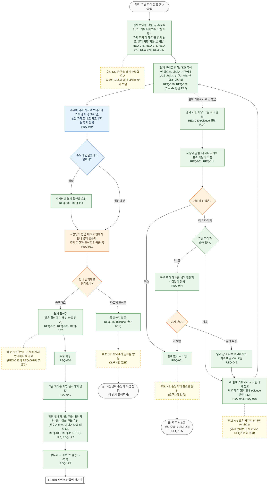

# FL-007 결제하고 주문 확정받기

채우는 요구사항: REQ-040, REQ-041, REQ-043, REQ-044, REQ-045, REQ-060, REQ-061, REQ-075, REQ-076, REQ-077, REQ-078, REQ-079, REQ-080, REQ-081, REQ-082, REQ-083, REQ-087, REQ-108, REQ-114, REQ-119, REQ-120, REQ-122, REQ-125, REQ-132

| 항목 | 내용 |
| --- | --- |
| 행위자 | 손님, 사장님, 우리 서비스 |
| 컨텍스트 | CTX-004 결제·환불, CTX-003 주문, CTX-002 가게 규칙, CTX-008 알림, CTX-009 장부 연결, CTX-005 제작·전달 |
| 시작 | 그날 자리 잡힘(FL-006) |
| 끝 | 주문 확정되어 제작으로 감(FL-010) / 결제 없어 취소됨 / 다르게 들어와 사장님이 손님과 정함 |
| 이어지는 흐름 | FL-010 케이크 만들어 넘기기, FL-013 장부에 저절로 적기 |

## 주 경로

1. 그날 자리가 잡히면 금액·가게 명의 계좌(와 카드 결제 링크)·결제 기한을 담은 결제 안내를 손님에게 전합니다.
2. 손님이 가게로 바로 돈을 냅니다. 우리는 돈을 받지 않습니다.
3. 손님이 입금했다고 말하면 사장님께 결제 확인을 요청합니다. 사장님은 입금 대조 화면에서 안내 금액대로 들어온 것을 확인합니다.
4. 결제가 확인되면 주문을 확정하고, 자리를 픽업 일시까지 남기고, 확정 안내를 한 번 보내고, 장부에 적고, 제작 목록에 올립니다.

## 실패 길

- 사장님이 안내 금액과 다르게 들어왔다고 표시하면 확정하지 않습니다(REQ-082). 손님에게 알릴 요구사항이 없습니다(후보 N2).
- 결제 기한까지 확인되지 않으면 그날 자리를 풀고 사장님이 더 기다리기와 취소 가운데 고릅니다(REQ-040, REQ-061).
- 더 기다리기로 하면 자리가 남을 때 새 결제 기한까지 다시 잡고 안내합니다. 다 찼으면 하루 최대 개수를 넘겨 받을지 묻습니다(REQ-043~REQ-045).
- 취소하면 '결제 없어 취소됨'이 되고 장부 줄을 적거나 고칩니다. 손님에게 알릴 요구사항이 없습니다(후보 N2).

## 읽은 방식 (Claude 판단)

- R12 결제 기한은 결제 안내를 낸 때부터 셉니다(REQ-087). 채널 친구가 아닌 손님은 안내를 다음 대화 때 받으므로, 주문 요청 때 채널 추가를 권합니다(REQ-121).
- R13 REQ-075의 '그날 자리가 잡히면'을 결제 전 주문의 자리(REQ-039, REQ-043)로 읽습니다. 날짜 변경으로 옮긴 자리(REQ-042)와 다시 만들기 자리(REQ-050)에는 결제 안내를 보내지 않고, 차액 결제(REQ-067)는 결제 안내와 같은 모양으로 보냅니다. 04단계에서 상태 기계로 다시 봅니다.
- R14 결제 기한이 지나 자리가 풀린 뒤 입금이 확인되면, 사장님이 먼저 '더 기다리기'로 자리를 다시 잡고(다 찼으면 넘겨 받기) 결제를 확인합니다(REQ-043, REQ-044). 기한 전에 입금했다고 말한 손님의 자리를 지켜 줄지는 04단계에서 다시 봅니다.
- R15 다르게 들어온 결제는 확정하지 않고(REQ-082), 그 뒤(더 받기·돌려주기)는 사장님이 손님과 정합니다. 04단계에서 상태를 정합니다.

## 빈 곳 (새 요구사항 후보)

- N2 (필수, CTX-008) 결제가 다르게 들어왔다는 표시와 결제 없어 취소된 주문을 손님에게 알릴 요구사항이 없습니다. 문장은 README의 후보 표에 있습니다.
- N3 (필수, CTX-004) REQ-083(한 주문에 확인된 결제 하나)이 REQ-067(차액 결제가 확인된 뒤 변경)과 부딪힙니다. REQ-083을 '제외'로 두고 "결제 안내 하나에 확인된 결제 하나"로 바꾸기를 권합니다.
- N4 (필수, CTX-008) 더 기다리기 뒤 새 결제 기한을 알리는 결제 안내가 "같은 주문의 같은 종류 안내는 한 번"(REQ-119)에 걸립니다. REQ-119를 '제외'로 두고 "같은 주문의 같은 사건에 대한 안내는 한 번"으로 바꾸기를 권합니다.
- N5 (권장, CTX-004) 사장님이 금액을 바꿔 수락하면 결제 안내에 요청한 금액과 바뀐 금액을 함께 보이기를 권합니다.
