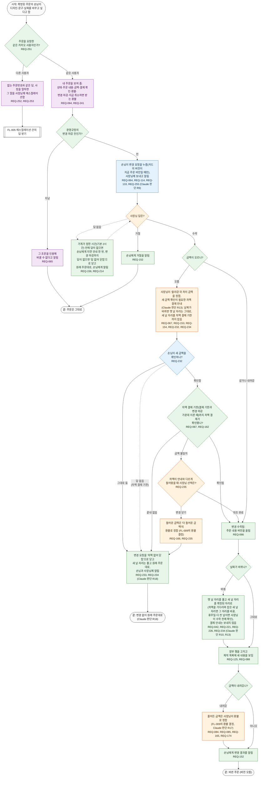

# FL-008 주문 바꾸기

채우는 요구사항: REQ-042, REQ-064, REQ-065, REQ-066, REQ-067, REQ-084, REQ-085, REQ-088, REQ-114, REQ-125, REQ-133, REQ-152, REQ-153, REQ-154, REQ-156, REQ-162, REQ-165, REQ-166, REQ-174, REQ-214, REQ-221, REQ-226, REQ-232, REQ-233, REQ-234, REQ-235, REQ-241, REQ-251, REQ-252, REQ-253, REQ-255

| 항목 | 내용 |
| --- | --- |
| 액터 | 손님, AI 상담, 사장님, 우리 서비스 |
| 컨텍스트 | CTX-003 주문, CTX-002 가게 규칙, CTX-004 결제·환불, CTX-005 제작·전달, CTX-008 알림, CTX-009 장부 연결 |
| 시작 | 확정된 주문의 손님이 디자인·문구·날짜를 바꾸고 싶다고 함 |
| 끝 | 바뀐 주문(버전 오름) / 주문은 그대로 / 에스컬레이션 건(FL-005) |
| 연결 플로우 | FL-010 케이크 제작·인도, FL-013 장부 자동 기록, FL-009의 환불 결정 |

결제가 확인되기 전에 바꾸고 싶으면 이 플로우를 쓰지 않고 주문 요청을 취소한 뒤 다시 요청합니다(R16, FL-009).

## 기본 경로

1. 주문을 요청한 같은 카카오 사용자이면 내 주문(상태·주문 내용·금액·결제 확인·환불·변경 마감·지금 취소하면 받는 환불)을 보여 줍니다(REQ-241).
2. 변경 마감 전이면 손님이 변경 요청을 누르고, 사장님께 보내 알립니다.
3. 사장님이 수락하면(금액은 '그대로·올라감·내려감'과 차이 금액으로 정함), 금액이 오르는 변경은 손님이 새 금액을 확인하고 차액 결제가 확인된 뒤에 반영합니다. 그동안 주문 내용과 버전은 그대로이고, 날짜가 바뀌면 옛 날의 확정된 자리를 그대로 둔 채 새 날 자리를 차액 결제 기한까지 잡습니다.
4. 변경 요청이 본 버전 위에 버전을 올리고, 날짜가 바뀌면 자리를 옮기고, 장부 행과 제작 목록을 고칩니다.

## 예외 경로

- 다른 카카오 사용자가 바꾸려 하면 없는 주문번호와 같은 답을 주고, 사정을 말하면 그 말을 사장님께 에스컬레이션합니다(REQ-252, REQ-253).
- 변경 마감이 지났으면 조문을 인용해 바꿀 수 없다고 알립니다(REQ-065).
- 사장님이 거절하면 주문은 그대로입니다. 손님에게 거절을 알립니다(REQ-152, 버전 2).
- 손님이 새 금액을 받지 않거나 차액 결제가 끝내 확인되지 않으면 변경 요청을 '차액 없어 닫힘'으로 닫고 원래 주문대로 갑니다. 차액을 기다리며 잡은 새 날 자리는 풉니다(REQ-067, REQ-233, REQ-234, R18).
- 차액이 안내 금액과 다르게 들어오면 사장님이 손님과 정한 뒤 '대조 완료'로 반영하거나 변경 요청만 닫고, 닫으면 들어온 금액을 '더 들어온 금액'의 환불로 돌려줍니다(REQ-235).
- 옛 버전을 보고 만든 변경 요청 카드는 누를 때 받지 않습니다(C4, REQ-133). 한 주문에 열린 변경 요청은 하나라 받은 변경 요청이 반영 전에 옛 버전이 되지 않습니다.

## 요구사항 해석 (Claude 판단)

- R16 결제가 확인되기 전(주문 요청·수락 뒤 결제 전)에는 변경 플로우를 쓰지 않고, 주문 요청을 취소한 뒤 다시 요청합니다. 01단계 E 플로우는 주문이 확정된 뒤의 변경입니다.
- R17 금액이 내려가는 변경의 차액은 사장님이 환불로 정합니다(REQ-084~REQ-086, FL-009와 같은 길).
- R18 차액 결제가 확인되지 않으면 변경을 수락하지 않은 채 원래 주문대로 갑니다. 이때 그날 자리를 풀거나(REQ-222, 버전 5에서 REQ-040을 바꿈) 주문을 취소할지 묻지(REQ-061) 않습니다. 차액 결제의 기한은 04단계에서 정합니다.
- R10·R13은 FL-006·FL-007과 같습니다(다 찬 새 날은 사장님이 초과해 받는 것을 확인한 뒤 추가 수락으로 잡고(버전 5, REQ-226), 옮긴 자리에는 결제 안내를 보내지 않음).

## 버전 2에 더한 요구사항 (03단계 확정, 2026-11-12)

- REQ-152 (필수, CTX-008, 후보 N2) 사장님이 변경 요청에 답한 결과(수락·거절)를 손님에게 알립니다.
- REQ-153 (필수, CTX-004, 후보 N3) 차액 결제는 같은 주문의 두 번째 확인된 결제이므로, 확인된 결제는 결제 안내마다 하나로 둡니다(REQ-083 제외, FL-007).
- REQ-154 (필수, CTX-008, 후보 N4) 차액 결제 안내는 같은 주문의 두 번째 결제 안내이므로, 같은 이벤트에 대한 안내만 한 번으로 둡니다(REQ-119 제외, FL-007).
- REQ-156 (권장, CTX-008, 후보 N6) 변경 요청에 사장님 답이 늦으면 손님에게 지연 안내를 한 번 보냅니다(FL-006).

## 확정한 뒤 고친 것

2026-11-13 설계 독립 재검토의 묶음 H1·H2를 동희님 2026-11-13 20:59 결정 카드 '추천안대로 (추천)'에 따라 고쳤습니다. C10의 REQ-086('제외')을 REQ-165(받은 금액을 넓힘)로 바꾸고, 금액이 내려간 변경의 환불을 정할 일 알림(REQ-174)을 더했습니다. 기한이 지난 뒤 들어온 차액은 사장님이 입금 대조에서 남기고 FL-009의 환불 결정으로 갑니다(REQ-166).

같은 결정 카드로 묶음 M1(RB-03, RA-17)과 M3(RB-04, RA-11)도 고쳤습니다. G6: 변경 요청에 변경 마감까지 사장님 답이 없으면 '답 없어 닫힘'으로 닫고 원래 주문대로 두고 손님에게 한 번 알립니다(REQ-214). C8: 새 날이 휴무일이거나 다 찼으면 사장님이 수락하기 전에 휴무일임이나 초과해 받는 것을 확인받습니다(REQ-221, REQ-226).

같은 결정 카드의 '모두 지금 고침 (추천)'대로 묶음 M5(RB-07, RA-08, RE-17)도 고쳤습니다. C5: 사장님은 '올라감'과 차이 금액(양수)을 정하고, 날짜가 바뀌면 옛 날의 확정된 자리를 그대로 둔 채 새 날 자리를 차액 결제 기한까지 잡습니다(REQ-234). 새 D8·C11: 손님이 새 금액을 확인해야 차액 결제로 가고(REQ-232), 그대로 두거나 답이 없으면 '차액 없어 닫힘'으로 닫고 새 날 자리를 풉니다(REQ-233). 새 D9·C12: 차액이 다르게 들어오면 사장님이 '대조 완료'로 반영하거나 변경 요청만 닫고, 들어온 금액은 '더 들어온 금액'의 환불로 돌려줍니다(REQ-235). C8은 잡아 둔 새 날 자리를 확정된 자리로 바꿉니다. D5·E2(옛 버전을 보고 만든 변경)는 지웠습니다: 한 주문에 열린 변경 요청은 하나이고 버전은 변경 반영으로만 올라 닿을 수 없는 길이었고, REQ-133은 C4의 카드 확인으로 옮겼습니다.

2026-11-14 설계 독립 재검토의 묶음 M11(RA-05)·M14(RB-12)를 동희님 2026-11-13 20:59 결정 카드 '모두 지금 고침 (추천)'에 따라 고쳤습니다(02단계 11절, 버전 5). C2의 내 주문에 주문 내용·금액·결제 확인·환불을 더해 손님이 상담에서 주문 기록을 보게 했습니다(REQ-241, 전자상거래법 제6조①, 잠정, 5-2 질문 7).

설계 재검토 M12(RB-15)를 같은 결정 카드의 '모두 지금 고침 (추천)'대로 고쳤습니다(Claude 추천, 동희님 확인 요청. 2026-11-15 14:19 동희님 결정 카드 '지금대로 둠 (추천)'으로 확정). D0을 REQ-251로, C1을 '없는 주문번호와 같은 답, 사정을 말하면 에스컬레이션'(REQ-252, REQ-253)으로 바꿨습니다(REQ-062·REQ-063 제외).

2026-11-15 설계 독립 재검토의 묶음 M8(RB-10)을 동희님 2026-11-13 20:59 결정 카드 '모두 지금 고침 (추천)'에 따라 고쳤습니다. 버전 3~5 요구사항을 04단계 SPEC으로만 잇지 않고 다이어그램에 넣었습니다(03단계 README 2절·8절).

| 노드 | 바뀐 동작 | 요구사항·SPEC |
| --- | --- | --- |
| D4 | 차액 결제 기한은 결제 기한과 변경 마감 가운데 이른 때이고, 그때까지 확인되지 않으면 '끝내 없음'으로 원래 주문대로 | REQ-162(버전 3), SPEC-043, SPEC-044 |

<!-- 07-sitemap:start · '화면'·'화면 없음 사유' 열이 원본, 나머지 열은 build_sitemap.py가 생성 -->
## 화면 (07단계)

노드마다 그 시점에 사람이 보는 화면을 적었습니다. 화면이 없으면 사유를 적었습니다(분기·서버 처리·외부·종료, 정의는 `docs/07-sitemap/README.md` 3절). 다른 플로우로 연결되는 노드는 해당 플로우의 표에 있습니다. 화면 목록은 `docs/07-sitemap/sitemap.yaml`.

| 노드 | 내용 | 화면 | 화면 없음 사유 |
| --- | --- | --- | --- |
| S | 시작: 확정된 주문의 손님이 디자인·문구·날짜를 바꾸고 싶다고 함 | SCR-003 가게 채널 상담 |  |
| D0 | 주문을 요청한 같은 카카오 사용자인가? |  | 분기 |
| C1 | 없는 주문번호와 같은 답, 사정을 말하면 그 말을 사장님께 에스컬레이션함 | SCR-003 가게 채널 상담 |  |
| C2 | 내 주문을 보여 줌: 상태·주문 내용·금액·결제 확인·환불· 변경 마감·지금 취소하면 받는 환불 | SCR-007 내 주문 보기 |  |
| D1 | 운영규정의 변경 마감 전인가? |  | 분기 |
| C3 | 그 조문을 인용해 바꿀 수 없다고 알림 | SCR-003 가게 채널 상담 |  |
| E0 | 끝: 주문은 그대로 |  | 종료 |
| C4 | 손님이 변경 요청을 누름(카드의 버전이 지금 주문 버전일 때만), 사장님께 보내고 알림 | SCR-008 변경 요청 카드, SCR-019 사장님 알림, SCR-016 할 일 목록 |  |
| D2 | 사장님 답은? | SCR-024 변경 요청 |  |
| G6 | 가게가 정한 시간(기본 2시간) 안에 답이 없으면 손님에게 지연 안내 한 번, 변경 마감까지 답이 없으면 '답 없어 닫힘'으로 닫고 원래 주문대로, 손님에게 알림 | SCR-011 손님 알림 |  |
| G2a | 손님에게 거절을 알림 | SCR-011 손님 알림 |  |
| D3 | 금액이 오르나? |  | 분기 |
| C5 | 사장님이 '올라감'과 차이 금액을 정함, 새 금액 확인이 필요한 차액 결제 안내 . 날짜가 바뀌면 옛 날 자리는 그대로, 새 날 자리를 차액 결제 기한까지 잡음 | SCR-024 변경 요청, SCR-005 결제 안내 |  |
| D4 | 차액 결제 기한(결제 기한과 변경 마감 가운데 이른 때)까지 차액 결제가 확인됐나? |  | 분기 |
| E1 | 끝: 변경 없이 원래 주문대로 |  | 종료 |
| D8 | 손님이 새 금액을 확인하나? | SCR-005 결제 안내 |  |
| C11 | 변경 요청을 '차액 없어 닫힘'으로 닫고 새 날 자리는 풀고 원래 주문대로, 손님과 사장님께 알림 | SCR-011 손님 알림, SCR-019 사장님 알림 |  |
| D9 | 차액이 안내와 다르게 들어왔을 때 사장님 선택은? | SCR-029 입금 대조 |  |
| C12 | 들어온 금액은 '더 들어온 금액'의 환불로 정함 (FL-009의 환불 결정) | SCR-025 환불 결정 |  |
| C7 | 변경 수락됨: 주문 내용 버전을 올림 | SCR-024 변경 요청 |  |
| D6 | 날짜가 바뀌나? |  | 분기 |
| C8 | 옛 날 자리를 풀고 새 날 자리를 확정된 자리로 (차액을 기다리며 잡은 새 날 자리면 그 자리를 바꿈, 휴무일·다 찬 날이면 사장님이 수락 전에 확인), 결제 안내는 보내지 않음 |  | 서버 처리 |
| C9 | 장부 행을 고치고 제작 목록에 새 내용을 보임 | SCR-030 제작 목록 |  |
| D7 | 금액이 내려갔나? |  | 분기 |
| C10 | 줄어든 금액은 사장님이 환불로 정함 (FL-009의 환불 결정, Claude 판단 R17) | SCR-025 환불 결정 |  |
| G2b | 손님에게 변경 결과를 알림 | SCR-011 손님 알림 |  |
| E3 | 끝: 바뀐 주문 (버전 오름) |  | 종료 |
<!-- 07-sitemap:end -->
