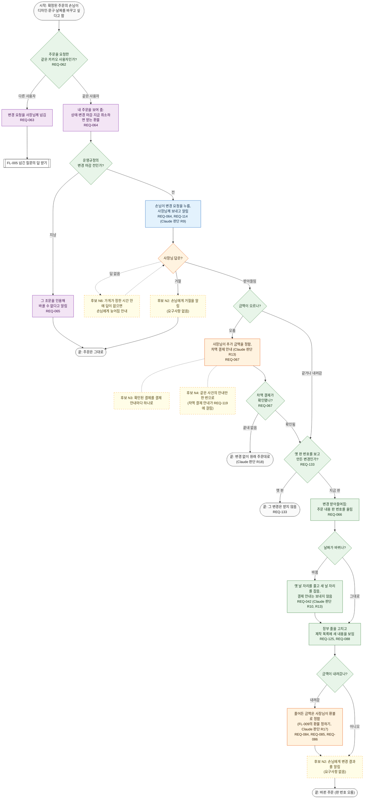

# FL-008 주문 바꾸기

채우는 요구사항: REQ-042, REQ-062, REQ-063, REQ-064, REQ-065, REQ-066, REQ-067, REQ-084, REQ-085, REQ-086, REQ-088, REQ-114, REQ-125, REQ-133

| 항목 | 내용 |
| --- | --- |
| 행위자 | 손님, AI 상담, 사장님, 우리 서비스 |
| 컨텍스트 | CTX-003 주문, CTX-002 가게 규칙, CTX-004 결제·환불, CTX-005 제작·전달, CTX-008 알림, CTX-009 장부 연결 |
| 시작 | 확정된 주문의 손님이 디자인·문구·날짜를 바꾸고 싶다고 함 |
| 끝 | 바뀐 주문(판 번호 오름) / 주문은 그대로 / 넘긴 질문(FL-005) |
| 이어지는 흐름 | FL-010 케이크 만들어 넘기기, FL-013 장부에 저절로 적기, FL-009의 환불 정하기 |

결제가 확인되기 전에 바꾸고 싶으면 이 흐름을 쓰지 않고 주문 요청을 취소한 뒤 다시 요청합니다(R16, FL-009).

## 주 경로

1. 주문을 요청한 같은 카카오 사용자이면 내 주문(상태·변경 마감·지금 취소하면 받는 환불)을 보여 줍니다.
2. 변경 마감 전이면 손님이 변경 요청을 누르고, 사장님께 보내 알립니다.
3. 사장님이 받아들이면, 금액이 오르는 변경은 차액 결제가 확인된 뒤에 받아들입니다.
4. 옛 판 번호를 보고 만든 늦은 변경이 아니면 판 번호를 올리고, 날짜가 바뀌면 자리를 옮기고, 장부 줄과 제작 목록을 고칩니다.

## 실패 길

- 다른 카카오 사용자가 바꾸려 하면 사장님께 넘깁니다(REQ-063).
- 변경 마감이 지났으면 조문을 인용해 바꿀 수 없다고 알립니다(REQ-065).
- 사장님이 거절하면 주문은 그대로입니다. 손님에게 알릴 요구사항이 없습니다(후보 N2).
- 차액 결제가 끝내 확인되지 않으면 변경 없이 원래 주문대로 갑니다(REQ-067, R18).
- 옛 판 번호를 보고 만든 변경이 늦게 오면 받지 않습니다(REQ-133).

## 읽은 방식 (Claude 판단)

- R16 결제가 확인되기 전(주문 요청·수락 뒤 결제 전)에는 변경 흐름을 쓰지 않고, 주문 요청을 취소한 뒤 다시 요청합니다. 01단계 E 흐름은 주문이 확정된 뒤의 변경입니다.
- R17 금액이 내려가는 변경의 차액은 사장님이 환불로 정합니다(REQ-084~REQ-086, FL-009와 같은 길).
- R18 차액 결제가 확인되지 않으면 변경을 받아들이지 않은 채 원래 주문대로 갑니다. 이때 그날 자리를 풀거나(REQ-040) 주문을 취소할지 묻지(REQ-061) 않습니다. 차액 결제의 기한은 04단계에서 정합니다.
- R10·R13은 FL-006·FL-007과 같습니다(다 찬 새 날은 사장님이 받아 준 것으로 보고, 옮긴 자리에는 결제 안내를 보내지 않음).

## 빈 곳 (새 요구사항 후보)

- N2 (필수, CTX-008) 사장님이 변경 요청에 답한 결과(받아들임·거절)를 손님에게 알릴 요구사항이 없습니다.
- N3 (필수, CTX-004) 차액 결제는 같은 주문의 두 번째 확인된 결제라 REQ-083과 부딪힙니다(FL-007).
- N4 (필수, CTX-008) 차액 결제 안내는 같은 주문의 두 번째 결제 안내라 "같은 주문의 같은 종류 안내는 한 번"(REQ-119)에 걸립니다(FL-007).
- N6 (권장, CTX-008) 변경 요청에 사장님 답이 늦을 때 손님에게 알릴 요구사항이 없습니다(FL-006).
