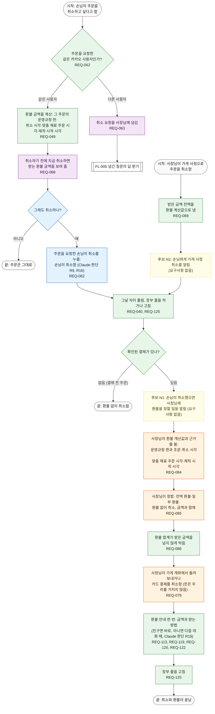

# FL-009 주문 취소하고 환불받기

채우는 요구사항: REQ-040, REQ-049, REQ-062, REQ-063, REQ-068, REQ-069, REQ-079, REQ-084, REQ-085, REQ-086, REQ-113, REQ-119, REQ-120, REQ-122, REQ-125

| 항목 | 내용 |
| --- | --- |
| 행위자 | 손님, AI 상담, 사장님, 우리 서비스 |
| 컨텍스트 | CTX-003 주문, CTX-004 결제·환불, CTX-002 가게 규칙, CTX-008 알림, CTX-009 장부 연결 |
| 시작 | 손님이 주문을 취소하고 싶다고 함 / 사장님이 가게 사정으로 취소함 |
| 끝 | 취소와 환불이 끝남 / 환불 없이 취소됨 / 주문은 그대로 / 넘긴 질문(FL-005) |
| 이어지는 흐름 | FL-013 장부에 저절로 적기 |

## 주 경로

1. 주문을 요청한 같은 카카오 사용자가 취소하려 하면, 그 주문의 운영규정 판과 시각들로 환불 금액을 계산해 취소하기 전에 보여 줍니다.
2. 손님이 그래도 취소하면 그날 자리를 풀고 장부 줄을 고칩니다. 가게 사정 취소는 받은 금액 전액을 환불 계산값으로 냅니다.
3. 확인된 결제가 있으면 사장님이 계산값과 근거를 보고 환불을 정합니다. 환불 합계는 받은 금액을 넘지 않습니다.
4. 사장님이 가게 계좌에서 돌려보내거나 카드 결제를 취소하고, 손님에게 환불 금액과 받는 방법을 한 번 알립니다.

## 실패 길

- 다른 카카오 사용자가 취소하려 하면 사장님께 넘깁니다(REQ-063).
- 환불 금액을 보고 손님이 취소하지 않으면 주문은 그대로입니다(REQ-068).
- 결제 전 주문이면 환불 없이 취소됩니다.
- 손님이 결제가 확인된 주문을 취소해도 사장님께 환불을 정할 일을 알릴 요구사항이 없습니다. REQ-114의 '사장님이 정할 일'에 취소·환불이 없습니다(후보 N1).
- 가게 사정으로 취소한 것을 손님에게 알릴 요구사항은 환불이 있을 때의 환불 안내(REQ-113)뿐입니다(후보 N2).

## 읽은 방식 (Claude 판단)

- R16 결제가 확인되기 전에 바꾸고 싶은 손님도 이 흐름으로 주문 요청을 취소한 뒤 다시 요청합니다(FL-008).
- R19 계좌로 돌려받을 때 손님 계좌가 필요하면 상담에서 묻고, AI 모델에는 가려서 보내고 원래 값은 그 가게 사장님 화면에만 보입니다(REQ-113, REQ-136, REQ-137).

## 빈 곳 (새 요구사항 후보)

- N1 (필수, CTX-008) 손님이 결제가 확인된 주문을 취소하면, 시스템은 사장님께 환불을 정할 일을 알려야 한다.
- N2 (필수, CTX-008) 가게 사정 취소를 손님에게 알릴 요구사항이 없습니다(FL-007).
