# FL-009 주문 취소하고 환불받기

채우는 요구사항: REQ-049, REQ-068, REQ-069, REQ-079, REQ-084, REQ-085, REQ-113, REQ-120, REQ-122, REQ-125, REQ-152, REQ-154, REQ-165, REQ-166, REQ-167, REQ-168, REQ-170, REQ-171, REQ-172, REQ-173, REQ-215, REQ-222, REQ-251, REQ-252, REQ-253, REQ-255

| 항목 | 내용 |
| --- | --- |
| 액터 | 손님, AI 상담, 사장님, 우리 서비스 |
| 컨텍스트 | CTX-003 주문, CTX-004 결제·환불, CTX-002 가게 규칙, CTX-008 알림, CTX-009 장부 연결 |
| 시작 | 손님이 주문을 취소하고 싶다고 함 / 사장님이 가게 사정으로 취소함 / 취소된 주문이나 닫힌 결제 안내에 들어온 입금이 있음 |
| 끝 | 취소와 환불이 완료됨 / 환불 없이 취소됨 / 환불 없이 닫힘 / 주문은 그대로 / 에스컬레이션 건(FL-005) |
| 연결 플로우 | FL-013 장부 자동 기록 |

```mermaid
flowchart TD
  S1(["시작: 손님이 주문을<br/>취소하고 싶다고 함"])
  S2(["시작: 사장님이 가게 사정으로<br/>주문을 취소함"])
  S3(["시작: 취소된 주문이나 닫힌<br/>결제 안내에 들어온 입금이 있음"])
  D0{"주문을 요청한<br/>같은 카카오 사용자인가?<br/>REQ-251"}
  X1["없는 주문번호와 같은 답, 사정을 말하면<br/>그 말을 사장님께 에스컬레이션함<br/>REQ-252, REQ-253"]
  F5[["FL-005 에스컬레이션 건의 답 받기"]]
  X2["환불 금액을 계산: 그 주문의 운영규정 버전·<br/>취소 시각·맞춤 재료 주문 시각·제작 시작 시각<br/>REQ-049"]
  X3["취소하기 전에 지금 취소하면<br/>받는 환불 금액을 보여 줌<br/>REQ-068"]
  D1{"그래도 취소하나?"}
  E0(["끝: 주문은 그대로"])
  X4["주문을 요청한 손님이 취소를 누름:<br/>손님이 취소함 (Claude 판단 R9, R16)<br/>REQ-251, REQ-255"]
  X5["받은 금액 전액을<br/>환불 계산값으로 냄<br/>REQ-069"]
  G2["손님에게 가게 사정 취소를 알림<br/>REQ-152"]
  X6["가예약 해제됨, 장부 행을 적거나 고침<br/>REQ-222, REQ-125"]
  D2{"받은 금액이 있나?<br/>(확인된 결제와 사장님이<br/>들어왔다고 표시한 금액)<br/>REQ-165"}
  D3{"결제 확인 요청 중이었나?"}
  E1(["끝: 환불 없이 취소됨"])
  G3["사장님께 들어온 입금이 있는지<br/>확인할 일을 알림<br/>REQ-167"]
  D4{"사장님이 입금 대조에서<br/>들어온 입금을 찾았나?"}
  X16["사장님이 들어온 금액을 남김:<br/>받은 금액에 넣고 환불을 정할 일을 알림<br/>REQ-166"]
  G1["손님이 취소했으면 사장님께<br/>환불을 정할 일을 알림<br/>REQ-168"]
  X7["사장님이 환불 계산값과 근거를 봄:<br/>운영규정 버전과 조문·취소 시각·<br/>맞춤 재료 주문 시각·제작 시작 시각.<br/>가게가 정한 시간 안에 정하지 않으면<br/>다시 알림과 지연 안내 한 번<br/>REQ-084, REQ-215"]
  X8["사장님이 정함: 전액 환불·일부 환불·<br/>환불 없이 취소, 금액과 함께.<br/>보상이 아니면 환불 계산값보다 낮게 정하지 못함<br/>REQ-085, REQ-170"]
  X9["환불 합계가 받은 금액을<br/>넘지 않게 막음<br/>REQ-165"]
  X11["환불 안내 한 번: 금액과 받는 방법<br/>(친구면 바로, 아니면 다음 대화 때, Claude 판단 R19)<br/>REQ-113, REQ-154, REQ-120, REQ-122"]
  X12["장부 행을 고침<br/>REQ-125"]
  D5{"돌려줄 금액이 있나?"}
  E3(["끝: 환불 없이 닫힘"])
  X14["할 일 '환불 보내기'를 남기고,<br/>정한 뒤 24시간이 지나도 보내지 않았으면<br/>사장님께 한 번 다시 알림<br/>REQ-173"]
  X13["손님 계좌를 모르면 상담에서<br/>환불받을 계좌를 물어 그 환불에 남김<br/>REQ-171"]
  X10["사장님이 가게 계좌에서 반환하거나<br/>카드 결제를 취소하고 '보냄'을 표시함<br/>(돈은 우리를 거치지 않음)<br/>REQ-079, REQ-172"]
  X15["보낸 방법과 시각을 남기고 손님에게<br/>보냈다고 한 번 알리고 장부 행을 고침<br/>REQ-172, REQ-125"]
  E2(["끝: 취소와 환불이 완료됨"])

  S1 --> D0
  D0 -->|"다른 사용자"| X1 --> F5
  D0 -->|"같은 사용자"| X2 --> X3 --> D1
  D1 -->|"아니오"| E0
  D1 -->|"예"| X4 --> X6
  S2 --> X5 --> G2 --> X6
  X6 --> D2
  D2 -->|"없음"| D3
  D3 -->|"아니오 (결제 전 주문)"| E1
  D3 -->|"예"| G3 --> D4
  D4 -->|"안 들어옴 (미입금)"| E1
  D4 -->|"들어옴"| X16
  S3 --> X16 --> X7
  D2 -->|"있음"| G1 --> X7 --> X8 --> X9 --> X11 --> X12 --> D5
  D5 -->|"없음 (환불 없이 취소)"| E3
  D5 -->|"있음"| X14 --> X13 --> X10 --> X15 --> E2

  classDef cust fill:#e3f2fd,stroke:#1565c0,color:#0d2a4a
  classDef ai fill:#f3e5f5,stroke:#7b1fa2,color:#3b0a4a
  classDef owner fill:#fff3e0,stroke:#e65100,color:#3e2000
  classDef svc fill:#e8f5e9,stroke:#2e7d32,color:#0f3313
  classDef gap fill:#fffde7,stroke:#f9a825,stroke-dasharray:5 5,color:#4a3b00
  classDef flow fill:#ffffff,stroke:#424242,color:#212121
  classDef term fill:#fafafa,stroke:#757575,color:#212121
  class D1,X4 cust
  class X1,X3,X13 ai
  class X7,X8,X10,D4,X16 owner
  class D0,X2,X5,X6,D2,D3,X9,X11,X12,D5,X14,X15 svc
  class G1,G2,G3 svc
  class F5 flow
  class S1,S2,S3,E0,E1,E2,E3 term
```

## 기본 경로

1. 주문을 요청한 같은 카카오 사용자가 취소하려 하면, 그 주문의 운영규정 버전과 시각들로 환불 금액을 계산해 취소하기 전에 보여 줍니다.
2. 손님이 그래도 취소하면 그날 자리를 풀고 장부 행을 고칩니다. 가게 사정 취소는 받은 금액 전액을 환불 계산값으로 냅니다.
3. 받은 금액(확인된 결제와 사장님이 들어왔다고 표시한 금액의 합)이 있으면 사장님이 계산값과 근거를 보고 환불을 정합니다. 보상이 아니면 계산값보다 낮게 정하지 못하고, 환불 합계는 받은 금액을 넘지 않습니다.
4. 돌려줄 금액이 있으면 할 일 '환불 보내기'가 남습니다. 손님 계좌를 모르면 상담에서 묻습니다. 사장님이 가게 계좌에서 반환하거나 카드 결제를 취소하고 '보냄'을 표시하면, 손님에게 보냈다고 한 번 알리고 장부 행을 고칩니다.

## 예외 경로

- 다른 카카오 사용자가 취소하려 하면 없는 주문번호와 같은 답을 주고, 사정을 말하면 그 말을 사장님께 에스컬레이션합니다(REQ-252, REQ-253).
- 환불 금액을 보고 손님이 취소하지 않으면 주문은 그대로입니다(REQ-068).
- 결제 전 주문이면 환불 없이 취소됩니다.
- 결제 확인 요청 중에 손님이 취소하면 사장님께 들어온 입금이 있는지 확인할 일을 알립니다(REQ-167). 사장님이 입금 대조에서 들어온 금액을 남기면 환불 결정으로 가고(REQ-166), '미입금'이면 환불 없이 끝납니다.
- 취소된 주문이나 닫힌 결제 안내에 나중에 들어온 입금이 있으면, 사장님이 입금 대조에서 그 금액을 남기고 환불을 정합니다(REQ-166).
- 손님이 받은 금액이 있는 주문을 취소하면 사장님께 환불을 정할 일을 알립니다(REQ-168, 버전 5에서 REQ-151을 바꿈).
- 가게 사정으로 취소하면 손님에게 취소를 알립니다(REQ-152, 버전 2). 환불이 있으면 환불 안내(REQ-113)도 보냅니다.
- 돌려줄 금액이 없게 정하면(환불 없이 취소) 환불 송금 없이 닫고 손님에게 알립니다.
- 정한 뒤 24시간이 지나도 '보냄'이 없으면 사장님께 한 번 다시 알립니다(REQ-173).

## 요구사항 해석 (Claude 판단)

- R16 결제가 확인되기 전에 바꾸고 싶은 손님도 이 플로우로 주문 요청을 취소한 뒤 다시 요청합니다(FL-008).
- R19 계좌로 돌려받을 때 손님 계좌가 필요하면 상담에서 묻고, AI 모델에는 마스킹해서 보내고 원래 값은 그 가게 사장님 화면에만 보입니다(REQ-113, REQ-136, REQ-137). 버전 5부터 원래 값은 암호화해 두고, 사유를 적은 운영자도 열 수 있습니다(REQ-137을 바꾼 REQ-193, REQ-191).

## 버전 2에 더한 요구사항 (03단계 확정, 2026-11-12)

- REQ-151 (필수, CTX-008, 후보 N1) 손님이 결제가 확인된 주문을 취소하면, 시스템은 사장님께 환불을 정할 일을 알려야 한다. 버전 5에서 '제외'로 두고 REQ-168로 바꿨습니다(아래).
- REQ-152 (필수, CTX-008, 후보 N2) 가게 사정 취소를 손님에게 알립니다(FL-007).

## 확정한 뒤 고친 것

2026-11-13 설계 독립 재검토의 묶음 H1(RB-01, RC-05, RD-02, RA-15)과 H2(RA-01, RE-02, RE-03, RE-04)를 동희님 2026-11-13 20:59 결정 카드 '추천안대로 (추천)'에 따라 고쳤습니다. 요구사항 버전 5(requirements.md 11절)를 다이어그램에 넣었습니다.

- 받은 금액을 확인된 결제와 사장님이 들어왔다고 표시한 금액의 합으로 넓힘: D2, X9(REQ-086 → REQ-165).
- 결제 확인 요청 중 취소(D3, G3, D4)와 취소된 주문이나 닫힌 결제 안내에 들어온 입금(S3, X16)을 환불 결정으로 이음: REQ-166, REQ-167.
- 환불을 정할 일 알림을 받은 금액이 있는 주문으로 넓힘: G1(REQ-151 → REQ-168).
- 환불 계산값보다 낮게 정하지 못함: X8(REQ-170).
- 정한 뒤: 돌려줄 금액이 없으면 송금 없이 닫음(D5, E3). 있으면 할 일 '환불 보내기'와 24시간 뒤 다시 알림(X14, REQ-173), 손님 계좌 묻기(X13, REQ-171), '보냄' 표시와 보냄 안내·장부(X10, X15, REQ-172).

같은 결정 카드로 묶음 M1(RB-03)과 M3(RA-04)도 고쳤습니다. X7: 환불 결정에도 가게가 정한 시간(기본 2시간) 안에 사장님이 정하지 않으면 다시 알림과 손님 지연 안내를 한 번씩 보냅니다(REQ-215). X6의 자리 풀기는 REQ-040을 '제외'로 두고 REQ-222로 잇습니다.

설계 재검토 M12(RB-15)를 같은 결정 카드의 '모두 지금 고침 (추천)'대로 고쳤습니다(Claude 추천, 동희님 확인 요청. 2026-11-15 14:19 동희님 결정 카드 '지금대로 둠 (추천)'으로 확정함). D0·X4를 REQ-251로, X1을 '없는 주문번호와 같은 답, 사정을 말하면 에스컬레이션'(REQ-252, REQ-253)으로 바꿨습니다(REQ-062·REQ-063 제외).

<!-- 07-sitemap:start · '화면'·'화면 없음 사유' 열이 원본, 나머지 열은 build_sitemap.py가 생성 -->
## 화면 (07단계)

노드마다 그 시점에 사람이 보는 화면을 적었습니다. 화면이 없으면 사유를 적었습니다(분기·서버 처리·외부·종료, 정의는 `docs/07-sitemap/README.md` 3절). 다른 플로우로 연결되는 노드는 해당 플로우의 표에 있습니다. 화면 목록은 `docs/07-sitemap/sitemap.yaml`.

| 노드 | 내용 | 화면 | 화면 없음 사유 |
| --- | --- | --- | --- |
| S1 | 시작: 손님이 주문을 취소하고 싶다고 함 | SCR-003 가게 채널 상담 |  |
| S2 | 시작: 사장님이 가게 사정으로 주문을 취소함 | SCR-021 주문 상세 |  |
| S3 | 시작: 취소된 주문이나 닫힌 결제 안내에 들어온 입금이 있음 |  | 외부 |
| D0 | 주문을 요청한 같은 카카오 사용자인가? |  | 분기 |
| X1 | 없는 주문번호와 같은 답, 사정을 말하면 그 말을 사장님께 에스컬레이션함 | SCR-003 가게 채널 상담 |  |
| X2 | 환불 금액을 계산: 그 주문의 운영규정 버전· 취소 시각·맞춤 재료 주문 시각·제작 시작 시각 |  | 서버 처리 |
| X3 | 취소하기 전에 지금 취소하면 받는 환불 금액을 보여 줌 | SCR-009 취소 카드 |  |
| D1 | 그래도 취소하나? | SCR-009 취소 카드 |  |
| E0 | 끝: 주문은 그대로 |  | 종료 |
| X4 | 주문을 요청한 손님이 취소를 누름: 손님이 취소함 | SCR-009 취소 카드 |  |
| X5 | 받은 금액 전액을 환불 계산값으로 냄 | SCR-021 주문 상세 |  |
| G2 | 손님에게 가게 사정 취소를 알림 | SCR-011 손님 알림 |  |
| X6 | 가예약 해제됨, 장부 행을 적거나 고침 |  | 서버 처리 |
| D2 | 받은 금액이 있나? (확인된 결제와 사장님이 들어왔다고 표시한 금액) |  | 분기 |
| D3 | 결제 확인 요청 중이었나? |  | 분기 |
| E1 | 끝: 환불 없이 취소됨 |  | 종료 |
| G3 | 사장님께 들어온 입금이 있는지 확인할 일을 알림 | SCR-019 사장님 알림, SCR-016 할 일 목록 |  |
| D4 | 사장님이 입금 대조에서 들어온 입금을 찾았나? | SCR-029 입금 대조 |  |
| X16 | 사장님이 들어온 금액을 남김: 받은 금액에 넣고 환불을 정할 일을 알림 | SCR-029 입금 대조 |  |
| G1 | 손님이 취소했으면 사장님께 환불을 정할 일을 알림 | SCR-019 사장님 알림, SCR-016 할 일 목록 |  |
| X7 | 사장님이 환불 계산값과 근거를 봄: 운영규정 버전과 조문·취소 시각· 맞춤 재료 주문 시각·제작 시작 시각. 가게가 정한 시간 안에 정하지 않으면 다시 알림과 지연 안내 한 번 | SCR-025 환불 결정 |  |
| X8 | 사장님이 정함: 전액 환불·일부 환불· 환불 없이 취소, 금액과 함께. 보상이 아니면 환불 계산값보다 낮게 정하지 못함 | SCR-025 환불 결정 |  |
| X9 | 환불 합계가 받은 금액을 넘지 않게 막음 | SCR-025 환불 결정 |  |
| X11 | 환불 안내 한 번: 금액과 받는 방법 (친구면 바로, 아니면 다음 대화 때, Claude 판단 R19) | SCR-011 손님 알림 |  |
| X12 | 장부 행을 고침 |  | 외부 |
| D5 | 돌려줄 금액이 있나? |  | 분기 |
| E3 | 끝: 환불 없이 닫힘 |  | 종료 |
| X14 | 할 일 '환불 보내기'를 남기고, 정한 뒤 24시간이 지나도 보내지 않았으면 사장님께 한 번 다시 알림 | SCR-016 할 일 목록, SCR-019 사장님 알림 |  |
| X13 | 손님 계좌를 모르면 상담에서 환불받을 계좌를 물어 그 환불에 남김 | SCR-003 가게 채널 상담, SCR-026 환불 송금 |  |
| X10 | 사장님이 가게 계좌에서 반환하거나 카드 결제를 취소하고 '보냄'을 표시함 (돈은 우리를 거치지 않음) | SCR-026 환불 송금 |  |
| X15 | 보낸 방법과 시각을 남기고 손님에게 보냈다고 한 번 알리고 장부 행을 고침 | SCR-011 손님 알림 |  |
| E2 | 끝: 취소와 환불이 완료됨 |  | 종료 |
<!-- 07-sitemap:end -->
