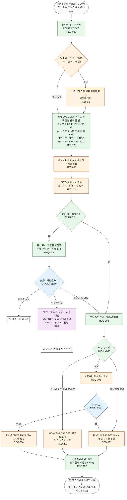

# FL-010 케이크 만들어 넘기기

채우는 요구사항: REQ-071, REQ-088, REQ-089, REQ-090, REQ-091, REQ-092, REQ-093, REQ-094, REQ-109, REQ-111, REQ-120, REQ-122, REQ-123, REQ-124, REQ-154, REQ-157

| 항목 | 내용 |
| --- | --- |
| 행위자 | 사장님, 손님, 우리 서비스 |
| 컨텍스트 | CTX-005 제작·전달, CTX-008 알림, CTX-003 주문 |
| 시작 | 주문 확정됨(FL-007) / 다시 만들기 주문(FL-011) |
| 끝 | 넘겼거나 미수령으로 닫힘, 받은 주문은 다음 날 후기 부탁(FL-012) |
| 이어지는 흐름 | FL-012 후기 남기고 사진 게시 정하기, FL-008 주문 바꾸기, FL-005 넘긴 질문의 답 받기 |

## 주 경로

1. 확정 주문만 날짜별 제작 목록에 오릅니다. 맞춤 재료가 필요하면 사장님이 주문을 표시해 시각을 남깁니다.
2. 픽업 전날 가게가 정한 시각에 전날 안내를 한 번 보냅니다.
3. 사장님이 제작 시작과 완성을 표시합니다. 완성 사진 보내기를 켠 가게는 완성 사진을 픽업 전에 손님에게 보냅니다.
4. 사장님은 오늘 픽업 목록을 보고 매장에서 넘기거나 손님이 부른 퀵에 넘기고, 넘긴 시각을 남깁니다.

## 실패 길

- 손님이 완성 사진을 보고 바꾸고 싶다고 하면 FL-008(변경 마감 규칙)로, 주문과 다르다고 하면 받기 전 문제라 넘긴 질문으로 갑니다(REQ-071, R20).
- 픽업 일시에 손님이 오지 않으면 사장님이 미수령을 표시하고, 끝내 오지 않으면 폐기를 표시합니다(REQ-093, REQ-094).
- 넘긴 결과와 미수령도 장부의 그 주문 줄에 적습니다(REQ-157, 2판).

## 읽은 방식 (Claude 판단)

- R20 완성 사진을 본 손님이 바꾸고 싶다고 하면 변경 요청(FL-008)으로, 주문과 다르다고 하면 받기 전 문제이므로 넘긴 질문(REQ-071)으로 받습니다.

## 2판에 더한 요구사항 (03단계 확정, 2026-11-12)

- REQ-157 (권장, CTX-009, 후보 N7) 케이크를 넘기거나 미수령이 표시되면, 시스템은 장부의 그 주문 줄에 그 결과를 적어야 한다. 1판은 주문이 확정·변경·취소되거나 환불이 정해질 때만 장부에 적었습니다(REQ-125). 01단계에서 가게들의 장부에 '작업 상태' 칸이 있었습니다(TERM-050 근거).

<!-- 07-sitemap:start · '화면'·'화면이 없는 까닭' 칸이 원본, 나머지는 build_sitemap.py가 그림 -->
## 화면 (07단계)

상자마다 그 순간 사람이 보는 화면을 적었습니다. 화면이 없으면 까닭을 적었습니다(가름·안에서·밖에서·흐름 끝, 뜻은 `docs/07-sitemap/README.md` 3절). 다른 흐름으로 잇는 상자는 그 흐름의 표에 있습니다. 화면 목록은 `docs/07-sitemap/sitemap.yaml`.

| 상자 | 내용 | 화면 | 화면이 없는 까닭 |
| --- | --- | --- | --- |
| S | 시작: 주문 확정됨 (FL-007) 또는 다시 만들기 주문 (FL-011) |  | 안에서 |
| M1 | 날짜별 제작 목록에 확정 주문만 올림 | SCR-030 제작 목록 |  |
| D1 | 맞춤 재료가 필요한가? (포토·문구 토퍼 등) | SCR-030 제작 목록 |  |
| M2 | 사장님이 맞춤 재료 주문을 표시, 시각을 남김 | SCR-030 제작 목록 |  |
| M3 | 픽업 전날 가게가 정한 시각에 전날 안내 한 번, 광고 없이 08:00~20:50 사이에 (친구면 바로, 아니면 다음 대화 때) | SCR-011 손님에게 가는 알림 |  |
| M4 | 사장님이 제작 시작을 표시, 시각을 남김 | SCR-030 제작 목록 |  |
| M5 | 사장님이 완성을 표시 (완성 사진을 올릴 수 있음) | SCR-030 제작 목록 |  |
| D2 | 완성 사진 보내기를 켠 가게인가? |  | 가름 |
| M6 | 완성 표시 때 올린 사진을 픽업 전에 손님에게 보냄 | SCR-011 손님에게 가는 알림 |  |
| D3 | 손님이 사진을 보고 무엇이라 하나? | SCR-003 가게 채널 상담 |  |
| M7 | 받기 전 문제는 문제 신고가 아닌 넘긴 질문으로 사장님께 보냄 | SCR-003 가게 채널 상담 |  |
| M8 | 오늘 픽업 목록: 시각·퀵 여부 | SCR-031 픽업 목록 |  |
| D4 | 픽업 일시에 어떻게 되나? | SCR-031 픽업 목록 |  |
| M9 | 매장에서 넘김: 픽업 완료됨, 넘긴 시각을 남김 | SCR-031 픽업 목록 |  |
| M10 | 손님이 부른 퀵에 넘김: 퀵으로 보냄, 넘긴 시각을 남김 | SCR-031 픽업 목록 |  |
| M11 | 사장님이 미수령을 표시 | SCR-031 픽업 목록 |  |
| D5 | 늦게라도 찾으러 오나? |  | 밖에서 |
| M12 | 미수령 케이크 폐기를 표시, 시각을 남김 | SCR-031 픽업 목록 |  |
| G7 | 넘긴 결과와 미수령을 장부 줄에 적음 (FL-013) |  | 밖에서 |
| E1 | 끝: 넘겼거나 미수령으로 닫힘, 받은 주문은 다음 날 후기 부탁 (FL-012) |  | 흐름 끝 |
<!-- 07-sitemap:end -->
