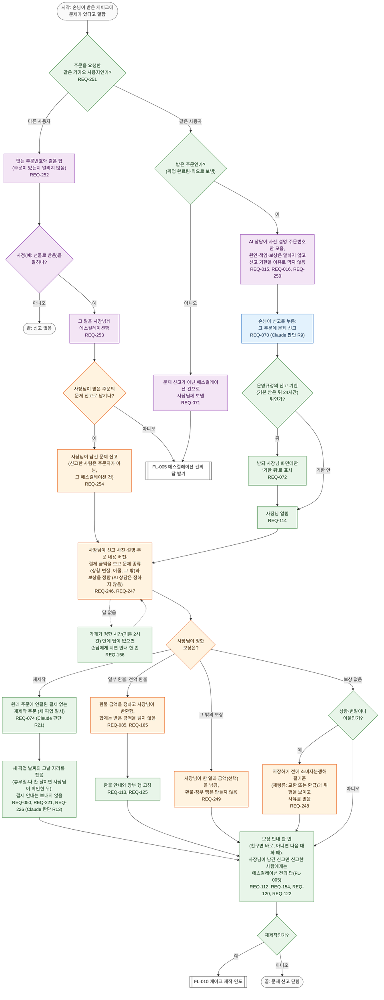

# FL-011 문제 신고하고 보상받기

채우는 요구사항: REQ-015, REQ-016, REQ-050, REQ-070, REQ-071, REQ-072, REQ-074, REQ-085, REQ-112, REQ-113, REQ-114, REQ-120, REQ-122, REQ-125, REQ-154, REQ-156, REQ-165, REQ-221, REQ-226, REQ-246, REQ-247, REQ-248, REQ-249, REQ-250, REQ-251, REQ-252, REQ-253, REQ-254

| 항목 | 내용 |
| --- | --- |
| 액터 | 손님, AI 상담, 사장님, 우리 서비스 |
| 컨텍스트 | CTX-003 주문, CTX-001 상담, CTX-004 결제·환불, CTX-002 가게 규칙, CTX-008 알림, CTX-009 장부 연결 |
| 시작 | 손님이 받은 케이크에 문제가 있다고 말함 |
| 끝 | 문제 신고 닫힘 / 재제작으로 제작(FL-010) / 에스컬레이션 건(FL-005) / 신고 없음(다른 사용자가 사정을 말하지 않음) |
| 연결 플로우 | FL-010 케이크 제작·인도, FL-013 장부 자동 기록 |

## 기본 경로

1. 주문을 요청한 같은 카카오 사용자의 받은 주문이면 AI 상담이 사진·설명·주문번호만 모으고, 원인·책임·보상은 말하지 않습니다. 신고 기한을 이유로 막지 않습니다.
2. 손님이 신고를 누르면 그 주문에 문제 신고를 남기고 사장님께 알립니다.
3. 사장님이 신고 내용과 그 주문의 버전·결제 금액을 보고 문제 종류(상함·변질, 이물, 그 밖)와 보상(재제작·일부 환불·전액 환불·그 밖의 보상·보상 없음)을 정합니다.
4. 보상 안내를 한 번 보냅니다. 재제작이면 원래 주문에 연결된 결제 없는 주문으로 새 픽업 날짜의 자리를 잡고 FL-010으로 갑니다.

## 예외 경로

- 받지 않은 주문에 문제를 말하면 문제 신고가 아닌 에스컬레이션 건으로 보냅니다(REQ-071).
- 신고 기한 뒤에 오면 받되 사장님 화면에만 '기한 뒤'로 표시합니다(REQ-072). 손님에게는 기한이 지났다고 말하지 않습니다(REQ-250).
- AI 상담은 원인·책임·보상을 말하지 않습니다(REQ-016). 보상은 사장님만 정합니다(REQ-246).
- 상함·변질이나 이물로 고른 신고에 보상 없음을 고르면 저장하기 전에 소비자분쟁해결기준과 위험을 보이고 사유를 받습니다(REQ-248). 그 밖의 보상은 사장님이 한 일과 금액(선택)만 남기고 환불·장부 행은 만들지 않습니다(REQ-249).
- 주문을 요청하지 않은 카카오 사용자가 주문번호로 신고하려 하면 없는 주문번호와 같은 답을 줍니다(REQ-252). 선물로 받았다는 것처럼 사정을 말하면 사장님께 에스컬레이션하고(REQ-253), 사장님이 그 건에서 받은 주문의 문제 신고로 남기면 같은 보상 길로 갑니다. 환불은 결제한 주문자에게 돌아가고, 신고한 사람에게는 그 건의 답으로 사장님 답이 갑니다(REQ-254).
- 사장님이 보상을 오래 정하지 않으면 손님에게 지연 안내를 한 번 보냅니다(REQ-156, 버전 2).

## 요구사항 해석 (Claude 판단)

- R21 재제작의 새 픽업 일시는 사장님이 손님과 정해 넣습니다. 재제작 주문은 결제가 확인된 원래 주문에 연결해 제작 목록에 오릅니다(02단계 5-1의 2). 04단계에서 상태로 다시 봅니다.
- R13 재제작 자리에는 결제 안내를 보내지 않습니다(FL-007).

## 버전 2에 더한 요구사항 (03단계 확정, 2026-11-12)

- REQ-156 (권장, CTX-008, 후보 N6) 문제 신고에 사장님 답이 늦으면 손님에게 지연 안내를 한 번 보냅니다(FL-006).

## 확정한 뒤 고친 것

2026-11-13 설계 독립 재검토의 묶음 H1을 동희님 2026-11-13 20:59 결정 카드 '추천안대로 (추천)'에 따라 고쳤습니다. I9의 REQ-086('제외')을 REQ-165(받은 금액은 확인된 결제와 사장님이 들어왔다고 표시한 금액의 합)로 바꿨습니다. 보상으로 정한 환불은 환불 계산값보다 낮게 정하지 못하는 규칙(REQ-170)에서 빠집니다.

같은 결정 카드로 묶음 M1(RB-03)과 M3(RB-04, RA-11)도 고쳤습니다. I8: 재제작의 새 날이 휴무일이거나 다 찼으면 사장님이 확인한 뒤 마감 후 추가 수락으로 잡습니다(REQ-221, REQ-226). 문제 신고는 사장님 답이 없어도 자동으로 닫지 않습니다: 보상은 사장님만 정할 수 있고 신고는 손님의 권리라, G6의 지연 안내 뒤 할 일 목록에 남아 사장님이 정할 때까지 기다립니다(04단계 1-7).

설계 재검토 M12(RA-13, RB-15)를 같은 결정 카드의 '모두 지금 고침 (추천)'대로 고쳤습니다(RB-15는 Claude 추천, 동희님 확인 요청). 새 DU·U1·DU2·E2·U2·DU3·U3: 주문을 요청한 같은 카카오 사용자만 신고하고(REQ-251), 다른 사용자에게는 없는 주문번호와 같은 답, 사정을 말하면 에스컬레이션, 사장님이 받은 주문의 문제 신고로 남김(REQ-252~254). I2에 신고 기한으로 막지 않음(REQ-250), I4는 사장님 화면에만, I6에 문제 종류(REQ-247)와 보상 다섯(REQ-246, REQ-073 제외). 새 I12: 그 밖의 보상(REQ-249). 새 D4·I13: 상함·변질·이물에 보상 없음이면 소비자분쟁해결기준과 사유(REQ-248). I11: 사장님이 남긴 신고면 신고한 사람에게는 에스컬레이션 건의 답.

<!-- 07-sitemap:start · '화면'·'화면 없음 사유' 열이 원본, 나머지 열은 build_sitemap.py가 생성 -->
## 화면 (07단계)

노드마다 그 시점에 사람이 보는 화면을 적었습니다. 화면이 없으면 사유를 적었습니다(분기·서버 처리·외부·종료, 정의는 `docs/07-sitemap/README.md` 3절). 다른 플로우로 연결되는 노드는 해당 플로우의 표에 있습니다. 화면 목록은 `docs/07-sitemap/sitemap.yaml`.

| 노드 | 내용 | 화면 | 화면 없음 사유 |
| --- | --- | --- | --- |
| S | 시작: 손님이 받은 케이크에 문제가 있다고 말함 | SCR-003 가게 채널 상담 |  |
| DU | 주문을 요청한 같은 카카오 사용자인가? |  | 분기 |
| U1 | 없는 주문번호와 같은 답 (주문이 있는지 알리지 않음) | SCR-003 가게 채널 상담, SCR-007 내 주문 보기 |  |
| DU2 | 사정(예: 선물로 받음)을 말하나? |  | 분기 |
| E2 | 끝: 신고 없음 |  | 종료 |
| U2 | 그 말을 사장님께 에스컬레이션함 | SCR-003 가게 채널 상담, SCR-017 에스컬레이션 건 |  |
| DU3 | 사장님이 받은 주문의 문제 신고로 남기나? | SCR-017 에스컬레이션 건 |  |
| U3 | 사장님이 남긴 문제 신고 (신고한 사람은 주문자가 아님, 그 에스컬레이션 건) | SCR-017 에스컬레이션 건, SCR-027 문제 신고 |  |
| D0 | 받은 주문인가? (픽업 완료됨·퀵으로 보냄) |  | 분기 |
| I1 | 문제 신고가 아닌 에스컬레이션 건으로 사장님께 보냄 | SCR-003 가게 채널 상담 |  |
| I2 | AI 상담이 사진·설명·주문번호만 모음, 원인·책임·보상은 말하지 않고 신고 기한을 이유로 막지 않음 | SCR-003 가게 채널 상담, SCR-007 내 주문 보기 |  |
| I3 | 손님이 신고를 누름: 그 주문에 문제 신고 | SCR-010 문제 신고 카드 |  |
| D1 | 운영규정의 신고 기한 (기본 받은 뒤 24시간) 뒤인가? |  | 분기 |
| I4 | 받되 사장님 화면에만 '기한 뒤'로 표시 | SCR-027 문제 신고 |  |
| I5 | 사장님 알림 | SCR-019 사장님 알림, SCR-016 할 일 목록 |  |
| I6 | 사장님이 신고 사진·설명·주문 내용 버전· 결제 금액을 보고 문제 종류(상함·변질, 이물, 그 밖)와 보상을 정함 (AI 상담은 정하지 않음) | SCR-027 문제 신고 |  |
| G6 | 가게가 정한 시간(기본 2시간) 안에 답이 없으면 손님에게 지연 안내 한 번 | SCR-011 손님 알림 |  |
| D2 | 사장님이 정한 보상은? | SCR-027 문제 신고 |  |
| I7 | 원래 주문에 연결된 결제 없는 재제작 주문 (새 픽업 일시) | SCR-027 문제 신고 |  |
| I8 | 새 픽업 날짜의 그날 자리를 잡음 (휴무일·다 찬 날이면 사장님이 확인한 뒤), 결제 안내는 보내지 않음 |  | 서버 처리 |
| I9 | 환불 금액을 정하고 사장님이 반환함, 합계는 받은 금액을 넘지 않음 | SCR-027 문제 신고, SCR-026 환불 송금 |  |
| I10 | 환불 안내와 장부 행 고침 | SCR-011 손님 알림 |  |
| D4 | 상함·변질이나 이물인가? |  | 분기 |
| I13 | 저장하기 전에 소비자분쟁해결기준 (제빵류: 교환 또는 환급)과 위험을 보이고 사유를 받음 | SCR-027 문제 신고 |  |
| I12 | 사장님이 한 일과 금액(선택)을 남김, 환불·장부 행은 만들지 않음 | SCR-027 문제 신고 |  |
| I11 | 보상 안내 한 번 (친구면 바로, 아니면 다음 대화 때). 사장님이 남긴 신고면 신고한 사람에게는 에스컬레이션 건의 답(FL-005) | SCR-011 손님 알림 |  |
| D3 | 재제작인가? |  | 분기 |
| E1 | 끝: 문제 신고 닫힘 |  | 종료 |
<!-- 07-sitemap:end -->
