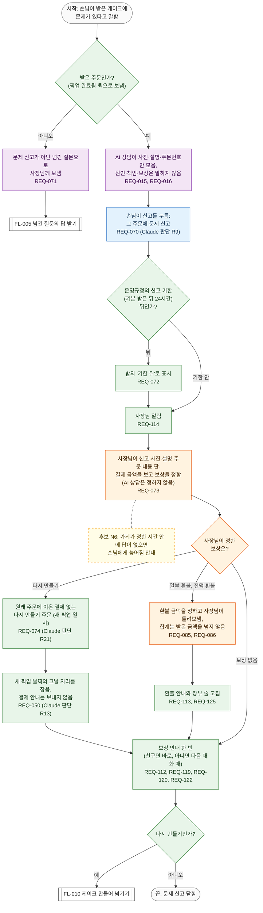

# FL-011 문제 신고하고 보상받기

채우는 요구사항: REQ-015, REQ-016, REQ-050, REQ-070, REQ-071, REQ-072, REQ-073, REQ-074, REQ-085, REQ-086, REQ-112, REQ-113, REQ-114, REQ-119, REQ-120, REQ-122, REQ-125

| 항목 | 내용 |
| --- | --- |
| 행위자 | 손님, AI 상담, 사장님, 우리 서비스 |
| 컨텍스트 | CTX-003 주문, CTX-001 상담, CTX-004 결제·환불, CTX-002 가게 규칙, CTX-008 알림, CTX-009 장부 연결 |
| 시작 | 손님이 받은 케이크에 문제가 있다고 말함 |
| 끝 | 문제 신고 닫힘 / 다시 만들기로 제작(FL-010) / 넘긴 질문(FL-005) |
| 이어지는 흐름 | FL-010 케이크 만들어 넘기기, FL-013 장부에 저절로 적기 |

## 주 경로

1. 받은 주문이면 AI 상담이 사진·설명·주문번호만 모으고, 원인·책임·보상은 말하지 않습니다.
2. 손님이 신고를 누르면 그 주문에 문제 신고를 남기고 사장님께 알립니다.
3. 사장님이 신고 내용과 그 주문의 판·결제 금액을 보고 보상(다시 만들기·일부 환불·전액 환불·보상 없음)을 정합니다.
4. 보상 안내를 한 번 보냅니다. 다시 만들기면 원래 주문에 이은 결제 없는 주문으로 새 픽업 날짜의 자리를 잡고 FL-010으로 갑니다.

## 실패 길

- 받지 않은 주문에 문제를 말하면 문제 신고가 아닌 넘긴 질문으로 보냅니다(REQ-071).
- 신고 기한 뒤에 오면 받되 '기한 뒤'로 표시합니다(REQ-072).
- AI 상담은 원인·책임·보상을 말하지 않습니다(REQ-016). 보상은 사장님만 정합니다(REQ-073).
- 사장님이 보상을 오래 정하지 않으면 손님에게 알릴 요구사항이 없습니다(후보 N6).

## 읽은 방식 (Claude 판단)

- R21 다시 만들기의 새 픽업 일시는 사장님이 손님과 정해 넣습니다. 다시 만들기 주문은 결제가 확인된 원래 주문에 이어 붙여 제작 목록에 오릅니다(02단계 5-1의 2). 04단계에서 상태로 다시 봅니다.
- R13 다시 만들기 자리에는 결제 안내를 보내지 않습니다(FL-007).

## 빈 곳 (새 요구사항 후보)

- N6 (권장, CTX-008) 문제 신고에 사장님 답이 늦을 때 손님에게 알릴 요구사항이 없습니다(FL-006).
