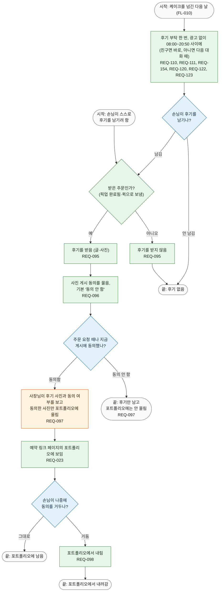

# FL-012 후기 남기고 사진 게시 정하기

채우는 요구사항: REQ-023, REQ-095, REQ-096, REQ-097, REQ-098, REQ-110, REQ-111, REQ-120, REQ-122, REQ-123, REQ-154

| 항목 | 내용 |
| --- | --- |
| 행위자 | 손님, 사장님, 우리 서비스 |
| 컨텍스트 | CTX-006 후기·포트폴리오, CTX-008 알림, CTX-007 가게 등록·연결 |
| 시작 | 케이크를 넘긴 다음 날 / 손님이 스스로 후기를 남기려 함 |
| 끝 | 포트폴리오에 남음 / 포트폴리오에서 내려감 / 후기만 남음 / 후기 없음 |
| 이어지는 흐름 | 없음(예약 링크 페이지의 포트폴리오로 FL-003에 보임) |

## 주 경로

1. 케이크를 넘긴 다음 날 후기 부탁을 한 번 보냅니다.
2. 받은 주문의 후기를 받고, 사진 게시 동의를 기본 '동의 안 함'으로 묻습니다.
3. 동의한 사진만 사장님이 포트폴리오에 올리고, 예약 링크 페이지에 보입니다.

## 실패 길

- 받지 않은 주문에는 후기를 받지 않습니다(REQ-095).
- 게시에 동의하지 않으면 포트폴리오에 올리지 않습니다(REQ-097).
- 손님이 동의를 거두면 포트폴리오에서 내립니다(REQ-098).

## 읽은 방식 (Claude 판단)

없음. 주문 요청 때 받은 사진 게시 동의(FL-006, REQ-096)도 여기서 같이 봅니다.

## 빈 곳 (새 요구사항 후보)

없음.
