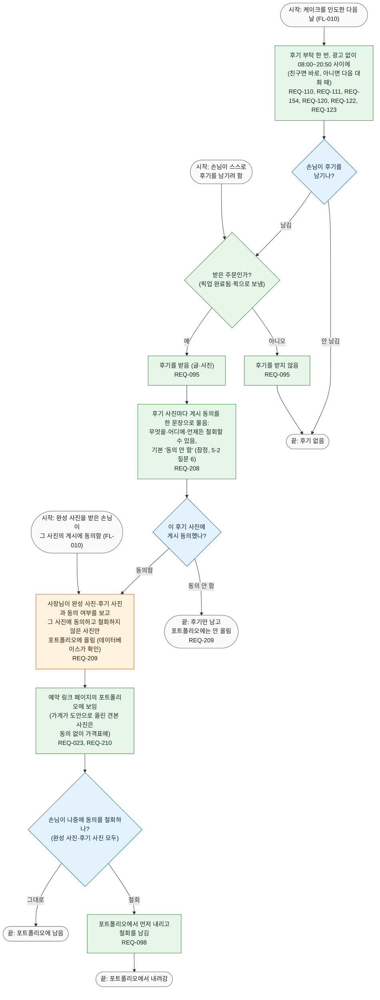

# FL-012 후기 남기고 사진 게시 정하기

채우는 요구사항: REQ-023, REQ-095, REQ-098, REQ-110, REQ-111, REQ-120, REQ-122, REQ-123, REQ-154, REQ-208, REQ-209, REQ-210

| 항목 | 내용 |
| --- | --- |
| 액터 | 손님, 사장님, 우리 서비스 |
| 컨텍스트 | CTX-006 후기·포트폴리오, CTX-008 알림, CTX-007 가게 등록·연결 |
| 시작 | 케이크를 인도한 다음 날 / 손님이 스스로 후기를 남기려 함 / 완성 사진의 게시에 동의함(FL-010) |
| 끝 | 포트폴리오에 남음 / 포트폴리오에서 내려감 / 후기만 남음 / 후기 없음 |
| 연결 플로우 | FL-010(완성 사진의 게시 동의에서 시작), 예약 링크 페이지의 포트폴리오로 FL-003에 보임 |

## 기본 경로

1. 케이크를 인도한 다음 날 후기 부탁을 한 번 보냅니다.
2. 받은 주문의 후기를 받고, 후기 사진마다 게시 동의를 한 문장(무엇을·어디에·언제든 철회할 수 있음)으로 묻습니다(기본 '동의 안 함', 잠정, 5-2 질문 6).
3. 완성 사진(FL-010)과 후기 사진 가운데 그 사진에 동의하고 철회하지 않은 사진만 사장님이 포트폴리오에 올리고, 예약 링크 페이지에 보입니다. 가게가 도안으로 올린 견본 사진은 동의 없이 가격표에 보입니다(REQ-210).

## 예외 경로

- 받지 않은 주문에는 후기를 받지 않습니다(REQ-095).
- 그 사진에 동의하지 않았거나 철회했으면 포트폴리오에 올리지 않습니다. 다른 사진의 동의로도 올리지 못하게 데이터베이스가 확인합니다(REQ-209).
- 손님이 동의를 철회하면(완성 사진·후기 사진 모두) 포트폴리오에서 먼저 내리고 철회를 남깁니다(REQ-098).

## 요구사항 해석 (Claude 판단)

없음. 주문 요청 때 받던 사진 게시 동의(REQ-096)는 버전 5에서 빠졌고, 완성 사진의 동의는 FL-010에서 받아 S3으로 이어집니다.

## 빈 곳 (새 요구사항 후보)

없음.

## 확정한 뒤 고친 것

2026-11-13 설계 독립 재검토의 묶음 H10(RE-01, RA-14, RB-16, RC-11)을 동희님 2026-11-13 20:59 결정 카드 '추천안대로 (추천)'에 따라 고쳤습니다. D3이 '주문 요청 때나 지금' 한 동의를 함께 보던 것을 이 후기 사진의 동의만 보게 바꿨습니다(RB-16). 주문 요청 때의 동의(REQ-096)는 빼고, V4는 후기 사진마다 한 문장으로 묻습니다(REQ-208). 새 S3: 완성 사진을 받으며 게시에 동의한 손님의 사진(FL-010 M13)도 V5로 옵니다. V5·E1은 그 사진에 동의하고 철회하지 않은 사진만 올리고 데이터베이스가 확인합니다(REQ-097을 '제외'로 두고 REQ-209). V6에 가게의 도안 견본 사진(REQ-210)을, D4·V7에 두 동의의 철회와 먼저 내림을 적었습니다. 잠정, 5-2 질문 6의 답으로 다시 봄.

<!-- 07-sitemap:start · '화면'·'화면 없음 사유' 열이 원본, 나머지 열은 build_sitemap.py가 생성 -->
## 화면 (07단계)

노드마다 그 시점에 사람이 보는 화면을 적었습니다. 화면이 없으면 사유를 적었습니다(분기·서버 처리·외부·종료, 정의는 `docs/07-sitemap/README.md` 3절). 다른 플로우로 연결되는 노드는 해당 플로우의 표에 있습니다. 화면 목록은 `docs/07-sitemap/sitemap.yaml`.

| 노드 | 내용 | 화면 | 화면 없음 사유 |
| --- | --- | --- | --- |
| S1 | 시작: 케이크를 인도한 다음 날 (FL-010) |  | 서버 처리 |
| S2 | 시작: 손님이 스스로 후기를 남기려 함 | SCR-003 가게 채널 상담, SCR-012 후기 남기기 |  |
| S3 | 시작: 완성 사진을 받은 손님이 그 사진의 게시에 동의함 (FL-010) | SCR-011 손님 알림 |  |
| V1 | 후기 부탁 한 번, 광고 없이 08:00~20:50 사이에 (친구면 바로, 아니면 다음 대화 때) | SCR-011 손님 알림 |  |
| D1 | 손님이 후기를 남기나? | SCR-011 손님 알림, SCR-012 후기 남기기 |  |
| E0 | 끝: 후기 없음 |  | 종료 |
| D2 | 받은 주문인가? (픽업 완료됨·퀵으로 보냄) |  | 분기 |
| V2 | 후기를 받지 않음 | SCR-012 후기 남기기 |  |
| V3 | 후기를 받음 (글·사진) | SCR-012 후기 남기기 |  |
| V4 | 후기 사진마다 게시 동의를 한 문장으로 물음: 무엇을·어디에·언제든 철회할 수 있음, 기본 '동의 안 함' (잠정, 5-2 질문 6) | SCR-012 후기 남기기 |  |
| D3 | 이 후기 사진에 게시 동의했나? | SCR-012 후기 남기기 |  |
| E1 | 끝: 후기만 남고 포트폴리오에는 안 올림 |  | 종료 |
| V5 | 사장님이 완성 사진·후기 사진과 동의 여부를 보고 그 사진에 동의하고 철회하지 않은 사진만 포트폴리오에 올림 (데이터베이스가 확인) | SCR-044 포트폴리오 |  |
| V6 | 예약 링크 페이지의 포트폴리오에 보임 (가게가 도안으로 올린 견본 사진은 동의 없이 가격표에) | SCR-001 예약 링크 페이지 |  |
| D4 | 손님이 나중에 동의를 철회하나? (완성 사진·후기 사진 모두) | SCR-003 가게 채널 상담, SCR-013 사진 게시 동의 철회 카드 |  |
| V7 | 포트폴리오에서 먼저 내리고 철회를 남김 | SCR-013 사진 게시 동의 철회 카드, SCR-044 포트폴리오, SCR-001 예약 링크 페이지 |  |
| E2 | 끝: 포트폴리오에서 내려감 |  | 종료 |
| E3 | 끝: 포트폴리오에 남음 |  | 종료 |
<!-- 07-sitemap:end -->
