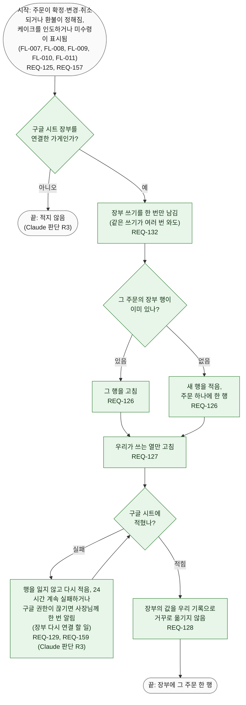

# FL-013 장부 자동 기록

채우는 요구사항: REQ-125, REQ-126, REQ-127, REQ-128, REQ-129, REQ-132, REQ-157, REQ-159

| 항목 | 내용 |
| --- | --- |
| 액터 | 우리 서비스 |
| 컨텍스트 | CTX-009 장부 연결, CTX-003 주문, CTX-004 결제·환불 |
| 시작 | 주문이 확정·변경·취소되거나 환불이 정해짐, 케이크를 인도하거나 미수령이 표시됨 |
| 끝 | 장부에 그 주문 한 행 / 장부를 연결하지 않은 가게라 적지 않음 |
| 연결 플로우 | 없음 |

## 기본 경로

1. 주문이 확정·변경·취소되거나 환불이 정해지면 장부 쓰기를 한 번만 남깁니다.
2. 그 주문의 장부 행이 있으면 고치고, 없으면 새로 적습니다. 주문 하나에 한 행입니다.
3. 우리가 쓰는 열만 고치고, 장부의 값을 우리 기록으로 거꾸로 옮기지 않습니다.

## 예외 경로

- 같은 쓰기가 여러 번 와도 한 번만 남깁니다(REQ-132).
- 구글 시트에 적기가 실패하면 행을 잃지 않고 다시 적습니다(REQ-129).
- 장부를 연결하지 않은 가게는 적지 않습니다(R3).

## 요구사항 해석 (Claude 판단)

- R3 장부 연결은 고를 수 있습니다(FL-001). 적기가 계속 실패할 때 사장님께 알릴지는 04단계에서 정합니다. 04단계에서 24시간 계속 실패하거나 권한이 끊기면 한 번 알리기로 정했고(REQ-159, SPEC-064), 설계 재검토 M8에서 L5에 넣었습니다.

## 버전 2에 더한 요구사항 (03단계 확정, 2026-11-12)

- REQ-157 (권장, CTX-009, 후보 N7) 인도 결과와 미수령도 장부에 적습니다(FL-010).

## 확정한 뒤 고친 것

2026-11-15 설계 독립 재검토의 묶음 M8(RB-10)을 동희님 2026-11-13 20:59 결정 카드 '모두 지금 고침 (추천)'에 따라 고쳤습니다. 버전 3~5 요구사항을 04단계 SPEC으로만 잇지 않고 다이어그램에 넣었습니다(03단계 README 2절·8절).

| 노드 | 바뀐 동작 | 요구사항·SPEC |
| --- | --- | --- |
| L5 | 24시간 계속 실패하거나 구글 권한이 끊기면 사장님께 한 번 알림 | REQ-159(버전 3), SPEC-064 |

<!-- 07-sitemap:start · '화면'·'화면 없음 사유' 열이 원본, 나머지 열은 build_sitemap.py가 생성 -->
## 화면 (07단계)

노드마다 그 시점에 사람이 보는 화면을 적었습니다. 화면이 없으면 사유를 적었습니다(분기·서버 처리·외부·종료, 정의는 `docs/07-sitemap/README.md` 3절). 다른 플로우로 연결되는 노드는 해당 플로우의 표에 있습니다. 화면 목록은 `docs/07-sitemap/sitemap.yaml`.

| 노드 | 내용 | 화면 | 화면 없음 사유 |
| --- | --- | --- | --- |
| S | 시작: 주문이 확정·변경·취소되거나 환불이 정해짐, 케이크를 인도하거나 미수령이 표시됨 (FL-007, FL-008, FL-009, FL-010, FL-011) |  | 서버 처리 |
| D0 | 구글 시트 장부를 연결한 가게인가? |  | 분기 |
| E0 | 끝: 적지 않음 |  | 종료 |
| L1 | 장부 쓰기를 한 번만 남김 (같은 쓰기가 여러 번 와도) |  | 서버 처리 |
| D1 | 그 주문의 장부 행이 이미 있나? |  | 분기 |
| L2 | 그 행을 고침 |  | 외부 |
| L3 | 새 행을 적음, 주문 하나에 한 행 |  | 외부 |
| L4 | 우리가 쓰는 열만 고침 |  | 외부 |
| D2 | 구글 시트에 적혔나? |  | 분기 |
| L5 | 행을 잃지 않고 다시 적음, 24시간 계속 실패하거나 구글 권한이 끊기면 사장님께 한 번 알림 (장부 다시 연결 할 일) | SCR-042 장부 연결, SCR-016 할 일 목록 |  |
| L6 | 장부의 값을 우리 기록으로 거꾸로 옮기지 않음 |  | 서버 처리 |
| E1 | 끝: 장부에 그 주문 한 행 |  | 외부 |
<!-- 07-sitemap:end -->
