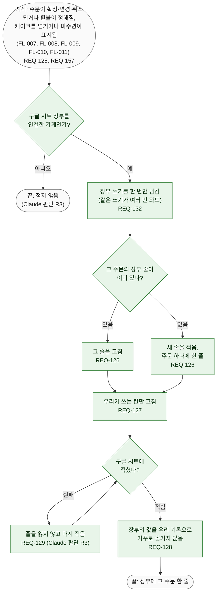

# FL-013 장부에 저절로 적기

채우는 요구사항: REQ-125, REQ-126, REQ-127, REQ-128, REQ-129, REQ-132, REQ-157

| 항목 | 내용 |
| --- | --- |
| 행위자 | 우리 서비스 |
| 컨텍스트 | CTX-009 장부 연결, CTX-003 주문, CTX-004 결제·환불 |
| 시작 | 주문이 확정·변경·취소되거나 환불이 정해짐, 케이크를 넘기거나 미수령이 표시됨 |
| 끝 | 장부에 그 주문 한 줄 / 장부를 연결하지 않은 가게라 적지 않음 |
| 이어지는 흐름 | 없음 |

## 주 경로

1. 주문이 확정·변경·취소되거나 환불이 정해지면 장부 쓰기를 한 번만 남깁니다.
2. 그 주문의 장부 줄이 있으면 고치고, 없으면 새로 적습니다. 주문 하나에 한 줄입니다.
3. 우리가 쓰는 칸만 고치고, 장부의 값을 우리 기록으로 거꾸로 옮기지 않습니다.

## 실패 길

- 같은 쓰기가 여러 번 와도 한 번만 남깁니다(REQ-132).
- 구글 시트에 적기가 실패하면 줄을 잃지 않고 다시 적습니다(REQ-129).
- 장부를 연결하지 않은 가게는 적지 않습니다(R3).

## 읽은 방식 (Claude 판단)

- R3 장부 연결은 고를 수 있습니다(FL-001). 적기가 계속 실패할 때 사장님께 알릴지는 04단계에서 정합니다.

## 2판에 더한 요구사항 (03단계 확정, 2026-11-12)

- REQ-157 (권장, CTX-009, 후보 N7) 넘긴 결과와 미수령도 장부에 적습니다(FL-010).
