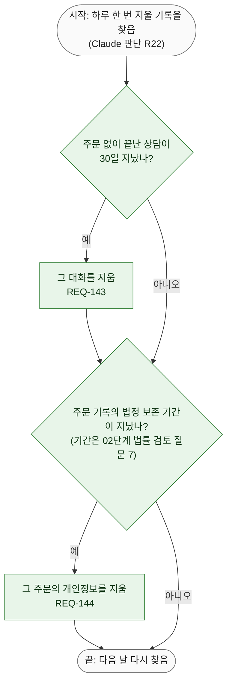

# FL-014 지난 기록 지우기

채우는 요구사항: REQ-143, REQ-144

| 항목 | 내용 |
| --- | --- |
| 행위자 | 우리 서비스 |
| 컨텍스트 | CTX-001 상담, CTX-003 주문 |
| 시작 | 하루 한 번 지울 기록을 찾음 |
| 끝 | 다음 날 다시 찾음 |
| 이어지는 흐름 | 없음 |

## 주 경로

1. 하루 한 번, 주문 없이 끝난 지 30일이 지난 상담의 대화를 지웁니다.
2. 법정 보존 기간이 지난 주문 기록의 개인정보를 지웁니다.

## 실패 길

- 보존 기간이 아직 정해지지 않았습니다. 02단계 법률 검토 질문 7(전자상거래법 시행령 제6조)의 답이 오기 전에는 주문 기록을 지우지 않습니다.

## 읽은 방식 (Claude 판단)

- R22 지울 기록은 하루 한 번 찾습니다. 요구사항은 기간만 정합니다.

## 빈 곳 (새 요구사항 후보)

없음.
