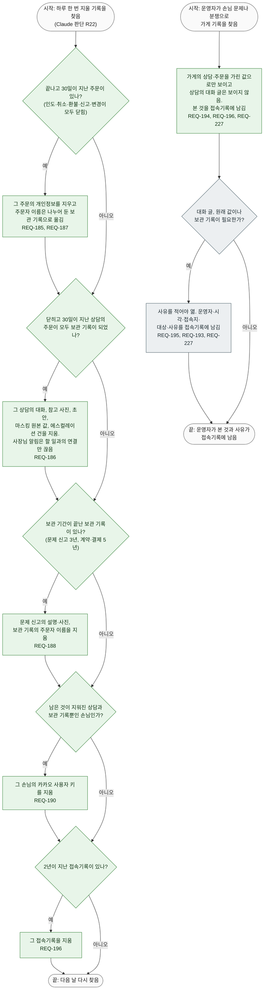

# FL-014 지난 기록 지우기

채우는 요구사항: REQ-185, REQ-186, REQ-187, REQ-188, REQ-190, REQ-193, REQ-194, REQ-195, REQ-196, REQ-227

| 항목 | 내용 |
| --- | --- |
| 액터 | 우리 서비스, 운영자 |
| 컨텍스트 | CTX-001 상담, CTX-003 주문, CTX-007 가게 등록·연결 |
| 시작 | 하루 한 번 지울 기록을 찾음 / 운영자가 손님 문제나 분쟁으로 가게 기록을 찾음 |
| 끝 | 다음 날 다시 찾음 / 운영자가 본 것과 사유가 접속기록에 남음 |
| 연결 플로우 | 없음 |

기간(주문이 끝나고 30일, 문제 신고 3년, 계약·결제 5년)은 잠정, 5-2 질문 7의 답으로 다시 봄(02단계 요구사항 5-2·11절).

## 기본 경로

1. 하루 한 번, 끝나고 30일이 지난 주문(인도·취소·환불과 그 주문의 신고·변경 요청·결제 안내가 모두 닫힘)의 개인정보를 지우고, 주문자 이름은 지금 데이터와 나누어 둔 보관 기록으로 옮깁니다. 계약·결제 기록(주문 내용의 버전, 동의한 운영규정 버전, 금액, 결제, 환불, 장부 행)과 문제 신고 기록은 지우지 않고 보관 기록이 됩니다.
2. 문의 끊김이나 상담 끝남으로 닫히고 30일이 지난 상담 가운데, 그 상담이 다룬 주문이 모두 보관 기록이 된 상담의 대화·참고 사진·주문이 되지 않은 초안·마스킹 원본 값·에스컬레이션 건을 지웁니다.
3. 보관 기간이 끝난 보관 기록에서 문제 신고의 설명·사진(주문이 끝난 날부터 3년), 주문자 이름(5년)을 지웁니다.
4. 상담이 모두 지워지고 주문이 모두 보관 기록이 된 손님의 카카오 사용자 키를 지웁니다.
5. 2년이 지난 접속기록을 지웁니다(REQ-196).
6. 운영자가 손님 문제나 분쟁으로 가게 기록을 볼 때 손님 개인정보는 가린 값으로만 보이고, 상담은 메시지마다 발신자·시각·종류·글자 수·사진 수만 보입니다. 대화 글(번호는 가린 채), 원래 값이나 보관 기록이 필요하면 사유를 적어야 열리고, 본 것과 사유가 접속기록에 남습니다(REQ-193~196, REQ-227). 사장님은 보관 기록이 필요하면 운영자에게 요청합니다.

## 예외 경로

- 주문이 끝난 뒤 늦은 신고나 들어온 입금 대조로 그 주문의 일이 다시 열리면, 그 주문은 다시 끝날 때까지 지우지 않습니다.
- 상담이 다룬 주문 가운데 아직 보관 기록이 되지 않은 주문이 있으면 그 상담은 지우지 않습니다(그 대화는 그 주문의 대화이기도 함).
- 지우기가 중간에 실패하면 다음 날 이어서 지웁니다. 주문 하나, 상담 하나는 한 트랜잭션으로 지웁니다.
- 사진 행을 지우는 트랜잭션은 그 사진 파일의 저장 위치를 '지울 파일'로 함께 남기고, 저장소에서 파일을 지운 뒤에만 그 행을 뺍니다. 저장소가 실패하거나 작업이 멈추면 다음 날 남은 파일을 다시 지웁니다(04단계 SPEC-065).
- 접속기록을 남기지 못하면 운영자에게 원래 값이나 보관 기록을 열어 보이지 않습니다.
- 원래 값을 두지 않는 값(카드번호의 끝 4자리 밖, 주민등록번호처럼 보이는 숫자)과 이미 지운 개인정보는 사유를 적어도 열리지 않습니다(REQ-192).

## 요구사항 해석 (Claude 판단)

- R22 지울 기록은 하루 한 번 찾습니다. 요구사항은 기간만 정합니다.

## 빈 곳 (새 요구사항 후보)

없음.

## 확정한 뒤 고친 것

2026-11-13 설계 독립 재검토의 묶음 H3(RB-09, RC-02, RA-06, RC-04, RC-03)을 동희님 2026-11-13 20:59 결정 카드 '추천안대로 (추천)'에 따라 고쳤습니다. REQ-143·REQ-144를 '제외'로 두고 REQ-185~188·190을 다이어그램에 넣었습니다. D1·K1은 '끝나고 30일이 지난 주문'으로, D2·K2는 '닫히고 30일이 지나고 다룬 주문이 모두 보관 기록이 된 상담'으로 바꿨고, 보관 기간 끝(D3·K3)과 카카오 사용자 키 지우기(D4·K4)를 더했습니다. 기간은 잠정, 5-2 질문 7의 답으로 다시 봄.

같은 결정 카드로 묶음 H4(RA-16)도 고쳤습니다. 2년이 지난 접속기록 지우기(D5·K5)와, 운영자가 가게 기록을 가린 값으로 보고 원래 값과 보관 기록은 사유를 적어 여는 길(S2·O1·D6·O2·E2)을 더했습니다(REQ-193~196). PR D에서 미룬 '보관 기록을 꺼내 보는 길'이 이것입니다.

2026-11-14 Codex 자동 검토 의견 둘을 고쳤습니다. [PR #31 의견](https://github.com/kodonghui/siljang.ai/pull/31#discussion_r4568849791): 번호만 가린 대화 글에는 손님 이름·알레르기 같은 말이 그대로 남아, O1은 상담의 대화 글을 보이지 않고 D6·O2는 대화 글도 사유를 적어 열게 했습니다(REQ-227). [PR #30 의견](https://github.com/kodonghui/siljang.ai/pull/30#discussion_r4567801476): 사진 행을 지운 뒤 저장소 지우기가 실패하면 다음 날 다시 지울 저장 위치가 남지 않아, 지울 파일을 같은 트랜잭션에서 남기는 예외 경로를 더했습니다(다이어그램은 그대로).

<!-- 07-sitemap:start · '화면'·'화면 없음 사유' 열이 원본, 나머지 열은 build_sitemap.py가 생성 -->
## 화면 (07단계)

노드마다 그 시점에 사람이 보는 화면을 적었습니다. 화면이 없으면 사유를 적었습니다(분기·서버 처리·외부·종료, 정의는 `docs/07-sitemap/README.md` 3절). 다른 플로우로 연결되는 노드는 해당 플로우의 표에 있습니다. 화면 목록은 `docs/07-sitemap/sitemap.yaml`.

| 노드 | 내용 | 화면 | 화면 없음 사유 |
| --- | --- | --- | --- |
| S | 시작: 하루 한 번 지울 기록을 찾음 |  | 서버 처리 |
| D1 | 끝나고 30일이 지난 주문이 있나? (인도·취소·환불·신고·변경이 모두 닫힘) |  | 분기 |
| K1 | 그 주문의 개인정보를 지우고 주문자 이름은 나누어 둔 보관 기록으로 옮김 |  | 서버 처리 |
| D2 | 닫히고 30일이 지난 상담의 주문이 모두 보관 기록이 되었나? |  | 분기 |
| K2 | 그 상담의 대화, 참고 사진, 초안, 마스킹 원본 값, 에스컬레이션 건을 지움. 사장님 알림은 할 일과의 연결만 끊음 |  | 서버 처리 |
| D3 | 보관 기간이 끝난 보관 기록이 있나? (문제 신고 3년, 계약·결제 5년) |  | 분기 |
| K3 | 문제 신고의 설명·사진, 보관 기록의 주문자 이름을 지움 |  | 서버 처리 |
| D4 | 남은 것이 지워진 상담과 보관 기록뿐인 손님인가? |  | 분기 |
| K4 | 그 손님의 카카오 사용자 키를 지움 |  | 서버 처리 |
| D5 | 2년이 지난 접속기록이 있나? |  | 분기 |
| K5 | 그 접속기록을 지움 |  | 서버 처리 |
| E1 | 끝: 다음 날 다시 찾음 |  | 종료 |
| S2 | 시작: 운영자가 손님 문제나 분쟁으로 가게 기록을 찾음 | SCR-047 영업 신고 확인 목록 |  |
| O1 | 가게의 상담·주문을 가린 값으로만 보이고 상담의 대화 글은 보이지 않음. 본 것을 접속기록에 남김 | SCR-050 가게 기록 보기 |  |
| D6 | 대화 글, 원래 값이나 보관 기록이 필요한가? | SCR-050 가게 기록 보기 |  |
| O2 | 사유를 적어야 엶. 운영자·시각·접속지· 대상·사유를 접속기록에 남김 | SCR-050 가게 기록 보기 |  |
| E2 | 끝: 운영자가 본 것과 사유가 접속기록에 남음 | SCR-050 가게 기록 보기 |  |
<!-- 07-sitemap:end -->
