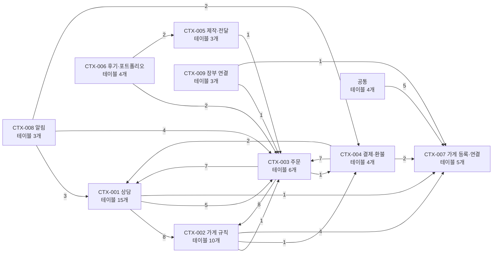
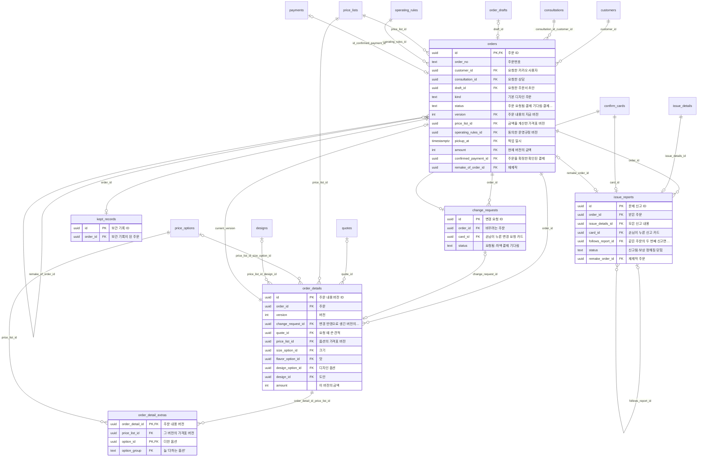
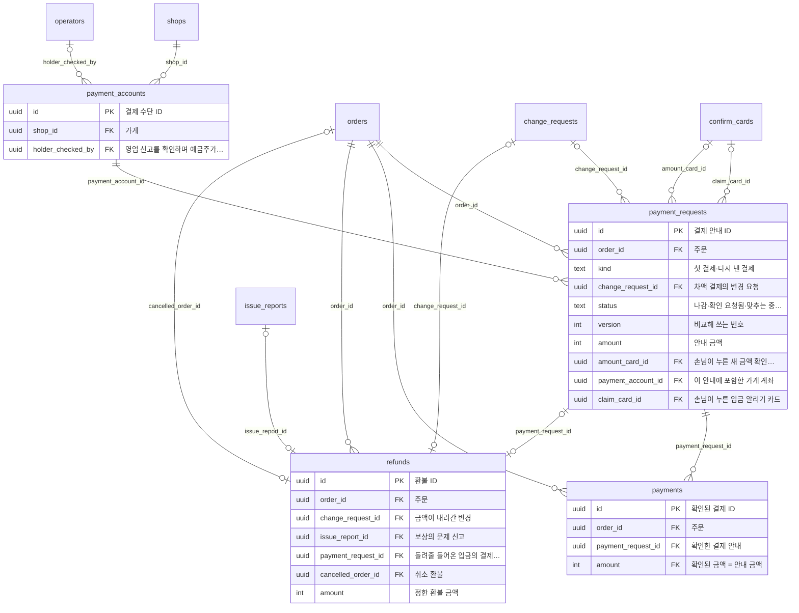
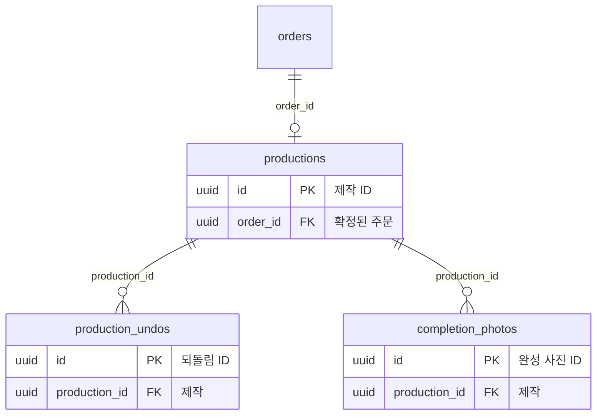
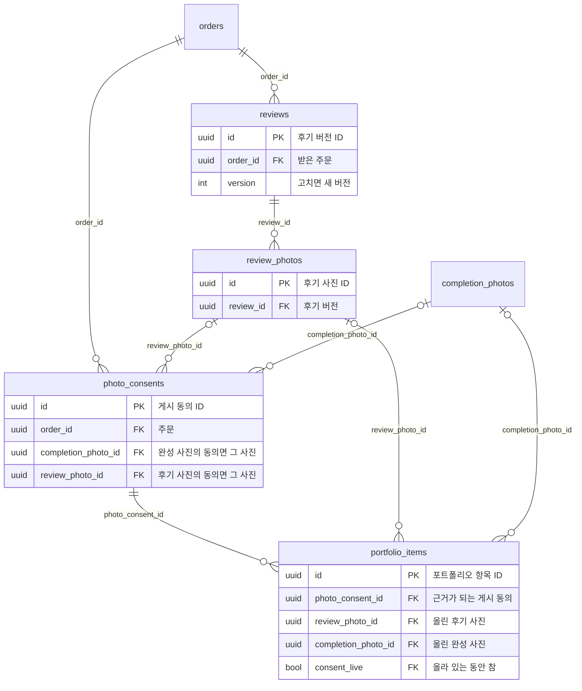
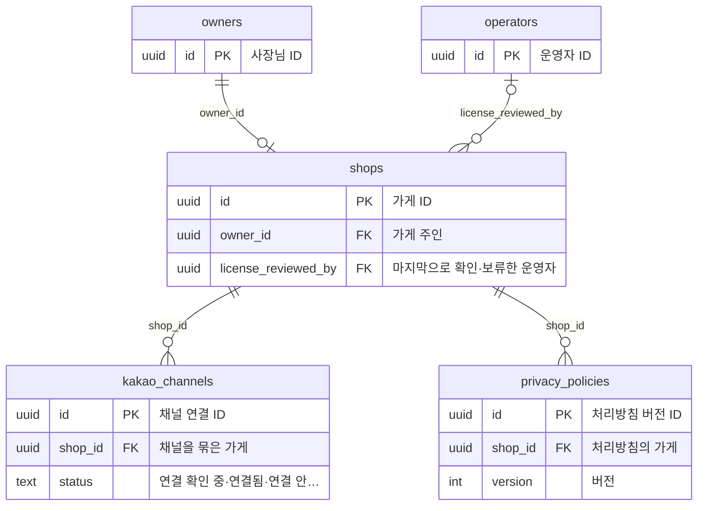
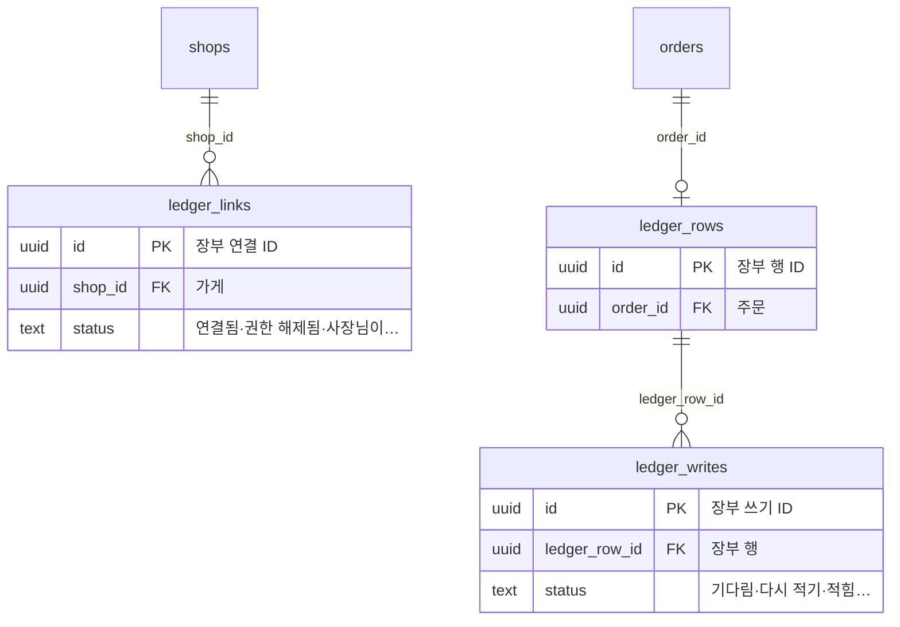
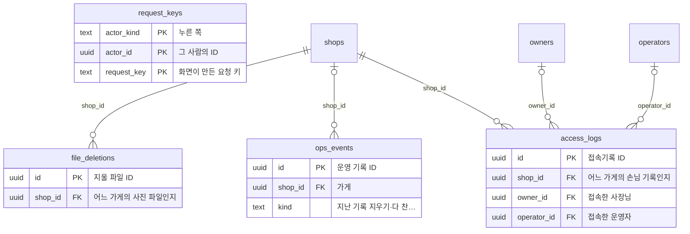

# 05단계 ERD: 수제케이크 주문제작 데이터베이스

상태: 확정(2026-11-12 11:56 동희님 '추천대로 굳힘', 10절). 2026-11-13 설계 재검토의 높음 묶음(H1·H2, H11·H12, H7·H8, H3, H4, H5·H10)과 중간 묶음(M1·M2·M3·M9·M10)을 마이그레이션 0002~0008로, 합친 PR에 남은 Codex 자동 검토 의견 넷을 0009로, 중간 묶음 M4·M13을 0010으로, M5·M6을 0011로, M7·M17을 0012로 고쳤습니다(11절). 원본은 [`db/schema.sql`](../../db/schema.sql)이고, 사람이 보는 곳은 ERD Editor로 여는 [`db/schema.erd.json`](../../db/schema.erd.json)입니다(`truth: source`). 이 문서의 표 목록과 다이어그램은 같은 원본에서 `build_erd.py`가 만듭니다.

## 1. 한눈에

- 테이블 57개(TBL-001~057), 컬럼 692개입니다. 외래 키 128개, CHECK 376개, UNIQUE 87개, EXCLUDE 1개로 데이터베이스가 지키는 규칙을 적었고, 제약 밖 인덱스는 61개(그 가운데 부분 인덱스 44개)입니다. 접속기록은 트리거 둘(`access_logs_guard`)이 고치거나 비우는 것을 막고, 주문 상태와 제작 행의 짝은 지연 제약 트리거 둘(`orders_production_sync`)이, 취소 뒤 들어온 입금·더 들어온 금액의 환불 계산값은 트리거 하나(`refunds_unconfirmed`)가, 재제작 주문이 돈을 낸 원래 주문을 가리키고 결제 안내·환불·장부 행을 두지 않음은 트리거 넷(`orders_remake_root`, `payment_requests_remake` 등)이, 끝나지 않은 재제작 주문이 있는 원래 주문이 끝나지 않음은 지연 제약 트리거 하나(`orders_remake_finish`)가, 한 주문에 잡힌 자리와 확정된 자리가 함께 있는 것이 차액을 기다리는 날짜 변경뿐임은 트리거 하나(`slot_holds_pair`)가, 취소 환불의 취소한 주문이 환불을 남기는 주문이나 그 재제작 주문임은 트리거 하나(`refunds_cancelled`)가, 주문 확정 뒤 그 주문을 확정한 결제가 확인을 취소한 것이 아님은 지연 제약 트리거 둘(`orders_confirmed_payment_live`, `payments_confirmed_void`)이 봅니다.
- 기능 명세 SPEC-001~076이 읽고 쓰는 데이터 998건을 테이블.컬럼 468개에 하나씩 이었습니다([`erd_map.py`](../../research/cake-erd-2026-11/erd_map.py)). 모든 SPEC에 대응이 있고, 쓰이지 않는 테이블은 없습니다.
- 용어집 TERM-001~074가 모두 자리를 가집니다. 애그리거트·읽기 모델 31개는 테이블 헤더 주석(16개)이나 '테이블 없음' 행(15개)에, 상태·값 이름 23개는 컬럼 설명에 TERM 번호로 있습니다.
- PostgreSQL 16.15의 빈 데이터베이스에 `db/schema.sql`과 마이그레이션 `0001_init.sql`~`0012_request_keys_questions_extras.sql`을 각각 만들어 카탈로그가 같음을 봤고, 규칙 테스트 257개가 모두 기대한 결과였습니다(막아야 할 쓰기 220개는 막힘, 늦은 쓰기 3개는 0행, 받아야 할 쓰기 8개는 들어감, 지우기 결과 26개는 기대한 값). 지우기(6절)를 31일·32일·3년·5년 뒤 시각으로 돌려, 지운 뒤 개인정보는 0건이고 계약·결제 기록은 그대로 남으며, 저장소가 실패한 사진 파일은 지울 파일로 남아 다음 날 지워짐을 봤고(8절 D4), 두 세션이 같은 주문을 동시에 쓰면 잠금 번호가 늦은 쓰기를 막음도 봤습니다(8절 D5).
- ERD Editor 다이어그램은 MCP 서버(1.2.0)로 이 원본을 들여와 만들었고, 2026-11-13·14의 바꿈은 편집 도구로 더했습니다(`erd_editor_sync.py`). 다이어그램의 DDL을 빈 데이터베이스에 만들어 견주면 CHECK 376개 말고는 같습니다(9절).
- 체크포인트: 2026-11-12 11:56 동희님이 이 작업 대화의 결정 카드에서 '추천대로 굳힘'을 고르셔서, 이 스키마와 5절의 결정 사항 E1~E14를 추천대로 확정했습니다. SPEC-021을 좁혀 읽은 E5(카드번호는 끝 4자리만 남김)도 함께 정해졌습니다.

## 2. 읽은 것과 만든 것

| 읽은 것 | 버전 | 쓴 것 |
| --- | --- | --- |
| [`docs/04-functional-spec/spec.md`](../04-functional-spec/spec.md) | 04단계 확정(2026-11-12 09:57 동희님 '추천대로 확정'), 커밋 ddb9c85. 2026-11-13 SPEC-070~075를 더하고 환불 길·주문자 정보·카카오 먼저 보내기와 채널 연결·보관과 지우기·계좌 암호화와 접속기록·알레르기 정보 동의·사진 게시 동의를 고침. 2026-11-14 중간 묶음과 Codex 후속(SPEC-016·065·073)으로 다시 고치고 SPEC-076을 더함(spec.md 8절) | SPEC-001~076의 데이터, 상태 머신 1-1~1-8, 공통 규칙 G1~G9, 요구사항 해석 R2~R21, AI-1 |
| [`docs/02-prd/requirements.md`](../02-prd/requirements.md) | 05단계를 확정했을 때는 버전 3(REQ-001~163, 유효한 161), 커밋 ddb9c85. 지금은 버전 5(REQ-001~235, 유효한 214) | 컬럼 설명과 제약에 단 REQ 번호 |
| [`docs/01-domain/domain.md`](../01-domain/domain.md) | 커밋 dc7dfae | CTX-001~009, TERM-001~074와 이름, 애그리거트 규칙(3-1), 읽기 모델(5-2) |
| [`docs/03-user-flow/`](../03-user-flow/) | FL-001~014, 커밋 ddb9c85. 2026-11-13 FL-001·002·003·004·005·006·008·009·010·011·012·014를 고침 | 플로우의 순서(한 트랜잭션으로 써야 하는 곳) |

| 만든 것 | 무엇 |
| --- | --- |
| [`db/schema.sql`](../../db/schema.sql) | 원본 DDL. 테이블마다 `-- TBL-번호 이름 (컨텍스트) ← SPEC 목록 \| terms: 용어` 헤더 주석과 TBL 번호로 시작하는 테이블 설명, 컬럼마다 설명 |
| [`db/migrations/0001_init.sql`](../../db/migrations/0001_init.sql) | 첫 마이그레이션(확정할 때의 `schema.sql` 사본). 한 번 적용한 뒤에는 고치지 않고 0002부터 더함 |
| [`db/migrations/0002_refund_path.sql`](../../db/migrations/0002_refund_path.sql) | 환불 길(설계 재검토 H1·H2)의 바꿈(11절). 0001 위에 적용하면 `schema.sql`과 같은 카탈로그(D2) |
| [`db/migrations/0003_order_input_lock.sql`](../../db/migrations/0003_order_input_lock.sql) | 주문자 정보 카드와 잠금 번호(설계 재검토 H11·H12)의 바꿈(11절) |
| [`db/migrations/0004_kakao_event_path.sql`](../../db/migrations/0004_kakao_event_path.sql) | 카카오 먼저 보내기 길과 버튼 블록 ID(설계 재검토 H7·H8)의 바꿈(11절) |
| [`db/migrations/0005_retention_split.sql`](../../db/migrations/0005_retention_split.sql) | 보관과 지우기(설계 재검토 H3)의 바꿈: 상담 끝남, 주문이 끝난 시각, 보관 기록 테이블(11절) |
| [`db/migrations/0006_account_encryption_access_log.sql`](../../db/migrations/0006_account_encryption_access_log.sql) | 계좌번호 암호문, 원래 값을 두지 않는 번호, 예금주 확인, 접속기록 테이블과 트리거(설계 재검토 H4)의 바꿈(11절) |
| [`db/migrations/0007_consent_allergy_photo.sql`](../../db/migrations/0007_consent_allergy_photo.sql) | 알레르기 정보 동의의 답·동의 글 버전·시각, 알레르기 답 블록, 사진마다 게시 동의와 동의가 살아 있는 포트폴리오(설계 재검토 H5·H10)의 바꿈(11절) |
| [`db/migrations/0008_wait_ends_due_cap.sql`](../../db/migrations/0008_wait_ends_due_cap.sql) | 사장님 답 기다림의 끝, 결제 기한의 시작과 상한, 그날 자리 세기, 주문 상태와 제작 행의 짝(설계 재검토 M1·M2·M3·M9·M10)의 바꿈(11절) |
| [`db/migrations/0009_refund_excess_file_queue.sql`](../../db/migrations/0009_refund_excess_file_queue.sql) | 더 들어온 금액의 환불 계산값과 환불 금액 상한, 지울 사진 파일 테이블, 운영자가 여는 상담의 대화 글(Codex 후속)의 바꿈(11절) |
| [`db/migrations/0010_refund_calc_remake.sql`](../../db/migrations/0010_refund_calc_remake.sql) | 금액이 내려간 변경의 차액 돌려주기, 재제작 주문이 돈을 낸 원래 주문을 가리킴과 재제작 주문의 결제 안내·환불·장부 행 막기, 끝나지 않은 재제작 주문이 있는 원래 주문을 끝내지 않기(Codex 의견), 환불 계산의 차례를 적은 설명(설계 재검토 M4·M13)의 바꿈(11절) |
| [`db/migrations/0011_amount_confirm_standard_quote.sql`](../../db/migrations/0011_amount_confirm_standard_quote.sql) | 손님의 새 금액 확인(결제 안내의 확인 필요·확인한 시각·받지 않은 시각·누른 카드), 차액을 기다리는 날짜 변경의 잡힌 자리와 확정된 자리, 닿을 수 없던 오래된 버전 변경 상태와 할 일 빼기, 기본 디자인 범위의 옵션과 견적(설계 재검토 M5·M6)의 바꿈(11절) |
| [`db/migrations/0012_request_keys_questions_extras.sql`](../../db/migrations/0012_request_keys_questions_extras.sql) | 화면 요청 키의 요청 지문·처리 상태·처음 결과, 환불의 취소한 주문과 대상마다 하나, 주문을 확정한 결제, 덧붙은 질문과 날짜마다의 마감된 날 질문 건·추가 수락을 쓴 주문 요청, 초안의 픽업 날짜와 시각, 더하는 옵션 연결 테이블과 (상담, 손님) 쌍 외래 키(설계 재검토 M7·M17)의 바꿈(11절). 0001~0012를 차례로 적용하면 `schema.sql`과 같은 카탈로그(D2) |
| [`db/schema.erd.json`](../../db/schema.erd.json) | ERD Editor 다이어그램. 컨텍스트마다 색 그룹, 맨 위 메모 |
| [`research/cake-erd-2026-11/`](../../research/cake-erd-2026-11/) | `build_erd.py`(헤더 주석 SPEC 목록·컬럼 설명·이 문서의 표와 다이어그램을 만듦), `erd_map.py`(SPEC → 테이블.컬럼 대응), `check_erd.py`(검사), `rule_tests.sql`(규칙 테스트와 지우기를 돌려 남는 것), `erd_editor_build.py`(ERD Editor 다이어그램 만들기와 견주기), `erd_editor_sync.py`(마이그레이션 0002부터의 바꿈을 ERD Editor 편집 도구로 다이어그램에 옮김) |

다시 만들고 검사하는 법(저장소 맨 위에서):

```sh
python3 -B research/cake-erd-2026-11/build_erd.py . --write
python3 -B research/cake-erd-2026-11/erd_editor_sync.py . --write
python3 -B research/cake-erd-2026-11/check_erd.py . --db "host=… port=… user=…"
python3 -B research/cake-erd-2026-11/erd_editor_build.py . --compare --db "host=… port=… user=…"
```

`check_erd.py`의 `--db`는 검사용 PostgreSQL 서버입니다. 검사용 DB(`erd_check_*`)를 만들고 끝나면 지우니 운영 서버에는 쓰지 않습니다.

## 3. 테이블과 다이어그램

### 3-1. 이름과 형식을 정한 방식

- 이름은 영어 snake_case, 테이블은 복수형이고 용어집의 코드 이름에서 땄습니다. 상태 값도 영어로 두고 한국어 이름은 컬럼 설명에 적었습니다.
- 기본 키는 모두 uuid입니다. 손님에게 보이는 번호는 주문번호(`orders.order_no`, 무작위) 하나뿐입니다(G6).
- 시각은 `timestamptz`(UTC로 저장, 계산은 가게 시간대, G8), 날짜만 쓰는 자리·목록은 가게 시간대의 `date`입니다. 돈은 원 단위 정수입니다.
- 외래 키는 모두 `ON DELETE RESTRICT`입니다. 기록은 지우기 작업(6절)이 딸린 행부터 직접 지웁니다.
- 이전 버전(가격표·운영규정·주문 내용·후기)은 지우지 않고 행으로 남깁니다(REQ-027).
- 시크릿(토큰·키·비밀번호)은 어느 테이블에도 없고 시크릿 저장소의 이름만 둡니다(REQ-135).

### 3-2. 테이블 목록

'읽고 쓰는 SPEC'은 `erd_map.py` 대응에서 만듭니다. 테이블 순서는 만드는 순서(참조되는 테이블이 먼저)라 컨텍스트가 섞입니다.

<!-- build_erd:tables:begin -->
| TBL | 테이블 | 이름 | 컨텍스트 | 읽고 쓰는 SPEC | 용어 |
| --- | --- | --- | --- | --- | --- |
| TBL-001 | `owners` | 사장님 | CTX-007 | 001, 067 | TERM-044 |
| TBL-002 | `operators` | 운영자 | CTX-007 | 001, 003 | TERM-074 |
| TBL-003 | `shops` | 가게 | CTX-007 | 001, 002, 003, 006, 009, 010, 011, 017, 024, 025, 052, 053, 068, 073 | TERM-053 |
| TBL-004 | `kakao_channels` | 카카오톡 채널 연결 | CTX-007 | 008, 010, 011, 017, 066, 068, 075 | TERM-053 |
| TBL-005 | `privacy_policies` | 가게 개인정보 처리방침 | CTX-007 | 010, 011, 018 | 없음 |
| TBL-006 | `price_lists` | 가격표 버전 | CTX-002 | 004, 010, 011, 013, 027 | TERM-047 |
| TBL-007 | `price_options` | 가격표 옵션 | CTX-002 | 004, 011, 013 | TERM-047 |
| TBL-008 | `price_option_rules` | 옵션 규칙 | CTX-002 | 004, 013 | TERM-047 |
| TBL-009 | `designs` | 도안 | CTX-002 | 004, 011, 013 | TERM-020 |
| TBL-010 | `operating_rules` | 운영규정 버전 | CTX-002 | 005, 010, 013, 016, 029, 032, 040, 041, 042, 043, 058 | TERM-017 |
| TBL-011 | `rule_clauses` | 운영규정 조문 | CTX-002 | 005, 016, 026, 028, 041, 046, 047, 048 | TERM-017 |
| TBL-012 | `refund_tiers` | 단계별 환불 | CTX-002 | 005, 016, 040 | TERM-017 |
| TBL-013 | `business_calendars` | 영업 캘린더 설정 | CTX-002 | 007, 010, 011, 012, 014, 024, 052, 061 | TERM-048 |
| TBL-014 | `calendar_days` | 영업 캘린더 날짜 행 | CTX-002 | 007, 011, 012, 014, 015 | TERM-048 |
| TBL-015 | `payment_accounts` | 결제 수단 | CTX-004 | 003, 006, 032 | 없음 |
| TBL-016 | `customers` | 손님 | CTX-001 | 017, 022, 029, 040, 065, 066, 068, 069 | TERM-043 |
| TBL-017 | `consultations` | 상담 | CTX-001 | 017, 018, 022, 023, 025, 029, 065, 068, 073 | TERM-046 |
| TBL-018 | `messages` | 상담 대화 | CTX-001 | 017, 018, 019, 020, 021, 022, 065, 066, 073 | TERM-046 |
| TBL-019 | `masked_values` | 마스킹 원본 값 | CTX-001 | 021, 022, 049, 065, 068, 073 | 없음 |
| TBL-020 | `order_drafts` | 주문서 초안 | CTX-001 | 013, 019, 020, 025, 027, 028, 029, 065, 072, 075 | TERM-003, TERM-057 |
| TBL-021 | `reference_photos` | 참고 사진 | CTX-001 | 013, 019, 031, 065 | TERM-019 |
| TBL-022 | `quotes` | 견적 | CTX-001 | 013, 020, 025, 027, 028, 031, 032, 076 | TERM-013, TERM-058 |
| TBL-023 | `orders` | 주문 | CTX-003 | 013, 016, 024, 025, 029, 030, 031, 034, 036, 037, 038, 039, 040, 041, 042, 045, 046, 047, 048, 050, 052, 054, 055, 056, 059, 060, 061, 062, 064, 065, 068, 070, 073, 076 | TERM-001 |
| TBL-024 | `confirm_cards` | 손님 확인 카드 | CTX-001 | 028, 029, 033, 040, 041, 046, 053, 057, 058, 063, 065, 069, 072, 075, 076 | 없음 |
| TBL-025 | `change_requests` | 변경 요청 | CTX-003 | 024, 035, 041, 042, 043, 044, 045, 046, 048, 065, 070, 076 | TERM-001 |
| TBL-026 | `order_details` | 주문 내용 | CTX-003 | 016, 029, 031, 033, 045, 050, 054, 059, 060, 064, 065, 073, 076 | TERM-004 |
| TBL-027 | `handoffs` | 에스컬레이션 건 | CTX-001 | 014, 015, 017, 020, 021, 022, 023, 024, 025, 026, 029, 030, 040, 053, 056, 065 | TERM-008, TERM-018 |
| TBL-028 | `issue_details` | 신고 내용 | CTX-001 | 057, 058, 059, 065 | TERM-032 |
| TBL-029 | `issue_photos` | 신고 사진 | CTX-001 | 057, 059, 065 | TERM-032 |
| TBL-030 | `issue_reports` | 문제 신고 | CTX-003 | 058, 059, 060, 061 | TERM-031 |
| TBL-031 | `payment_requests` | 결제 안내 | CTX-004 | 006, 015, 016, 024, 029, 030, 031, 032, 033, 034, 035, 036, 037, 038, 039, 042, 043, 044, 046, 047, 048, 059, 065, 066, 068, 070, 071, 076 | TERM-049 |
| TBL-032 | `payments` | 확인된 결제 | CTX-004 | 016, 034, 035, 036, 040, 043, 046, 047, 059, 070 | TERM-049, TERM-014 |
| TBL-033 | `refunds` | 환불 | CTX-004 | 016, 035, 036, 045, 046, 047, 048, 049, 059, 065, 070, 071, 073 | TERM-049 |
| TBL-034 | `slot_holds` | 그날 자리 | CTX-002 | 011, 012, 014, 015, 029, 030, 031, 033, 035, 036, 037, 038, 042, 043, 044, 045, 046, 048, 060, 070, 076 | TERM-007 |
| TBL-035 | `productions` | 제작 | CTX-005 | 016, 036, 045, 050, 051, 053, 054, 055, 058, 060, 061, 070 | TERM-050 |
| TBL-036 | `production_undos` | 제작 표시 되돌린 기록 | CTX-005 | 051 | TERM-050 |
| TBL-037 | `completion_photos` | 완성 사진 | CTX-005 | 011, 053, 063 | TERM-050 |
| TBL-038 | `reviews` | 후기 | CTX-006 | 062 | TERM-051 |
| TBL-039 | `review_photos` | 후기 사진 | CTX-006 | 011, 062, 063 | TERM-051 |
| TBL-040 | `photo_consents` | 사진 게시 동의 | CTX-006 | 053, 062, 063 | TERM-051 |
| TBL-041 | `portfolio_items` | 포트폴리오 | CTX-006 | 011, 063 | TERM-052 |
| TBL-042 | `owner_tasks` | 사장님 할 일 | CTX-008 | 003, 007, 022, 023, 024, 029, 031, 033, 034, 035, 036, 037, 041, 042, 045, 046, 047, 048, 049, 058, 059, 064, 065, 067, 071 | TERM-059 |
| TBL-043 | `owner_alerts` | 사장님 알림 | CTX-008 | 003, 006, 022, 024, 044, 046, 048, 050, 057, 058, 064, 065, 067, 076 | TERM-035 |
| TBL-044 | `notifications` | 알림 | CTX-008 | 022, 023, 024, 029, 031, 032, 035, 036, 039, 042, 044, 045, 047, 048, 052, 053, 059, 061, 065, 066, 070 | TERM-054 |
| TBL-045 | `ledger_links` | 장부 연결 | CTX-009 | 009, 064 | TERM-028 |
| TBL-046 | `ledger_rows` | 장부 행 | CTX-009 | 060, 064 | TERM-055 |
| TBL-047 | `ledger_writes` | 장부 쓰기 | CTX-009 | 009, 036, 039, 045, 046, 047, 048, 054, 055, 060, 064, 070, 076 | TERM-055 |
| TBL-048 | `ai_calls` | AI 호출 기록 | CTX-001 | 017, 020, 021, 068 | TERM-045 |
| TBL-049 | `ai_tool_calls` | AI 도구 호출 기록 | CTX-001 | 013, 014, 020, 021, 026, 040, 065 | 없음 |
| TBL-050 | `request_keys` | 요청 키 | 공통 | 002, 003, 004, 005, 007, 031, 034, 038, 039, 042, 047, 048, 051, 054, 059, 065, 070, 071 | 없음 |
| TBL-051 | `ops_events` | 운영 기록 | 공통 | 008, 010, 017, 029, 065 | 없음 |
| TBL-052 | `kept_records` | 보관 기록 | CTX-003 | 065, 073 | 없음 |
| TBL-053 | `access_logs` | 접속기록 | 공통 | 065, 073, 074 | 없음 |
| TBL-054 | `file_deletions` | 지울 파일 | 공통 | 065 | 없음 |
| TBL-055 | `handoff_questions` | 덧붙은 질문 | CTX-001 | 022, 023, 065 | TERM-008 |
| TBL-056 | `order_draft_extras` | 초안의 더하는 옵션 | CTX-001 | 013, 065 | TERM-003 |
| TBL-057 | `order_detail_extras` | 주문 내용의 더하는 옵션 | CTX-003 | 029, 050 | TERM-004 |
<!-- build_erd:tables:end -->

### 3-3. 컨텍스트별 다이어그램

전체 다이어그램은 ERD Editor에서 봅니다. 아래는 컨텍스트마다 키와 상태 열만 보이는 요약입니다.

<!-- build_erd:diagrams:begin -->
### 컨텍스트 사이 (화살표: 참조하는 쪽 → 참조되는 쪽, 숫자는 외래 키 수)



### CTX-001 상담

테이블: TBL-016 `customers`, TBL-017 `consultations`, TBL-018 `messages`, TBL-019 `masked_values`, TBL-020 `order_drafts`, TBL-021 `reference_photos`, TBL-022 `quotes`, TBL-024 `confirm_cards`, TBL-027 `handoffs`, TBL-028 `issue_details`, TBL-029 `issue_photos`, TBL-048 `ai_calls`, TBL-049 `ai_tool_calls`, TBL-055 `handoff_questions`, TBL-056 `order_draft_extras`. 컬럼은 기본 키(PK)·외래 키(FK)와 상태·종류·버전·금액만 보입니다. 다른 컨텍스트의 테이블은 이름만 나옵니다.

```mermaid
erDiagram
  customers {
    uuid id PK "손님 ID"
    uuid kakao_channel_id FK "메시지를 보낸 가게 채널"
  }
  consultations {
    uuid id PK "상담 ID"
    uuid customer_id FK "손님"
    text status "열림·사장님 답 기다림·문의…"
  }
  messages {
    uuid id PK "메시지 ID"
    uuid consultation_id FK "상담"
    text kind "글·사진·확인 카드·받지 않는…"
  }
  masked_values {
    uuid id PK "마스킹한 값 ID"
    uuid consultation_id FK "상담"
    text kind "전화번호·계좌번호·카드번호…"
  }
  order_drafts {
    uuid id PK "초안 ID"
    uuid consultation_id FK "상담"
    text status "채우는 중·주문 요청됨"
    uuid price_list_id FK "옵션을 고른 가격표 버전"
    uuid size_option_id FK "크기"
    uuid flavor_option_id FK "맛"
    uuid design_option_id FK "디자인 옵션"
    uuid design_id FK "고른 도안"
  }
  reference_photos {
    uuid id PK "사진 ID"
    uuid draft_id FK "붙인 주문서 초안"
    uuid message_id FK "사진이 온 메시지"
  }
  quotes {
    uuid id PK "견적 ID"
    uuid draft_id FK "계산한 주문서 초안"
    uuid price_list_id FK "계산한 가격표 버전"
    uuid operating_rules_id FK "유효 기한을 정한 운영규정…"
    int amount "금액"
  }
  confirm_cards {
    uuid id PK "카드 ID"
    uuid consultation_id FK "카드를 보낸 상담"
    uuid customer_id FK "카드를 받은 사용자"
    text kind "주문 요청·입금 알리기·변경…"
    uuid draft_id FK "주문 요청·주문자 정보…"
    uuid order_id FK "대상 주문"
  }
  handoffs {
    uuid id PK "에스컬레이션 건 ID"
    uuid consultation_id FK "상담"
    uuid source_message_id FK "에스컬레이션한 손님 말"
    uuid order_id FK "관련 주문"
    text status "열림·답함·답 없어 닫힘"
    uuid day_used_order_id FK "추가 수락을 쓴 주문 요청"
  }
  issue_details {
    uuid id PK "신고 내용 ID"
    uuid consultation_id FK "상담"
    uuid order_id FK "받은 주문"
    text status "모으는 중·신고됨·그만둠"
  }
  issue_photos {
    uuid id PK "신고 사진 ID"
    uuid issue_details_id FK "신고 내용"
    uuid message_id FK "사진이 온 메시지"
  }
  ai_calls {
    uuid id PK "AI 호출 ID"
    uuid consultation_id FK "대화 ID"
  }
  ai_tool_calls {
    uuid id PK "도구 호출 ID"
    uuid ai_call_id FK "도구를 호출한 AI 호출"
    uuid consultation_id FK "대화 ID"
  }
  handoff_questions {
    uuid id PK "덧붙은 질문 ID"
    uuid handoff_id FK "덧붙은 열린 에스컬레이션 건"
    uuid message_id FK "덧붙은 손님 말"
    uuid order_id FK "관련 주문"
  }
  order_draft_extras {
    uuid draft_id PK, FK "주문서 초안"
    uuid price_list_id FK "초안의 가격표 버전"
    uuid option_id PK, FK "더한 옵션"
    text option_group FK "늘 '더하는 옵션'"
  }
  kakao_channels ||--o{ customers : "kakao_channel_id"
  customers ||--o{ consultations : "customer_id"
  consultations ||--o{ messages : "consultation_id"
  consultations ||--o{ masked_values : "consultation_id"
  consultations ||--o{ order_drafts : "consultation_id"
  price_lists |o--o{ order_drafts : "price_list_id"
  price_options |o--o{ order_drafts : "price_list_id_size_option_id"
  designs |o--o{ order_drafts : "price_list_id_design_id"
  order_drafts ||--o{ reference_photos : "draft_id"
  messages ||--o{ reference_photos : "message_id"
  order_drafts ||--o{ quotes : "draft_id"
  price_lists ||--o{ quotes : "price_list_id"
  operating_rules ||--o{ quotes : "operating_rules_id"
  consultations ||--o{ confirm_cards : "consultation_id_customer_id"
  customers ||--o{ confirm_cards : "customer_id"
  order_drafts |o--o{ confirm_cards : "draft_id"
  orders |o--o{ confirm_cards : "order_id"
  consultations ||--o{ handoffs : "consultation_id"
  messages ||--o| handoffs : "source_message_id"
  orders |o--o{ handoffs : "order_id"
  orders |o--o| handoffs : "day_used_order_id"
  consultations ||--o{ issue_details : "consultation_id"
  orders |o--o{ issue_details : "order_id"
  issue_details ||--o{ issue_photos : "issue_details_id"
  messages |o--o{ issue_photos : "message_id"
  consultations ||--o{ ai_calls : "consultation_id"
  ai_calls ||--o{ ai_tool_calls : "ai_call_id"
  consultations ||--o{ ai_tool_calls : "consultation_id"
  handoffs ||--o{ handoff_questions : "handoff_id"
  messages ||--o| handoff_questions : "message_id"
  orders |o--o{ handoff_questions : "order_id"
  order_drafts ||--o{ order_draft_extras : "draft_id_price_list_id"
  price_options ||--o{ order_draft_extras : "price_list_id"
```



### CTX-002 가게 규칙

테이블: TBL-006 `price_lists`, TBL-007 `price_options`, TBL-008 `price_option_rules`, TBL-009 `designs`, TBL-010 `operating_rules`, TBL-011 `rule_clauses`, TBL-012 `refund_tiers`, TBL-013 `business_calendars`, TBL-014 `calendar_days`, TBL-034 `slot_holds`. 컬럼은 기본 키(PK)·외래 키(FK)와 상태·종류·버전·금액만 보입니다. 다른 컨텍스트의 테이블은 이름만 나옵니다.


### CTX-003 주문

테이블: TBL-023 `orders`, TBL-025 `change_requests`, TBL-026 `order_details`, TBL-030 `issue_reports`, TBL-052 `kept_records`, TBL-057 `order_detail_extras`. 컬럼은 기본 키(PK)·외래 키(FK)와 상태·종류·버전·금액만 보입니다. 다른 컨텍스트의 테이블은 이름만 나옵니다.



### CTX-004 결제·환불

테이블: TBL-015 `payment_accounts`, TBL-031 `payment_requests`, TBL-032 `payments`, TBL-033 `refunds`. 컬럼은 기본 키(PK)·외래 키(FK)와 상태·종류·버전·금액만 보입니다. 다른 컨텍스트의 테이블은 이름만 나옵니다.



### CTX-005 제작·전달

테이블: TBL-035 `productions`, TBL-036 `production_undos`, TBL-037 `completion_photos`. 컬럼은 기본 키(PK)·외래 키(FK)와 상태·종류·버전·금액만 보입니다. 다른 컨텍스트의 테이블은 이름만 나옵니다.



### CTX-006 후기·포트폴리오

테이블: TBL-038 `reviews`, TBL-039 `review_photos`, TBL-040 `photo_consents`, TBL-041 `portfolio_items`. 컬럼은 기본 키(PK)·외래 키(FK)와 상태·종류·버전·금액만 보입니다. 다른 컨텍스트의 테이블은 이름만 나옵니다.



### CTX-007 가게 등록·연결

테이블: TBL-001 `owners`, TBL-002 `operators`, TBL-003 `shops`, TBL-004 `kakao_channels`, TBL-005 `privacy_policies`. 컬럼은 기본 키(PK)·외래 키(FK)와 상태·종류·버전·금액만 보입니다. 다른 컨텍스트의 테이블은 이름만 나옵니다.



### CTX-008 알림

테이블: TBL-042 `owner_tasks`, TBL-043 `owner_alerts`, TBL-044 `notifications`. 컬럼은 기본 키(PK)·외래 키(FK)와 상태·종류·버전·금액만 보입니다. 다른 컨텍스트의 테이블은 이름만 나옵니다.


### CTX-009 장부 연결

테이블: TBL-045 `ledger_links`, TBL-046 `ledger_rows`, TBL-047 `ledger_writes`. 컬럼은 기본 키(PK)·외래 키(FK)와 상태·종류·버전·금액만 보입니다. 다른 컨텍스트의 테이블은 이름만 나옵니다.



### 공통

테이블: TBL-050 `request_keys`, TBL-051 `ops_events`, TBL-053 `access_logs`, TBL-054 `file_deletions`. 컬럼은 기본 키(PK)·외래 키(FK)와 상태·종류·버전·금액만 보입니다. 다른 컨텍스트의 테이블은 이름만 나옵니다.


<!-- build_erd:diagrams:end -->

## 4. 앱이 지키는 규칙

DB는 한 행 안의 규칙(CHECK), 행 사이의 관계(외래 키·UNIQUE), '하나만 열림'(부분 UNIQUE), 기간 중복(EXCLUDE)을 지킵니다. 아래는 여러 행을 세거나 상태 전이를 봐야 해서 앱(06·11단계)이 지키고 12단계 테스트로 보는 규칙입니다.

| 번호 | 규칙 | 근거 | 앱이 하는 일 |
| --- | --- | --- | --- |
| A1 | 확정은 결제 확인으로만 | REQ-060, 1-2, SPEC-036, SPEC-070, 설계 재검토 M7, 5절 E29 | 주문을 `confirmed`로 바꾸는 쓰기는 `payments` 행을 남기는 같은 트랜잭션에서만 하고, 그 결제를 주문을 확정한 결제(`orders.confirmed_payment_id`)로 씁니다. 결제 확인 취소(A17)는 주문을 결제 기다림으로 돌리며 주문을 확정한 결제를 비웁니다. 데이터베이스는 주문 확정 뒤 상태(확정·받음·미수령)의 주문에 그 주문을 확정한 결제가 있고(재제작 주문은 뺌) 그것이 그 주문의 결제이며 확정 시각이 있는지(`orders_confirmed_payment_chk`, `orders_confirmed_payment_fk`), 커밋할 때 그 결제의 확인이 취소되지 않았는지(지연 제약 트리거 `orders_confirmed_payment_live`, `payments_confirmed_void`)를 봅니다 |
| A2 | 환불 합은 받은 금액을 넘지 않음 | REQ-165(REQ-086을 넓힘) | 주문 행을 잠그고(`SELECT … FOR UPDATE`) 그 주문 결제 안내의 들어온 금액(`payment_requests.arrived_amount`) 합과 `refunds` 합을 셉니다. 보상이 아닌 환불이 계산값보다 낮은 쓰기는 `refunds_floor_chk`가 막습니다(REQ-170) |
| A3 | 하루 최대 개수를 넘지 않음 | G3, 1-4, REQ-220, REQ-221, REQ-225, REQ-226 | `calendar_days`의 (가게, 날짜) 행을 없으면 만들고 잠근 뒤, 그날 잡힌 자리·확정된 자리·종료된 자리를 세고(`slot_holds_day_live_idx`) 잡습니다. 픽업 일시가 지나 종료된 자리도 그날 만든 수라 셉니다(설계 재검토 M9). 손님이 고른 날이 다 찼거나 휴무일이면 자리를 잡지 않고 손님에게 알립니다(REQ-220, REQ-225). 마감 후 추가 수락(`overbooked`)은 사장님이 추가 수락한 날(R10)이나, 사장님이 고르는 주문에서 다 찬 날·휴무일임을 보고 확인한 자리(REQ-221, REQ-226)에만 씁니다. 사장님이 추가 수락한 날은 그 마감된 날 질문 건의 날짜에 24시간 안의 주문 요청 하나만 쓰고, 쓴 주문 요청을 그 건에 남깁니다(`handoffs.day_used_order_id`, A34) |
| A4 | 픽업 날짜 | G8 | `orders.pickup_day`는 가게 시간대(`shops.time_zone`)로 본 `pickup_at`의 날짜이고, 유효한 자리의 날짜와 같습니다 |
| A5 | 결제 안내 금액 | REQ-076, REQ-230, REQ-231, R13 | 첫 결제는 수락한 버전(기본 디자인은 요청한 버전)의 금액, 차액 결제는 변경 요청의 올라간 금액(사장님이 고른 방향과 양수 차이 금액으로 앱이 셈한 `change_requests.amount_delta`)입니다. '부터'·'범위' 견적의 맞춤 주문은 사장님이 수락할 때 넣은 최종 금액이고 견적의 아래 끝보다 낮을 수 없으며, 결제 안내에 손님이 요청한 금액(`requested_amount`)을 함께 둡니다(A32) |
| A6 | 상태가 가는 길과 동시 쓰기 | 1-1~1-8, G3, 설계 재검토 H12 | DB는 상태와 시각의 쌍만 봅니다. 어느 상태에서 어디로 갈 수 있는지는 앱의 상태 머신이 지킵니다. 주문·변경 요청은 읽은 잠금 번호와 같을 때만 쓰고 하나 올립니다(`UPDATE … SET …, lock_version = lock_version + 1 WHERE id = … AND lock_version = 읽은 값`). 0행이면 그 사이 다른 쓰기가 있었던 것이라 다시 읽어 지금 상태로 판단합니다(5절 E15, 8절 D5). 결제 안내는 `payment_requests.version`(비교해 쓰는 번호)이 같은 일을 합니다. 2026-11-13 전에는 내용 버전(`version`)을 견줬는데, 상태만 바꾸는 쓰기에서 오르지 않아 늦은 쓰기를 막지 못했습니다(11절) |
| A7 | 손님 확인 카드 | G9 | 누른 사용자가 카드의 손님이고, 30분 안이고, 묶인 버전이 현재 버전일 때만 명령합니다 |
| A8 | 손님 명령은 그 손님만 | REQ-062, G1 | 변경·취소·신고는 말한 손님이 `orders.customer_id`일 때만 받습니다 |
| A9 | 모든 읽기·쓰기는 그 가게 것만 | G1, SPEC-068 | 채널로 찾은 가게 ID로 거릅니다. DB의 복합 외래 키(E1)는 가게가 섞인 행을 막을 뿐, 다른 가게 행을 읽는 것은 막지 않습니다 |
| A10 | 예약 링크를 낼 조건 | SPEC-010 | 영업 신고 확인됨은 DB가(`shops_booking_needs_license`), 현재 버전 가격표·운영규정·영업 캘린더·채널 연결·처리방침 국외 이전 항목은 앱이 봅니다 |
| A11 | 사진 장수 | SPEC-019, SPEC-053, SPEC-057, SPEC-062 | 신고·완성·후기 사진은 순서 컬럼이 1~5라 DB가 막고, 참고 사진의 상담마다 10장은 앱이 셉니다 |
| A12 | 먼저 보내는 안내 | G5 | 채널 친구에게만, 정해진 시각 안내는 가게 시간 08:00~20:50에만 보냅니다 |
| A13 | AI 비용 한도 | REQ-163 | `ai_calls`의 가게 하루 `cost_krw` 합이 `shops.daily_ai_cost_limit_krw`에 닿으면 그날 남은 질문을 에스컬레이션합니다 |
| A14 | 장부에 적는 값 | 1-8, R21, SPEC-064 | 적을 때 그 주문의 지금 값으로 적어 옛 이벤트가 새 값을 덮지 않게 합니다. 재제작 주문은 따로 행을 두지 않고(트리거 `ledger_rows_remake`) 그 만듦·변경·인도·미수령·취소를 원래 주문의 행에 '재제작'(`ledger_writes.event_kind = 'remake'`)으로 적습니다(A31) |
| A15 | 마스킹한 값 | SPEC-021, REQ-191~193 | AI·로그로는 `messages.body_masked`만 보냅니다. 원래 값은 전화번호·계좌번호만 암호문(`masked_values.original_enc`, A23)으로 두고 그 가게 사장님 화면과 사유를 적고 연 운영자(A24)에게만 보입니다. 카드번호는 끝 4자리(`last4`)만, 주민등록번호처럼 보이는 숫자와 무엇인지 모르는 긴 숫자는 아무것도 두지 않습니다(`masked_values_kept_chk`, `masked_values_last4_chk`). 나누는 규칙은 SPEC-021입니다. 같은 값에 같은 플레이스홀더를 주려고 원래 값 대신 비밀 키의 HMAC(`value_hmac`)으로 찾습니다(`masked_values_value_uq`) |
| A16 | 지난 기록 지우기 | SPEC-065, REQ-185~190 | 하루 한 번(03:00) 6절의 여섯 차례대로 지웁니다. 주문 하나·상담 하나를 한 트랜잭션으로 지우고, 사진 행을 지우는 그 트랜잭션에서 저장 위치를 지울 파일(`file_deletions`, 5절 E24)로 넣습니다. 저장소의 사진 파일은 트랜잭션이 끝난 뒤 지울 파일에서 지우고 지운 파일의 행만 지우며, 저장소가 실패하거나 작업이 멈추면 지울 파일이 남아 다음 날 다시 지웁니다(Codex 후속). 지우는 주문은 잠금 번호를 올려 같은 때 온 늦은 쓰기를 막습니다(A6). 데이터베이스에서 지우는 차례는 규칙 테스트의 `purge_run`이 그대로 씁니다(8절) |
| A17 | 결제 확인 취소 | REQ-169, SPEC-070 | 제작을 시작하지 않은 주문만 받습니다. 한 트랜잭션으로 결제에 취소 시각·사유를 남기고, 결제 안내는 나감으로(들어온 금액 지움), 주문은 결제 기다림으로, 자리는 가예약으로 되돌리고, 제작 행을 지웁니다 |
| A18 | 환불 보내기 | REQ-172, REQ-173 | 돌려줄 금액이 있는 환불을 정하는 트랜잭션에서 할 일 '환불 보내기'(`refund_send`)를 열고, 보내지 않은 채 24시간이 지나면 한 번 다시 알립니다(`realerted_at`). '보냄'을 남기는 트랜잭션에서 할 일을 닫고 손님 안내와 장부 쓰기를 남깁니다 |
| A19 | 채널 연결 확인 | REQ-179, SPEC-008 | '연결 확인'을 누른 뒤 10분 안에 온 테스트 메시지의 사용자 키를 `test_user_key`로 두고, 그 사용자가 누른 시험 버튼이 우리 스킬(확인 카드·주문자 정보·입금자 이름·후기)에 닿을 때마다 그 블록을 `verified_blocks`에 더합니다. 넷이 모두 닿아야 연결됨으로 씁니다(데이터베이스는 `kakao_channels_blocks_chk`로 블록 ID 넷과 닿은 블록 넷을 봄) |
| A20 | 먼저 보내기와 발송 결과 | REQ-180, REQ-181, REQ-182, G5 | 연결된 뒤 `test_user_key`로 시험 안내를 한 번 보내 그 결과로 `event_status`를 됨·안 됨으로 씁니다. 안 됨인 가게는 손님 안내를 보내지 않고 다음 대화 때 전함으로 둡니다. 보낼 때는 카카오가 받은 taskId와 시각을 남기고 '발송 결과 확인 중'(`confirming`)으로 두었다가 1분·5분·30분 뒤 결과를 조회해, 닿았으면 보냄(`sent_at`), 친구가 아님(101)이면 다음 대화 때 전함과 손님의 친구 아님, 가게 설정 오류면 `event_status`를 안 됨과 사장님 알림, 월렛 잔액이 모자라면 운영자 알림, 30분 뒤에도 모르면 `fail_code = 'unknown'`으로 다음 대화 때 전함으로 둡니다. 사장님 알림(`owner_alerts`)도 같은 길이고 받는 곳은 `owners.kakao_account_id`입니다 |
| A21 | 주문 요청 카드에 들어가는 규정 글 | REQ-184, SPEC-005, SPEC-028 | 운영규정 버전을 저장할 때 취소·환불 조문으로 주문 요청 카드의 규정 글(머리 줄, 조문마다 한 줄, 청약철회 제한 문장)을 만들어 1,000자 말풍선 둘에 들어가지 않으면 저장하지 않습니다. 카드는 저장된 버전의 글을 자르지 않고 보입니다 |
| A22 | 주문이 끝남, 상담 끝남, 보관 기록 | SPEC-025, SPEC-040, SPEC-060, SPEC-065, REQ-187, REQ-189 | 주문이 받음·미수령·거절·취소에 있고 그 주문의 환불·문제 신고·변경 요청·결제 안내·할 일이 모두 닫히고 그 주문을 가리키는 재제작 주문이 모두 끝나는 트랜잭션에서 `orders.finished_at`을 씁니다(재제작 주문이 끝나는 트랜잭션에서 원래 주문도 끝나면 함께 씀). 끝난 뒤 늦은 신고나 들어온 입금 대조로 그 주문의 일이 다시 열리면 `finished_at`을 비우고(끝난 재제작 주문이 다시 열리면 원래 주문의 것도 함께 비움), 다시 끝날 때까지 지우지 않습니다. 데이터베이스는 끝나지 않은 재제작 주문이 있는 원래 주문이 끝나지 않는지를 트랜잭션 끝에 봅니다(지연 제약 트리거 `orders_remake_finish`, [PR #35 Codex 의견](https://github.com/kodonghui/siljang.ai/pull/35#discussion_r4571233614)). 개인정보를 지운 주문은 다시 열지 않습니다(`orders_purged_chk`). 상담이 다룬 주문(그 상담에서 요청된 주문과 그 상담의 확인 카드·신고 내용·에스컬레이션 건·손님 안내가 가리키는 주문)이 모두 끝나고 손님의 마지막 메시지 뒤 가게가 정한 시간이 지나면 `status = 'ended'`와 `ended_at`을 쓰고, 그 손님의 다음 말은 새 상담으로 받아 고지부터 보냅니다(손님마다 끝나지도 지워지지도 않은 상담 하나, `consultations_one_live_per_customer`). 보관 기록이 된 주문(`personal_data_purged_at`이 있음)과 그 결제 안내·결제·환불·변경 요청·문제 신고는 사장님·손님 화면, 06단계 API(목록에서 빼고 하나를 읽으면 404 `not_found`, 06단계 README 5절), 제작 목록, AI 도구가 읽지 않습니다. 보관 기록은 같은 데이터베이스 안에서 표시(`kept_records`, `personal_data_purged_at`)로 나누므로 이 읽지 않음은 앱이 지킵니다(5절 E19) |
| A23 | 계좌번호와 원래 값의 암호화 | REQ-191, SPEC-006, SPEC-021, SPEC-049, 5절 E20 | 가게 계좌번호·환불 계좌번호·대화 속 전화번호와 계좌번호는 저장하기 전에 앱이 암호화해 봉투(`v키버전:base64url(nonce‖암호문‖태그)`)로 쓰고, 사장님 화면·결제 안내·운영자가 연 값을 보일 때만 복호화합니다. 데이터베이스는 봉투 모양만 보고(`payment_accounts_account_number_enc_check`, `refunds_refund_account_enc_check`, `masked_values_original_enc_check`), 평문 형식(숫자와 '-', 10~16자리)은 06단계 API가 봅니다. 결제 안내 글(`notifications.body`)에는 계좌번호를 넣지 않고 자리만 두어 보일 때 채웁니다. 끝 4자리 컬럼은 운영자 화면과 목록의 가린 값입니다 |
| A24 | 접속기록 | REQ-194~196, SPEC-073, SPEC-074, 5절 E21 | 사장님·운영자가 손님 개인정보를 읽거나 바꾸거나 여는 요청마다 응답과 같은 트랜잭션에서 `access_logs`에 한 행을 넣고, 넣지 못하면 개인정보를 돌려주지 않습니다. 손님 자신의 요청(카카오 스킬)과 서버 작업은 넣지 않습니다. 운영자의 원래 값·상담의 대화 글·보관 기록 열기는 사유(5~200자)와 대상이 꼭 있고(`access_logs_open_chk`) 운영자만 합니다(`access_logs_open_operator_chk`). 운영자가 상담을 볼 때는 대화 글 없이 메시지마다 글자 수만 돌려주고, 대화 글은 사유를 적어 연 페이지만 돌려주며 대상 `consultation_text`로 남깁니다(REQ-227, Codex 후속). 고치기·지우기·비우기는 트리거 `access_logs_guard`가 어느 데이터베이스 계정으로 해도 막고, 지금 시각으로 2년이 지난 행 지우기만 받습니다(6절 여섯째 차례). 데이터베이스 소유자는 트리거를 끄거나 지울 수 있으므로 앱이 소유자 계정을 쓰지 않게 하는 것과 접속기록 점검 주기는 출시 전 내부 관리계획에서 정합니다(「개인정보의 안전성 확보조치 기준」 제8조②) |
| A25 | 예금주 확인과 계좌 바꾸기 | REQ-197~199, SPEC-003, SPEC-006 | 운영자는 결제 계좌가 있고 그 예금주가 대표자·상호와 같은지 본 뒤에만 영업 신고를 확인됨으로 쓰고, 같은 트랜잭션에서 그 계좌에 확인한 운영자와 시각(`payment_accounts.holder_checked_by`·`holder_checked_at`)을 씁니다. 확인된 가게의 새 계좌는 예금주가 확인된 대표자·상호나 운영자가 확인한 예금주와 같을 때만 받습니다. 계좌를 바꾸는 트랜잭션은 옛 행에 그만 쓴 시각을 쓰고 새 행을 지금 계좌로 넣고 사장님 알림 `payment_account_changed`(할 일 없음, 계좌번호 없음)를 남깁니다. 이미 나간 결제 안내는 옛 계좌를 그대로 가리키고 바꾼 뒤 내는 안내만 새 계좌를 씁니다. 보류된 가게가 계좌를 바꾸면 영업 신고를 확인 기다림으로 되돌립니다 |
| A26 | 알레르기 정보 동의와 사진 게시 동의 | REQ-200~205, REQ-207~209, SPEC-029, SPEC-053, SPEC-063, SPEC-075 | 알레르기 정보 동의 단계를 켠 배포(배포 설정, 기본 켬)에서는 알레르기 정보 카드를 주문자 정보 카드 앞에 보내고, 손님이 누른 답과 동의 글 버전·시각을 초안에 쓰며, 알레르기 답은 전용 블록으로만 받아 AI 호출의 입력에 넣지 않습니다(REQ-204, 데이터베이스는 보내는 것을 보지 못함). 주문 요청은 초안에 동의의 답이 있고 동의했으면 알레르기 답도 있을 때만 받고, 주문 내용 버전마다 그 답을 옮깁니다. 완성 사진 안내의 답은 그 안내의 사진마다 한 행으로 쓰고, 철회는 그 사진의 올라 있는 항목을 먼저 내린 뒤(`consent_live` 비움) 같은 트랜잭션에서 `withdrawn_at`과 `publishable = false`를 씁니다. 거꾸로 하면 `portfolio_items_consent_live_fk`가 막습니다. 잠정, 5-2 질문 4·6 |
| A27 | 주문 상태와 제작 행의 인도·미수령 시각 | 1-2, SPEC-054, SPEC-055, 설계 재검토 M9, 5절 E3 | 받음으로 두는 쓰기와 제작 행의 인도 시각(`productions.handed_over_at`), 미수령으로 두는 쓰기와 미수령 시각(`productions.no_pickup_at`)은 한 트랜잭션에서 씁니다. 주문이 받음이면 인도 시각이 있고, 미수령이면 미수령 시각이 있고 인도 시각이 없으며, 다른 상태에는 둘 다 없어야 합니다(미수령 뒤 찾아가면 둘 다 있고 받음). 어긋나면 지연 제약 트리거 `orders_production_sync`(주문 상태를 쓸 때)와 `productions_order_sync`(제작 행의 두 시각을 쓰거나 행을 지울 때)가 커밋 때 막습니다(함수 `orders_production_sync_check()`, SQLSTATE 23514). 같은 트랜잭션 안에서는 어느 쪽을 먼저 써도 됩니다. 데이터베이스가 보는 규칙이지만 두 테이블을 함께 봐야 해서 여기 적습니다 |
| A28 | 사장님 답 기다림의 끝과 결제 기한 | 1-7, REQ-213~218, REQ-223, SPEC-024, SPEC-032, SPEC-037, 5절 E23 | 기한 처리 작업이 몇 분마다 한 건씩 한 트랜잭션으로 씁니다. 맞춤 주문 요청은 그 픽업 날짜의 주문 마감(요청 때 이미 지났으면 픽업 일시)에 주문을 '답 없어 닫힘'(`orders.cancel_kind = 'no_answer'`)으로, 변경 요청은 변경 마감에 `closed_no_answer`로, 에스컬레이션 건은 남긴 지 7일에 `closed_no_answer`와 닫힌 시각으로 닫고(`handoffs_open_age_idx`), 같은 트랜잭션에서 그 할 일을 `wait_status = 'closed_no_answer'`로 닫고 손님 안내 `no_answer_closed`를 한 번 남깁니다. 결제 확인 요청·맞추는 중·환불 결정도 기다리는 시간이 지나면 사장님 다시 알림과 손님 지연 안내를 한 번씩 보내고 '지연'으로 둡니다(REQ-215). 결제 기한 지난 주문을 사장님이 픽업 일시까지 고르지 않으면 결제 없어 취소합니다(REQ-217). 결제 기한은 결제 안내가 손님에게 전해진 시각(`payment_requests.delivered_at`)에 운영규정의 결제 기한을 더한 때와 낼 때 정한 결제 기한 상한(`due_cap_at`) 가운데 이른 쪽으로 쓰고, 확인 요청됨인 결제 안내는 상한에 기한 지남으로 두고 그 결제 확인 요청 할 일을 '답 없어 닫힘'으로 닫습니다(REQ-223, `payment_requests_claim_cap_idx`). 데이터베이스는 상태와 시각의 짝, 기한이 상한을 넘지 않음, 답 없어 닫히는 종류만 봅니다 |
| A29 | 취소 뒤 들어온 입금·더 들어온 금액의 환불 계산값 | SPEC-016, SPEC-071, REQ-165, Codex 후속 | 계산값은 그 결제 안내에서 결제로 확인하지 않은 몫, 곧 그 결제 안내의 들어온 금액에서 결제 확인을 취소하지 않은 확인된 결제를 뺀 값입니다(더 들어온 금액은 넘은 몫만, 취소 뒤 들어온 입금은 확인된 결제가 없어 전부). 주문 행을 잠그고 셈하고(A2), 데이터베이스는 환불 행을 쓰거나 계산값을 고칠 때 트리거 `refunds_unconfirmed`로 그 몫을 넘는 계산값을 막습니다. 환불 금액과 계산값의 상한은 들어온 금액의 상한과 같은 1억 원입니다 |
| A30 | 환불 계산값 | SPEC-005, SPEC-016, SPEC-045, SPEC-047, SPEC-048, REQ-084, 설계 재검토 M4 | 주문 행을 잠그고(A2) SPEC-016의 차례로 셉니다. ① 바탕 = 받은 금액 - 이미 정한 환불 합계 - 따로 정할 환불의 계산값(아직 정하지 않은 금액이 내려간 변경·취소 뒤 들어온 입금·더 들어온 금액의 환불). ② 비율: 맞춤 재료 주문과 제작 시작이 둘 다 표시되지 않았으면 제작 전 취소 조문의 비율(`operating_rules.pre_production_refund_pct`), 하나라도 표시됐으면 기준 픽업 일시까지 남은 시간(1시간 미만 버림, 지났으면 0)이 든 단계별 환불 행(`refund_tiers.hours_before_min`은 넣고 `hours_before_max`는 뺌)의 비율입니다. 기준 픽업 일시는 운영규정의 `date_change_refund_basis`에 따라 주문 내용 첫 버전의 픽업 일시(`order_details.pickup_at`)나 지금 픽업 일시이고, 단계별 환불이 없는 버전은 제작 전 비율을 씁니다. ③ 고정 취소 수수료를 먼저 빼고(바탕보다 크면 0원) ④ 비율을 곱해 원 미만을 버리며 ⑤ 결과는 0원 이상 바탕 이하입니다. 가게 사정 취소는 바탕 전액(보상 조문은 글로만), 금액이 내려간 변경은 내려간 금액(차액 돌려주기: 일부 환불로 남기고 0원이면 환불 없음, `refunds_change_decision_chk`), 보상은 사장님이 고른 금액입니다. 수수료가 주문 금액보다 큰지는 운영규정을 저장할 때 볼 수 없어(0원~1,000만 원만 봄) 계산 때 봅니다. 계산값과 다른 금액은 사유 1~200자를 꼭 받고(`refunds_override_chk`), 보상이 아니면 높은 금액만 됩니다(`refunds_floor_chk`). 데이터베이스는 계산값을 셈하지 않고, 앱이 셈한 값을 근거(`refunds.calc_basis`)와 함께 씁니다 |
| A31 | 재제작 주문의 돈과 후기 부탁 | SPEC-016, SPEC-042, SPEC-046~048, SPEC-059~061, SPEC-064, R21, 설계 재검토 M13 | 재제작 주문은 결제 없는 주문이라 돈의 일을 원래 주문에서 합니다. 재제작 주문의 취소·가게 사정 취소·다시 신고의 보상은 원래 주문의 받은 금액·이미 정한 환불·따로 정할 환불과 운영규정 버전으로, 시각과 픽업 일시는 재제작 주문 것으로 셈해(A30) 환불을 원래 주문에 남기고, 다시 신고의 보상 한도는 원래 주문의 받은 금액입니다. 재제작 주문의 변경 요청은 금액이 그대로일 때만 수락하고, 장부는 원래 주문 행에 '재제작'으로 적습니다(A14). 재제작 주문의 취소·다시 신고의 환불을 원래 주문에 남기므로 원래 주문은 그 재제작 주문이 모두 끝날 때까지 끝나지 않습니다(A22). 후기 부탁은 보내기 직전에 그 주문에 문제 신고가 한 번이라도 들어왔는지(닫힌 신고 포함) 다시 보고, 신고가 있었던 주문과 재제작 주문에는 보내지 않습니다. 데이터베이스는 재제작 주문이 돈을 낸 원래 주문을 가리키는지(`orders_remake_root`, 재제작의 재제작도 원래 주문에 이음)와 재제작 주문에 결제 안내·환불·장부 행이 없는지(`payment_requests_remake`, `refunds_remake`, `ledger_rows_remake`), 끝나지 않은 재제작 주문이 있는 원래 주문이 끝나지 않는지(`orders_remake_finish`)를 봅니다 |
| A32 | 기본 디자인 범위와 손님의 새 금액 확인 | REQ-228~235, SPEC-004, SPEC-013, SPEC-031~035, SPEC-042~045, SPEC-076, 1-4, 1-5, 설계 재검토 M5·M6, 5절 E25·E26 | (1) 주문 종류는 AI가 아니라 가게 규칙이 가릅니다. 고른 옵션·도안이 모두 그 가격표 버전의 기본 디자인 범위 안(`price_options.in_standard`, `designs.in_standard`, 도안은 값을 정하는 옵션도 범위 안)이고 참고 사진·빼야 할 재료가 없고 견적이 '확정'이면 기본 디자인, 아니면 맞춤입니다. 데이터베이스는 범위 안의 옵션과 기본 디자인 견적이 '확정'인지만 봅니다(`price_options_standard_fixed_chk`, `quotes_standard_fixed_chk`). (2) 손님이 본 금액은 견적이 '확정'이면 그 금액, '부터'면 아래 끝, '범위'면 위 끝이고, 결제 안내의 요청한 금액(`requested_amount`)과 주문 첫 버전의 견적(`order_details.quote_id`)으로 셉니다. 맞춤 주문을 그보다 높게 수락하거나 금액이 오르는 변경을 수락하면 결제 안내를 새 금액 확인 필요(`needs_amount_confirm`)로 내고 계좌 대신 새 금액 확인 카드(`confirm_cards.kind = 'amount_confirm'`)를 보냅니다. 손님이 확인하면 그 시각을 확인한 시각과 전해진 시각으로 쓰고 그때부터 결제 기한을 셉니다. 받지 않으면 맞춤 주문은 손님 취소로 자리를 바로 풀고, 변경은 '차액 없어 닫힘'으로 원래 주문대로 둡니다. 확인 전에 들어온 돈을 사장님이 결제로 확인하면('입금됨'·'대조 완료') 그 시각을 손님의 확인으로 남깁니다. 데이터베이스는 차액 결제가 늘 확인 필요인지, 첫 결제·다시 낸 결제의 확인 필요가 요청한 금액보다 높은 금액에만 있는지, 확인 전에 전해짐·결제 확인 요청·확인됨이 없는지, 받지 않으면 닫힘인지를 봅니다(`payment_requests_needs_confirm_chk` 등 여섯). '범위'의 위 끝과 견주는 것은 앱이 합니다. (3) 날짜를 바꾸고 금액이 오르는 변경은 차액을 기다리는 동안 옛 날의 확정된 자리를 그대로 두고 새 날 자리를 차액 결제 안내로 잡습니다(그날 자리 세기는 A3). 차액이 결제로 확인되면 옛 자리를 풀고(`date_changed`) 새 자리를 확정하며, 변경 요청이 반영되지 않고 닫히면 새 자리를 '변경 닫힘'(`change_closed`)으로 풉니다. 데이터베이스는 주문마다 잡힌 자리 하나·확정된 자리 하나(`slot_holds_one_held_per_order`, `slot_holds_one_fixed_per_order`)와 둘이 함께 있는 것이 차액 결제 안내의 자리뿐인지(트리거 `slot_holds_pair`)를 봅니다 |
| A33 | 같은 일은 한 번만: 이벤트 키의 형식과 대상마다 하나 | G2, REQ-132, REQ-154, SPEC-067, 06 DEC-04, 설계 재검토 M7(RD-05, RC-06), 5절 E27·E29 | 자동으로 하는 일은 아래 표의 형식으로 키를 짓고 그 키로 한 번만 남깁니다. 대상 ID는 그 행의 UUID(소문자 36자), 종류·사유는 그 테이블의 영문 값입니다. 대상은 그 일을 만든 기록이라, 같은 주문에 같은 종류의 일이 다시 생기면(두 번째 변경, 결제 확인 취소 뒤 다른 결제로 주문을 확정함, 환불 둘) 그때의 변경 요청·결제·환불이 대상이 되어 저마다 한 번씩 남습니다. 데이터베이스는 가게마다 같은 키를 한 번만 받고(키마다 `(shop_id, 키)` UNIQUE), 환불은 키가 달라도 대상마다 하나를 따로 봅니다: 취소 환불은 취소한 주문마다(`refunds_cancelled_uq`, 재제작 주문의 취소 환불은 원래 주문에 남기고 취소한 주문은 그 재제작 주문, 트리거 `refunds_cancelled`), 금액이 내려간 변경의 환불은 변경 요청마다(`refunds_change_uq`), 보상은 문제 신고마다(`refunds_issue_uq`), 취소 뒤 들어온 입금·더 들어온 금액의 환불은 결제 안내마다(`refunds_request_uq`, 그 결제 안내에서 결제로 확인하지 않은 몫을 한 번에 정함, A29). 주문 확정은 주문을 확정한 결제 하나로 봅니다(A1). 사장님·운영자 화면의 요청 키는 06 DEC-04와 5절 E27을 따릅니다 |
| A34 | 덧붙은 질문과 마감된 날 질문 | SPEC-014, SPEC-022, SPEC-023, SPEC-029, R10, REQ-225, 설계 재검토 M17(RC-08), 5절 E28 | 같은 상담에 열린 에스컬레이션 건이 있으면 새 질문은 그 건에 덧붙고 질문마다 `handoff_questions` 한 행(사유·손님 말·관련 주문)을 남깁니다. 덧붙은 질문의 손님 말이 그 건과 같은 상담의 메시지인지는 앱이 봅니다(같은 말은 한 번만, `handoff_questions_message_uq`). 마감된 날 질문은 덧붙이지 않고, 다른 열린 건이 있어도 상담과 날짜마다 따로 건을 엽니다(`handoffs_one_open_day_per_consultation`). 사장님이 그 건에서 추가 수락하면 24시간 안에 그 날짜로 온 주문 요청 하나가 마감 후 추가 수락(`overbooked`)으로 자리를 잡고, 그 주문 요청을 그 건에 남겨 다시 쓰지 않습니다(`handoffs.day_used_order_id`, 하나만 `handoffs_day_used_uq`, 추가 수락한 건만 `handoffs_day_used_chk`) |

A33의 키 형식입니다. 키는 가게마다 한 번(키마다 `(shop_id, 키)` UNIQUE)이라 같은 이벤트를 다시 처리해도 처음 행만 남습니다. 들어온 입금의 환불을 정한 뒤 같은 결제 안내에 또 들어온 금액을 돌려주는 길은 이번 고침 밖입니다(열린 문제).

| 컬럼 | 형식 | 대상 | 한 번만 | 규칙 테스트 |
| --- | --- | --- | --- | --- |
| `payment_requests.event_key` | `pay:{대상 ID}:{결제 종류}` | 첫 결제(`first`)는 주문, 다시 낸 결제(`reissue`)는 기한이 지난 결제 안내, 차액 결제(`difference`)는 변경 요청 | `payment_requests_event_uq` | G2 같은 이벤트의 결제 안내 둘 |
| `refunds.event_key` | `refund:{대상 ID}:{사유}` | 손님 취소·가게 사정 취소는 취소한 주문, 금액이 내려간 변경은 변경 요청, 보상은 문제 신고, 취소 뒤 들어온 입금·더 들어온 금액은 결제 안내. 사유는 `cause` | `refunds_event_uq`와 대상마다 `refunds_cancelled_uq`·`refunds_change_uq`·`refunds_issue_uq`·`refunds_request_uq` | G2 같은 환불을 두 번 정함, M7 다른 이벤트 키로 같은 주문의 취소 환불 둘·같은 변경 요청에 환불 둘·같은 신고에 보상 환불 둘·같은 결제 안내의 들어온 입금에 환불 둘 |
| `slot_holds.hold_key` | `hold:{주문 ID}:{결제 안내 ID}`, 날짜 변경은 `hold:{주문 ID}:{변경 요청 ID}`, 재제작은 `hold:{주문 ID}:remake` | 자리를 잡은 주문과 그 사유 | `slot_holds_key_uq` | G2 같은 가예약 키 둘 |
| `owner_tasks.event_key` | `task:{만든 이벤트}:{대상 ID}` | 할 일을 만든 이벤트와 그 대상(건·주문·결제 안내·환불 등) | `owner_tasks_event_uq` | G2 같은 이벤트의 할 일 둘 |
| `owner_alerts.event_key` | `alert:{알린 일}:{할 일 ID나 대상 ID}`, 하루 한 번까지인 다시 알림은 뒤에 `:{가게 날짜}` | 알림 종류와 그 대상 | `owner_alerts_event_uq` | G2 같은 이벤트의 사장님 알림 둘 |
| `notifications.event_key` | `notice:{대상 ID}:{안내 종류}` | 손님 안내의 대상(주문·결제 안내·변경 요청 등)과 종류 | `notifications_event_uq` | REQ-154 같은 이벤트의 안내 둘 |
| `ledger_writes.event_key` | `ledger:{대상 ID}:{이벤트 종류}`, 재제작은 `ledger:{대상 ID}:remake:{재제작 주문의 일}` | 그 장부 쓰기를 만든 일의 기록: 주문 확정(`confirmed`)은 주문을 확정한 결제, 변경(`changed`)은 적용된 변경 요청, 환불(`refund`)·환불 보냄(`refund_sent`)은 환불, 결제 확인 취소(`payment_voided`)는 확인을 취소한 결제, 취소(`cancelled`)·인도(`handed_over`)·미수령(`no_pickup`)은 주문(주문마다 한 번뿐인 끝 상태). 재제작은 재제작 주문(그 변경은 변경 요청)과 그 일(`created`·`changed`·`handed_over`·`no_pickup`·`cancelled`). 그래서 같은 주문에 변경이 두 번 있거나 결제 확인 취소 뒤 다른 결제로 주문을 확정하더라도 일마다 한 번씩 적힘 | `ledger_writes_event_uq` | REQ-132 같은 이벤트의 장부 쓰기 둘 |

## 5. 이 단계의 결정 사항

스키마를 확정할 때 함께 정한 결정 사항입니다(2026-11-12 11:56 확정, 10절). 바꾸면 테이블이나 컬럼이 달라지므로 바꿀 때는 새 마이그레이션과 함께 다시 확인 요청합니다.

| 번호 | 결정 사항 | 사유 | 대안과 그 결과 |
| --- | --- | --- | --- |
| E1 | 가게에 딸린 테이블은 모두 `shop_id`를 갖고, 다른 테이블을 `(shop_id, 대상_id)` 복합 외래 키로 참조함. 주문·확인 카드·손님 안내는 상담을 `(shop_id, 상담_id, 손님_id)`로 참조해 손님도 맞는지 보고, 더하는 옵션 연결 테이블은 초안·주문 내용을 `(shop_id, 대상_id, 가격표 버전)`으로, 옵션을 `(가격표 버전, 옵션_id, 무리)`로 참조함(가격표 버전이 가게에 묶여 가게가 섞이지 않음, E30, 2026-11-14 설계 재검토 M17) | 한 가게의 행이 다른 가게의 행을 참조하는 일을 DB가 막음(G1, SPEC-068). 규칙 테스트 G1 2개 | `id`만으로 참조함: 컬럼과 인덱스가 줄지만 가게가 섞인 행을 앱만 막음 |
| E2 | 주문 내용은 버전마다 한 행(`order_details`), 주문 행은 현재 버전의 금액·픽업 일시·가격표 버전을 함께 가짐. 둘이 늘 같음을 지연 외래 키(`orders_current_details_fk`)로 트랜잭션 끝에 확인 | 목록·전날 안내가 주문 행만 읽어도 되고, 이전 버전은 남음(REQ-027). 규칙 테스트 E2 2개 | 현재 버전을 주문 행에 두지 않음: 읽을 때마다 마지막 버전을 찾아야 함 |
| E3 | 인도 시각·미수령 시각은 `productions`에만 두고 주문 행에는 상태만 | 같은 시각을 두 곳에 두지 않음. 2026-11-14 설계 재검토 M9부터 주문 상태와 두 시각의 짝은 커밋 때 트리거가 봄(4절 A27, 11절) | 주문 행에도 둠: 둘이 어긋날 수 있음 |
| E4 | 확인된 결제는 `(결제 안내, 주문, 금액)`으로 결제 안내를 참조함(`payments_match_fk`), 결제 안내마다 하나. 2026-11-13부터 결제 확인을 취소한 것은 빼고 하나(`payments_one_live_per_request`, 11절) | 확인된 결제가 안내한 주문·금액과 다를 수 없음(REQ-081, REQ-153) | 결제 안내 ID만: 금액이 다른 결제를 DB가 받음 |
| E5 | 상담에서 마스킹한 카드번호는 끝 4자리만 남김(`masked_values_card_last4_chk`). 2026-11-13 설계 재검토 H4로 넓힘: 카드번호는 끝 4자리 컬럼(`masked_values.last4`)만 두고(`masked_values_kept_chk`), 주민등록번호처럼 보이는 숫자와 무엇인지 모르는 긴 숫자는 아무것도 두지 않음(`masked_values_last4_chk`, REQ-192, 11절) | 손님이 실수로 보낸 카드번호 전체는 사장님에게도 쓸모가 없고, 남기면 새어 나갈 때 피해가 큼. 전화번호·계좌번호는 원래 값을 그대로 둠(H4부터 암호문으로, E20) | SPEC-021을 글자 그대로: 카드번호 전체를 그 가게 사장님 화면에만 보임. 반론: 끝 4자리만으로는 사장님이 손님에게 어느 카드인지 되물을 때 덜 분명함 |
| E6 | 잡힌 자리는 결제 안내를 참조해야 함(`slot_holds_held_chk`). 그래서 기본 디자인 주문 요청은 주문·첫 버전·동의·결제 안내·자리를 한 트랜잭션으로 쓰고, 맞춤 주문은 수락 때 결제 안내와 자리를 함께 씀 | 자리는 결제 기한까지 잡는데(R13) 그 기한이 결제 안내에 있음. R11의 '한 트랜잭션'을 테이블로 옮김 | 자리에 기한을 따로 둠: 결제 안내와 기한이 어긋날 수 있음 |
| E7 | 퀵 여부 컬럼(`courier_pickup`)을 주문서 초안과 주문 내용에 더함. 말이 없으면 매장 픽업 | REQ-092 오늘 픽업 목록이 퀵 여부를 보이는데 SPEC에 받는 필드가 없었음 | 인도할 때만 고름(`productions.handover_kind`): 오늘 목록에 미리 보이지 않음 |
| E8 | '입금 알리기'는 결제 안내마다 한 번. 사장님이 '미입금'을 고른 시각(`claim_rejected_at`)을 남겨 다시 받지 않음 | SPEC-033과 R14: 거짓 알림으로 자리를 계속 붙잡지 못하게 | 여러 번 받음: 기한이 지나도 자리가 풀리지 않을 수 있음 |
| E9 | 사장님 할 일 목록(TERM-059, 용어집은 CTX-001)을 알림 컨텍스트(CTX-008)의 `owner_tasks` 테이블로 둠 | 에스컬레이션 건만이 아니라 결제·환불·장부·영업 신고·영업 캘린더까지 모으는 목록이라 여러 컨텍스트가 씀. 검사에서 이 하나만 예외로 둠 | 상담(CTX-001)에 둠: 상담이 결제·장부 일까지 알게 됨 |
| E10 | 운영자 알림(이미 다른 가게에 묶인 채널, 처리방침 국외 이전 항목 빔, AI 실패 몰림)은 운영 기록(`ops_events`)의 종류로 둠 | 운영자 화면이 하나뿐이고 손님·주문 기록을 보이지 않음(G1). 건수만 남김. 2026-11-13 설계 재검토 H4부터 운영자는 가게의 상담·주문을 가린 값으로 보고 원래 값은 사유를 적어 엶(SPEC-073, A24). 운영자 알림은 그대로 운영 기록의 종류 | 운영자 알림 테이블을 따로 둠: 테이블이 늘지만 읽음 표시 등을 둘 수 있음 |
| E11 | AI-1의 '우리 로그는 마스킹한 대화만, 30일 보관'은 도구 호출 기록(`ai_tool_calls`, 마스킹한 인자)에 씀: 30일 지난 행을 지움. AI 호출 기록(`ai_calls`)은 숫자와 종류만이라 남겨 상담·가게별 비용을 셈(REQ-150, REQ-163). 대화(`messages`)는 SPEC-065를 따름 | 비용 기록에는 대화 글이 없어 지울 이유가 없음 | `ai_calls`도 30일 뒤 지움: 상담별 비용을 30일 넘게 볼 수 없음 |
| E12 | 가게 규칙이 '안 됨'을 준 견적(마감된 날, 맞지 않는 옵션)은 `quotes`에 남기지 않음. 견적 행은 금액이 있는 것만 | 견적은 금액·유효 기한을 손님에게 안내한 기록(TERM-013) | 안 된 견적도 남김: 견적 행 대부분이 비게 됨 |
| E13 | 영업 신고 확인은 마지막 상태·이유·운영자·시각만 `shops`에 둠 | 첫 버전 범위(SPEC-003). 운영자가 예약 링크를 회수하는 기능(M7)도 첫 버전에 없음 | 확인 이력 테이블을 둠: 다음 버전에서 마이그레이션으로 더할 수 있음 |
| E14 | 픽업 장소(`shops.pickup_address`)를 더하고 비워 둘 수 있게 둠 | SPEC-052 전날 안내가 가게 위치를 포함하는데 가게 등록 필드(SPEC-002)에 없음. 등록 플로우를 바꾸지 않고 가게 설정에서 받음 | 등록 때 꼭 받음: SPEC-002가 바뀜. 비었을 때 예약 링크를 막을지는 06단계 API에서 정함 |
| E15 | 주문(`orders`)과 변경 요청(`change_requests`)에 잠금 번호(`lock_version`)를 두고 그 행을 쓸 때마다 하나 올림. 쓰기는 읽은 잠금 번호와 같을 때만 하고, 0행이면 다시 읽어 지금 상태로 판단함(4절 A6). 06단계 주문·변경 요청의 `revision`(DEC-05, 명령의 `baseRevision`과 견줌)이 이 값. 2026-11-13 설계 재검토 H12로 더함(11절) | 내용 버전(`version`)은 상태만 바뀌는 쓰기(결제 확인·취소·받음)에서 오르지 않아, 같은 버전을 읽은 결제 확인과 손님 취소가 둘 다 조건에 맞아 늦은 쪽이 덮어썼음(RC-01, 8절 D5가 재현). 쓸 때마다 오르는 값은 화면·카드가 읽어 둔 값과 견줄 수 있어 DEC-05와 같은 값을 쓰고, PostgreSQL은 같은 행의 늦은 쓰기를 먼저 쓴 쪽의 커밋까지 기다렸다가 조건을 새 행으로 다시 보아 0행으로 끝냄(D5) | 행 잠금(`SELECT … FOR UPDATE`)만 씀: 한 요청 안의 읽기와 쓰기는 차례가 되지만, 화면이나 카드가 예전에 읽은 상태로 보낸 요청은 막지 못하고(잠금은 요청이 끝나면 풀림) DEC-05가 견줄 값이 없음. 여러 행을 함께 쓰는 곳(A2 환불 합, A3 하루 최대 개수)은 지금처럼 행 잠금도 함께 씀 |
| E16 | 가게 봇의 버튼 블록 ID 넷을 `kakao_channels`의 text 컬럼 넷(`card_block_id`·`orderer_block_id`·`depositor_block_id`·`review_block_id`)에 두고, 시험 버튼으로 닿은 블록은 이름 배열(`verified_blocks`)로 둠. 연결됨이면 넷이 모두 있고 모두 닿음(`kakao_channels_blocks_chk`). 2026-11-13 설계 재검토 H8로 더함(11절) | 카드 버튼의 블록 ID는 봇마다 달라 가게마다 받아야 하고(RD-04), 버튼이 넷으로 정해져 있음. 컬럼이면 넷 모두 있음을 CHECK가 보고 06단계 입력의 필드와 하나씩 맞음 | 블록 ID를 JSON 하나에 둠: 넷 모두 있음을 데이터베이스가 보지 못함. 블록 테이블을 따로 둠: 블록이 늘 넷이라 행 사이 규칙만 늘어남 |
| E17 | 사장님 알림 받는 곳을 `owners.kakao_account_id`(카카오 로그인 사용자 번호, Event API의 appUserId)로 하고, 채울 길이 없던 `alert_user_key`를 지움. 친구 여부(`alert_channel_friend`)는 로그인 때의 채널 관계 조회와 발송 결과로 고치고 본 시각(`alert_friend_checked_at`)을 둠. 2026-11-13 설계 재검토 H7로 바꿈(11절) | 우리 서비스 채널의 사용자 키는 우리 채널 봇이 스킬 요청을 받아야 알 수 있는데 그 길이 없었음(RD-10). 우리 앱에 연결한 우리 채널은 카카오 로그인 사용자 번호로 보낼 수 있어 로그인 때 이미 받은 값을 씀(카카오 비즈니스 도움말 Event API, 2026-11-13 다시 읽음) | 사장님이 우리 채널에 코드를 보내 사용자 키를 잇게 함: 할 일이 하나 늘고 그 스킬 API가 새로 필요함. 알림을 할 일 목록에만 둠: 사장님이 알림을 받지 못함(이 길은 친구가 아닐 때의 대안으로 남김) |
| E18 | 손님 안내(`notifications`)와 사장님 알림(`owner_alerts`)에 카카오 taskId·요청 시각·결과 조회 시각·전하지 못한 사유를 두고, '발송 결과 확인 중'(`confirming`)을 거쳐 닿음을 확인한 뒤에만 보냄으로 씀. 확인 중·보냄이면 taskId가 꼭 있음(`*_kakao_task_chk`). 2026-11-13 설계 재검토 H7로 더함(11절) | Event API는 요청을 받았다는 답(taskId)만 바로 주고, 친구가 아니어서 못 받은 것은 결과 조회로만 알 수 있음. 받음을 보냄으로 쓰면 친구가 아닌 손님의 안내가 다음 대화 때 전해지지 않음(RD-01) | 받은 답만 보고 보냄으로 씀: 못 받은 안내를 놓침. 결과 조회 기록을 따로 둠: 첫 버전은 마지막 조회만 있으면 돼 컬럼으로 둠 |
| E19 | 보관과 지우기를 상담과 주문에 나눔: (1) 상담이 다룬 주문이 모두 끝나면 상담을 끝내고(`consultations.status = 'ended'`, `ended_at`) 손님의 다음 말은 새 상담으로 받아, 대화마다 어느 주문의 것인지 상담으로 갈림. (2) 주문은 끝난 시각(`orders.finished_at`)부터 30일 뒤 개인정보 컬럼을 비우거나 지우고, 주문자 이름과 보관 기간을 보관 기록(`kept_records`, TBL-052)으로 나눔. 계약·결제 기록은 5년, 문제 신고 기록은 3년(잠정, 5-2 질문 7의 답으로 다시 봄). (3) 사장님 알림은 지우지 않고 할 일과의 연결만 비움. (4) 상담이 모두 지워지고 주문이 모두 보관 기록이 된 손님의 카카오 사용자 키를 지움(`customers.purged_at`). 2026-11-13 설계 재검토 H3으로 더함(11절) | 손님마다 상담이 하나뿐이고 메시지에 주문이 없어, 주문이 하나라도 있는 손님의 대화는 지울 수 없었고 주문의 개인정보는 지우는 때가 없었음(RC-02, RB-09, RA-06). 입금자 이름·카드 내용·변경 내용·신고 설명·안내 글·문구·디자인 설명·카카오 사용자 키도 지우는 목록에 없었음(RC-04). 묶인 사장님 알림이 에스컬레이션 할 일을 참조해 6절의 지우는 차례가 막혔음(RC-03). 전자상거래법 시행령 제6조①(계약·청약철회와 대금결제·공급 기록 5년, 불만·분쟁 처리 기록 3년)과 개인정보 보호법 제21조①(지체 없이 파기)·③(보존할 개인정보는 나누어 저장), 검토자의 인용이며 원문은 다시 대조하지 못함 | 메시지마다 주문 컬럼을 둠: 주문 전 말이나 여러 주문을 함께 말한 메시지가 어느 주문의 것인지 정할 수 없음. 5년 보관을 가게 장부(구글 시트)에만 맡김: 장부는 가게 것이라 우리가 보관 기간을 지키는지 보일 수 없음. 보관 기록을 다른 스키마나 데이터베이스로 옮김: 지금 데이터와 물리적으로 나뉘지만 결제·환불·신고 행을 옮기는 길과 그 사이의 외래 키가 늘어남. 반론: 지금은 표시와 앱 규칙(4절 A22)으로 나누므로 앱이 실수하면 보관 기록이 화면에 보일 수 있음 |
| E20 | 계좌번호(가게 계좌·환불 계좌)와 마스킹 원본 값(전화번호·계좌번호)은 앱이 AES-256-GCM(256비트 키, 값마다 새 12바이트 nonce, 16바이트 태그)으로 암호화해 text 봉투 `v키버전:base64url(nonce‖암호문‖태그)`로 둠(`payment_accounts.account_number_enc`, `refunds.refund_account_enc`, `masked_values.original_enc`). 끝 4자리는 따로 둠(`*_last4`). 같은 값 찾기는 원래 값 대신 다른 비밀 키의 HMAC-SHA256(`masked_values.value_hmac`). 키는 시크릿 저장소에만 두고(REQ-135) 키 버전을 봉투에 적어 바꿀 수 있게 함. 데이터베이스는 봉투 모양만 CHECK로 보고, 평문 형식 CHECK는 06단계 API 검증으로 옮김. 2026-11-13 설계 재검토 H4로 더함(11절) | 「개인정보의 안전성 확보조치 기준」 제7조②는 이용자의 계좌번호·신용카드번호 등을 안전한 암호 알고리즘으로 암호화해 저장하라고 함(REQ-191, 2026-11-13 law.go.kr 원문). 앱 쪽 암호화는 데이터베이스 백업·덤프·운영자 쿼리에도 평문이 없고, 키가 데이터베이스 밖에 있어 데이터베이스만 새어도 풀리지 않음. GCM은 암호문이 바뀌면 복호화가 실패해 위·변조를 앎. 전화번호는 그 조항의 항목이 아니지만 같은 행(마스킹 원본 값)이라 같이 암호화함 | 데이터베이스 안의 pgcrypto(`pgp_sym_encrypt`): 키가 쿼리와 데이터베이스 로그로 지나가고 키와 암호문이 같은 서버에 있음. 디스크 암호화만: 데이터베이스에 접속한 사람과 덤프에는 평문이 보여 제7조②를 채우지 못함. bytea 컬럼: 몇 바이트 짧지만 키 버전을 따로 둬야 하고 봉투 모양을 CHECK로 보기 어려움. 반론: 앱이 키를 잃으면 계좌번호를 되살릴 수 없음(키 보관과 바꾸기는 10단계 배포에서 정함) |
| E21 | 접속기록을 새 테이블 `access_logs`(TBL-053, 공통)에 둠: 사장님·운영자가 손님 개인정보를 읽거나 바꾸거나 연 요청마다 한 행(누가·언제·어디서·어느 가게의 어느 손님·무엇을, 운영자가 열면 사유와 대상). 2년이 지나면 지우기의 여섯째 차례가 지움. 고치기·지우기·비우기는 트리거 `access_logs_guard`가 막고 2년 지난 행 지우기만 받음. 대상 ID에는 외래 키를 두지 않음. 2026-11-13 설계 재검토 H4로 더함(11절) | 같은 고시 제8조①은 접속기록을 1년 이상(민감정보를 처리하면 2년 이상) 두고, ③은 위·변조·도난·분실을 막으라고 함(REQ-196). 알레르기 답이 민감정보일 수 있어(5-2 질문 4) 2년으로 둠. 사장님 화면도 손님 개인정보를 보이므로 사장님 접속도 함께 남겨 분쟁 때 누가 언제 봤는지 가림. 트리거는 스키마에 있어 마이그레이션과 규칙 테스트(D4)로 보이고 어느 계정으로 써도 막음. 대상 행은 30일·3년·5년 뒤 지워지는데 접속기록은 2년 남아야 해서 외래 키를 두지 않음 | 데이터베이스 권한(앱 계정에 넣기만 허용): 역할과 권한은 배포 환경에서 만들어 이 스키마와 테스트로 보이지 않음. 함께 쓰면 더 좋아 10단계 배포에서 앱 계정 권한도 줄이기를 권함. 로그 파일이나 외부 로그 서비스: 처리를 맡기는 곳이 하나 늘고 응답과 같은 트랜잭션으로 묶을 수 없음. 운영자 접속만 남김(bundles.md H4의 글자): 사장님 쪽 열람을 가리지 못함 |
| E22 | 알레르기 정보 동의는 초안과 주문 내용 버전의 컬럼 셋(동의의 답·동의 글 버전·시각)으로 두고, 동의 없는 알레르기 답을 CHECK로 막음(`order_drafts_allergy_answer_chk`, `order_details_allergy_answer_chk`). 동의 단계를 끄는 것은 배포 설정이라 컬럼이 없고 답은 '동의 필요 없음'. 사진 게시 동의는 완성 사진·후기 사진 한 장마다 한 행이고, 포트폴리오 항목은 `(shop_id, photo_consent_id, consent_live)`로 동의의 `(shop_id, id, publishable)`을 참조해 동의함·철회 안 함인 동안만 올라 있음. 사진과 동의의 짝도 복합 외래 키로 봄 | 설계 재검토 H5(RA-02)·H10(RE-01, RA-14, RB-16, RC-11): 알레르기 정보를 따로 동의받았는지와 동의한 사진만 올라 있는지를 앱만이 아니라 데이터베이스가 지킴. 동의는 초안마다 한 번이라 그 행에 두면 '동의 없는 답'을 한 행의 CHECK로 막을 수 있음. 잠정, 5-2 질문 4·6 | 동의를 따로 테이블로 둠: 동의와 답이 다른 행이라 동의 없는 답을 CHECK로 막지 못함. 철회 때 트리거가 올라 있는 항목을 내림: 숨은 쓰기가 생기고 다이어그램에 보이지 않음. 앱만 봄: 화면을 거치지 않은 쓰기를 막지 못함 |
| E23 | 결제 안내에 손님에게 전해진 시각(`payment_requests.delivered_at`)과 낼 때 정하는 결제 기한 상한(`due_cap_at`)을 두고, 결제 기한(`due_at`)은 둘로 계산한 값을 씀. 기한이 상한을 넘거나 전해지기 전인데 상한과 다르면 CHECK로 막음(`payment_requests_due_cap_chk`, `payment_requests_delivered_chk`). 2026-11-14 설계 재검토 M2로 더함(11절) | 설계 재검토 M2(RB-08, RE-08, RA-10): 결제 기한을 낸 시각부터 세면 친구가 아니어서 전하지 못한 동안 기한이 흘러 손님이 보기도 전에 자리가 풀림. 전해진 때부터 세되 그날 주문 마감을 넘지 않아야(REQ-218) 다른 손님이 그날 자리를 오래 기다리지 않음. 상한을 낼 때 정해 두면 운영규정이나 주문 마감을 나중에 바꿔도 이미 나간 안내의 상한이 그대로이고, 기한 처리 작업과 확인 요청됨의 끝(REQ-223)이 같은 값을 봄 | 결제 기한만 두고 앱이 상한을 매번 계산: 운영규정 버전과 픽업 날짜를 다시 읽어야 하고 바뀐 규정이 이미 나간 안내에 닿음. 전해진 시각을 `notifications`에서 찾음: 결제 안내 하나에 손님 안내가 여러 행이라 처음 전해진 때를 한 값으로 보지 못함. 낸 시각부터 세되 기한을 길게 둠: 대화 중인 손님의 자리도 오래 묶임 |
| E24 | 지우기가 지운 참고 사진·신고 사진의 저장 위치를 새 테이블 `file_deletions`(TBL-054, 공통)에 그 사진 행을 지우는 트랜잭션에서 함께 넣고, 저장소에서 파일을 지운(이미 없는 파일 포함) 뒤에만 그 행을 지움. 실패하면 실패 횟수와 시각(`attempts`, `last_tried_at`, 둘은 함께 `file_deletions_tried_chk`)을 남기고 다음 날 다시. 같은 파일은 한 행(`file_deletions_key_uq`). 2026-11-14 Codex 후속으로 더함(11절) | 사진 행을 지운 뒤 저장소가 실패하거나 작업이 멈추면 저장 위치가 어디에도 남지 않아 '다음 날 다시 지움'을 할 수 없고, 손님 사진 파일이 보관 기간을 넘어 남음([PR #30 의견](https://github.com/kodonghui/siljang.ai/pull/30#discussion_r4567801476)) | 사진 행에 지운 표시만 두고 파일을 지운 뒤 행을 지움: 사진 행을 읽는 곳마다 지운 표시를 걸러야 하고 지우는 차례(6절)가 이틀에 걸침 |
| E25 | 손님의 새 금액 확인은 결제 안내의 컬럼 넷(`payment_requests.needs_amount_confirm`·`amount_confirmed_at`·`amount_declined_at`·`amount_card_id`)으로 둠. 확인한 시각을 전해진 시각으로 써서 결제 기한이 그때부터 흐르고(5절 E23), 확인 전에는 결제 확인 요청·확인됨이 없고 받지 않으면 닫힘을 CHECK 여섯이 봄. 2026-11-14 설계 재검토 M5로 더함(11절) | 설계 재검토 M5(RA-08, RE-17): 사장님이 다른 금액으로 수락하면 손님이 그 금액을 받아들이기 전에 계좌와 결제 기한이 나가 손님이 모르는 금액을 기한 안에 내야 했음. 확인은 결제 안내 하나에 한 번이고 그 결과가 결제 기한·결제 확인 요청과 같은 행에 있어야 확인 전의 쓰기를 한 행의 CHECK로 막을 수 있음. 맞춤 주문의 첫 결제와 변경의 차액 결제가 같은 길을 씀 | 변경 요청에 확인 상태를 둠: 맞춤 주문의 금액 확인을 담지 못하고 차액 결제 안내와 어긋날 수 있음. 확인을 따로 테이블로 둠: 결제 안내와 다른 행이라 확인 전 결제 확인 요청을 CHECK로 막지 못함. 확인 없이 결제 안내만 냄(지금까지): 손님이 동의하지 않은 금액이 결제 기한과 함께 흐름 |
| E26 | 날짜를 바꾸고 금액이 오르는 변경의 차액을 기다리는 동안 한 주문에 옛 날의 확정된 자리와 새 날의 잡힌 자리를 함께 둠. 주문마다 살아 있는 자리 하나를 잡힌 자리 하나·확정된 자리 하나(부분 UNIQUE 둘)로 나누고, 둘이 함께 있는 것은 잡힌 자리가 차액 결제 안내를 가리킬 때만(트리거 `slot_holds_pair`). 2026-11-14 설계 재검토 M5로 더함(11절) | 설계 재검토 M5(RB-07): 차액을 기다리는 동안 옛 날 자리를 풀면 손님이 차액을 내지 않을 때 원래 날짜도 잃고, 새 날을 잡지 않으면 차액을 낸 뒤 그날이 다 차 있을 수 있음. 자리 상태(1-4)와 그날 자리 세기(A3)를 바꾸지 않고 두 자리를 각각 세어 그날 하루 최대 개수가 그대로 지켜짐 | 옛 자리를 풀고 새 자리만 잡음: 차액을 내지 않으면 원래 주문의 날을 지킬 수 없음. 차액이 확인될 때 새 날을 잡음: 그 사이 새 날이 다 찰 수 있음. 자리 행에 '변경 기다림' 상태를 더함: 1-4 상태 머신과 그날 자리 세기 인덱스가 바뀜 |
| E27 | 사장님·운영자 화면의 요청 키(`request_keys`, TBL-050)에 요청 지문(`request_hash`: 명령·경로의 ID·본문을 정한 차례로 이어 시크릿 저장소의 키로 만든 HMAC-SHA256)과 처리 상태(`state`, 처리 중의 기한 `processing_expires_at` = 받은 때 + 60초), 끝났을 때의 처음 결과(`response_status` 200~499·`response_code`·`response_ref`)와 끝난 시각을 두고, 처음 결과 본문(`response_body`)은 두지 않음. 같은 키에 지문이 다르면 422 `idempotency_key_reused`, 처리 중이면 409 `request_in_progress`, 끝났으면 같은 상태 코드와 `response_ref`가 가리킨 기록을 지금 읽은 본문(06 DEC-04). 입력 검사 실패(422)·서버 오류(5xx)는 남기지 않고 처리 중 행을 지움. 기한이 지난 처리 중 행은 같은 키·같은 지문의 다음 요청이 이어받음. 24시간 뒤 지우기(6절 7)가 지움. 2026-11-14 설계 재검토 M7로 바꿈(11절) | 설계 재검토 M7(RC-16): 06 DEC-04는 같은 키에 다른 내용 422, 처리 중 409, 다시 오면 처음 결과를 약속했지만 이 테이블에는 요청 지문과 처리 상태가 없고 처음 결과의 ID와 상태만 있어 셋 다 지킬 수 없었음. 처음 결과 본문을 두면 이름·연락처·원래 값 같은 개인정보가 지우기(6절) 밖에 남음 | 처음 결과 본문을 그대로 둠: 다시 보낸 요청에 처음과 같은 바이트를 주지만 개인정보가 요청 키에 복사되고 그것을 따로 지워야 함. 지문 없이 키만 봄: 다른 내용을 같은 키로 보내면 처음 결과를 잘못 돌려줌. 처리 중 기한 없음: 처리하던 서버가 멈추면 그 키가 계속 409 |
| E28 | 열린 에스컬레이션 건에 덧붙은 질문을 새 테이블 `handoff_questions`(TBL-055, CTX-001)의 행으로 두고(사유·손님 말·관련 주문, 같은 말은 한 번), 마감된 날 질문은 덧붙이지 않고 상담과 날짜마다 따로 건(`handoffs_one_open_day_per_consultation`)으로 둠. 추가 수락은 그 건의 날짜에 24시간 안의 주문 요청 하나에만 쓰고 그 주문 요청을 `handoffs.day_used_order_id`(하나만)로 남김. 2026-11-14 설계 재검토 M17로 더함(11절) | 설계 재검토 M17(RC-08): 덧붙은 질문은 행이 없어 사유·관련 주문을 남길 곳이 없었고, 열린 건에 덧붙은 마감된 날 질문은 그 날짜와 추가 수락을 기록할 수 없었음(건마다 날짜 하나). 추가 수락을 쓴 주문을 남기지 않으면 한 번의 추가 수락으로 24시간 동안 몇 번이고 넘겨 받을 수 있음(4절 A3, 마감 후 추가 수락 확인과 이음) | 덧붙은 질문을 에스컬레이션 건의 배열 컬럼으로: 외래 키를 걸 수 없음. 마감된 날 질문도 덧붙이고 날짜·결정을 질문 행에: 건 하나에서 날짜마다 따로 고르는 화면과 API가 필요하고 열린 건 하나 규칙과 어긋남. 추가 수락을 24시간 동안 여러 번 씀: 사장님이 받은 수보다 많이 넘겨 받음 |
| E29 | 환불은 대상마다 하나를 이벤트 키와 따로 UNIQUE로 봄: 취소 환불은 취소한 주문(`refunds.cancelled_order_id`, 그 주문이나 그 재제작 주문)마다, 금액이 내려간 변경의 환불은 변경 요청마다, 보상은 문제 신고마다, 들어온 입금의 환불은 결제 안내마다. 주문은 그 주문을 확정한 결제(`orders.confirmed_payment_id`)를 가리키고 주문 확정 뒤 상태면 꼭 있으며(재제작 주문은 뺌) 그 결제의 확인 취소는 주문을 결제 기다림으로 돌릴 때만 됨(지연 제약 트리거). 이벤트 키의 형식은 4절 A33. 2026-11-14 설계 재검토 M7로 더함(11절) | 설계 재검토 M7(RD-05, RC-06): 환불·결제의 '한 번만'을 이벤트 키의 `(shop_id, 키)` UNIQUE에만 맡기면 키를 다르게 지은 두 쓰기(다시 시도, 다른 작업)가 같은 대상에 환불 둘을 남길 수 있었고 키 형식도 정해지지 않았음. 주문 확정이 어느 결제로 됐는지 남지 않아 결제 확인을 취소한 뒤에도 주문 확정이 남을 수 있었음 | 키 형식만 정함: 앱이 형식을 어기면 데이터베이스가 막지 못함. 환불을 주문마다 하나: 재제작 주문의 취소 환불을 원래 주문에 남기므로(A31) 원래 주문과 재제작 주문의 취소가 함께 막힘. 확정을 결제 행에만 표시: 주문의 상태와 결제를 한 행의 CHECK로 잇지 못함 |
| E30 | 주문서 초안의 픽업 일시(`pickup_at`)를 날짜(`pickup_day`)와 비울 수 있는 시각(`pickup_time`)으로 나누고(날짜 없이 시각만은 막음), 더하는 옵션 uuid 배열 둘을 연결 테이블 `order_draft_extras`(TBL-056)·`order_detail_extras`(TBL-057)로 옮겨 초안·주문 내용과 같은 가격표 버전의 '더하는 옵션'만 외래 키로 받음. 주문·확인 카드·손님 안내는 상담을 (가게, 상담, 손님)으로 참조함(`consultations_customer_key`). 초안의 가격표 버전을 바꾸려면 앱이 그 초안의 더하는 옵션 행을 먼저 지움. 2026-11-14 설계 재검토 M17로 바꿈(11절) | 설계 재검토 M17(RC-13, RC-12): 날짜만 들은 초안을 timestamptz 하나로는 남길 수 없어 시각을 지어내야 했고, uuid[]에는 외래 키가 없어 다른 가게·다른 가격표 버전의 옵션이 들어갈 수 있었으며, 주문의 손님과 상담의 손님이 같은지 데이터베이스가 보지 않았음 | 픽업 일시에 자정 같은 값을 넣고 '시각 모름'을 따로 표시: 값과 뜻이 갈라짐. 배열을 트리거로 봄: 옵션을 지우거나 가격표를 바꿀 때마다 배열을 다시 봐야 함. 상담의 손님을 앱만 맞춤: 다른 손님의 상담에 주문이 붙을 수 있음 |

## 6. 지난 기록 지우기의 차례 (SPEC-065)

하루 한 번 03:00에 아래 일곱 차례를 차례대로 돌고 끝에 저장소의 사진 파일을 지우며, 두 번 돌아도 결과가 같고, 중간에 멈추면 다음 날 이어서 지웁니다. 외래 키가 모두 `RESTRICT`(트랜잭션 끝으로 미룰 수 없음)라 참조하는 행부터 지우고, 차례가 어긋나면 그 문장이 바로 실패합니다. 30일·3년·5년은 잠정이고 5-2 질문 7의 답으로 다시 봅니다(REQ-185~188). 규칙 테스트의 `pg_temp.purge_run(시각)`이 이 차례를 그대로 써서 8절 D4가 돌려 봅니다.

**1. 끝나고 30일 지난 주문**(`orders.finished_at`이 30일 지남, `personal_data_purged_at` 없음. 끝나지 않은 재제작 주문이 있는 원래 주문은 `finished_at`이 없어 들지 않음, 4절 A22)마다 한 트랜잭션으로(REQ-185, REQ-187):

1. 보관 기록 `kept_records` 한 행: 주문자 이름(주문 내용의 이름이 있는 마지막 버전에서), 끝난 시각, 계약·결제 기록을 둘 때까지(5년), 그 주문에 문제 신고가 있으면 신고 기록을 둘 때까지(3년). 주문자 정보가 없는 재제작 주문은 이름이 비고 원래 주문의 보관 기록에 있음
2. `order_details`(모든 버전)와 그 주문이 된 `order_drafts`에서 주문자 이름·연락처·알레르기 답·빼야 할 재료·문구·디자인 설명을 비움. 알레르기 정보 동의의 답·동의 글 버전·시각은 동의를 받은 근거라 남김(REQ-201)
3. 그 초안의 `reference_photos`. 지우는 문장에서 그 저장 위치를 `file_deletions`에 넣고(5절 E24), 파일은 끝의 차례에서 지움
4. `payment_requests.depositor_name`(비교해 쓰는 번호를 올림)과 `refunds`의 환불 계좌(은행·암호문·끝 4자리·예금주)를 비움
5. 그 주문과 그 초안의 `confirm_cards.payload`, `change_requests.changes`(잠금 번호를 올림)는 빈 객체(`{}`)로, 그 주문의 할 일 `owner_tasks.detail`은 빈 값으로
6. 그 주문의 `notifications`(안내 글을 담은 행)
7. `orders.personal_data_purged_at`을 쓰고 잠금 번호를 올림

남는 것: 주문 행, 주문 내용 버전의 나머지(옵션·금액·픽업 일시·가격표 버전, 알레르기 정보 동의 기록), 동의한 운영규정 버전, 결제 안내·결제·환불·변경 요청 행, 자리, 제작, 장부 행, 문제 신고와 그 설명·사진(3년까지).

**2. 닫히고 30일 지난 상담**(문의 끊김 `dropped_at`이나 상담 끝남 `ended_at`이 30일 지남, 열린 에스컬레이션 건 없음, 다룬 주문이 모두 1을 지남. 다룬 주문에는 추가 수락을 쓴 주문 요청과 덧붙은 질문의 관련 주문도 듦)마다 한 트랜잭션으로(REQ-186):

1. 그 상담의 에스컬레이션 건 할 일을 참조하는 `owner_alerts`는 `owner_task_id`만 비움. 알림 행은 글이 없어 남고, 묶인 알림(`batched_into_id`)이 같은 테이블을 참조해도 지우는 차례가 막히지 않음(RC-03)
2. 에스컬레이션 건의 `owner_tasks`와 덧붙은 질문 `handoff_questions` → `handoffs`
3. 주문이 되지 않은 초안의 `confirm_cards`와 `quotes`
4. 그 상담 초안의 `reference_photos`(저장 위치는 `file_deletions`로)
5. 신고로 전환되지 않은 `issue_details`의 `issue_photos`(저장 위치는 `file_deletions`로) → `issue_details`. 신고된 것의 사진은 `issue_photos.message_id`만 비우고 3에서 지움
6. 주문이 되지 않은 초안의 더하는 옵션 `order_draft_extras` → `order_drafts`
7. `masked_values`, `notifications`, `ai_tool_calls`
8. `messages`
9. 상담 행은 내용 없이 남김: `status = 'deleted'`, `deleted_at` 기록. 주문 행과 AI 호출 기록(`ai_calls`, 비용)이 이 행을 참조함

**3. 끝나고 3년 지난 문제 신고 기록**(`kept_records.issue_keep_until` 지남): 신고된 `issue_photos`를 지우고(저장 위치는 `file_deletions`로) `issue_details.description`을 비우고 `content_purged_at`과 `kept_records.issue_purged_at`을 씀. 신고(`issue_reports`)와 보상은 남음(REQ-188).

**4. 끝나고 5년 지난 보관 기록**(`kept_records.contract_keep_until` 지남): 그 행을 주문자 이름과 함께 지움. 주문·결제·환불 행은 개인정보 없이 남음(REQ-188).

**5. 손님의 카카오 사용자 키**: 상담이 모두 지워지고 주문이 모두 보관 기록이 된 손님의 `customers.kakao_user_key`를 비우고 `purged_at`을 씀. 같은 사용자가 다시 오면 새 손님 행으로 받음(REQ-190).

**6. 2년 지난 접속기록**(`access_logs.accessed_at`이 2년 지남): 그 행을 지움(REQ-196). 접속기록을 지키는 트리거 `access_logs_guard`가 지금 시각으로 2년이 지나지 않은 행의 지우기를 막으므로 이 차례는 늘 지금 시각으로 셉니다(규칙 테스트의 `purge_run`은 앞당긴 시각으로 돌려도 이 차례만 지금 시각). 접속기록을 참조하는 외래 키는 없습니다.

**7. 하루 지난 화면 요청 키**(`request_keys.created_at`이 24시간 지남): 그 행을 지움(06 DEC-04, 5절 E27). 사장님·운영자가 같은 요청을 다시 보내는 것은 하루 안에만 받습니다. 요청 키에는 요청 지문과 처음 결과가 가리킨 기록의 ID만 있어 개인정보가 없고, 요청 키를 참조하는 외래 키는 없습니다.

**끝: 저장소의 사진 파일**: `file_deletions`의 행마다(이번 차례들이 넣은 것과 지난날 남은 것) 저장소에서 파일을 지우고(이미 없는 파일은 지운 것으로 봄) 지운 행만 지웁니다. 저장소가 실패하면 그 행에 실패 횟수(`attempts`)와 시각(`last_tried_at`)을 남기고 다음 날 다시 지웁니다(5절 E24). 사진 행을 지운 트랜잭션이 저장 위치를 함께 남기므로, 사진 행을 지운 뒤 저장소가 실패하거나 작업이 멈춰도 지울 파일을 잃지 않습니다([PR #30 의견](https://github.com/kodonghui/siljang.ai/pull/30#discussion_r4567801476)). 지울 파일을 참조하는 외래 키는 없습니다.

끝에 차례마다 지운 건수와 저장소에서 지운 파일 수, 아직 지우지 못한 파일 수를 `ops_events`(`purge_run`)에 내용 없이 남깁니다.

이 차례는 행을 지우는 테이블 18개(지울 파일·요청 키 포함)를 참조하는 외래 키 19개(2026-11-14 17:39 KST `db/schema.sql`을 빈 데이터베이스에 만들어 카탈로그에서 읽음, 지울 파일·요청 키·덧붙은 질문·초안의 더하는 옵션을 참조하는 것은 없음)를 모두 따릅니다. 지우는 행을 참조하는 행은 먼저 지우거나 그 참조를 비우고, 주문·주문 내용·신고·결제 안내·변경 요청이 참조하는 초안·견적·신고 내용·카드는 지우지 않습니다. 지우지 않고 남기는 것과 그 이유입니다.

| 남는 것 | 이유 |
| --- | --- |
| 주문·주문 내용 버전(개인정보를 뺀 것)과 그 더하는 옵션(`order_detail_extras`)·결제 안내·결제·환불·변경 요청·장부 행 | 계약·결제 기록(REQ-187). 5년 뒤에도 개인정보 없이 남아 가게별 숫자를 셈 |
| 사장님 알림(`owner_alerts`) | 종류·시각·발송 결과뿐이라 개인정보가 없음 |
| AI 호출 기록(`ai_calls`) | 숫자와 종류만(5절 E11) |
| 상담 행(`deleted`)과 키를 지운 손님 행 | 주문이 참조함. 내용과 개인정보가 없음 |
| 완성 사진(`completion_photos`)·후기(`reviews`·`review_photos`)와 사진 게시 동의 | 포트폴리오의 근거가 되는 사진·글과 사진마다의 동의라 이 지우기에 넣지 않음(SPEC-065). 게시에 동의하지 않은 완성 사진을 언제 지울지는 5-2 질문 6의 답으로 정함(설계 재검토 H10, 이번 고침 밖). 손님의 삭제 요청과 가게가 그만둘 때의 처리는 아직 없음(설계 재검토 RA-06 넷째, 이번 고침 밖) |
| 사장님 장부(구글 시트)에 이미 적힌 이름·연락처 | 가게의 장부라 우리가 지우지 않음(SPEC-064) |
| 채널 연결 시험의 사용자 키(`kakao_channels.test_user_key`) | 연결을 시험한 사람(보통 사장님)의 키라 손님 기록이 아님. 연결 뒤 시험 안내(A20)와 다시 시험(06단계 API-032 `event_recheck`)에 씀. 가게가 그만둘 때의 처리와 함께 정함(설계 재검토 RA-06 넷째, 이번 고침 밖) |

## 7. AI 호출 기록

05 계약이 요구하는 AI 호출 기록 컬럼과 이 스키마의 컬럼입니다. 대화 글·개인정보·시크릿은 두지 않습니다.

| 계약의 필드 | 테이블.컬럼 |
| --- | --- |
| 보낸 시각, 모델, 프롬프트 버전 | `ai_calls.sent_at`, `provider`, `model`, `prompt_version` |
| 토큰 수 | `ai_calls.input_tokens`, `output_tokens` |
| 첫 토큰까지·끝까지 시간 | `ai_calls.first_token_ms`, `total_ms` |
| 결과(성공·실패·한도) | `ai_calls.result`(`success`, `failure`, `timeout`, `limit_reached`), `error_kind` |
| 요청 추적 ID | `ai_calls.trace_id`(+ `attempt`), `messages.trace_id`로 대화와 연결 |
| 멈춘 사유 | `ai_calls.stop_reason` |
| 캐시 읽기·쓰기 토큰 | `ai_calls.cache_read_tokens`, `cache_write_tokens` |
| 추론 설정 | `ai_calls.reasoning` |
| 도구 호출(이름·결과·대화 ID·대상 ID·마스킹한 인자) | `ai_tool_calls.tool_name`, `result`, `consultation_id`, `target_id`, `args_masked` |
| 정해진 문장을 쓴 이유 | `ai_calls.fallback_reason` |
| 비용(REQ-150, REQ-163) | `ai_calls.cost_usd`, `cost_krw`, `cost_basis` |

프롬프트와 답 글은 남기지 않습니다. 손님에게 간 답은 상담 대화(`messages`)에 마스킹한 글로만 있습니다.

## 8. 검사 결과

2026-11-14 18:16 KST, PostgreSQL 16.15, `check_erd.py . --db ...` 출력 그대로입니다(M7·M17을 고치고 새 글의 금지어를 허용 꼴로 고친 뒤, 11절). E1의 시각은 다이어그램 파일을 마지막으로 커밋한 시각(이 PR에서 다이어그램을 마지막으로 고친 커밋)이라, 합친 뒤 main에서는 합친 커밋의 시각으로 보입니다. 2026-11-14 14:25 검사(M5·M6을 고친 뒤)는 컬럼 668, CHECK 363, 규칙 테스트 221개, 함수 7·트리거 11로 15개 모두 통과였고, 2026-11-14 12:46 검사(M4·M13과 그 PR의 Codex 의견을 고친 뒤)는 컬럼 664, CHECK 355, 규칙 테스트 207개, 함수 6·트리거 10으로 15개 모두 통과였고, 2026-11-14 11:52 검사(M4·M13을 고친 뒤, Codex 의견 전)는 데이터 908건, 규칙 테스트 204개, 함수 5·트리거 9로 15개 모두 통과였고, 2026-11-14 10:36 검사(Codex 후속을 고친 뒤)는 컬럼 664, CHECK 354, 규칙 테스트 198개로 15개 모두 통과였고, 2026-11-14 09:09 검사(M1·M2·M3·M9·M10을 고친 뒤)는 컬럼 657, CHECK 351, 규칙 테스트 185개로 15개 모두 통과였고, 2026-11-14 07:18 검사(H5·H10을 고친 뒤)는 컬럼 654, CHECK 345, 규칙 테스트 175개로 15개 모두 통과였고, 2026-11-14 05:29 검사(H4를 고친 뒤)는 컬럼 644, CHECK 333, 규칙 테스트 157개로 15개 모두 통과였고, 2026-11-14 04:05 검사(H3을 고친 뒤)는 컬럼 624, CHECK 312, 규칙 테스트 140개로 15개 모두 통과였고, 2026-11-14 01:32 검사(H7·H8을 고친 뒤)는 컬럼 611, CHECK 304, 규칙 테스트 113개로 15개 모두 통과였고, 2026-11-13 23:42 검사(H11·H12를 고친 뒤)는 컬럼 593, CHECK 287, 규칙 테스트 105개로 15개 모두 통과였고, 2026-11-13 22:42 검사(H1·H2를 고친 뒤)는 컬럼 591, CHECK 285, 규칙 테스트 99개로 14개 모두 통과였고, 2026-11-12 11:48 검사는 컬럼 585, 외래 키 105, CHECK 275, 규칙 테스트 87개로 14개 모두 통과였습니다.

```text
통과 S1 TBL 번호 57개(TBL-001~TBL-057), 테이블 이름 중복 없음
통과 S2 헤더 주석 컨텍스트가 CTX-001~009나 공통
통과 S3 헤더 주석 SPEC 목록이 erd_map.py 대응과 같음
통과 S4 SPEC 76개 모두 대응 있음: 데이터 998건 → 컬럼 468개(전체 컬럼 692개)
통과 S5 쓰이지 않는 테이블 없음(57개 모두 SPEC 대응에 나옴)
통과 S6 컬럼 692개 모두 설명 있음
통과 S7 애그리거트 13개·읽기 모델 18개 용어가 테이블 헤더 주석 16개·'테이블 없음' 행 15개에 한 번씩, 나머지 용어 23개는 컬럼·테이블 설명에. 용어집 74개 모두 자리 있음. 컨텍스트 예외 TERM-059→owner_tasks
통과 S8 테이블 설명이 테이블마다 하나이고 헤더 주석과 같은 TBL 번호로 시작
통과 S9 build_erd.py로 만든 부분(헤더 주석 SPEC·컬럼 설명·README 표와 다이어그램)이 최신
통과 D1 db/schema.sql을 빈 DB에 한 트랜잭션으로 적용(PostgreSQL 16.15)
통과 D2 마이그레이션 12개(0001_init.sql, 0002_refund_path.sql, 0003_order_input_lock.sql, 0004_kakao_event_path.sql, 0005_retention_split.sql, 0006_account_encryption_access_log.sql, 0007_consent_allergy_photo.sql, 0008_wait_ends_due_cap.sql, 0009_refund_excess_file_queue.sql, 0010_refund_calc_remake.sql, 0011_amount_confirm_standard_quote.sql, 0012_request_keys_questions_extras.sql)로 빈 DB에서 다시 만든 카탈로그가 schema.sql과 같음(column 692, constraint 654, extension 1, function 9, index 206, table 57, trigger 14)
통과 D3 DB 테이블 57개 모두 기본 키와 TBL 설명, 대응 컬럼 모두 있음(기본 키 57, 외래 키 128, CHECK 376, UNIQUE 87, EXCLUDE 1)
통과 D4 규칙 테스트 257개 가운데 기대한 제약에 막힘(늦은 쓰기 3개는 0행, 받아야 할 쓰기 8개는 들어감, 지우기 결과 26개는 기대한 값) 257개, 안 막힘 0개
통과 D5 두 세션이 같은 주문에 결제 확인과 손님 취소를 같은 값을 읽고 동시에 씀: 옛 방식은 늦은 취소가 확인을 덮어쓰고(문제 재현), 잠금 번호는 늦은 취소가 먼저 쓴 쪽의 커밋을 기다린 뒤 0행이라 결제 확인이 남음
      옛 방식(내용 버전 version 비교): 결제 확인 1행, 손님 취소 1행(기다림 1.4초) → cancelled, 잠금 번호 1
      잠금 번호(lock_version 비교): 결제 확인 1행, 손님 취소 0행(기다림 1.4초) → confirmed, 잠금 번호 2
통과 E1 ERD Editor 파일(2026-11-14T09:16:12+00:00)의 테이블 57개·컬럼 692개·관계 128개·인덱스 83개와 컨텍스트 그룹이 스키마와 같음. 다이어그램이 담지 못하는 부분·식 인덱스 45개와 EXCLUDE는 after 스크립트에, CHECK는 schema.sql에만

검사 15개: 통과 15, 실패 0, 미확인 0
```

- 규칙 테스트(`rule_tests.sql`)는 한 트랜잭션 안에서 가게 둘과 주문 다섯의 정상 플로우를 먼저 쓰고(지연 외래 키 확인 포함), 막아야 할 쓰기 220개가 각각 기대한 이름의 제약(접속기록, 주문 상태·제작 행의 짝, 결제로 확인하지 않은 몫을 넘는 환불 계산값, 재제작 주문의 원래 주문과 결제 안내·환불·장부 행, 끝나지 않은 재제작 주문이 있는 원래 주문의 끝남, 한 주문의 잡힌 자리와 확정된 자리의 짝, 취소 환불의 취소한 주문, 주문을 확정한 결제의 확인 취소는 트리거, 주문 내용 버전의 알레르기 정보 동의는 NOT NULL의 컬럼 이름)에 막히는지, 같은 잠금 번호를 읽고 늦게 쓴 쓰기 3개가 0행인지(`expect_stale`), 넓힌 범위 안의 쓰기 2개, 금액이 내려간 변경의 차액 돌려주기 1개, 원래 주문과 재제작 주문을 함께 다시 엶 1개, 금액이 오르는 날짜 변경의 새 날 자리를 잡고 변경이 닫혀 풂 1개, 재제작 주문의 취소 환불을 원래 주문에 남김 1개, 열린 건이 있어도 마감된 날 질문을 날짜마다 따로 둠 1개, 날짜만 아는 초안 1개가 들어가는지(`expect_ok`, 쓴 것은 되돌림), 지우기를 돌린 뒤 남은 행과 값 26개가 기대한 값인지(`expect_left`) 봅니다. 1부의 주문·변경 요청 쓰기는 앱처럼 잠금 번호를 올립니다. 끝에 되돌려 아무것도 남기지 않습니다. 이름의 앞머리로 묶으면 SPEC 행 63개, REQ 문장 89개, 공통 규칙 G1~G9 14개, 상태 머신 1-2~1-7 9개, 요구사항 해석 R2~R21 5개, AI-1 4개, 4절 A27 3개, 지연 외래 키(E2) 2개, 상담마다 채우는 초안 하나 1개, 설계 재검토 H12 5개, H3 1개, M4 2개, M13 7개, M5 12개, M6 2개, M7 10개, M17 17개, 06단계 DEC-04 6개, Codex 후속 5개입니다. 주문 상태와 제작 행의 짝(A27), 원래 주문의 끝남(A31)과 주문을 확정한 결제의 확인 취소(A1)는 지연 제약 트리거라, 지연 외래 키처럼 `expect_fail`이 쓰기 뒤 `SET CONSTRAINTS ALL IMMEDIATE`로 바로 봅니다.
- 지우기(6절)는 `pg_temp.purge_run(시각, 저장소가 실패할 파일)`이 6절의 일곱 차례와 끝의 사진 파일 차례를 SQL로 그대로 씁니다(저장소는 없어 실패할 파일만 정함). 정상 플로우 뒤에 주문 넷(손님 1의 주문 1·재제작 주문 2·주문 4, 손님 2의 주문 5)을 끝난 것으로 두고(이때 원래 주문 1이 끝난 채 재제작 주문 2만 다시 열면 막히고 둘을 함께 다시 열면 들어감을 봄), 그 셋을 다룬 손님 1의 상담을 상담 끝남으로, 주문 없이 끊긴 손님 3의 상담(대화·마스킹 원본 값·초안·참고 사진·견적·주문자 정보 카드·신고하지 않은 신고 내용과 사진·안내·AI 도구 호출 기록)을 더하고, 보내지 않은 환불이 있는 손님 2의 주문 3은 끝나지 않은 채 둡니다. 31일 뒤 시각으로 돌리면 끝난 주문 넷의 개인정보 21건(알레르기 정보 카드와 사진 게시 동의 카드의 내용 포함)과 두 상담의 내용 25건(손님 1의 상담에 카드번호 끝 4자리만 둔 행과 아무것도 두지 않은 긴 숫자 행, 덧붙은 질문 하나, 손님 3의 초안에 더한 옵션 하나를 포함)이 0건이 되고, 주문자 이름은 보관 기록 넷으로 옮겨지고, 알레르기 정보 동의 기록(동의함 셋·동의 안 함 하나, 동의 글 버전과 시각)은 남고, 계약·결제 기록과 남겨 두는 행 17가지(주문 내용의 더하는 옵션 포함)의 행 수는 그대로이고, 주문 3과 주문 3·5를 다룬 손님 2의 상담은 그대로이고, 묶인 사장님 알림 둘은 남고 할 일 연결만 비고, 새 상담이 열린 손님 1과 끝나지 않은 주문이 있는 손님 2의 키는 남고 손님 3의 키만 지워집니다. 접속기록은 2년 1일 전 행 하나만 지워지고 1년 전 행 하나와 지금의 행 둘(원래 값 열기, 상담의 대화 글 열기)이 남고, 하루 지난 화면 요청 키 하나가 지워져 0건이 됩니다(지운 수 1은 운영 기록에). 이때 저장소가 손님 3의 참고 사진 파일에 실패한 것으로 두면 사진 행은 0건이고 지울 파일 1행이 실패 1번으로 남고(신고 사진 파일 하나는 지워짐), 32일 뒤(다음 날) 돌리면 그 파일을 지워 지울 파일이 0건이 됩니다. 같은 시각에 다시 돌리면 0건이고 지우기가 건드리는 테이블(지울 파일 포함)의 행과 값의 지문(md5)이 같습니다. 3년 1일 뒤에는 신고 설명과 사진(파일까지)만 지워지고 신고와 보상은 남고, 5년 1일 뒤에는 보관 기록 넷이 지워지고 주문·결제 행은 개인정보 없이 남습니다. 각 단계의 기대한 값은 `rule_tests.sql`의 `expect_left` 줄에 있습니다.
- PostgreSQL은 한 행의 CHECK를 이름 차례로 보고 처음 어긋난 것 하나로 막습니다. 그래서 규칙 테스트는 기대한 제약 말고는 모두 맞는 행을 씁니다. 새 CHECK를 더하면 그 이름이 앞서는 테스트가 다른 제약에 막히지 않는지 함께 봅니다(11절의 SPEC-035 10배 테스트).
- D2와 E1이 차이를 잡는지는 일부러 다르게 만든 사본으로 봤습니다(마이그레이션에 컬럼을 더하고 제약을 지운 사본, 컬럼 설명과 인덱스를 바꾼 사본). 둘 다 실패와 그 행을 보였습니다.
- D5는 검사용 데이터베이스에 주문 한 행과 그 확인된 결제 한 행(주문을 확정한 결제, A1)을 외래 키 트리거 없이 만들고(`session_replication_role = replica`, CHECK는 그대로 봄), 두 psql 세션으로 사장님 결제 확인(먼저 쓰고 1.5초 뒤 커밋)과 손님 취소(같은 값을 읽은 채 늦게 씀)를 동시에 돌립니다. 내용 버전(`version`)을 견주는 옛 방식은 늦은 취소가 기다린 뒤에도 조건이 맞아 확인을 덮어쓰고(RC-01 재현), 잠금 번호를 견주면 늦은 취소가 같은 시간을 기다린 뒤 0행이라 결제 확인이 남습니다. 옛 방식이 덮어쓰지 않으면 시험이 헛돈 것으로 보아 실패로 셉니다.
- 보지 못한 것: 앱이 지키는 규칙(4절)은 앱이 없어 테스트하지 못했습니다. A19~A26, A28~A34(시험 버튼, 발송 결과 조회, 카드 글 길이, 주문이 끝남·상담 끝남·보관 기록을 읽지 않음, 진짜 키로 하는 암호화와 복호화, 응답과 같은 트랜잭션의 접속기록, 예금주 확인과 계좌 바꾸기, 알레르기 정보 카드의 차례와 AI로 알레르기 답을 보내지 않음, 사진마다 동의를 남기고 철회 때 먼저 내림, 기한 처리 작업이 기다림을 닫고 결제 기한을 계산함, 결제로 확인하지 않은 몫을 계산값으로 냄, 환불 계산의 차례와 기준 픽업 일시, 재제작 주문의 취소·다시 신고를 원래 주문의 돈으로 셈하고 후기 부탁을 보내지 않음, 가게 규칙으로 주문 종류를 가름, 손님이 본 금액과 견줘 새 금액 확인 카드를 보내고 답에 따라 결제 안내·주문·변경 요청·자리를 씀, 요청 지문을 셈하고 기한이 지난 처리 중 키를 이어받고 처음 결과의 기록을 다시 읽어 돌려줌, 이벤트 키를 형식대로 지음, 덧붙은 질문의 손님 말이 같은 상담의 것인지 봄)도 같습니다. 데이터베이스 쪽은 봉투 모양과 평문 거절, 원래 값을 두지 않는 번호, 접속기록 고치기·지우기·비우기 막힘, 동의 없는 알레르기 답과 동의가 살아 있지 않은 포트폴리오 항목의 막힘, 결제 기한 상한과 답 없어 닫히는 종류, 주문 상태와 제작 행의 짝(A27), 결제로 확인하지 않은 몫을 넘는 환불 계산값의 막힘(A29), 금액이 내려간 변경의 전액 환불과 재제작 주문을 가리키는 재제작, 재제작 주문의 결제 안내·환불·장부 행, 끝나지 않은 재제작 주문이 있는 원래 주문의 끝남의 막힘(A30·A31), 범위 안의 '부터'·'범위' 옵션과 '확정'이 아닌 기본 디자인 견적, 새 금액 확인 전의 전해짐·결제 확인 요청·확인됨과 받지 않은 열린 결제 안내, 차액 결제가 아닌 잡힌 자리와 확정된 자리의 짝의 막힘(A32), 처리 중·끝남이 어긋난 요청 키와 서버 오류를 처음 결과로 남김(E27), 대상마다 둘째 환불, 주문을 확정한 결제 없는 주문 확정·다른 주문의 결제로 주문 확정·확인을 취소한 결제로 주문 확정(A1·A33), 날짜마다 둘째 마감된 날 건, 추가 수락 없이 쓰거나 두 번 쓴 주문 요청, 마감된 날 질문의 덧붙음과 같은 말 두 번(A34), 날짜 없는 시각, 다른 가격표 버전·가게·무리의 더하는 옵션, 다른 손님의 상담(E30)의 막힘을 D4로 봤습니다. A6의 잠금 번호는 D4·D5가 데이터베이스 쪽 동작만 봤고, 앱이 모든 쓰기에서 잠금 번호를 올리는지는 10단계 뒤 앱 테스트로 봅니다. 지우기(6절)는 데이터베이스에서 지우는 차례와 지울 파일이 남고 다음 날 지워지는 것만 D4로 돌려 봤고(저장소가 실패한 파일은 `failed_keys`로 정함), 하루 한 번의 실행, 주문 하나·상담 하나씩의 트랜잭션, 저장소에서 실제로 파일을 지우는 것은 10단계 뒤 앱 테스트로 봅니다.

## 9. ERD Editor

- 여는 법: VS Code의 ERD Editor 확장 4.0.0 이상(또는 JetBrains·Obsidian 플러그인 1.0.0 이상)으로 `db/schema.erd.json`을 엽니다. 그룹은 CTX-001부터 위에서 아래로 쌓여 있고 맨 위 노란 메모에 이 다이어그램의 한계를 적었습니다.
- 만든 법: `erd_editor_build.py --build`가 ERD Editor MCP 서버(`@dineug/erd-editor-mcp` 1.2.0, headless)로 `db/schema.sql`을 들여오고(`erd_import_sql`), 데이터베이스를 PostgreSQL로 맞추고, 컨텍스트 그룹과 배치, 메모를 도구로 더했습니다. JSON은 손으로 쓰지 않았습니다.
- 고친 법(마이그레이션 0002부터): `erd_editor_sync.py --write`가 `db/schema.sql`과 다이어그램의 차이(E1이 견주는 것)를 찾아 ERD Editor MCP 편집 도구(`erd_batch` 안의 `erd_add_column`·`erd_move_column`·`erd_change_column_comment`·`erd_set_column_unique`·`erd_link_columns`·`erd_change_relationship_on_delete`·`erd_add_index`, `erd_set_ddl_script`, `erd_change_memo_value` 등)로 옮기고 `erd_save`로 저장합니다. 마이그레이션 0003부터는 컬럼 기본값도 견주어 `erd_change_column_default`로 옮깁니다. 마이그레이션 0005부터는 `erd_add_table`이 새 테이블을 그룹 밖 빈 곳에 두므로, 그 컨텍스트 그룹 상자 안의 빈 곳을 찾아 `erd_move_table`로 옮깁니다(`place_new_tables`). 마이그레이션 0006부터는 상자 안에 빈 곳이 없으면 상자를 아래로 늘려(`erd_resize_table_group`, 다른 그룹 상자와 겹치지 않을 때만) 그룹의 맨 아래 테이블 밑에 두고, 새 테이블의 편집은 늘 새 `erd_batch` 묶음(한 번에 100개까지)에서 시작합니다. 마이그레이션 0008부터는 메모의 트리거 문장을 `db/schema.sql`의 함수 목록으로 다시 씁니다(`trigger_text`). 들여오기(`erd_import_*`)와 `--build`는 쓰지 않아 배치와 그룹이 그대로 남습니다. 다이어그램 파일은 ID를 찾으려고 읽기만 합니다. 쓰기 없이 돌리면 바꿀 편집만 보입니다.
- 다이어그램이 담지 못하는 것: CHECK 376개(다이어그램에 자리가 없음), 부분 인덱스 44개의 WHERE 조건, 식 인덱스 1개(`operators_email_uq`), EXCLUDE 1개, 지연 외래 키 설정 1개. 부분 인덱스는 들여오면 조건 없는 인덱스가 되어 '가게마다 가격표 하나'처럼 실제보다 센 규칙으로 보이므로 다이어그램의 인덱스에서 빼고, 이것들을 모두 DDL의 after 스크립트에 원본 그대로 옮겼습니다. 접속기록을 지키는 함수 `access_logs_guard()`와 트리거 둘(마이그레이션 0006), 주문 상태와 제작 행의 짝을 보는 함수 `orders_production_sync_check()`와 지연 제약 트리거 둘(마이그레이션 0008), 더 들어온 금액의 환불 계산값을 보는 함수 `refunds_unconfirmed_check()`와 트리거 하나(마이그레이션 0009), 재제작 주문이 돈을 낸 원래 주문을 가리키고 결제 안내·환불·장부 행을 두지 않음을 보는 함수 `orders_remake_root_check()`·`remake_money_check()`와 트리거 넷, 끝나지 않은 재제작 주문이 있는 원래 주문이 끝나지 않는지 보는 함수 `orders_remake_finish_check()`와 지연 제약 트리거 하나(마이그레이션 0010), 한 주문의 잡힌 자리와 확정된 자리가 함께 있는 것이 차액을 기다리는 날짜 변경뿐인지 보는 함수 `slot_holds_pair_check()`와 트리거 하나(마이그레이션 0011), 취소 환불의 취소한 주문을 보는 함수 `refunds_cancelled_check()`와 트리거 하나, 주문 확정 뒤 그 주문을 확정한 결제가 확인을 취소한 것이 아닌지 보는 함수 `confirmed_payment_live_check()`와 지연 제약 트리거 둘(마이그레이션 0012)은 CHECK처럼 규칙이라 after 스크립트에도 넣지 않고 `db/schema.sql`과 그 마이그레이션에만 두며, 맨 위 메모에 그렇게 적었습니다. 외래 키와 UNIQUE의 이름은 다이어그램이 다시 지어 원본과 다릅니다.
- 견준 결과(`--compare`, 2026-11-14 편집 도구로 고친 다이어그램, 18:34 KST 출력): 다이어그램의 DDL 133,919자를 빈 데이터베이스에 만들어 원본 데이터베이스와 뜻으로 견주면 컬럼 692·기본 키 57·외래 키 128·고유 110·인덱스 38·EXCLUDE 1·테이블 설명과 컬럼 설명이 모두 같고(`db/schema.sql에만 0줄, 다이어그램에만 0줄`), 다른 것은 CHECK(원본 376개, 다이어그램 0개)뿐입니다(M7·M17을 고친 뒤). 견주기는 트리거와 함수를 보지 않습니다(8절 D2가 봄). M5·M6을 고친 뒤에는 125,984자, 컬럼 668, CHECK 363개였고, M4·M13과 그 PR의 Codex 의견을 고친 뒤에는 123,617자, 컬럼 664, CHECK 355개였고, M4·M13을 고친 뒤(Codex 의견 전)에는 123,555자였고, Codex 후속을 고친 뒤에는 122,664자, 컬럼 664, CHECK 354개였고, M1·M2·M3·M9·M10을 고친 뒤에는 121,262자, 컬럼 657, CHECK 351개였고, H5·H10을 고친 뒤에는 119,779자, 컬럼 654, CHECK 345개였고, H4를 고친 뒤에는 116,284자, 컬럼 644, CHECK 333개였고, H3을 고친 뒤에는 112,305자, 컬럼 624, CHECK 312개였고, H7·H8을 고친 뒤에는 108,676자, 컬럼 611, CHECK 304개였고, H11·H12를 고친 뒤에는 105,657자, 컬럼 593, CHECK 287개였고, H1·H2를 고친 뒤에는 104,900자, 컬럼 591, CHECK 285개였고, 2026-11-12에는 102,991자, 컬럼 585·외래 키 105·고유 92, CHECK 275개였습니다.
- 주의: ERD Editor의 DDL은 외래 키를 인덱스보다 먼저 쓰는데, 복합 UNIQUE가 인덱스로 바뀌어 그 순서로는 PostgreSQL에 적용되지 않습니다(견줄 때는 인덱스를 앞에 둠). 그래서 DB는 늘 `db/schema.sql`과 마이그레이션으로 만들고, 다이어그램의 DDL로 만들지 않습니다.
- 그래서 `truth`는 `source`입니다(계약: 들여와 견줄 때 잃는 것이 있으면 `source`를 유지). 확정한 뒤 바꿀 때는 `db/schema.sql`과 새 마이그레이션을 먼저 고치고, 같은 변경을 ERD Editor 편집 도구로 다이어그램에 더한 뒤(`erd_editor_sync.py --write`) `check_erd.py`의 E1로 맞는지 봅니다. 다시 들여오면 배치가 지워지므로 확정한 뒤에는 들여오지 않습니다.
- 보지 못한 것: 이 작업 환경에 VS Code가 없어 다이어그램을 화면으로 열어 보지는 못했습니다. 그룹 사이 중복이 없고 테이블이 모두 자기 그룹 안에 있음은 파일의 좌표로 봤습니다. 새 테이블 `kept_records`도 CTX-003 그룹 상자 안(x 2137, y 4144)에, `access_logs`는 높이를 274에서 700으로 늘린 공통 그룹 상자 안(x 74, y 9668, `ops_events` 아래)에, `file_deletions`는 같은 공통 그룹 상자 안(x 1340, y 9668, `access_logs` 오른쪽)에 있습니다. 새 테이블 `handoff_questions`와 `order_draft_extras`는 너비를 4630에서 6793으로, 높이를 1876에서 1924로 늘린 CTX-001 그룹 상자 안(x 5563, y 352와 y 610)에, `order_detail_extras`는 너비를 3737에서 5818로, 높이를 1488에서 1560으로 늘린 CTX-003 그룹 상자 안(x 4583, y 3434)에 있습니다. 두 상자는 아래가 다음 그룹 상자에 막혀 오른쪽으로 늘렸고(`erd_editor_sync.py`가 아래로 늘리지 못하면 오른쪽으로 늘리게 고침), 편집 도구가 보는 테이블 크기로 상자가 그룹의 테이블을 모두 담습니다.

## 10. 체크포인트

- 질문(2026-11-12 11:52 무렵, 이 작업 대화의 결정 카드): "ERD 표 51개와 정한 것 14개를 추천대로 굳힐까요?" 고를 것은 추천대로 굳힘, E5만 바꿈(카드번호를 SPEC-021 글자대로 전체 남김), 고칠 것 말씀이었습니다.
- 결정: 2026-11-12 11:56 동희님이 '추천대로 굳힘'을 고르셨습니다. 테이블 51개(TBL-001~051)와 5절의 E1~E14를 이대로 확정하고 `db/migrations/0001_init.sql`을 첫 마이그레이션으로 둡니다. 확인 요청한 뒤 PR #6에 댓글과 리뷰는 없었습니다.
- 확정한 뒤: 06단계 API 계약을 이 테이블과 컬럼으로 씁니다. 바꿈은 `db/schema.sql`과 새 마이그레이션(0002부터)으로 하고, 이미 보이는 데이터나 보내는 요청을 깨는 바꿈은 다시 확인 요청합니다.

## 11. 확정한 뒤 고친 것

2026-11-13 설계 독립 재검토([research/design-review-2026-11](../../research/design-review-2026-11/README.md))의 높음 묶음 H1(RB-01, RC-05, RD-02, RA-15)과 H2(RA-01, RE-02, RE-03, RE-04)를 동희님 2026-11-13 20:59 결정 카드 '추천안대로 (추천)'에 따라 고쳤습니다. 요구사항은 버전 5(REQ-165~174, REQ-086·REQ-151 제외), 기능 명세는 SPEC-070·071을 더하고 환불 길의 행을 고쳤습니다(spec.md 8절). 바꿈은 새 마이그레이션 [`0002_refund_path.sql`](../../db/migrations/0002_refund_path.sql) 하나이고 `0001_init.sql`은 그대로입니다.

| 무엇 | 테이블.컬럼·제약 | 근거 |
| --- | --- | --- |
| 받은 금액을 결제 안내의 들어온 금액 합으로 셈 | `payment_requests.arrived_amount`, `arrived_at` 더함. 확인됨은 안내 금액 이상, 맞추는 중은 다르게 들어온 금액과 같음, 나감·확인 요청됨은 없음, 안내 금액의 10배까지(`payment_requests_arrived_chk`, `_arrived_amount_chk`, `_arrived_status_chk`, `_arrived_paid_chk`, `_arrived_mismatch_chk`) | REQ-165(REQ-086을 넓힘), 4절 A2 |
| 결제로 확인하지 않은 들어온 입금 남기기 | 닫힘·기한 지남 결제 안내에 들어온 금액을 남김. 환불 원인 `over_received`(더 들어온 금액·기한 뒤 차액) 더함. `refunds.payment_request_id` 더하고 취소 뒤 들어온 입금·더 들어온 금액이면 꼭 있게 함(`refunds_request_fk`, `refunds_request_chk`, 참조용 `refunds_shop_scope`) | REQ-166, SPEC-071 |
| 결제 확인 요청 중 손님 취소 | 할 일 종류 '들어온 입금 대조'(`owner_tasks.kind = 'arrival_check'`, 결제 안내를 꼭 참조) | REQ-167 |
| 잘못 누른 결제 확인 취소 | `payments.voided_at`, `void_reason` 더함(`payments_void_chk`). 결제 안내마다 하나는 `payments_one_per_request`(UNIQUE)에서 취소한 것을 뺀 부분 UNIQUE `payments_one_live_per_request`로 바꿈(5절 E4). 손님 안내 `payment_corrected`, 장부 쓰기 `payment_voided` 더함 | REQ-169, SPEC-070, 4절 A17 |
| 환불은 계산값보다 낮게 정하지 못함 | `refunds_floor_chk`: 보상이 아니면 환불 금액이 계산값 이상. '환불 없음'은 계산값이 0일 때만 | REQ-170 |
| 환불 보내기 할 일과 보냄 안내 | 할 일 종류 '환불 보내기'(`owner_tasks.kind = 'refund_send'`)와 보낼 환불(`owner_tasks.refund_id`, `owner_tasks_refund_fk`). 손님 안내 `refund_sent`, 장부 쓰기 `refund_sent` 더함 | REQ-172, REQ-173, 4절 A18 |

- 마이그레이션 0002: 컬럼과 제약을 더하고, 종류 CHECK(`refunds_cause_check`, `owner_tasks_kind_check`, `owner_tasks_subject_chk`, `notifications_kind_check`, `ledger_writes_event_kind_check`)는 지우고 다시 만듭니다. 이미 확인됨·맞추는 중인 결제 안내의 들어온 금액은 안내 금액·다르게 들어온 금액으로 채운 뒤 제약을 더합니다(운영 데이터는 아직 없음). 컬럼 설명은 `schema.sql`과 같은 줄을 옮겨 D2가 같음을 봅니다.
- 다이어그램: `erd_editor_sync.py`를 새로 만들어 편집 도구로 옮겼습니다(9절). 1단계 테이블·컬럼 편집 41개, 2단계 관계 2개·인덱스(`refunds_shop_scope`) 편집 7개, 3단계 메모(CHECK 285개)와 after 스크립트 2개. 첫 실행에서 새 관계 2개의 지울 때 동작이 'none'으로 들어가, 외래 키 읽기를 고치고 `erd_change_relationship_on_delete` 2개로 `restrict`로 맞췄습니다. 그 뒤 낱말을 고치며 컬럼 설명 편집 3개(`erd_change_column_comment`: 할 일 이름 '들어온 입금 대조', `refunds.cause`, `owner_tasks.kind`)를 더 했습니다. 마지막 쓰기 없는 실행은 편집 0개입니다.
- 규칙 테스트 87개 → 99개. 정상 플로우에 주문 하나를 더해 결제 확인 취소 → 입금했다고 알린 뒤 손님 취소 → 들어온 입금 남기기 → 환불 → 환불 보내기를 쓰고, 차액 결제에서 더 들어온 금액을 환불(`over_received`)로 돌려줍니다. 새 테스트 12개: REQ-165 3개, REQ-167 1개, REQ-169 2개, REQ-170 2개, REQ-173 1개, SPEC-035 1개, SPEC-071 2개.
- 바뀐 테스트 3개: 'REQ-153 결제 안내 하나에 확인된 결제 둘'은 기대 제약이 `payments_one_live_per_request`로, 'SPEC-035 다르게 들어온 금액이 10배를 넘음'은 맞추는 중의 들어온 금액도 같이 넘게 써서 이름이 앞서는 `payment_requests_arrived_amount_chk`가 막음(전에는 `payment_requests_mismatch_amount_chk`), 'SPEC-047 계산값과 다른 금액에 사유 없음'은 낮은 금액을 `refunds_floor_chk`가 먼저 막으므로 '계산값보다 높은 금액에 사유 없음'으로 바꿈(기대 제약 `refunds_override_chk` 그대로).
- 설명 낱말: 할 일 종류 `paid_after_cancel`의 설명 이름을 '취소 뒤 들어온 입금'으로, 환불 원인 `over_received` 설명을 '안내 금액을 넘은 몫, 기한 뒤 차액'으로 적었습니다(`db/schema.sql`과 0002의 COMMENT, 다이어그램 컬럼 설명). 0001은 그대로 둡니다.
- 검사: 8절. 14개 모두 통과, `--compare` 차이 0줄.

2026-11-13 같은 재검토의 높음 묶음 H11(RB-02, RD-16), H12(RC-01), H6(RD-08)도 같은 결정 카드('추천안대로 (추천)')에 따라 고쳤습니다. 요구사항 버전 5에 REQ-175~178을 더하고, 기능 명세에 SPEC-072(주문자 이름·연락처 받기)를 더했습니다(spec.md 8절). 바꿈은 새 마이그레이션 [`0003_order_input_lock.sql`](../../db/migrations/0003_order_input_lock.sql)입니다. H6(제작 목록에 알레르기 답·빼야 할 재료·더하는 옵션)는 `order_details`에 이미 있는 컬럼이라 테이블은 그대로 두고 SPEC-050의 대응만 더했습니다.

| 무엇 | 테이블.컬럼·제약 | 근거 |
| --- | --- | --- |
| 쓸 때마다 오르는 잠금 번호 | `orders.lock_version`, `change_requests.lock_version` 더함(1부터, `orders_lock_version_check`, `change_requests_lock_version_check`). 주문·변경 요청은 읽은 잠금 번호와 같을 때만 쓰고 하나 올림. 내용 버전(`orders.version`)은 그대로 주문 내용의 버전 | 설계 재검토 H12(RC-01), 4절 A6, 5절 E15, 06단계 DEC-05 |
| 주문자 정보 카드 | 카드 종류 `orderer_info` 더함(`confirm_cards_kind_check`). 주문 요청 카드처럼 초안과 고친 번호에 묶이고 주문은 아직 없음(`confirm_cards_draft_chk`, `confirm_cards_order_chk`를 다시 만듦) | REQ-175, SPEC-072 |
| 주문자 이름·연락처와 입금자 이름의 출처 | 컬럼은 그대로 두고 설명만 고침. 초안의 `customer_name`·`customer_phone`은 주문 요청 확인 카드 전에 AI를 거치지 않는 입력으로 받고, `payment_requests.depositor_name`은 결제 확인 요청 때 받으며 따로 넣지 않으면 주문자 이름. 셋 다 AI로 보내지 않음 | REQ-175, REQ-176, REQ-178 |
| 제작 목록이 보이는 것 | 테이블은 그대로. SPEC-050의 대응에 `order_details`의 디자인 옵션·더하는 옵션·알레르기 답·빼야 할 재료를 더함 | 설계 재검토 H6(RD-08), REQ-177 |

- 마이그레이션 0003: 잠금 번호 컬럼 둘을 기본값 1로 더하고(운영 데이터가 아직 없어 옛 행은 1부터), 카드 종류 CHECK와 초안·주문 CHECK를 지우고 다시 만듭니다. 컬럼 설명 8줄은 `schema.sql`과 같은 줄을 옮겨 D2가 같음을 봅니다. 내용 버전(`orders.version`) 설명에 '상태만 바꾸는 쓰기에는 오르지 않아 동시 쓰기는 잠금 번호로 견줌'을 더했습니다.
- 잠금 번호와 행 잠금 가운데 잠금 번호를 고른 이유와 대안은 5절 E15에 적었습니다. 06단계 DEC-05의 `revision`이 주문·변경 요청에서는 이 값입니다.
- 규칙 테스트 99개 → 105개. 1부의 주문·변경 요청 쓰기 11곳이 앱처럼 잠금 번호를 올리고, 주문자 정보 카드를 하나 더 씁니다. 새 테스트 6개: 잠금 번호 0 막힘 2개(`orders_lock_version_check`, `change_requests_lock_version_check`), 초안 없는 주문자 정보 카드 1개(`confirm_cards_draft_chk`), 같은 잠금 번호를 읽은 늦은 쓰기 3개(결제 확인 뒤 손님 취소, 손님 취소 뒤 결제 확인, 변경 수락 뒤 취소로 닫기). 늦은 쓰기는 새 도우미 `expect_stale`이 0행인지 보고 D4가 함께 셉니다.
- 두 세션 동시 쓰기 D5를 `check_erd.py`에 더했습니다(8절). 옛 방식(내용 버전 비교)으로 문제를 재현하고 잠금 번호로 막히는지를 함께 봅니다.
- 다이어그램: `erd_editor_sync.py --write`로 컬럼 2개 더함(이름·타입·NOT NULL·설명)과 컬럼 설명 6개, 메모(CHECK 수) 1개를 옮겼습니다. 그 뒤 `--compare`가 새 컬럼의 기본값(1)이 다이어그램에 없다는 2줄 차이를 보여, `erd_editor_sync.py`가 컬럼 기본값도 견주어 `erd_change_column_default`로 옮기게 고치고 2개를 더했습니다(9절). `--compare` 차이 0줄.
- 검사: 8절. 15개 모두 통과(D5 새로).

2026-11-13 같은 재검토의 높음 묶음 H7(RD-01, RD-10, RA-10)과 H8(RD-04)도 같은 결정 카드('추천안대로 (추천)')에 따라 고쳤습니다. 요구사항 버전 5에 REQ-179~184를 더하고 REQ-115를 REQ-183으로 바꿨습니다(requirements.md 11절). 기능 명세는 SPEC-001·005·008·028·066·067을 고쳤습니다(spec.md 8절). 바꿈은 새 마이그레이션 [`0004_kakao_event_path.sql`](../../db/migrations/0004_kakao_event_path.sql)입니다. H9(RD-03, 주문 요청 카드의 규정 글)는 테이블을 바꾸지 않고 앱 규칙 A21로 적었습니다.

| 무엇 | 테이블.컬럼·제약 | 근거 |
| --- | --- | --- |
| 사장님 알림 받는 곳 | `owners.alert_user_key`와 `owners_alert_user_key_uq`를 지움. 받는 곳은 `owners.kakao_account_id`(appUserId). 친구 여부를 본 시각 `owners.alert_friend_checked_at` 더함 | REQ-183(REQ-115를 바꿈), SPEC-001, SPEC-067, 5절 E17 |
| 버튼 블록 ID와 시험 버튼 | `kakao_channels`에 `card_block_id`·`orderer_block_id`·`depositor_block_id`·`review_block_id`(1~100자), `verified_blocks`(넷 가운데 닿은 것), `test_user_key` 더함. 연결됨이면 블록 ID 넷과 닿은 블록 넷(`kakao_channels_blocks_chk`) | REQ-179, SPEC-008, 4절 A19, 5절 E16. PR B가 남긴 '주문자 정보'·'입금자 이름' 블록 ID도 여기 |
| 먼저 보내기 시험 | `kakao_channels.event_status`(아직 안 봄·시험 중·됨·안 됨), `event_task_id`, `event_checked_at`, `event_fail_reason`. 안 됨에는 사유, 시험 중에는 taskId, 결과에는 받은 시각, 시험은 연결된 뒤(`kakao_channels_event_chk`) | REQ-180, REQ-181 |
| 발송 결과 확인 | `notifications`·`owner_alerts`의 상태에 `confirming` 더함. `kakao_task_id`, `requested_at`, `delivery_checked_at`, `fail_code` 더함. 확인 중·보냄이면 taskId와 요청 시각(`notifications_kakao_task_chk`, `owner_alerts_kakao_task_chk`). 조회할 행의 부분 인덱스 `notifications_confirming_idx`, `owner_alerts_confirming_idx` | REQ-182, SPEC-066, SPEC-067, 4절 A20, 5절 E18 |

- 마이그레이션 0004: `alert_user_key`와 그 UNIQUE를 지우고, 컬럼을 먼저 더한 뒤 여러 컬럼을 보는 제약을 더합니다. 상태 CHECK 둘(`owner_alerts_status_check`, `notifications_status_check`)은 지우고 다시 만듭니다. 운영 데이터가 아직 없어 연결된 채널·보낸 안내가 없습니다. 테이블·컬럼 설명 25줄은 `schema.sql`과 같은 줄을 옮겨 D2가 같음을 봅니다.
- 대응(`erd_map.py`): SPEC-001에 친구 여부와 본 시각, SPEC-008에 새 컬럼 10개, SPEC-066에 발송 결과 컬럼 넷과 가게의 먼저 보내기, SPEC-067의 '알림 받는 곳'을 `owners.kakao_account_id`로 바꾸고 발송 결과 컬럼 넷을 더했습니다(데이터 742건 → 764건, 컬럼 370개 → 388개).
- 규칙 테스트 105개 → 113개. 1부의 연결된 채널은 블록 ID 넷이 모두 닿고 먼저 보내기가 됨, 연결 확인 중인 채널은 확인 카드 블록만 닿음으로 쓰고, 보낸 손님 안내·사장님 알림에 taskId와 요청 시각을 씁니다. 새 테스트 8개: 블록 ID 없이 연결됨과 닿지 않은 블록으로 연결됨(`kakao_channels_blocks_chk`), 모르는 블록 이름(`kakao_channels_verified_blocks_check`), 사유 없는 안 됨과 연결 전 시험 안내(`kakao_channels_event_chk`), taskId 없는 확인 중 안내(`notifications_kakao_task_chk`)와 보낸 사장님 알림(`owner_alerts_kakao_task_chk`), 모르는 전하지 못한 사유(`notifications_fail_code_check`).
- 다이어그램: `erd_editor_sync.py --write`로 1단계 편집 106개(컬럼 19개 더함·1개 뺌, 컬럼 설명 24개, 기본값 2개, NOT NULL 2개, 테이블 설명 1개), 2단계 0개, 3단계 메모(CHECK 수)와 after 스크립트(새 부분 인덱스 둘) 2개를 옮겼습니다. 그 뒤 낱말을 고치며 컬럼 설명 편집 1개(`kakao_channels.depositor_block_id`: '결제 확인 요청 카드 버튼이 부름')를 더 했습니다. 마지막 쓰기 없는 실행은 편집 0개, `erd_editor_build.py --compare` 차이 0줄입니다.
- 검사: 8절. 15개 모두 통과.

2026-11-13 같은 재검토의 높음 묶음 H3(RB-09, RC-02, RA-06, RC-04, RC-03)도 같은 결정 카드('추천안대로 (추천)')에 따라 고쳤습니다. 요구사항 버전 5에 REQ-185~190을 더하고 REQ-143·REQ-144를 제외로 바꿨습니다(requirements.md 11절). 기능 명세는 SPEC-065를 다섯 차례로 다시 쓰고 SPEC-010·017·018·025·040과 상태 머신 1-1을 고쳤습니다(spec.md 8절). 바꿈은 새 마이그레이션 [`0005_retention_split.sql`](../../db/migrations/0005_retention_split.sql)입니다. 30일·3년·5년은 잠정이고 5-2 질문 7의 답으로 다시 봅니다. 법 조문(전자상거래법 시행령 제6조①, 개인정보 보호법 제21조①·③)은 검토자의 인용이고 원문은 다시 대조하지 못했습니다.

| 무엇 | 테이블.컬럼·제약 | 근거 |
| --- | --- | --- |
| 상담 끝남과 새 상담 | `consultations.status`에 `ended`, `ended_at` 더함(`consultations_ended_chk`). 손님마다 하나인 상담은 끝나지도 지워지지도 않은 상담(`consultations_one_live_per_customer`의 조건을 `status NOT IN ('ended', 'deleted')`로). 끝낼 상담과 지울 상담을 찾는 부분 인덱스 `consultations_ordered_idx`, `consultations_ended_idx` | REQ-189, SPEC-025, SPEC-017, RC-02, 4절 A22 |
| 주문이 끝난 시각 | `orders.finished_at` 더함. 받음·미수령·거절·취소에만(`orders_finished_chk`), 개인정보를 지운 주문은 끝난 주문(`orders_purged_chk`). 지울 주문을 찾는 부분 인덱스 `orders_purge_due_idx` | REQ-185, SPEC-065, 4절 A22 |
| 보관 기록 | 새 테이블 `kept_records`(TBL-052, CTX-003): 주문마다 하나(`kept_records_order_uq`), 주문자 이름, 끝난 시각, 계약·결제 기록을 둘 때까지(5년), 문제 신고 기록을 둘 때까지(3년), 신고 내용을 지운 시각. 기간은 끝난 뒤이고 신고 기록이 계약 기록보다 길지 않음(`kept_records_keep_chk`, `kept_records_issue_purged_chk`). 찾는 인덱스 `kept_records_contract_due_idx`, `kept_records_issue_due_idx` | REQ-187, REQ-188, RA-06, RB-09, 5절 E19 |
| 신고 내용을 지운 표시 | `issue_details.content_purged_at` 더함(신고된 것의 설명을 비운 뒤에만, `issue_details_purged_chk`). `issue_photos.message_id`는 빈 값을 받음(상담을 지울 때 메시지 연결만 비움) | REQ-188, REQ-186 |
| 카카오 사용자 키 지우기 | `customers.kakao_user_key`는 빈 값을 받고 `purged_at` 더함(`customers_purged_chk`). 지운 키끼리는 사용자 키 UNIQUE에 걸리지 않음 | REQ-190, RC-04 |
| 개인정보 컬럼마다 지우는 때 | 컬럼 설명에 '주문이 끝나고 30일 뒤 비움/지움(SPEC-065)'을 더함: 주문 내용·초안의 이름·연락처·알레르기 답·빼야 할 재료·문구·디자인 설명, 입금자 이름, 환불 계좌, 카드 내용(`payload`)과 변경 내용(`changes`)은 빈 객체로, 할 일의 글감, 안내 글 | REQ-185, RC-04 |
| 사장님 알림 | 지우지 않고 에스컬레이션 할 일과의 연결(`owner_alerts.owner_task_id`)만 비움. 묶인 알림(`batched_into_id`)이 같은 테이블을 참조해도 6절의 차례가 막히지 않음 | RC-03, REQ-186 |

- 마이그레이션 0005: 컬럼을 더하고 NOT NULL 둘을 풀고, 상태 CHECK(`consultations_status_check`)와 손님마다 하나인 부분 UNIQUE 인덱스는 지운 뒤 새 조건으로 만들고, 새 테이블과 인덱스를 만듭니다. 운영 데이터가 아직 없어 끝난 주문과 닫힌 상담이 없습니다. 테이블·컬럼 설명 37줄은 `schema.sql`과 같은 줄을 옮겨 D2가 같음을 봅니다.
- 대응(`erd_map.py`): SPEC-065에 지우는 컬럼과 보관 기록 컬럼(대응 40개), SPEC-025에 끝난 상담과 다룬 주문이 끝남, SPEC-017에 손님마다 끝나지 않은 상담 하나, SPEC-040에 '보관 기록이 된 주문은 빼고'를 더했습니다(데이터 764건 → 793건, 컬럼 388개 → 401개).
- 규칙 테스트 113개 → 140개. 새 제약 8개(`customers_purged_chk`, `consultations_ended_chk`, `orders_finished_chk`, `orders_purged_chk`, `issue_details_purged_chk`, `kept_records_keep_chk`, `kept_records_issue_purged_chk`, `kept_records_order_uq`)를 막는 테스트 8개와, 지우기를 돌린 뒤 남은 행과 값을 보는 새 도우미 `expect_left`의 테스트 19개(8절). `check_erd.py`의 D4가 `expect_left`도 셉니다.
- 다이어그램: `erd_editor_sync.py --write`로 1단계 편집 92개(테이블 1개 더함과 그 이름·그룹·설명, 컬럼 13개 더함과 이름·타입, 컬럼 설명 35개, NOT NULL 7개, 기본값 2개, 컬럼 자리 2개, 기본 키·UNIQUE 각 1개, 테이블 설명 1개), 새 테이블 자리 1개(`erd_move_table`, 이 PR에서 `place_new_tables`를 더함), 2단계 관계 1개(`kept_records`→`orders`)·인덱스(`kept_records_contract_due_idx`) 편집 3개, 3단계 메모(CHECK 수)와 after 스크립트(새 부분 인덱스 넷과 조건을 바꾼 하나) 2개를 옮겼습니다. 마지막 쓰기 없는 실행은 편집 0개, `erd_editor_build.py --compare` 차이 0줄입니다.
- 검사: 8절. 15개 모두 통과.

2026-11-13 같은 재검토의 높음 묶음 H4(RC-10, RC-09, RA-16)도 같은 결정 카드('추천안대로 (추천)')에 따라 고쳤습니다. 요구사항 버전 5에 REQ-191~199를 더하고 REQ-137을 제외로 바꿨습니다(requirements.md 11절). 기능 명세는 SPEC-073(운영자의 가게 기록 보기와 원래 값·보관 기록 열기)과 SPEC-074(접속기록 남기기)를 더하고 SPEC-003·006·021·032·049·065·067·068을 고쳤습니다(spec.md 8절). 바꿈은 새 마이그레이션 [`0006_account_encryption_access_log.sql`](../../db/migrations/0006_account_encryption_access_log.sql)입니다. 법 조문은 「개인정보의 안전성 확보조치 기준」(개인정보보호위원회고시 제2026-9호, 2026.7.1 시행) 제7조②·⑥과 제8조①~③을 2026-11-13 law.go.kr 원문으로 읽었고, 2026-11-14에는 사이트 점검으로 다시 대조하지 못했습니다.

| 무엇 | 테이블.컬럼·제약 | 근거 |
| --- | --- | --- |
| 가게 계좌번호 암호화 | `payment_accounts.account_number`를 지우고 `account_number_enc`(봉투, `payment_accounts_account_number_enc_check`)와 `account_last4`를 더함. 평문 형식 CHECK(숫자와 '-', 10~16자리)는 06단계 API 검증으로 옮김 | REQ-191, SPEC-006, 4절 A23, 5절 E20 |
| 환불 계좌번호 암호화 | `refunds.refund_account_number`를 지우고 `refund_account_enc`·`refund_account_last4`를 더함(둘은 함께, `refunds_account_pair_chk`) | REQ-191, SPEC-049 |
| 마스킹 원본 값 | `masked_values.original_value`와 `masked_values_card_last4_chk`를 지우고 `original_enc`(전화번호·계좌번호만, `masked_values_kept_chk`), `value_hmac`(원래 값이 있을 때만, `masked_values_hmac_chk`), `last4`(긴 숫자는 없음, `masked_values_last4_chk`)를 더함. 같은 값에 같은 플레이스홀더는 `masked_values_value_uq`를 (상담, 종류, 해시)로 다시 만듦 | REQ-191, REQ-192, REQ-193, SPEC-021, 4절 A15, 5절 E5·E20 |
| 예금주 확인 | `payment_accounts.holder_checked_by`(운영자)·`holder_checked_at`를 더함(둘은 함께, `payment_accounts_holder_checked_chk`). 확인됨의 조건과 계좌 바꾸기는 앱이 봄 | REQ-197, REQ-199, SPEC-003, 4절 A25 |
| 계좌 바뀜 알림 | 사장님 알림 종류 `payment_account_changed`(`owner_alerts_kind_check`를 다시 만듦). 할 일 없이 알림만, 계좌번호 없음 | REQ-198, SPEC-006, SPEC-067 |
| 결제 안내 글의 계좌 | 컬럼은 그대로. `notifications.body`에는 가게 계좌번호를 넣지 않고 자리만 두어 보일 때 채움(설명을 고침) | REQ-191, SPEC-032 |
| 접속기록 | 새 테이블 `access_logs`(TBL-053, 공통)와 인덱스 둘(`access_logs_accessed_idx`, `access_logs_shop_time_idx`), 함수 `access_logs_guard()`와 트리거 둘(행마다 고치기·지우기, 문장마다 비우기). 제약 `access_logs_actor_chk`·`access_logs_open_chk`·`access_logs_open_operator_chk`·`access_logs_target_chk`와 컬럼 CHECK(쿼리 문자열 없는 경로, 손님 ID 배열, 접속지) | REQ-194~196, SPEC-073, SPEC-074, 4절 A24, 5절 E21 |
| 지우기 여섯째 차례 | 2년 지난 접속기록을 지움(6절). 환불 계좌는 암호문·끝 4자리를 비움 | REQ-196, SPEC-065 |

- 마이그레이션 0006: 평문 컬럼 셋을 지우고 새 컬럼과 제약을 더하고, 사장님 알림 종류 CHECK를 지우고 다시 만들고, 새 테이블·인덱스·함수·트리거를 만듭니다. 운영 데이터가 아직 없어(10단계 전) 계좌·마스킹 원본 값·환불 계좌 행이 없습니다. 행이 있으면 앱이 평문을 암호화해 새 컬럼을 채운 뒤 옛 컬럼을 지워야 하고, 데이터베이스에는 키가 없어 이 파일로는 할 수 없음을 파일 머리에 적었습니다. 테이블·컬럼 설명 30줄은 `schema.sql`과 같은 줄을 옮겨 D2가 같음을 봅니다. D2는 이번부터 함수 1개와 트리거 2개도 견줍니다(8절).
- 대응(`erd_map.py`): SPEC-073(22건)과 SPEC-074(11건)를 더하고, SPEC-003에 대표자·상호·결제 계좌와 예금주 확인, SPEC-006에 암호문·끝 4자리·바꾼 시각·확인된 이름·계좌 바뀜 알림, SPEC-021·022·049·065에 새 컬럼, SPEC-032에 안내 글의 계좌 자리, SPEC-065에 2년 지난 접속기록, SPEC-068에 가린 값을 더했습니다(데이터 793건 → 846건, 컬럼 401개 → 421개).
- 규칙 테스트 140개 → 157개. 1부는 가게 계좌·환불 계좌·마스킹 원본 값을 시험용 봉투('v1:TEST…', 진짜 암호문 아님)와 해시로 쓰고, 카드번호 끝 4자리만 둔 행과 아무것도 두지 않은 긴 숫자 행, 다른 가게의 계좌 바꾸기와 계좌 바뀜 알림, 접속기록 셋(1년 전 사장님 읽음, 지금 운영자의 원래 값 열기, 2년 1일 전 보관 기록 열기)을 더합니다. 새 테스트 17개: 마스킹 원본 값 4개(`masked_values_last4_chk`, `masked_values_original_enc_check`, `masked_values_hmac_chk`, `masked_values_value_uq`), 계좌 4개(`payment_accounts_account_number_enc_check`, `payment_accounts_holder_checked_chk`, `refunds_refund_account_enc_check`, `refunds_account_pair_chk`), 접속기록 8개(`access_logs_actor_chk`, `access_logs_open_chk`, `access_logs_open_operator_chk`, `access_logs_target_chk`, `access_logs_request_path_check`, 트리거로 고치기·지우기·비우기 막힘 3개), 지우기 결과 1개(2년 지난 접속기록만 지움). 바꾼 테스트: 'SPEC-021 카드번호 전체를 남김'을 'REQ-192 카드번호의 원래 값을 남김'(`masked_values_kept_chk`)으로, 지우기 결과 넷에 접속기록 건수를 더하고 지우기 전 상담 내용을 21건에서 23건으로 고쳤습니다. 트리거는 `restrict_violation`(SQLSTATE 23001, 무결성 제약 위반 묶음)으로 막아 `expect_fail`이 제약과 같은 길로 셉니다.
- 다이어그램: `erd_editor_sync.py --write`로 1단계 편집 128개(테이블 1개 더함과 이름·그룹·기본 키, 컬럼 23개 더함·3개 뺌과 이름·타입, 컬럼 설명 27개, 테이블 설명 3개, NOT NULL 10개, 컬럼 자리 9개, 기본값 3개), 새 테이블 자리 2개(`erd_move_table`, `erd_resize_table_group`), 2단계 관계 4개·인덱스 3개 편집 17개, 3단계 메모(CHECK 수) 1개를 옮겼습니다. 첫 실행에서 새 테이블의 편집이 한 묶음 100개를 넘어 MCP가 거부했고(파일은 그대로), 공통 그룹 상자에 빈 곳이 없어 새 테이블이 상자 밖에 놓였습니다. 그래서 `run_batches`는 새 테이블을 늘 새 묶음에서 시작하고 `place_new_tables`는 상자를 아래로 늘리게 고친 뒤 다이어그램 파일을 되돌려 다시 돌렸습니다(9절). 메모에 '접속기록 트리거는 db/schema.sql에만'을 더했습니다(`erd_change_memo_value`). 마지막 쓰기 없는 실행은 편집 0개, `erd_editor_build.py --compare` 차이 0줄입니다.
- 검사: 8절. 15개 모두 통과.

2026-11-13 같은 재검토의 높음 묶음 H5(RA-02)와 H10(RE-01, RA-14, RB-16, RC-11)도 같은 결정 카드('추천안대로 (추천)')에 따라 고쳤습니다. 요구사항 버전 5에 REQ-200~210을 더하고 REQ-013·REQ-096·REQ-097·REQ-179를 제외로 바꿨습니다(requirements.md 11절). 기능 명세는 SPEC-075(알레르기 정보 동의와 알레르기 답 받기)를 더하고 SPEC-008·010·011·020·021·027·028·029·050·053·062·063·065·072를 고쳤습니다(spec.md 8절). H5는 잠정(5-2 질문 4의 답으로 다시 봄), H10은 잠정(5-2 질문 6의 답으로 다시 봄)입니다. 바꿈은 새 마이그레이션 `0007_consent_allergy_photo.sql`입니다.

| 무엇 | 테이블.컬럼·제약 | 근거 |
| --- | --- | --- |
| 알레르기 정보 동의 | `order_drafts`에 `allergy_consent`(동의함·동의 안 함·동의 필요 없음), `allergy_consent_version`(1~20자), `allergy_consent_at` 더함. 답에는 시각이, 동의함·동의 안 함에는 동의 글 버전이 있음(`order_drafts_allergy_consent_chk`) | REQ-201, REQ-205, SPEC-075 |
| 동의 없는 알레르기 답 막기 | 초안의 알레르기 답은 동의함이나 동의 필요 없음일 때만(`order_drafts_allergy_answer_chk`, 빈 동의는 `coalesce`로 거짓이 되어 막힘) | REQ-200, REQ-203 |
| 주문 내용 버전의 동의 기록 | `order_details`에 같은 세 컬럼(동의의 답과 시각은 NOT NULL). 동의 안 함에는 알레르기 답이 없고(`order_details_allergy_answer_chk`), 동의 글 버전은 동의함·동의 안 함에만(`order_details_allergy_consent_chk`). 지우기(6절)는 알레르기 답을 비우고 동의 기록은 남김 | REQ-201, REQ-203, SPEC-029, SPEC-065 |
| 알레르기 답 블록 | `kakao_channels.allergy_block_id` 더함. 시험 버튼으로 닿은 블록 이름에 `allergy_answer`(`kakao_channels_verified_blocks_check`), 연결됨이면 블록 ID 다섯과 닿은 블록 다섯(`kakao_channels_blocks_chk`) | REQ-202, REQ-206, SPEC-008 |
| 카드 종류 | `allergy_info`(초안과 고친 번호에 묶임)와 `photo_consent`(주문과 버전에 묶임) 더함(`confirm_cards_kind_check`, `confirm_cards_draft_chk`, `confirm_cards_order_chk`를 다시 만듦) | SPEC-075, SPEC-053 |
| 사진마다 게시 동의 | `photo_consents.scope`의 주문 요청 때 동의(`order`)와 `photo_consents_order_uq`를 없애고 완성 사진 한 장의 동의(`completion_photo`)로. `completion_photo_id`와 외래 키(`photo_consents_completion_photo_fk`), 동의마다 사진 한 장(`photo_consents_scope_chk`), 완성 사진마다 동의 하나(`photo_consents_completion_photo_uq`) | REQ-207, REQ-208, SPEC-053, SPEC-062 |
| 동의가 살아 있는 동안만 포트폴리오 | `photo_consents.publishable`(동의함·철회 안 함과 늘 같음, `photo_consents_publishable_chk`)과 참조 키 셋(`photo_consents_live_key`, `photo_consents_review_photo_key`, `photo_consents_completion_photo_key`). `portfolio_items.consent_live`(올라 있는 동안 참, 내리면 비움, `portfolio_items_live_chk`)와 복합 외래 키 셋: 동의가 게시 가능(`portfolio_items_consent_live_fk`), 후기 사진·완성 사진이 그 동의의 사진(`portfolio_items_consent_review_photo_fk`, `portfolio_items_consent_completion_photo_fk`). 올려 둔 채로 철회를 쓰면 막혀 앱은 먼저 내림 | REQ-209, REQ-098, SPEC-063, 4절 A26, 5절 E22 |

- 마이그레이션 0007: 컬럼을 먼저 더한 뒤 여러 컬럼을 보는 제약을 더하고, CHECK 다섯(`kakao_channels_verified_blocks_check`, `kakao_channels_blocks_chk`, `confirm_cards_kind_check`, `confirm_cards_draft_chk`, `confirm_cards_order_chk`)과 사진 게시 동의의 범위 CHECK 둘(`photo_consents_scope_check`, `photo_consents_scope_chk`)은 지우고 다시 만들고, 부분 UNIQUE 인덱스 `photo_consents_order_uq`를 지웁니다. 운영 데이터가 아직 없어(10단계 전) 연결된 채널·주문 내용 버전·주문 요청 때의 사진 게시 동의가 없습니다. 있으면 이 파일이 실패하고, 그 이유(블록 ID를 받고 다시 연결 확인, 주문 내용 버전의 동의의 답, 어느 사진의 동의인지 알 수 없는 옛 동의)를 머리 주석에 적었습니다. 컬럼 설명 24줄은 `schema.sql`과 같은 줄을 옮겨 D2가 같음을 봅니다.
- 대응(`erd_map.py`): SPEC-075(10건)를 더하고, SPEC-008에 알레르기 답 블록, SPEC-011에 동의가 살아 있는 사진만, SPEC-027에 '알레르기 정보 동의를 아직 묻지 않음', SPEC-028에 요약의 알레르기 답과 '동의 안 함', SPEC-029에 주문 내용으로 옮기는 동의 셋, SPEC-050에 '동의 안 함' 표시, SPEC-053에 사진 게시 동의 카드와 사진마다의 동의, SPEC-062·063에 게시 가능과 동의가 살아 있음을 더했습니다. SPEC-020(AI는 알레르기를 묻지 않음)에서 알레르기 답을, SPEC-028·029에서 사진 게시 동의를 뺐습니다(데이터 846건 → 870건, 컬럼 421개 → 432개).
- 규칙 테스트 157개 → 175개. 1부는 초안 1·2·5와 그 주문 내용을 동의함(동의 글 버전 'allergy-v1'), 주문 4의 초안과 주문 내용을 동의 안 함(알레르기 답 없음)으로 쓰고, 알레르기 정보 카드를 주문자 정보 카드 앞에, 주문 1의 완성 사진 한 장과 사진 게시 동의 카드·동의를 완성 뒤에 씁니다. 주문 요청 때 사진 게시 동의는 쓰지 않습니다. 후기 사진은 둘(하나는 동의 안 함)이고, 포트폴리오에 후기 사진과 완성 사진을 올린 뒤 완성 사진의 동의 철회는 먼저 내리고 남깁니다. 새 테스트 18개: 알레르기 답 블록 없이 블록 넷으로 연결됨 1개, 초안 없는 알레르기 정보 카드와 주문 없는 사진 게시 동의 카드 2개, 동의 없는 알레르기 답·동의 글 버전 없는 동의·동의의 답 없는 주문 내용 버전·동의 안 한 주문의 알레르기 답·동의 필요 없음에 동의 글 버전 5개, 동의하지 않은 후기 사진과 철회한 완성 사진 올리기 2개(`portfolio_items_consent_live_fk`), 다른 사진의 동의로 올리기 2개, 올려 둔 채 철회 1개, 철회했는데 게시 가능 1개, 내린 항목에 동의가 살아 있음 1개, 사진 없는 완성 사진 동의 1개, 완성 사진 하나에 동의 둘 1개, 지운 뒤에도 알레르기 정보 동의 기록이 남음 1개(`expect_left`). 'REQ-179' 테스트 둘과 'REQ-097' 테스트 하나는 이름을 REQ-206·REQ-209로 바꾸고, 시험 버튼이 닿지 않은 블록 테스트는 알레르기 답 블록 ID도 넣어 닿지 않음만 남게 했습니다. 지우기 전 끝난 주문의 개인정보는 카드 내용 둘이 늘어 19건 → 21건입니다.
- 다이어그램: `erd_editor_sync.py --write`로 1단계 편집 67개(컬럼 10개 더함과 이름·타입, 컬럼 설명 23개, 기본값 2개, NOT NULL 3개, 컬럼 자리 8개, 테이블 설명 1개), 2단계 22개(관계 4개, 인덱스 셋과 그 컬럼·UNIQUE), 3단계 메모(CHECK 수)와 after 스크립트(새 부분 인덱스) 2개를 옮겼습니다. `--compare`는 차이 0줄입니다(9절).
- 검사: 8절. 15개 모두 통과.

2026-11-13 같은 재검토의 중간 묶음 M1(RB-03, RA-17), M2(RB-08, RE-08, RD-07), M3(RA-04, RA-11, RB-04, RB-05), M9(RB-19, RC-17, RB-20), M10(RA-03)도 같은 결정 카드('추천안대로 (추천)')에 따라 고쳤습니다. 요구사항 버전 5에 REQ-211~226을 더하고 REQ-019·021·037·040·048·080·087·160을 제외로 바꿨습니다(requirements.md 11절). 기능 명세는 SPEC 36개(005·007·014·015·017·018·022~025·028~035·037~039·041~048·054·055·060·064~067)와 상태 머신 1-1~1-8을 고쳤습니다(spec.md 8절). 바꿈은 새 마이그레이션 [`0008_wait_ends_due_cap.sql`](../../db/migrations/0008_wait_ends_due_cap.sql)입니다. M10(문의 끊김이 꼭 가야 하는 안내를 막지 않음, REQ-211·212)은 테이블을 바꾸지 않고 컬럼 설명만 고쳤습니다.

| 무엇 | 테이블.컬럼·제약 | 근거 |
| --- | --- | --- |
| 맞춤 주문 요청의 답 없어 닫힘 | `orders.cancel_kind`에 `no_answer` 더함(`orders_cancel_kind_check`를 다시 만듦). 수락하지 않은 맞춤 주문(재제작 아님)만(`orders_no_answer_chk`) | REQ-213, 1-7, 4절 A28 |
| 변경 요청의 답 없어 닫힘 | `change_requests.status`에 `closed_no_answer` 더함. 닫힌 시각이 있고 사장님이 정한 시각은 없음(`change_requests_no_answer_chk`) | REQ-214, 1-5 |
| 에스컬레이션 건의 답 없어 닫힘 | `handoffs.status`에 `closed_no_answer`, 닫힌 시각 `handoffs.closed_at` 더함(둘은 함께, `handoffs_closed_chk`). 7일 지난 열린 건을 찾는 부분 인덱스 `handoffs_open_age_idx` | REQ-216, 1-1, 1-7 |
| 기다림의 상태와 종류 | `owner_tasks.wait_status`를 기다림·지연·답함·답 없어 닫힘으로(옛 '할 일에 남음' `parked`는 지연에 합침). 기다림이 있는 할 일에 결제 확인 요청·맞추는 중·환불 결정을 더해 일곱(`owner_tasks_wait_kind_chk`). 지연이면 지연 안내 시각(`owner_tasks_late_chk`), 답함·답 없어 닫힘이면 닫힌 시각(`owner_tasks_answered_chk`), 답 없어 닫힘은 에스컬레이션 건·맞춤 주문·변경 요청·결제 확인 요청만(`owner_tasks_no_answer_chk`) | REQ-215, REQ-216, 1-7, 설계 재검토 M9 |
| 답 없어 닫힘 안내 | 손님 안내 종류 `no_answer_closed` 더함(`notifications_kind_check`를 다시 만듦). 상담이 문의 끊김이어도 이 안내와 결제 안내·사장님 답·전날 안내는 보내고, 못 보내면 다음 대화 때 먼저 전함(설명을 고침) | REQ-213, REQ-214, REQ-216, REQ-212 |
| 결제 기한의 시작과 상한 | `payment_requests.delivered_at`(손님에게 전해진 시각)과 `due_cap_at`(결제 기한 상한, NOT NULL) 더함. 기한은 상한을 넘지 않고(`payment_requests_due_cap_chk`), 전해지기 전에는 기한이 상한이고 전해진 시각은 낸 시각 뒤(`payment_requests_delivered_chk`). 상한이 지난 확인 요청됨을 찾는 부분 인덱스 `payment_requests_claim_cap_idx` | REQ-218, REQ-223, SPEC-032, SPEC-037, 5절 E23 |
| 그날 자리 세기 | 날짜별로 세는 부분 인덱스 `slot_holds_day_live_idx`의 조건에 종료됨(`done`)을 더함. `overbooked` 설명에 다 찬 날·휴무일에 사장님이 확인하고 받은 자리를 더함 | 1-4, REQ-220, REQ-221, REQ-226, 4절 A3 |
| 주문 상태와 제작 행의 짝 | 함수 `orders_production_sync_check()`와 지연 제약 트리거 `orders_production_sync`(주문)·`productions_order_sync`(제작 행). 받음이면 인도 시각, 미수령이면 미수령 시각만 있어야 커밋됨 | 1-2, 설계 재검토 M9(RC-17), 4절 A27, 5절 E3 |
| 친구 여부·문의 끊김·결제 기한 설명 | 컬럼은 그대로. `customers.channel_friend`(알리지 않으면 친구 아님, REQ-219), `shops.idle_close_hours`·`consultations.last_customer_message_at`(열린 에스컬레이션 건과 다룬 주문이 있으면 닫지 않음, REQ-211), `operating_rules.payment_due_hours`(전해진 뒤부터 셈), `change_requests.needs_owner_day`(휴무일·다 찬 날의 확인, REQ-221·226) 설명을 고침 | REQ-211, REQ-219, REQ-218, REQ-221 |

- 마이그레이션 0008: 종류·상태 CHECK 다섯(`orders_cancel_kind_check`, `change_requests_status_check`, `handoffs_status_check`, `owner_tasks_wait_status_check`, `notifications_kind_check`)과 기다림 제약 셋(`owner_tasks_wait_kind_chk`, `owner_tasks_late_chk`, `owner_tasks_answered_chk`)을 지우고 다시 만들고, 컬럼 셋과 새 제약 여섯, 부분 인덱스 둘, 함수와 지연 제약 트리거 둘을 더하고, `slot_holds_day_live_idx`를 새 조건으로 다시 만듭니다. 운영 데이터가 아직 없지만(10단계 전) 있으면 결제 기한 상한은 지금 결제 기한으로, '할 일에 남음'은 지연으로, 결제 확인 요청·맞추는 중·환불 결정 할 일은 닫혔으면 답함·열려 있으면 기다림으로 옮기고, 받음·미수령인데 제작 행의 시각이 맞지 않는 주문이 있으면 커밋에서 실패함을 머리 주석에 적었습니다. 컬럼 설명 25줄은 `schema.sql`과 같은 줄을 옮겨 D2가 같음을 봅니다. D2는 함수 2개와 트리거 4개를 견줍니다(8절).
- 대응(`erd_map.py`): SPEC-015에 종료된 시각과 결제 기한 상한, SPEC-024에 답 없어 닫히는 주문·변경 요청·에스컬레이션 건과 그 시각, 결제 기한 상한, 할 일이 닫힌 시각, SPEC-032에 전해진 시각과 상한, SPEC-037에 전해진 시각·상한과 결제 없어 취소를 더했습니다(데이터 870건 → 884건, 컬럼 432개 → 437개).
- 규칙 테스트 175개 → 185개. 1부의 결제 안내 17행에 결제 기한 상한을 쓰고(주문 1의 첫 결제 안내는 전해진 시각부터 12시간, 상한은 이틀 뒤), 결제 확인 요청·환불 결정 할 일을 기다림으로 열어 답함으로 닫습니다. 새 테스트 10개: 상한을 넘는 결제 기한과 전해지기 전인데 상한과 다른 기한 2개(`payment_requests_due_cap_chk`, `payment_requests_delivered_chk`), 기다림 없는 결제 확인 요청 할 일 1개(`owner_tasks_wait_kind_chk`), 환불 결정을 답 없어 닫힘으로 1개(`owner_tasks_no_answer_chk`), 수락한 맞춤 주문을 답 없어 닫힘으로 1개(`orders_no_answer_chk`), 사장님이 답한 변경 요청을 답 없어 닫힘으로 1개(`change_requests_no_answer_chk`), 닫힌 시각 없는 답 없어 닫힘 1개(`handoffs_closed_chk`), 주문 상태와 제작 행이 어긋난 쓰기 3개(받음인데 인도 시각 없음, 인도 시각만 쓰고 주문은 그대로, 인도한 주문을 미수령으로, 트리거 `orders_production_sync`). 트리거는 `check_violation`(SQLSTATE 23514)으로 막아 `expect_fail`이 제약과 같은 길로 셉니다.
- 다이어그램: `erd_editor_sync.py --write`로 1단계 편집 38개(컬럼 3개 더함과 이름·타입·자리, NOT NULL 1개, 컬럼 설명 25개), 2단계 0개, 3단계 메모(CHECK 수와 트리거 함수)와 after 스크립트(새 부분 인덱스 둘과 조건을 바꾼 하나) 2개를 옮겼습니다. 메모가 두 트리거 함수를 적도록 `erd_editor_sync.py`에 `trigger_text`를 더했습니다(9절). 마지막 쓰기 없는 실행은 편집 0개, `erd_editor_build.py --compare` 차이 0줄입니다.
- 검사: 8절. 15개 모두 통과.

2026-11-14 합친 PR에 남은 Codex 자동 검토 의견 넷을 지금 원본과 다시 대조해 모두 맞음을 확인하고, 2026-11-13 20:59 결정 카드 '추천안대로 (추천)'의 H1·H3·H4를 지키도록 고쳤습니다(Codex 후속): [PR #27 의견 하나](https://github.com/kodonghui/siljang.ai/pull/27#discussion_r4564156224)(더 들어온 금액의 환불 계산값이 넘은 몫이 아니라 그 결제 안내의 들어온 금액 전부), [PR #27 의견 둘](https://github.com/kodonghui/siljang.ai/pull/27#discussion_r4564156241)(환불 금액 상한 1,000만 원이 들어온 금액 상한 1억 원보다 낮아 더 들어온 큰 금액을 돌려주지 못함), [PR #30 의견](https://github.com/kodonghui/siljang.ai/pull/30#discussion_r4567801476)(지운 사진 행의 파일을 다음 날 다시 지울 기록이 없음), [PR #31 의견](https://github.com/kodonghui/siljang.ai/pull/31#discussion_r4568849791)(운영자가 보는 상담의 대화 글에 이름·알레르기 같은 말이 그대로 보임). 요구사항은 REQ-227을 더했고(requirements.md 11절), 기능 명세는 SPEC-016·065·073을 고쳤습니다(spec.md 8절). 바꿈은 새 마이그레이션 [`0009_refund_excess_file_queue.sql`](../../db/migrations/0009_refund_excess_file_queue.sql)입니다.

| 무엇 | 테이블.컬럼·제약 | 근거 |
| --- | --- | --- |
| 더 들어온 금액의 환불 계산값 | 함수 `refunds_unconfirmed_check()`와 트리거 `refunds_unconfirmed`(환불 행을 쓰거나 원인·결제 안내·계산값을 고칠 때). 취소 뒤 들어온 입금·더 들어온 금액이면 계산값이 그 결제 안내의 들어온 금액에서 결제 확인을 취소하지 않은 확인된 결제를 뺀 몫을 넘지 않음. `refunds.calculated_amount` 설명을 고침 | SPEC-016, SPEC-071, 4절 A29, PR #27 의견 하나 |
| 환불 금액 상한 | `refunds.amount`·`refunds.calculated_amount`의 CHECK(`refunds_amount_check`, `refunds_calculated_amount_check`)를 0~1억 원으로(들어온 금액 `payment_requests.arrived_amount`의 상한과 같음) | SPEC-071, PR #27 의견 둘 |
| 지울 사진 파일 | 새 테이블 `file_deletions`(TBL-054, 공통): 저장 위치(같은 파일은 한 행, `file_deletions_key_uq`)·지운 행의 종류(참고 사진·신고 사진)·넣은 시각·실패 횟수와 마지막 실패 시각(둘은 함께, `file_deletions_tried_chk`). 가게는 `shops`를 참조 | SPEC-065, 5절 E24, 6절, PR #30 의견 |
| 운영자가 여는 상담의 대화 글 | `access_logs.target_kind`에 `consultation_text` 더함(`access_logs_target_kind_check`를 다시 만듦). 대상 ID는 상담 ID(`access_logs.target_id` 설명). 보관 기록이 아니어서 원래 값 열기(`open_original`)로만 엶(`access_logs_target_chk`는 그대로) | REQ-227, SPEC-073, 4절 A24, PR #31 의견 |

- 마이그레이션 0009: 환불 CHECK 둘과 접속기록 대상 CHECK를 지우고 다시 만들고, 함수와 트리거, 새 테이블을 만듭니다. 운영 데이터가 아직 없어(10단계 전) 옮길 행이 없고, 있으면 트리거는 새로 쓰거나 고치는 환불만 보므로 이미 정한 환불의 계산값은 앱이 다시 셈을 머리 주석에 적었습니다. 컬럼 설명 11줄은 `schema.sql`과 같은 줄을 옮겨 D2가 같음을 봅니다. D2는 함수 3개와 트리거 5개를 견줍니다(8절).
- 대응(`erd_map.py`): SPEC-065에 지울 파일의 저장 위치·종류·넣은 시각·실패 횟수와 시각을, SPEC-073에 메시지의 발신자·시각·종류·글자 수와 대화 글 열기를 더하고 운영 기록의 설명을 '지운 건수와 아직 지우지 못한 파일 수'로 고쳤습니다(데이터 884건 → 893건, 컬럼 437개 → 443개).
- 규칙 테스트 185개 → 198개. 새 도우미 `expect_ok`는 넓힌 범위 안의 쓰기가 들어가는지 보고 되돌립니다(`check_erd.py` D4가 함께 셈). 1부에 운영자가 사유를 적고 상담의 대화 글을 연 접속기록 한 행(대상 `consultation_text`)을 더했습니다. 새 테스트 13개: 더 들어온 금액의 환불 계산값이 들어온 금액 전부인 쓰기와 정한 환불의 계산값을 넘은 몫보다 크게 고친 쓰기 2개(트리거 `refunds_unconfirmed`), 1억 원을 넘는 환불 1개(`refunds_amount_check`), 들어가야 할 쓰기 2개(1,500,000원 안내에 15,000,000원이 들어와 넘은 몫 13,500,000원을 환불, 결제 확인을 취소한 결제는 확인된 결제로 세지 않아 취소 뒤 들어온 35,000원을 환불), 상담의 대화 글을 보관 기록 열기로 남긴 쓰기 1개(`access_logs_target_chk`), 같은 파일 두 번·시각 없는 실패 횟수·완성 사진을 지울 파일로 넣은 쓰기 3개(`file_deletions_key_uq`, `file_deletions_tried_chk`, `file_deletions_source_check`), 지우기 결과 4개(첫 지우기에서 저장소가 참고 사진 파일 하나에 실패하면 사진 행은 0건이고 지울 파일 1행이 실패 1번으로 남음, 다음 날 지우기, 다음 날 지우기가 남은 파일을 지움, 3년 지난 신고 사진의 파일도 지움). 지우기 함수 `purge_run`은 사진 행을 지우는 네 문장이 그 저장 위치를 `file_deletions`에 넣고, 끝에 저장소가 실패한 것으로 둔 파일(`failed_keys`) 밖의 행을 지우며, 운영 기록에 지운 파일 수와 남은 파일 수를 남깁니다. 지우기의 지문에 지울 파일을 더했고, 접속기록이 남은 결과(3/1,2,4)와 운영 기록 건수(5/4/5)의 기대값을 고쳤습니다.
- 다이어그램: `erd_editor_sync.py --write`로 1단계 편집 46개(테이블 1개 더함과 이름·설명·그룹, 컬럼 7개 더함과 이름·타입, 기본 키 1개, NOT NULL 5개, UNIQUE 1개, 기본값 3개, 컬럼 설명 11개), 새 테이블 자리 1개(공통 그룹 상자 안), 2단계 관계 1개, 3단계 메모(CHECK 수와 트리거 함수) 1개를 옮겼습니다. 메모가 새 트리거 함수를 적도록 `erd_editor_sync.py`의 `TRIGGER_TEXT`에 더했습니다(9절). 마지막 쓰기 없는 실행은 편집 0개, `erd_editor_build.py --compare` 차이 0줄입니다.
- 검사: 8절. 15개 모두 통과.

2026-11-14 같은 재검토의 중간 묶음 M4(RB-06, RC-18, RE-16, RC-14, RD-19)와 M13(RB-17)도 같은 결정 카드의 '모두 지금 고침 (추천)'대로 검토자의 고치는 방향을 따라 고쳤습니다(두 묶음에는 Claude 추천이 없음). 요구사항은 바꾸지 않았고(requirements.md 11절), 기능 명세는 SPEC-005·016·025·042·045~048·059~061·064·065를 고쳤습니다(spec.md 8절). 바꿈은 새 마이그레이션 [`0010_refund_calc_remake.sql`](../../db/migrations/0010_refund_calc_remake.sql)입니다. 같은 PR의 Codex 자동 검토 의견([PR #35](https://github.com/kodonghui/siljang.ai/pull/35#discussion_r4571233614))을 원본과 대조해 맞음을 확인하고, 원래 주문은 그 재제작 주문이 모두 끝날 때까지 끝나지 않게 했습니다(재제작 주문의 새 픽업 일시는 60일 안이라, 원래 주문이 먼저 끝나 30일 뒤 지워지면 그 뒤 재제작 주문의 취소·다시 신고의 환불을 남길 곳이 없었음).

| 무엇 | 테이블.컬럼·제약 | 근거 |
| --- | --- | --- |
| 환불 계산의 차례 | 컬럼은 그대로. `refunds.calculated_amount`(바탕에서 수수료를 먼저 빼고 비율을 곱해 원 미만 버림, 0원 이상 바탕 이하), `operating_rules.cancellation_fee_krw`(0원~1,000만 원, 주문 금액과는 계산 때 견줌), `operating_rules.pre_production_refund_pct`(단계별 환불이 없는 버전은 제작 뒤 취소에도 씀), `operating_rules.date_change_refund_basis`(기준 픽업 일시), `refund_tiers.hours_before_min`(남은 시간은 1시간 미만 버림)과 `refund_tiers` 테이블 설명(0시간부터 끝없음까지 빈 구간 없이) 설명을 고침 | SPEC-005, SPEC-016, 4절 A30, RB-06·RC-18·RE-16 |
| 금액이 내려간 변경의 차액 돌려주기 | `refunds_change_decision_chk`: 원인이 금액이 내려간 변경(`change_reduced`)이면 전액 환불(`full`)이 아님(일부 환불, 계산값 0원이면 환불 없음). `refunds.decision` 설명을 고침 | SPEC-045, SPEC-047, 4절 A30, RB-06 |
| 계산값과 다른 금액의 사유 | 제약은 그대로(`refunds_override_chk`가 다르면 사유 1~200자를 꼭 받음, 명세를 이쪽에 맞춤). 보상은 고른 금액이 계산값이라 사유를 비움. `refunds.override_reason` 설명을 고침 | SPEC-047, REQ-084, RC-14·RD-19 |
| 재제작 주문의 돈과 장부 | 함수 `orders_remake_root_check()`와 트리거 `orders_remake_root`(재제작 주문을 가리키는 재제작을 막음, 재제작의 재제작은 돈을 낸 원래 주문에 이음), 함수 `remake_money_check()`와 트리거 `payment_requests_remake`·`refunds_remake`·`ledger_rows_remake`(재제작 주문에 결제 안내·환불·장부 행을 막음). `orders.remake_of_order_id`, `payment_requests.order_id`, `refunds.order_id`, `ledger_rows.order_id`, `ledger_writes.event_kind` 설명을 고침 | SPEC-016, SPEC-046, SPEC-059~061, SPEC-064, R21, 4절 A14·A31, RB-17 |
| 원래 주문이 끝나는 때 | 함수 `orders_remake_finish_check()`와 지연 제약 트리거 `orders_remake_finish`(끝나지 않은 재제작 주문이 있는 원래 주문을 끝내지 못하고, 원래 주문이 끝난 채 재제작 주문만 다시 열지 못함. 트랜잭션 끝에 봄). `orders.finished_at` 설명을 고침 | SPEC-025, SPEC-060, SPEC-065, 4절 A22·A31, [PR #35 Codex 의견](https://github.com/kodonghui/siljang.ai/pull/35#discussion_r4571233614) |

- 마이그레이션 0010: CHECK 하나(`refunds_change_decision_chk`)를 더하고 함수 셋과 트리거 다섯(지연 제약 트리거 `orders_remake_finish` 포함)을 만듭니다. 운영 데이터가 아직 없어(10단계 전) 옮길 행이 없고, 있으면 새 CHECK는 적용할 때 이미 있는 행을 보므로 금액이 내려간 변경의 전액 환불을 일부 환불로 고친 뒤 적용하고, 트리거는 새로 쓰거나 주문을 바꾸는 행만 보며 이미 끝난 원래 주문에 끝나지 않은 재제작 주문이 있으면 적용 전에 원래 주문의 끝난 시각을 비움을 머리 주석에 적었습니다. 테이블 설명 1줄과 컬럼 설명 13줄은 `schema.sql`과 같은 줄을 옮겨 D2가 같음을 봅니다. D2는 함수 6개와 트리거 10개를 견줍니다(8절).
- 대응(`erd_map.py`): SPEC-005에 단계의 끝, SPEC-016에 기준 픽업 일시(지금 픽업 일시와 주문 내용 첫 버전의 픽업 일시)와 단계 구간의 시작·끝, 재제작의 원래 주문, SPEC-042·046·059·061·064에 재제작의 원래 주문, SPEC-047에 환불을 남긴 주문과 금액이 내려간 변경의 원인, SPEC-048에 재제작의 원래 주문과 가게 사정 취소의 보상 조문 글을, SPEC-060에 원래 주문의 끝난 시각을 더했습니다(데이터 893건 → 909건, 컬럼 443개 → 445개. 새로 쓰인 컬럼은 `order_details.pickup_at`과 `refund_tiers.hours_before_max`).
- 규칙 테스트 198개 → 207개. 새 테스트 9개: 금액이 내려간 변경의 전액 환불 1개(`refunds_change_decision_chk`), 들어가야 할 차액 돌려주기(일부 환불) 1개(`expect_ok`), 재제작 주문을 가리키는 재제작 1개(트리거 `orders_remake_root`), 재제작 주문의 결제 안내·환불·장부 행 3개(트리거 `payment_requests_remake`, `refunds_remake`, `ledger_rows_remake`), 끝나지 않은 재제작 주문이 있는 원래 주문을 끝냄 1개와 원래 주문이 끝난 채 재제작 주문만 다시 엶 1개(지연 제약 트리거 `orders_remake_finish`), 원래 주문과 재제작 주문을 함께 다시 엶 1개(`expect_ok`). 1부의 정상 플로우는 재제작 주문 2에 결제 안내·환불·장부 행을 쓰지 않아 그대로입니다. 트리거는 `check_violation`(SQLSTATE 23514)으로 막고 메시지 앞머리에 트리거 이름을 둬 `expect_fail`이 제약과 같은 길로 셉니다. 지연 제약 트리거는 `expect_fail`·`expect_ok`가 `SET CONSTRAINTS ALL IMMEDIATE`로 바로 봅니다.
- 다이어그램: `erd_editor_sync.py --write`로 1단계 편집 13개(테이블 설명 1개, 컬럼 설명 12개), 2단계 0개, 3단계 메모(CHECK 수와 트리거 함수) 1개를 옮겼습니다. 메모가 새 트리거 함수를 적도록 `erd_editor_sync.py`의 `TRIGGER_TEXT`에 더했습니다(9절). Codex 의견을 고친 뒤 한 번 더 돌려 1단계 편집 1개(`orders.finished_at` 설명)와 3단계 메모 1개(새 트리거 함수 `orders_remake_finish_check`)를 옮겼습니다. 마지막 쓰기 없는 실행은 편집 0개, `erd_editor_build.py --compare` 차이 0줄입니다.
- 검사: 8절. 15개 모두 통과.

2026-11-14 같은 재검토의 중간 묶음 M5(RB-07, RA-08, RE-17)와 M6(RA-07, RB-18)도 같은 결정 카드의 '모두 지금 고침 (추천)'대로 검토자의 고치는 방향을 따라 고쳤습니다(두 묶음에는 Claude 추천이 없음). 요구사항은 REQ-228~235를 더하고 REQ-155를 REQ-231로 바꿨고(requirements.md 11절), 기능 명세는 SPEC-076(손님이 새 금액 확인하기)을 더하고 SPEC-004·013·015·019·027~029·031~035·042~046·048·066·067·070·071, AI-1과 상태 머신 1-2~1-5를 고쳤습니다(spec.md 8절). 바꿈은 새 마이그레이션 [`0011_amount_confirm_standard_quote.sql`](../../db/migrations/0011_amount_confirm_standard_quote.sql)입니다.

| 무엇 | 테이블.컬럼·제약 | 근거 |
| --- | --- | --- |
| 손님의 새 금액 확인 | `payment_requests.needs_amount_confirm`(NOT NULL, 기본 거짓)·`amount_confirmed_at`·`amount_declined_at`·`amount_card_id`(누른 새 금액 확인 카드, `payment_requests_amount_card_fk`) 더함. 차액 결제는 늘, 첫 결제·다시 낸 결제는 정한 금액이 요청한 금액보다 높을 때만 확인 필요(`payment_requests_needs_confirm_chk`). 확인과 받지 않음은 하나만이고 확인 필요인 결제 안내에만(`_amount_answer_chk`), 확인한 때가 전해진 때(`_amount_delivered_chk`), 확인 전에는 결제 확인 요청(`_amount_claim_chk`)과 확인됨(`_amount_paid_chk`)이 없음, 받지 않으면 닫힘(`_amount_declined_chk`). 확인 카드 종류 `amount_confirm` 더함(`confirm_cards_kind_check`를 다시 만듦). `payment_requests.amount`·`delivered_at`·`close_reason` 설명을 고침 | REQ-232, REQ-233, SPEC-076, SPEC-031~034, SPEC-043, SPEC-044, 4절 A32, 5절 E25, RA-08·RE-17 |
| 손님이 요청한 금액 | `payment_requests.requested_amount`를 다시 낸 결제에도 둠(`payment_requests_requested_amount_chk`를 첫 결제·다시 낸 결제로 다시 만듦). 표시 방식과 위 끝은 주문 첫 버전의 견적에서 읽음(설명을 고침) | REQ-231(REQ-155를 바꿈), SPEC-031, SPEC-032, 4절 A5, RB-18 |
| 차액을 기다리는 날짜 변경의 자리 | 주문마다 살아 있는 자리 하나(`slot_holds_one_live_per_order`)를 잡힌 자리 하나(`slot_holds_one_held_per_order`)와 확정된 자리 하나(`slot_holds_one_fixed_per_order`)로 나눔. 둘이 함께 있는 것은 잡힌 자리가 차액 결제 안내를 가리킬 때만(함수 `slot_holds_pair_check()`와 트리거 `slot_holds_pair`). 풀린 사유 `change_closed`(변경 요청이 반영되지 않고 닫혀 차액을 기다린 새 날을 풂) 더함(`slot_holds_release_reason_check`를 다시 만듦). `slot_holds.payment_request_id`·`status`·`fixed_at` 설명을 고침 | REQ-234, SPEC-015, SPEC-043~045, 1-4, 4절 A32, 5절 E26, RB-07 |
| 닿을 수 없던 오래된 버전 변경 | 변경 요청 상태 `stale`과 할 일 종류 `stale_change`(이전 버전 변경)를 뺌(`change_requests_status_check`, `owner_tasks_kind_check`, `owner_tasks_subject_chk`를 다시 만듦). 변경 요청 카드가 현재 버전이 아니면 받지 않아(G9, SPEC-041) 그 상태에 닿을 길이 없었음. REQ-133은 카드와 `change_requests_applied_version_chk`가 지킴 | REQ-133, 1-5, RB-07 |
| 다르게 들어온 차액과 변경 수락의 금액 | 컬럼은 그대로. `change_requests.status`(차액 결제 기다림이 새 금액 확인과 차액 맞추는 중을 품음)·`amount_delta`(사장님이 고른 방향과 양수 차이 금액으로 앱이 셈) 설명을 고침 | REQ-235, SPEC-035, SPEC-042, SPEC-071, RB-07·RE-17 |
| 기본 디자인 범위와 주문 종류 | `price_options_standard_fixed_chk`('부터'·'범위' 값의 옵션은 기본 디자인 범위에 넣지 않음), `quotes_standard_fixed_chk`(기본 디자인 견적은 '확정'만) 더함. `price_options.in_standard`·`designs.in_standard`(사장님이 고르고 가격표 버전에 함께 남음), `order_drafts.order_kind`, `quotes.order_kind`·`display_kind`·`amount`·`amount_max` 설명을 고침 | REQ-228, REQ-229, SPEC-004, SPEC-013, 4절 A32, RA-07 |
| '부터'·'범위' 견적의 최종 금액 | 컬럼은 그대로. 사장님이 수락할 때 넣은 최종 금액(아래 끝 이상)이 결제 안내 금액이고, 요청한 금액은 견적의 금액(아래 끝)이며, 위 끝을 넘으면 새 금액 확인(앱) | REQ-230, REQ-231, REQ-232, SPEC-031, 4절 A5·A32, RB-18 |

- 마이그레이션 0011: 결제 안내 컬럼 넷과 외래 키 하나, 새 CHECK 여덟(결제 안내 여섯, `price_options_standard_fixed_chk`, `quotes_standard_fixed_chk`)을 더하고, `payment_requests_requested_amount_chk`와 종류·상태 CHECK 넷(`confirm_cards_kind_check`, `change_requests_status_check`, `owner_tasks_kind_check`, `slot_holds_release_reason_check`), `owner_tasks_subject_chk`를 지우고 다시 만들고, `slot_holds_one_live_per_order`를 부분 UNIQUE 둘로 바꾸고, 함수와 트리거 하나씩을 만듭니다. 운영 데이터가 아직 없어(10단계 전) 옮길 행이 없고, 있으면 이미 나간 차액 결제 안내는 새 금액 확인이 필요한 것으로 두고 전해진 시각(없으면 결제 확인 요청·확인된 시각)을 확인한 시각으로 채우며(머리의 UPDATE), `stale` 변경 요청과 `stale_change` 할 일은 만들 길이 없어 없음을 머리 주석에 적었습니다. 컬럼 설명 23줄은 `schema.sql`과 같은 줄을 옮겨 D2가 같음을 봅니다. D2는 함수 7개와 트리거 11개를 견줍니다(8절).
- 대응(`erd_map.py`): SPEC-076(21건: 새 금액 확인의 네 컬럼, 카드의 종류·내용·손님·키·기한, 요청한 금액과 표시 방식, 정한 금액의 사유, 결제 기한과 상한, 전해진 시각, 닫는 사유, 손님 취소, 풀린 사유, 차액 없어 닫힘, 사장님 알림, 장부 쓰기)을 더하고, SPEC-013·027·028·031에 주문 종류와 표시 방식·아래 끝·위 끝·요청 때 쓴 견적, SPEC-015·042~045에 새 날 자리와 그 풂, 새 금액 확인과 받지 않음, SPEC-032~035·066에 확인한 시각·요청한 금액의 표시 방식·확인 카드를 다시 보임·결제로 확인한 시각을 손님의 확인으로·변경 닫기를 더하고, SPEC-042·043·045·070의 이름을 지금 뜻으로 고쳤습니다(데이터 909건 → 964건, 컬럼 445개 → 449개. 새로 쓰인 컬럼은 결제 안내의 새 컬럼 넷).
- 규칙 테스트 207개 → 221개. 1부의 차액 결제(주문 3 버전 2 변경의 차액 5,000원)를 새 금액 확인 필요로 쓰고, 손님이 누른 새 금액 확인 카드(`amount_confirm`)와 확인한 시각·전해진 시각을 남깁니다. 새 테스트 14개: 범위 값의 옵션을 기본 디자인 범위에 넣음 1개(`price_options_standard_fixed_chk`), 범위 견적의 기본 디자인 주문 1개(`quotes_standard_fixed_chk`), 오래된 버전 상태의 변경 요청과 이전 버전 변경 할 일 2개(`change_requests_status_check`, `owner_tasks_kind_check`), 주문 하나에 잡힌 자리 둘 1개(`slot_holds_one_held_per_order`), 차액 결제가 아닌 잡힌 자리를 확정된 자리와 함께 1개(트리거 `slot_holds_pair`), 들어가야 할 새 날 자리를 잡고 변경이 닫혀 풂 1개(`expect_ok`), 새 금액 확인이 없는 차액 결제와 요청한 금액보다 높지 않은 다시 낸 결제의 확인 필요 2개(`payment_requests_needs_confirm_chk`), 확인 전에 전해짐·결제 확인 요청·확인됨 3개(`payment_requests_amount_delivered_chk`, `_amount_claim_chk`, `_amount_paid_chk`), 받지 않았는데 열린 결제 안내 1개(`_amount_declined_chk`), 확인 필요가 아닌 결제 안내의 확인한 시각 1개(`_amount_answer_chk`). 주문 하나에 확정된 자리 둘을 막는 1-4 테스트는 인덱스 이름을 `slot_holds_one_fixed_per_order`로 고쳤습니다.
- 다이어그램: `erd_editor_sync.py --write`로 1단계 편집 41개(컬럼 4개 더함과 이름·타입·자리, NOT NULL 1개, 기본값 1개, 컬럼 설명 23개), 2단계 관계 1개(`payment_requests.amount_card_id` → `confirm_cards`), 3단계 메모(CHECK 수와 트리거 함수)와 after 스크립트(잡힌 자리·확정된 자리의 부분 UNIQUE 둘) 2개를 옮겼습니다. 메모가 새 트리거 함수를 적도록 `erd_editor_sync.py`의 `TRIGGER_TEXT`에 더했습니다(9절). 마지막 쓰기 없는 실행은 편집 0개, `erd_editor_build.py --compare` 차이 0줄입니다.
- 검사: 8절. 15개 모두 통과.

2026-11-14 같은 재검토의 중간 묶음 M7(RC-16, RD-05, RC-06)과 M17(RC-08, RC-13, RC-12)도 같은 결정 카드의 '모두 지금 고침 (추천)'대로 검토자의 고치는 방향을 따라 고쳤습니다(두 묶음에는 Claude 추천이 없음). 기능 명세는 SPEC-020·022·023·065를 고쳤고(spec.md 8절), 06단계는 DEC-04와 이 컬럼을 읽는 스키마를 고쳤으며(06 README 15절, 깨지는 변화는 11절), 화면 정의는 SCR-017을 고쳤습니다(08 README 12절). 바꿈은 새 마이그레이션 [`0012_request_keys_questions_extras.sql`](../../db/migrations/0012_request_keys_questions_extras.sql)입니다.

| 무엇 | 테이블.컬럼·제약 | 근거 |
| --- | --- | --- |
| 같은 요청 키의 다른 내용·처리 중·다시 옴 | `request_keys`에 `request_hash`(HMAC-SHA256 16진수 64자)·`state`(처리 중·끝남)·`processing_expires_at`(받은 때 + 60초)·`response_code`·`response_ref`(가리킨 기록의 ID)·`done_at`을 더하고, `response_status`는 끝났을 때만 200~499로 두며(서버 오류는 남기지 않음) `response_body`를 뺌(`request_keys_state_chk`). 지우기가 24시간 지난 행을 지움(6절 7) | 06 DEC-04, G2, REQ-132, 5절 E27, RC-16 |
| 이벤트 키 형식과 대상마다 하나 | 이벤트 키·가예약 키 설명에 형식을 적음(4절 A33). `refunds.cancelled_order_id`(`refunds_cancelled_fk`, `refunds_cancelled_chk`, 함수 `refunds_cancelled_check()`와 트리거 `refunds_cancelled`)와 대상마다 UNIQUE 넷(`refunds_cancelled_uq`, `refunds_change_uq`, `refunds_issue_uq`, `refunds_request_uq`). `orders.confirmed_payment_id`(`orders_confirmed_payment_chk`, `orders_confirmed_payment_fk`와 그 참조 키 `payments_order_key`, 함수 `confirmed_payment_live_check()`와 지연 제약 트리거 `orders_confirmed_payment_live`·`payments_confirmed_void`) | G2, REQ-060, REQ-154, SPEC-036, SPEC-070, 4절 A1·A33, 5절 E29, RD-05·RC-06 |
| 덧붙은 질문과 마감된 날 질문 | 새 테이블 `handoff_questions`(TBL-055, CTX-001: 질문마다 사유·손님 말·관련 주문, 같은 말은 한 번 `handoff_questions_message_uq`). 마감된 날 질문은 상담과 날짜마다 열린 건 하나(`handoffs_one_open_day_per_consultation`)로 두고 `handoffs_one_open_per_consultation`에서 뺌. `handoffs.day_used_order_id`(추가 수락을 쓴 주문 요청, `handoffs_day_used_fk`·`_uq`·`_chk`). `handoffs.source_message_id`·`requested_day` 설명을 고침 | SPEC-014, SPEC-022, SPEC-023, SPEC-029, R10, REQ-225, 4절 A3·A34, 5절 E28, RC-08 |
| 날짜만 아는 초안 | `order_drafts.pickup_at`을 `pickup_day`(date)와 `pickup_time`(time)으로 나누고 날짜 없이 시각만은 막음(`order_drafts_pickup_time_chk`) | SPEC-014, SPEC-020, SPEC-027, SPEC-029, 5절 E30, RC-13 |
| 더하는 옵션과 (상담, 손님) 쌍 | `order_drafts.extra_option_ids`·`order_details.extra_option_ids`(uuid[])를 새 연결 테이블 `order_draft_extras`(TBL-056, CTX-001)·`order_detail_extras`(TBL-057, CTX-003)로 옮김: 초안·주문 내용과 같은 가격표 버전(`order_draft_extras_draft_fk`·`order_detail_extras_detail_fk`, 참조 키 `order_drafts_list_key`·`order_details_list_key`)의 더하는 옵션만(`*_option_fk`, 참조 키 `price_options_group_key`). 주문·확인 카드·손님 안내는 (가게, 상담, 손님)으로 상담을 참조(`*_consultation_fk`, 참조 키 `consultations_customer_key`) | SPEC-013, SPEC-027, SPEC-028, SPEC-029, SPEC-050, G1, 5절 E1·E30, RC-12 |

- 마이그레이션 0012: 요청 키 행을 지우고(하루만 쓰는 값) 컬럼 여섯을 더하고 하나를 빼며, 새 테이블 셋, 컬럼 다섯(초안의 픽업 날짜·시각, 주문을 확정한 결제, 환불의 취소한 주문, 에스컬레이션 건의 추가 수락을 쓴 주문 요청)을 더하고 초안의 픽업 일시와 더하는 옵션 배열 둘을 뺍니다. 외래 키 열(새 테이블 일곱 포함)·UNIQUE 열하나·CHECK 열셋·인덱스 둘(마감된 날 질문 건의 부분 UNIQUE, 건마다 덧붙은 질문)을 더하고, 상담을 참조하는 외래 키 셋과 `order_drafts_options_need_list_chk`·`handoffs_day_chk`·`handoffs_one_open_per_consultation`을 다시 만들고, 함수 둘과 트리거 셋을 만듭니다. 운영 데이터가 아직 없어(10단계 전) 옮길 행이 없고, 있으면 초안의 픽업 일시는 가게 시간대의 날짜와 시각으로, 더하는 옵션 배열은 연결 테이블 행으로, 확정된 뒤의 주문은 취소하지 않은 첫 결제·다시 낸 결제를 주문을 확정한 결제로, 취소 환불은 취소한 주문으로 옮김을 머리 주석에 적었습니다. 컬럼 설명 39줄은 `schema.sql`과 같은 줄을 옮겨 D2가 같음을 봅니다. D2는 함수 9개와 트리거 14개를 견줍니다(8절).
- 대응(`erd_map.py`): 더하는 옵션 두 곳을 연결 테이블로, 픽업 일시를 날짜와 시각으로 바꾸고, SPEC-013·014·020·022·023·027·029·030·034·036·046·047·048·050·065·070에 덧붙은 질문, 마감된 날 질문 건과 추가 수락을 쓴 주문 요청, 요청 키의 지문·처리 상태·처음 결과, 주문을 확정한 결제, 취소한 주문을 더했습니다(데이터 964건 → 998건, 컬럼 449개 → 468개).
- 규칙 테스트 221개 → 257개. 정상 플로우의 초안 셋은 픽업 날짜와 시각으로, 더하는 옵션은 연결 테이블 행으로, 확정된 주문 셋은 주문을 확정한 결제로, 취소 환불 둘은 취소한 주문으로 쓰고, 덧붙은 질문 하나와 끝난 요청 키 하나를 더합니다. 새 테스트 36개: 06 DEC-04 6개(처리 중인 키의 처음 결과·기한 없는 처리 중·결과 종류 없는 끝남은 `request_keys_state_chk`, 16진수 64자가 아닌 지문, 서버 오류를 처음 결과로, 하루 지난 키는 지우기가 지움), M7 10개(취소한 주문 없는 취소 환불, 다른 주문의 취소로 환불(트리거 `refunds_cancelled`), 재제작 주문의 취소 환불을 원래 주문에(`expect_ok`), 대상마다 둘째 환불 넷, 주문을 확정한 결제 없는 주문 확정, 다른 주문의 결제로 주문 확정, 주문을 확정한 결제의 확인을 취소하고 주문은 확정된 그대로(지연 트리거 `payments_confirmed_void`)), G2 3개(같은 가예약 키·이벤트의 할 일·사장님 알림 둘), M17 17개(열린 건이 있어도 날짜마다 따로 건(`expect_ok`), 같은 날 마감된 날 건 둘, 날짜 없는 마감된 날 질문과 마감된 날이 아닌 질문의 날짜, 추가 수락 없이 쓴 주문 요청, 주문 요청 하나가 추가 수락 둘을 씀, 마감된 날 질문을 덧붙임, 같은 말을 두 번 덧붙임, 날짜만 아는 초안(`expect_ok`), 날짜 없이 시각만, 다른 가격표 버전·무리·두 번의 더하는 옵션, 다른 가게의 더하는 옵션을 주문 내용에, 다른 손님의 상담으로 주문·확인 카드·손님 안내). G2의 같은 화면 요청 키, G2·M13의 환불, H12의 늦은 쓰기 둘은 새 컬럼에 맞춰 고쳤습니다. D5의 준비도 주문을 확정한 결제를 씁니다(`check_erd.py`).
- 다이어그램: `erd_editor_sync.py --write`로 새 테이블 셋과 컬럼·설명, 관계와 인덱스, 메모(CHECK 수와 트리거 함수 둘)와 after 스크립트를 옮겼습니다. 새 테이블 셋이 그룹 상자 밖에 남아, 상자를 아래로 늘리지 못하면 오른쪽으로 늘리고 상자 밖에 남은 테이블도 옮기도록 `place_new_tables`를 고쳤습니다(9절). 메모가 새 트리거 함수를 적도록 `TRIGGER_TEXT`에 더했습니다. 마지막 쓰기 없는 실행은 편집 0개, `erd_editor_build.py --compare` 차이 0줄입니다.
- 금지어: 이 PR이 새로 쓴 설명에서 용어집이 허용하지 않는 꼴로 쓴 '확정'을 '주문을 확정한 결제'·'주문 확정 뒤 상태'처럼 허용 꼴로 고치고(스키마·마이그레이션 0012의 설명과 함수 `confirmed_payment_live_check()`의 오류 글, 매핑 이름, 규칙 테스트 이름 셋, 다이어그램 메모 `TRIGGER_TEXT`, `check_erd.py`의 D5 설명), 키 형식 표의 옛말을 '사유'로 고쳤습니다. 바꾼 문서의 금지어 수는 main과 같거나 적고, 새로 보이는 것은 8절 출력 그대로인 D2·D3 두 줄의 숫자가 바뀐 것뿐입니다.
- Codex 의견([PR #37](https://github.com/kodonghui/siljang.ai/pull/37#discussion_r4572803814)): 장부 쓰기 키의 대상을 주문으로 읽으면 같은 주문의 두 번째 변경이나 재제작 주문의 다음 일이 첫 키에 막혀 장부가 고쳐지지 않습니다. 대상을 그 일을 만든 기록(주문을 확정한 결제·변경 요청·환불·확인을 취소한 결제, 끝 상태는 주문)으로 정하고 재제작은 뒤에 그 일을 붙였습니다(4절 A33과 키 형식 표, `ledger_writes.event_key` 설명과 마이그레이션 0012의 같은 설명, 다이어그램). UNIQUE는 그대로입니다.
- 검사: 8절. 15개 모두 통과.
