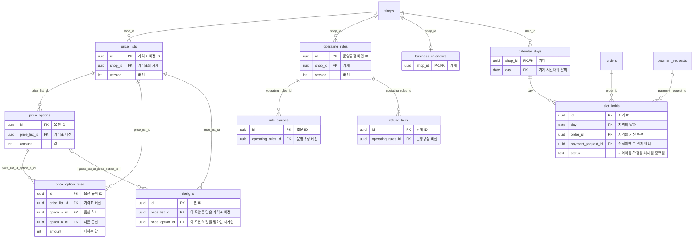
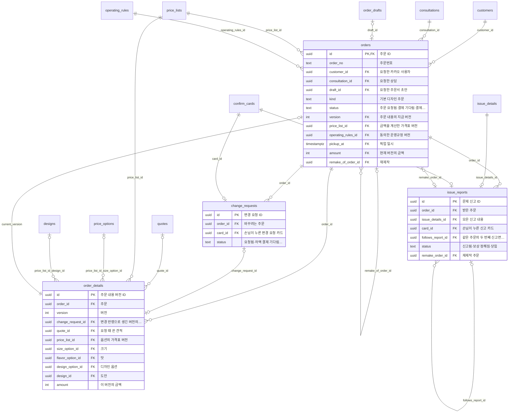
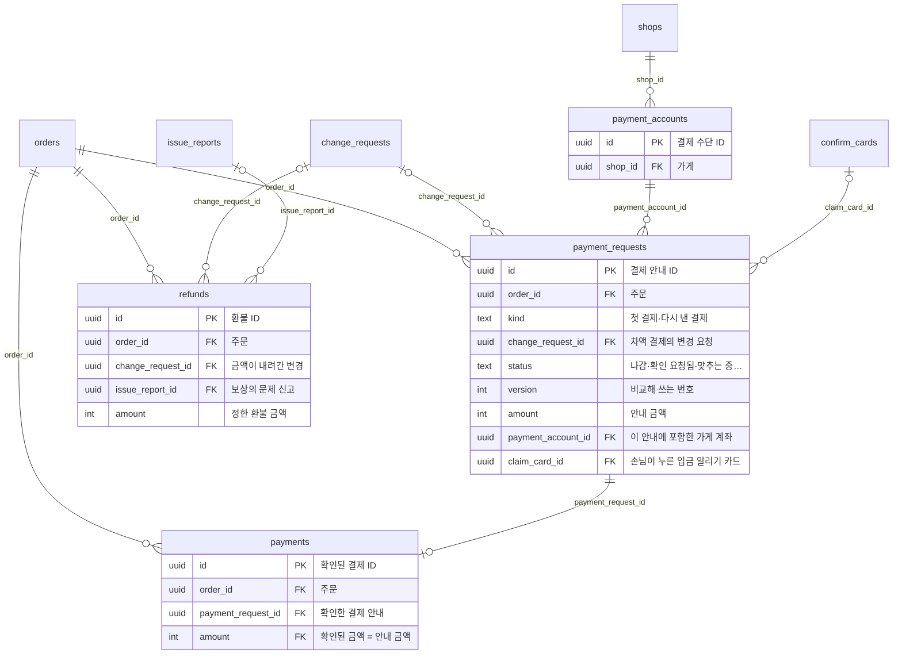
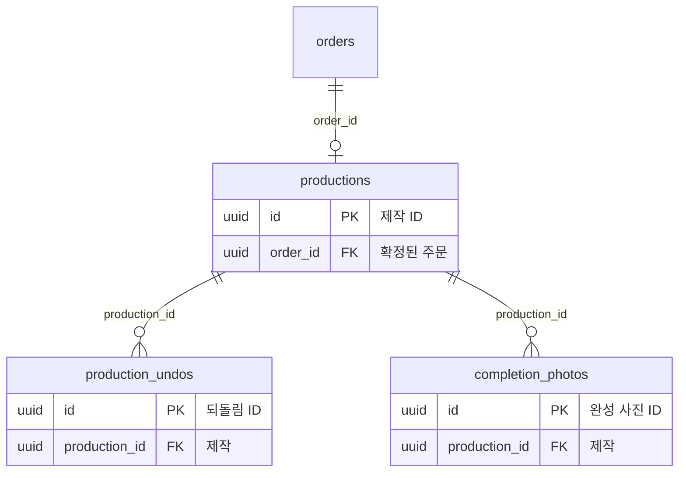
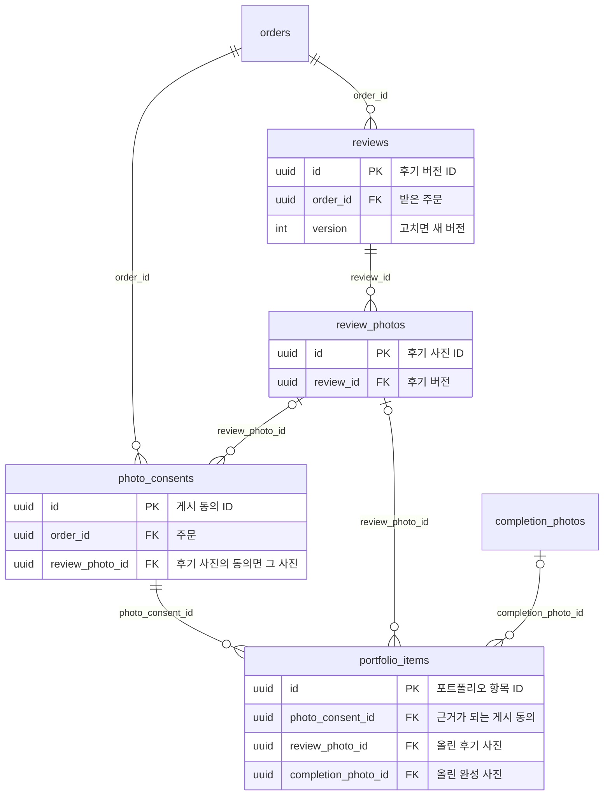
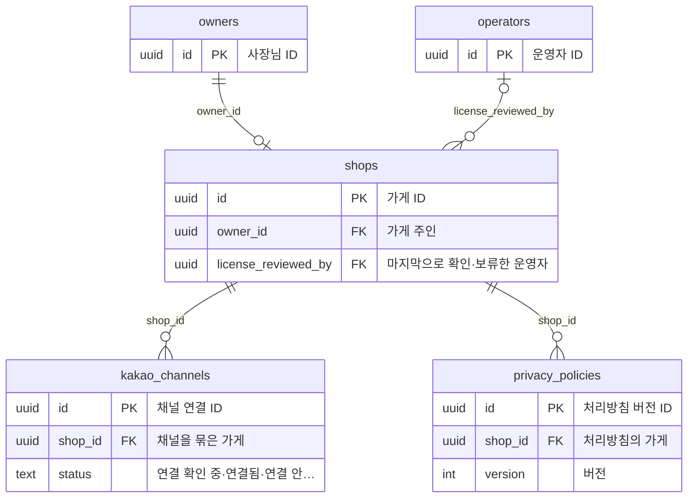
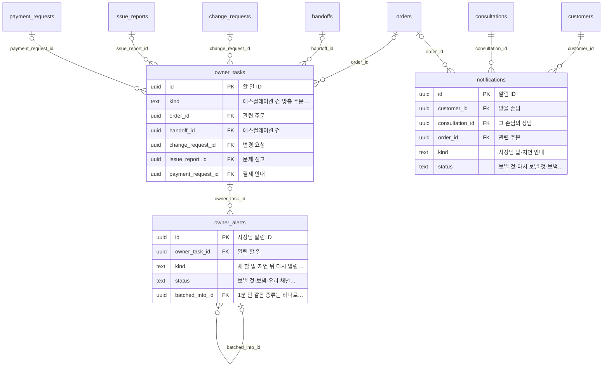
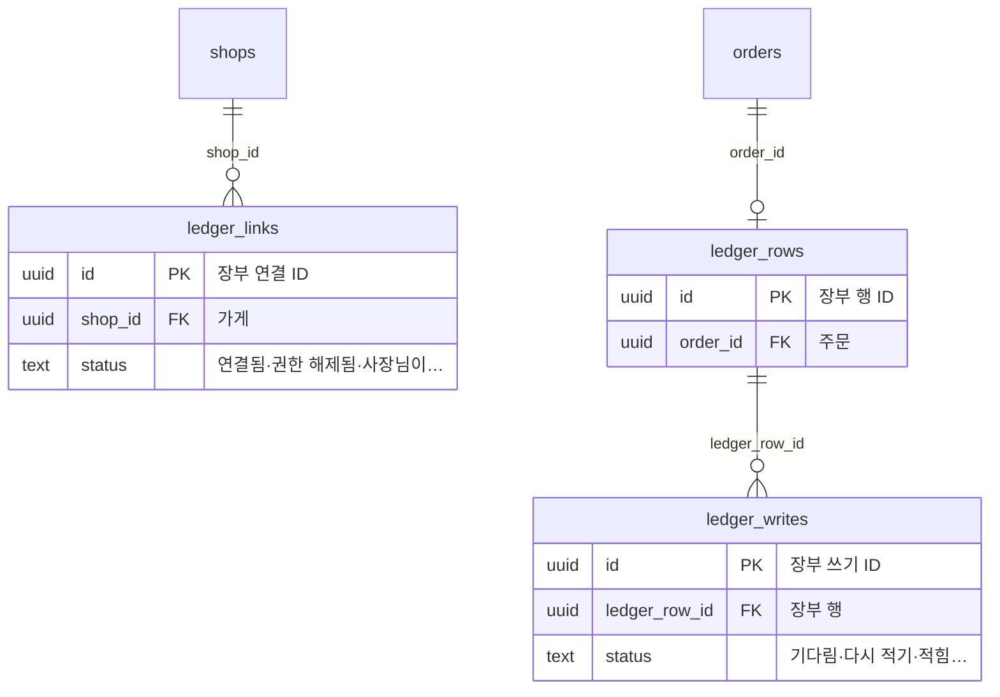
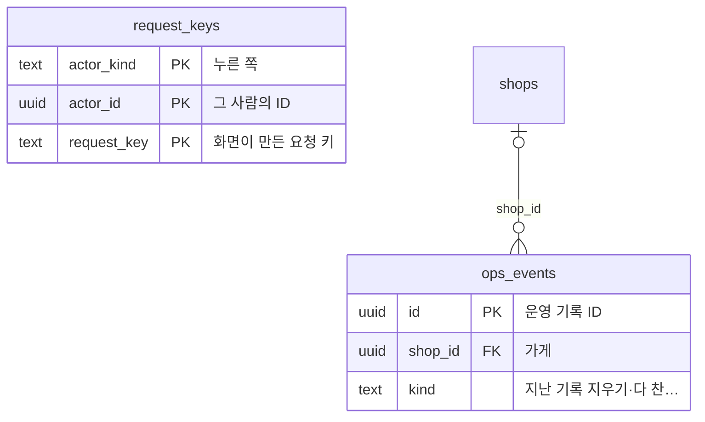

# 05단계 ERD: 수제케이크 주문제작 데이터베이스

상태: 확정(2026-11-12 11:56 동희님 '추천대로 굳힘', 10절). 원본은 [`db/schema.sql`](../../db/schema.sql)이고, 사람이 보는 곳은 ERD Editor로 여는 [`db/schema.erd.json`](../../db/schema.erd.json)입니다(`truth: source`). 이 문서의 표 목록과 다이어그램은 같은 원본에서 `build_erd.py`가 만듭니다.

## 1. 한눈에

- 테이블 51개(TBL-001~051), 컬럼 585개입니다. 외래 키 105개, CHECK 275개, UNIQUE 72개, EXCLUDE 1개로 DB가 지키는 규칙을 적었고, 제약 밖 인덱스는 46개(그 가운데 부분 인덱스 33개)입니다.
- 기능 명세 SPEC-001~069가 읽고 쓰는 데이터 680건을 테이블.컬럼 355개에 하나씩 이었습니다([`erd_map.py`](../../research/cake-erd-2026-11/erd_map.py)). 모든 SPEC에 대응이 있고, 쓰이지 않는 테이블은 없습니다.
- 용어집 TERM-001~074가 모두 자리를 가집니다. 애그리거트·읽기 모델 31개는 테이블 헤더 주석(16개)이나 '테이블 없음' 행(15개)에, 상태·값 이름 23개는 컬럼 설명에 TERM 번호로 있습니다.
- PostgreSQL 16.15의 빈 DB에 `db/schema.sql`과 마이그레이션 `0001_init.sql`을 각각 만들어 카탈로그가 같음을 봤고, 규칙 테스트 87개가 모두 기대한 제약에 막혔습니다(8절).
- ERD Editor 다이어그램은 MCP 서버(1.2.0)로 이 원본을 들여와 만들었고, 다이어그램의 DDL을 빈 DB에 만들어 견주면 CHECK 275개 말고는 같습니다(9절).
- 체크포인트: 2026-11-12 11:56 동희님이 이 작업 대화의 결정 카드에서 '추천대로 굳힘'을 고르셔서, 이 스키마와 5절의 결정 사항 E1~E14를 추천대로 확정했습니다. SPEC-021을 좁혀 읽은 E5(카드번호는 끝 4자리만 남김)도 함께 정해졌습니다.

## 2. 읽은 것과 만든 것

| 읽은 것 | 버전 | 쓴 것 |
| --- | --- | --- |
| [`docs/04-functional-spec/spec.md`](../04-functional-spec/spec.md) | 04단계 확정(2026-11-12 09:57 동희님 '추천대로 확정'), 커밋 ddb9c85 | SPEC-001~069의 데이터, 상태 머신 1-1~1-8, 공통 규칙 G1~G9, 요구사항 해석 R2~R21, AI-1 |
| [`docs/02-prd/requirements.md`](../02-prd/requirements.md) | 버전 3(REQ-001~163, 유효한 161), 커밋 ddb9c85 | 컬럼 설명과 제약에 단 REQ 번호 |
| [`docs/01-domain/domain.md`](../01-domain/domain.md) | 커밋 dc7dfae | CTX-001~009, TERM-001~074와 이름, 애그리거트 규칙(3-1), 읽기 모델(5-2) |
| [`docs/03-user-flow/`](../03-user-flow/) | FL-001~014, 커밋 ddb9c85 | 플로우의 순서(한 트랜잭션으로 써야 하는 곳) |

| 만든 것 | 무엇 |
| --- | --- |
| [`db/schema.sql`](../../db/schema.sql) | 원본 DDL. 테이블마다 `-- TBL-번호 이름 (컨텍스트) ← SPEC 목록 \| terms: 용어` 헤더 주석과 TBL 번호로 시작하는 테이블 설명, 컬럼마다 설명 |
| [`db/migrations/0001_init.sql`](../../db/migrations/0001_init.sql) | 첫 마이그레이션(확정할 때의 `schema.sql` 사본). 한 번 적용한 뒤에는 고치지 않고 0002부터 더함 |
| [`db/schema.erd.json`](../../db/schema.erd.json) | ERD Editor 다이어그램. 컨텍스트마다 색 그룹, 맨 위 메모 |
| [`research/cake-erd-2026-11/`](../../research/cake-erd-2026-11/) | `build_erd.py`(헤더 주석 SPEC 목록·컬럼 설명·이 문서의 표와 다이어그램을 만듦), `erd_map.py`(SPEC → 테이블.컬럼 대응), `check_erd.py`(검사), `rule_tests.sql`(규칙 테스트), `erd_editor_build.py`(ERD Editor 다이어그램 만들기와 견주기) |

다시 만들고 검사하는 법(저장소 맨 위에서):

```sh
python3 -B research/cake-erd-2026-11/build_erd.py . --write
python3 -B research/cake-erd-2026-11/check_erd.py . --db "host=… port=… user=…"
python3 -B research/cake-erd-2026-11/erd_editor_build.py . --compare --db "host=… port=… user=…"
```

`check_erd.py`의 `--db`는 검사용 PostgreSQL 서버입니다. 검사용 DB(`erd_check_*`)를 만들고 끝나면 지우니 운영 서버에는 쓰지 않습니다.

## 3. 테이블과 다이어그램

### 3-1. 이름과 형식을 정한 방식

- 이름은 영어 snake_case, 테이블은 복수형이고 용어집의 코드 이름에서 땄습니다. 상태 값도 영어로 두고 한국어 이름은 컬럼 설명에 적었습니다.
- 기본 키는 모두 uuid입니다. 손님에게 보이는 번호는 주문번호(`orders.order_no`, 무작위) 하나뿐입니다(G6).
- 시각은 `timestamptz`(UTC로 저장, 계산은 가게 시간대, G8), 날짜만 쓰는 자리·목록은 가게 시간대의 `date`입니다. 돈은 원 단위 정수입니다.
- 외래 키는 모두 `ON DELETE RESTRICT`입니다. 기록은 지우기 작업(6절)이 딸린 행부터 직접 지웁니다.
- 이전 버전(가격표·운영규정·주문 내용·후기)은 지우지 않고 행으로 남깁니다(REQ-027).
- 시크릿(토큰·키·비밀번호)은 어느 테이블에도 없고 시크릿 저장소의 이름만 둡니다(REQ-135).

### 3-2. 테이블 목록

'읽고 쓰는 SPEC'은 `erd_map.py` 대응에서 만듭니다. 테이블 순서는 만드는 순서(참조를 받는 테이블이 먼저)라 컨텍스트가 섞입니다.

<!-- build_erd:tables:begin -->
| TBL | 테이블 | 이름 | 컨텍스트 | 읽고 쓰는 SPEC | 용어 |
| --- | --- | --- | --- | --- | --- |
| TBL-001 | `owners` | 사장님 | CTX-007 | 001, 067 | TERM-044 |
| TBL-002 | `operators` | 운영자 | CTX-007 | 001, 003 | TERM-074 |
| TBL-003 | `shops` | 가게 | CTX-007 | 001, 002, 003, 009, 010, 011, 017, 024, 025, 052, 053, 068 | TERM-053 |
| TBL-004 | `kakao_channels` | 카카오톡 채널 연결 | CTX-007 | 008, 010, 011, 017, 068 | TERM-053 |
| TBL-005 | `privacy_policies` | 가게 개인정보 처리방침 | CTX-007 | 010, 011, 018 | 없음 |
| TBL-006 | `price_lists` | 가격표 버전 | CTX-002 | 004, 010, 011, 013, 027 | TERM-047 |
| TBL-007 | `price_options` | 가격표 옵션 | CTX-002 | 004, 011, 013 | TERM-047 |
| TBL-008 | `price_option_rules` | 옵션 규칙 | CTX-002 | 004, 013 | TERM-047 |
| TBL-009 | `designs` | 도안 | CTX-002 | 004, 011, 013 | TERM-020 |
| TBL-010 | `operating_rules` | 운영규정 버전 | CTX-002 | 005, 010, 013, 016, 029, 032, 040, 041, 042, 043, 058 | TERM-017 |
| TBL-011 | `rule_clauses` | 운영규정 조문 | CTX-002 | 005, 016, 026, 028, 041, 046, 047 | TERM-017 |
| TBL-012 | `refund_tiers` | 단계별 환불 | CTX-002 | 005, 016, 040 | TERM-017 |
| TBL-013 | `business_calendars` | 영업 캘린더 설정 | CTX-002 | 007, 010, 011, 012, 014, 024, 052, 061 | TERM-048 |
| TBL-014 | `calendar_days` | 영업 캘린더 날짜 행 | CTX-002 | 007, 011, 012, 014, 015 | TERM-048 |
| TBL-015 | `payment_accounts` | 결제 수단 | CTX-004 | 006, 032 | 없음 |
| TBL-016 | `customers` | 손님 | CTX-001 | 017, 022, 029, 040, 066, 068, 069 | TERM-043 |
| TBL-017 | `consultations` | 상담 | CTX-001 | 017, 018, 022, 023, 025, 029, 065, 068 | TERM-046 |
| TBL-018 | `messages` | 상담 대화 | CTX-001 | 017, 018, 019, 020, 021, 022, 065, 066 | TERM-046 |
| TBL-019 | `masked_values` | 마스킹 원본 값 | CTX-001 | 021, 022, 049, 065, 068 | 없음 |
| TBL-020 | `order_drafts` | 주문서 초안 | CTX-001 | 013, 019, 020, 025, 027, 028, 029, 065 | TERM-003, TERM-057 |
| TBL-021 | `reference_photos` | 참고 사진 | CTX-001 | 013, 019, 031, 065 | TERM-019 |
| TBL-022 | `quotes` | 견적 | CTX-001 | 013, 020, 025, 027, 028, 031 | TERM-013, TERM-058 |
| TBL-023 | `orders` | 주문 | CTX-003 | 013, 016, 029, 030, 031, 036, 037, 038, 039, 040, 041, 045, 046, 047, 048, 050, 052, 054, 055, 056, 060, 061, 062, 064, 065, 068 | TERM-001 |
| TBL-024 | `confirm_cards` | 손님 확인 카드 | CTX-001 | 028, 029, 033, 040, 041, 046, 057, 058, 063, 069 | 없음 |
| TBL-025 | `change_requests` | 변경 요청 | CTX-003 | 041, 042, 043, 044, 045, 046, 048 | TERM-001 |
| TBL-026 | `order_details` | 주문 내용 | CTX-003 | 029, 031, 045, 050, 054, 059, 060, 064, 065 | TERM-004 |
| TBL-027 | `handoffs` | 에스컬레이션 건 | CTX-001 | 014, 015, 017, 020, 021, 022, 023, 025, 026, 029, 030, 040, 053, 056 | TERM-008, TERM-018 |
| TBL-028 | `issue_details` | 신고 내용 | CTX-001 | 057, 058, 059, 065 | TERM-032 |
| TBL-029 | `issue_photos` | 신고 사진 | CTX-001 | 057, 059, 065 | TERM-032 |
| TBL-030 | `issue_reports` | 문제 신고 | CTX-003 | 058, 059, 060, 061 | TERM-031 |
| TBL-031 | `payment_requests` | 결제 안내 | CTX-004 | 006, 015, 029, 030, 031, 032, 033, 034, 035, 037, 038, 039, 043, 044, 046, 048, 068 | TERM-049 |
| TBL-032 | `payments` | 확인된 결제 | CTX-004 | 016, 034, 035, 036, 040, 043, 046, 047, 059 | TERM-049, TERM-014 |
| TBL-033 | `refunds` | 환불 | CTX-004 | 016, 036, 046, 047, 048, 049, 059, 065 | TERM-049 |
| TBL-034 | `slot_holds` | 그날 자리 | CTX-002 | 011, 012, 014, 015, 029, 030, 031, 033, 036, 037, 038, 045, 046, 048, 060 | TERM-007 |
| TBL-035 | `productions` | 제작 | CTX-005 | 016, 036, 045, 050, 051, 053, 054, 055, 058, 060, 061 | TERM-050 |
| TBL-036 | `production_undos` | 제작 표시 되돌린 기록 | CTX-005 | 051 | TERM-050 |
| TBL-037 | `completion_photos` | 완성 사진 | CTX-005 | 011, 053, 063 | TERM-050 |
| TBL-038 | `reviews` | 후기 | CTX-006 | 062 | TERM-051 |
| TBL-039 | `review_photos` | 후기 사진 | CTX-006 | 011, 062, 063 | TERM-051 |
| TBL-040 | `photo_consents` | 사진 게시 동의 | CTX-006 | 028, 029, 062, 063 | TERM-051 |
| TBL-041 | `portfolio_items` | 포트폴리오 | CTX-006 | 011, 063 | TERM-052 |
| TBL-042 | `owner_tasks` | 사장님 할 일 | CTX-008 | 003, 007, 022, 023, 024, 029, 031, 033, 034, 035, 036, 037, 041, 042, 045, 046, 047, 058, 059, 064, 067 | TERM-059 |
| TBL-043 | `owner_alerts` | 사장님 알림 | CTX-008 | 003, 022, 024, 044, 046, 048, 050, 057, 058, 064, 067 | TERM-035 |
| TBL-044 | `notifications` | 알림 | CTX-008 | 022, 023, 024, 029, 031, 032, 035, 036, 039, 042, 044, 045, 047, 048, 052, 053, 059, 061, 066 | TERM-054 |
| TBL-045 | `ledger_links` | 장부 연결 | CTX-009 | 009, 064 | TERM-028 |
| TBL-046 | `ledger_rows` | 장부 행 | CTX-009 | 060, 064 | TERM-055 |
| TBL-047 | `ledger_writes` | 장부 쓰기 | CTX-009 | 009, 036, 039, 045, 046, 047, 048, 054, 055, 060, 064 | TERM-055 |
| TBL-048 | `ai_calls` | AI 호출 기록 | CTX-001 | 017, 020, 021, 068 | TERM-045 |
| TBL-049 | `ai_tool_calls` | AI 도구 호출 기록 | CTX-001 | 013, 014, 020, 021, 026, 040 | 없음 |
| TBL-050 | `request_keys` | 요청 키 | 공통 | 002, 003, 004, 005, 007, 031, 034, 038, 039, 042, 047, 048, 051, 054, 059 | 없음 |
| TBL-051 | `ops_events` | 운영 기록 | 공통 | 008, 010, 017, 029, 065 | 없음 |
<!-- build_erd:tables:end -->

### 3-3. 컨텍스트별 다이어그램

전체 다이어그램은 ERD Editor에서 봅니다. 아래는 컨텍스트마다 키와 상태 열만 보이는 요약입니다.

<!-- build_erd:diagrams:begin -->
### 컨텍스트 사이 (화살표: 참조하는 쪽 → 참조를 받는 쪽, 숫자는 외래 키 수)


### CTX-001 상담

테이블: TBL-016 `customers`, TBL-017 `consultations`, TBL-018 `messages`, TBL-019 `masked_values`, TBL-020 `order_drafts`, TBL-021 `reference_photos`, TBL-022 `quotes`, TBL-024 `confirm_cards`, TBL-027 `handoffs`, TBL-028 `issue_details`, TBL-029 `issue_photos`, TBL-048 `ai_calls`, TBL-049 `ai_tool_calls`. 컬럼은 기본 키(PK)·외래 키(FK)와 상태·종류·버전·금액만 보입니다. 다른 컨텍스트의 테이블은 이름만 나옵니다.

```mermaid
erDiagram
  customers {
    uuid id PK "손님 ID"
    uuid kakao_channel_id FK "메시지를 보낸 가게 채널"
  }
  consultations {
    uuid id PK "상담 ID"
    uuid customer_id FK "손님"
    text status "열림·사장님 답 기다림·문의…"
  }
  messages {
    uuid id PK "메시지 ID"
    uuid consultation_id FK "상담"
    text kind "글·사진·확인 카드·받지 않는…"
  }
  masked_values {
    uuid id PK "마스킹한 값 ID"
    uuid consultation_id FK "상담"
    text kind "전화번호·계좌번호·카드번호…"
  }
  order_drafts {
    uuid id PK "초안 ID"
    uuid consultation_id FK "상담"
    text status "채우는 중·주문 요청됨"
    uuid price_list_id FK "옵션을 고른 가격표 버전"
    uuid size_option_id FK "크기"
    uuid flavor_option_id FK "맛"
    uuid design_option_id FK "디자인 옵션"
    uuid design_id FK "고른 도안"
  }
  reference_photos {
    uuid id PK "사진 ID"
    uuid draft_id FK "붙인 주문서 초안"
    uuid message_id FK "사진이 온 메시지"
  }
  quotes {
    uuid id PK "견적 ID"
    uuid draft_id FK "계산한 주문서 초안"
    uuid price_list_id FK "계산한 가격표 버전"
    uuid operating_rules_id FK "유효 기한을 정한 운영규정…"
    int amount "금액"
  }
  confirm_cards {
    uuid id PK "카드 ID"
    uuid consultation_id FK "카드를 보낸 상담"
    uuid customer_id FK "카드를 받은 사용자"
    text kind "주문 요청·입금 알리기·변경…"
    uuid draft_id FK "주문 요청 카드의 초안"
    uuid order_id FK "대상 주문"
  }
  handoffs {
    uuid id PK "에스컬레이션 건 ID"
    uuid consultation_id FK "상담"
    uuid source_message_id FK "에스컬레이션한 손님 말"
    uuid order_id FK "관련 주문"
    text status "열림·답함"
  }
  issue_details {
    uuid id PK "신고 내용 ID"
    uuid consultation_id FK "상담"
    uuid order_id FK "받은 주문"
    text status "모으는 중·신고됨·그만둠"
  }
  issue_photos {
    uuid id PK "신고 사진 ID"
    uuid issue_details_id FK "신고 내용"
    uuid message_id FK "사진이 온 메시지"
  }
  ai_calls {
    uuid id PK "AI 호출 ID"
    uuid consultation_id FK "대화 ID"
  }
  ai_tool_calls {
    uuid id PK "도구 호출 ID"
    uuid ai_call_id FK "도구를 호출한 AI 호출"
    uuid consultation_id FK "대화 ID"
  }
  kakao_channels ||--o{ customers : "kakao_channel_id"
  customers ||--o{ consultations : "customer_id"
  consultations ||--o{ messages : "consultation_id"
  consultations ||--o{ masked_values : "consultation_id"
  consultations ||--o{ order_drafts : "consultation_id"
  price_lists |o--o{ order_drafts : "price_list_id"
  price_options |o--o{ order_drafts : "price_list_id_size_option_id"
  designs |o--o{ order_drafts : "price_list_id_design_id"
  order_drafts ||--o{ reference_photos : "draft_id"
  messages ||--o{ reference_photos : "message_id"
  order_drafts ||--o{ quotes : "draft_id"
  price_lists ||--o{ quotes : "price_list_id"
  operating_rules ||--o{ quotes : "operating_rules_id"
  consultations ||--o{ confirm_cards : "consultation_id"
  customers ||--o{ confirm_cards : "customer_id"
  order_drafts |o--o{ confirm_cards : "draft_id"
  orders |o--o{ confirm_cards : "order_id"
  consultations ||--o{ handoffs : "consultation_id"
  messages ||--o| handoffs : "source_message_id"
  orders |o--o{ handoffs : "order_id"
  consultations ||--o{ issue_details : "consultation_id"
  orders |o--o{ issue_details : "order_id"
  issue_details ||--o{ issue_photos : "issue_details_id"
  messages ||--o{ issue_photos : "message_id"
  consultations ||--o{ ai_calls : "consultation_id"
  ai_calls ||--o{ ai_tool_calls : "ai_call_id"
  consultations ||--o{ ai_tool_calls : "consultation_id"
```



### CTX-002 가게 규칙

테이블: TBL-006 `price_lists`, TBL-007 `price_options`, TBL-008 `price_option_rules`, TBL-009 `designs`, TBL-010 `operating_rules`, TBL-011 `rule_clauses`, TBL-012 `refund_tiers`, TBL-013 `business_calendars`, TBL-014 `calendar_days`, TBL-034 `slot_holds`. 컬럼은 기본 키(PK)·외래 키(FK)와 상태·종류·버전·금액만 보입니다. 다른 컨텍스트의 테이블은 이름만 나옵니다.



### CTX-003 주문

테이블: TBL-023 `orders`, TBL-025 `change_requests`, TBL-026 `order_details`, TBL-030 `issue_reports`. 컬럼은 기본 키(PK)·외래 키(FK)와 상태·종류·버전·금액만 보입니다. 다른 컨텍스트의 테이블은 이름만 나옵니다.



### CTX-004 결제·환불

테이블: TBL-015 `payment_accounts`, TBL-031 `payment_requests`, TBL-032 `payments`, TBL-033 `refunds`. 컬럼은 기본 키(PK)·외래 키(FK)와 상태·종류·버전·금액만 보입니다. 다른 컨텍스트의 테이블은 이름만 나옵니다.



### CTX-005 제작·전달

테이블: TBL-035 `productions`, TBL-036 `production_undos`, TBL-037 `completion_photos`. 컬럼은 기본 키(PK)·외래 키(FK)와 상태·종류·버전·금액만 보입니다. 다른 컨텍스트의 테이블은 이름만 나옵니다.



### CTX-006 후기·포트폴리오

테이블: TBL-038 `reviews`, TBL-039 `review_photos`, TBL-040 `photo_consents`, TBL-041 `portfolio_items`. 컬럼은 기본 키(PK)·외래 키(FK)와 상태·종류·버전·금액만 보입니다. 다른 컨텍스트의 테이블은 이름만 나옵니다.



### CTX-007 가게 등록·연결

테이블: TBL-001 `owners`, TBL-002 `operators`, TBL-003 `shops`, TBL-004 `kakao_channels`, TBL-005 `privacy_policies`. 컬럼은 기본 키(PK)·외래 키(FK)와 상태·종류·버전·금액만 보입니다. 다른 컨텍스트의 테이블은 이름만 나옵니다.



### CTX-008 알림

테이블: TBL-042 `owner_tasks`, TBL-043 `owner_alerts`, TBL-044 `notifications`. 컬럼은 기본 키(PK)·외래 키(FK)와 상태·종류·버전·금액만 보입니다. 다른 컨텍스트의 테이블은 이름만 나옵니다.



### CTX-009 장부 연결

테이블: TBL-045 `ledger_links`, TBL-046 `ledger_rows`, TBL-047 `ledger_writes`. 컬럼은 기본 키(PK)·외래 키(FK)와 상태·종류·버전·금액만 보입니다. 다른 컨텍스트의 테이블은 이름만 나옵니다.



### 공통

테이블: TBL-050 `request_keys`, TBL-051 `ops_events`. 컬럼은 기본 키(PK)·외래 키(FK)와 상태·종류·버전·금액만 보입니다. 다른 컨텍스트의 테이블은 이름만 나옵니다.


<!-- build_erd:diagrams:end -->

## 4. 앱이 지키는 규칙

DB는 한 행 안의 규칙(CHECK), 행 사이의 관계(외래 키·UNIQUE), '하나만 열림'(부분 UNIQUE), 기간 중복됨(EXCLUDE)을 지킵니다. 아래는 여러 행을 세거나 상태 전이를 봐야 해서 앱(06·11단계)이 지키고 12단계 테스트로 보는 규칙입니다.

| 번호 | 규칙 | 근거 | 앱이 하는 일 |
| --- | --- | --- | --- |
| A1 | 확정은 결제 확인으로만 | REQ-060, 1-2 | 주문을 `confirmed`로 바꾸는 쓰기는 `payments` 행을 남기는 같은 트랜잭션에서만 합니다. DB는 확정 시각이 있는지만 봅니다 |
| A2 | 환불 합은 받은 금액을 넘지 않음 | REQ-086 | 주문 행을 잠그고(`SELECT … FOR UPDATE`) 그 주문의 `payments` 합과 `refunds` 합을 셉니다 |
| A3 | 하루 최대 개수를 넘지 않음 | G3 | `calendar_days`의 (가게, 날짜) 행을 없으면 만들고 잠근 뒤, 그날 가예약됨·확정됨을 세고 잡습니다. 마감 후 추가 수락은 사장님이 추가 수락한 날(R10)에만 |
| A4 | 픽업 날짜 | G8 | `orders.pickup_day`는 가게 시간대(`shops.time_zone`)로 본 `pickup_at`의 날짜이고, 유효한 자리의 날짜와 같습니다 |
| A5 | 결제 안내 금액 | REQ-076, R13 | 첫 결제는 수락한 버전(기본 디자인은 요청한 버전)의 금액, 차액 결제는 변경 요청의 추가 금액입니다 |
| A6 | 상태가 가는 길 | 1-1~1-8, G3 | DB는 상태와 시각의 쌍만 봅니다. 어느 상태에서 어디로 갈 수 있는지는 앱의 상태 머신이 지키고, 버전을 비교해 씁니다(`UPDATE … WHERE version = 읽은 값`) |
| A7 | 손님 확인 카드 | G9 | 누른 사용자가 카드의 손님이고, 30분 안이고, 묶인 버전이 현재 버전일 때만 명령합니다 |
| A8 | 손님 명령은 그 손님만 | REQ-062, G1 | 변경·취소·신고는 말한 손님이 `orders.customer_id`일 때만 받습니다 |
| A9 | 모든 읽기·쓰기는 그 가게 것만 | G1, SPEC-068 | 채널로 찾은 가게 ID로 거릅니다. DB의 복합 외래 키(E1)는 가게가 섞인 행을 막을 뿐, 다른 가게 행을 읽는 것은 막지 않습니다 |
| A10 | 예약 링크를 낼 조건 | SPEC-010 | 영업 신고 확인됨은 DB가(`shops_booking_needs_license`), 현재 버전 가격표·운영규정·영업 캘린더·채널 연결·처리방침 국외 이전 항목은 앱이 봅니다 |
| A11 | 사진 장수 | SPEC-019, SPEC-053, SPEC-057, SPEC-062 | 신고·완성·후기 사진은 순서 컬럼이 1~5라 DB가 막고, 참고 사진의 상담마다 10장은 앱이 셉니다 |
| A12 | 먼저 보내는 안내 | G5 | 채널 친구에게만, 정해진 시각 안내는 가게 시간 08:00~20:50에만 보냅니다 |
| A13 | AI 비용 한도 | REQ-163 | `ai_calls`의 가게 하루 `cost_krw` 합이 `shops.daily_ai_cost_limit_krw`에 닿으면 그날 남은 질문을 에스컬레이션합니다 |
| A14 | 장부에 적는 값 | 1-8, R21 | 적을 때 그 주문의 지금 값으로 적어 옛 이벤트가 새 값을 덮지 않게 합니다. 재제작 주문은 원래 주문의 행에 적습니다 |
| A15 | 마스킹한 값 | SPEC-021, REQ-137 | AI·로그로는 `messages.body_masked`만 보내고, 원래 값(`masked_values`)은 그 가게 사장님 화면에만 보입니다 |
| A16 | 지난 기록 지우기 | SPEC-065 | 6절의 순서대로 지웁니다 |

## 5. 이 단계의 결정 사항

스키마를 확정할 때 함께 정한 결정 사항입니다(2026-11-12 11:56 확정, 10절). 바꾸면 테이블이나 컬럼이 달라지므로 바꿀 때는 새 마이그레이션과 함께 다시 확인 요청합니다.

| 번호 | 결정 사항 | 사유 | 대안과 그 결과 |
| --- | --- | --- | --- |
| E1 | 가게에 딸린 테이블은 모두 `shop_id`를 갖고, 다른 테이블을 `(shop_id, 대상_id)` 복합 외래 키로 참조함 | 한 가게의 행이 다른 가게의 행을 참조하는 일을 DB가 막음(G1, SPEC-068). 규칙 테스트 G1 2개 | `id`만으로 참조함: 컬럼과 인덱스가 줄지만 가게가 섞인 행을 앱만 막음 |
| E2 | 주문 내용은 버전마다 한 행(`order_details`), 주문 행은 현재 버전의 금액·픽업 일시·가격표 버전을 함께 가짐. 둘이 늘 같음을 지연 외래 키(`orders_current_details_fk`)로 트랜잭션 끝에 확인 | 목록·전날 안내가 주문 행만 읽어도 되고, 이전 버전은 남음(REQ-027). 규칙 테스트 E2 2개 | 현재 버전을 주문 행에 두지 않음: 읽을 때마다 마지막 버전을 찾아야 함 |
| E3 | 인도 시각·미수령 시각은 `productions`에만 두고 주문 행에는 상태만 | 같은 시각을 두 곳에 두지 않음 | 주문 행에도 둠: 둘이 어긋날 수 있음 |
| E4 | 확인된 결제는 `(결제 안내, 주문, 금액)`으로 결제 안내를 참조함(`payments_match_fk`), 결제 안내마다 하나 | 확인된 결제가 안내한 주문·금액과 다를 수 없음(REQ-081, REQ-153) | 결제 안내 ID만: 금액이 다른 결제를 DB가 받음 |
| E5 | 상담에서 마스킹한 카드번호는 끝 4자리만 남김(`masked_values_card_last4_chk`) | 손님이 실수로 보낸 카드번호 전체는 사장님에게도 쓸모가 없고, 남기면 새어 나갈 때 피해가 큼. 전화번호·계좌번호는 원래 값을 그대로 둠 | SPEC-021을 글자 그대로: 카드번호 전체를 그 가게 사장님 화면에만 보임. 반론: 끝 4자리만으로는 사장님이 손님에게 어느 카드인지 되물을 때 덜 분명함 |
| E6 | 잡힌 자리는 결제 안내를 참조해야 함(`slot_holds_held_chk`). 그래서 기본 디자인 주문 요청은 주문·첫 버전·동의·결제 안내·자리를 한 트랜잭션으로 쓰고, 맞춤 주문은 수락 때 결제 안내와 자리를 함께 씀 | 자리는 결제 기한까지 잡는데(R13) 그 기한이 결제 안내에 있음. R11의 '한 트랜잭션'을 테이블로 옮김 | 자리에 기한을 따로 둠: 결제 안내와 기한이 어긋날 수 있음 |
| E7 | 퀵 여부 컬럼(`courier_pickup`)을 주문서 초안과 주문 내용에 더함. 말이 없으면 매장 픽업 | REQ-092 오늘 픽업 목록이 퀵 여부를 보이는데 SPEC에 받는 필드가 없었음 | 인도할 때만 고름(`productions.handover_kind`): 오늘 목록에 미리 보이지 않음 |
| E8 | '입금 알리기'는 결제 안내마다 한 번. 사장님이 '미입금'을 고른 시각(`claim_rejected_at`)을 남겨 다시 받지 않음 | SPEC-033과 R14: 거짓 알림으로 자리를 계속 붙잡지 못하게 | 여러 번 받음: 기한이 지나도 자리가 풀리지 않을 수 있음 |
| E9 | 사장님 할 일 목록(TERM-059, 용어집은 CTX-001)을 알림 컨텍스트(CTX-008)의 `owner_tasks` 테이블로 둠 | 에스컬레이션 건만이 아니라 결제·환불·장부·영업 신고·영업 캘린더까지 모으는 목록이라 여러 컨텍스트가 씀. 검사에서 이 하나만 예외로 둠 | 상담(CTX-001)에 둠: 상담이 결제·장부 일까지 알게 됨 |
| E10 | 운영자 알림(이미 다른 가게에 묶인 채널, 처리방침 국외 이전 항목 빔, AI 실패 몰림)은 운영 기록(`ops_events`)의 종류로 둠 | 운영자 화면이 하나뿐이고 손님·주문 기록을 보이지 않음(G1). 건수만 남김 | 운영자 알림 테이블을 따로 둠: 테이블이 늘지만 읽음 표시 등을 둘 수 있음 |
| E11 | AI-1의 '우리 로그는 마스킹한 대화만, 30일 보관'은 도구 호출 기록(`ai_tool_calls`, 마스킹한 인자)에 씀: 30일 지난 행을 지움. AI 호출 기록(`ai_calls`)은 숫자와 종류만이라 남겨 상담·가게별 비용을 셈(REQ-150, REQ-163). 대화(`messages`)는 SPEC-065를 따름 | 비용 기록에는 대화 글이 없어 지울 이유가 없음 | `ai_calls`도 30일 뒤 지움: 상담별 비용을 30일 넘게 볼 수 없음 |
| E12 | 가게 규칙이 '안 됨'을 준 견적(마감된 날, 맞지 않는 옵션)은 `quotes`에 남기지 않음. 견적 행은 금액이 있는 것만 | 견적은 금액·유효 기한을 손님에게 안내한 기록(TERM-013) | 안 된 견적도 남김: 견적 행 대부분이 비게 됨 |
| E13 | 영업 신고 확인은 마지막 상태·이유·운영자·시각만 `shops`에 둠 | 첫 버전 범위(SPEC-003). 운영자가 예약 링크를 회수하는 기능(M7)도 첫 버전에 없음 | 확인 이력 테이블을 둠: 다음 버전에서 마이그레이션으로 더할 수 있음 |
| E14 | 픽업 장소(`shops.pickup_address`)를 더하고 비워 둘 수 있게 둠 | SPEC-052 전날 안내가 가게 위치를 포함하는데 가게 등록 필드(SPEC-002)에 없음. 등록 플로우를 바꾸지 않고 가게 설정에서 받음 | 등록 때 꼭 받음: SPEC-002가 바뀜. 비었을 때 예약 링크를 막을지는 06단계 API에서 정함 |

## 6. 지난 기록 지우기의 순서 (SPEC-065)

외래 키가 모두 `RESTRICT`라 참조하는 행부터 지웁니다. 하루 한 번 03:00에 돌고, 두 번 돌아도 결과가 같고, 중간에 멈추면 다음 날 이어서 지웁니다.

주문 없이 종료된 상담(`consultations.status = 'dropped'`, `dropped_at`이 30일 지남, 그 상담의 `orders` 행 없음, 열린 에스컬레이션 건 없음)마다 한 트랜잭션으로:

1. 그 상담의 에스컬레이션 건을 참조하는 `owner_alerts` → `owner_tasks`
2. `handoffs`
3. `confirm_cards`(주문이 없는 상담이라 주문 요청 카드뿐)
4. `quotes`
5. `reference_photos`(저장소의 사진 파일도 지움)
6. `issue_photos`(파일 포함) → `issue_details`(주문이 없어 신고로 전환되지 않은 것)
7. `order_drafts`
8. `masked_values`
9. `notifications`(사장님 답을 담은 안내 포함)
10. `ai_tool_calls`
11. `messages`
12. 상담 행은 내용 없이 남김: `status = 'deleted'`, `deleted_at` 기록. 같은 손님이 다시 오면 새 상담이 열리고 고지를 다시 보냄(SPEC-018)
13. 지운 건수를 `ops_events`(`purge_run`)에 내용 없이 남김

이 순서는 `build_erd.py`가 읽은 외래 키 그래프로 거꾸로 참조가 없음을 확인했습니다. 주문으로 전환된 상담은 이 지우기에 들지 않으므로, 주문 쪽 테이블(`orders`, `order_details`, `change_requests`, `issue_reports`, `payment_requests`)가 이 행들을 참조해 막는 일은 없습니다. 실제 지우기 SQL은 11단계에서 쓰고 12단계에서 테스트합니다.

주문 기록의 개인정보(이름·연락처·대화·사진·알레르기, 환불 계좌)는 법정 보존 기간 뒤 지웁니다. 보존 기간이 법률 검토 전까지 정해지지 않아(SPEC-065) 지금은 지우지 않으며, 지울 때는 `order_details`·`order_drafts`의 이름·연락처·알레르기와 `refunds`의 계좌를 비우고, 사진·대화 행을 위 순서로 지운 뒤 `orders.personal_data_purged_at`을 남깁니다.

## 7. AI 호출 기록

05 계약이 요구하는 AI 호출 기록 컬럼과 이 스키마의 컬럼입니다. 대화 글·개인정보·시크릿은 두지 않습니다.

| 계약의 필드 | 테이블.컬럼 |
| --- | --- |
| 보낸 시각, 모델, 프롬프트 버전 | `ai_calls.sent_at`, `provider`, `model`, `prompt_version` |
| 토큰 수 | `ai_calls.input_tokens`, `output_tokens` |
| 첫 토큰까지·끝까지 시간 | `ai_calls.first_token_ms`, `total_ms` |
| 결과(성공·실패·한도) | `ai_calls.result`(`success`, `failure`, `timeout`, `limit_reached`), `error_kind` |
| 요청 추적 ID | `ai_calls.trace_id`(+ `attempt`), `messages.trace_id`로 대화와 연결 |
| 멈춘 사유 | `ai_calls.stop_reason` |
| 캐시 읽기·쓰기 토큰 | `ai_calls.cache_read_tokens`, `cache_write_tokens` |
| 추론 설정 | `ai_calls.reasoning` |
| 도구 호출(이름·결과·대화 ID·대상 ID·마스킹한 인자) | `ai_tool_calls.tool_name`, `result`, `consultation_id`, `target_id`, `args_masked` |
| 정해진 문장을 쓴 이유 | `ai_calls.fallback_reason` |
| 비용(REQ-150, REQ-163) | `ai_calls.cost_usd`, `cost_krw`, `cost_basis` |

프롬프트와 답 글은 남기지 않습니다. 손님에게 간 답은 상담 대화(`messages`)에 마스킹한 글로만 있습니다.

## 8. 검사 결과

2026-11-12 11:48 KST, PostgreSQL 16.15, `check_erd.py . --db ...` 출력 그대로입니다. E1의 시각은 다이어그램 파일을 커밋한 시각입니다.

```text
통과 S1 TBL 번호 51개(TBL-001~TBL-051), 테이블 이름 중복됨 없음
통과 S2 헤더 주석 컨텍스트가 CTX-001~009나 공통
통과 S3 헤더 주석 SPEC 목록이 erd_map.py 대응과 같음
통과 S4 SPEC 69개 모두 대응 있음: 데이터 680건 → 컬럼 355개(전체 컬럼 585개)
통과 S5 쓰이지 않는 테이블 없음(51개 모두 SPEC 대응에 나옴)
통과 S6 컬럼 585개 모두 설명 있음
통과 S7 애그리거트 13개·읽기 모델 18개 용어가 테이블 헤더 주석 16개·'테이블 없음' 행 15개에 한 번씩, 나머지 용어 23개는 컬럼·테이블 설명에. 용어집 74개 모두 자리 있음. 컨텍스트 예외 TERM-059→owner_tasks
통과 S8 테이블 설명이 테이블마다 하나이고 헤더 주석과 같은 TBL 번호로 시작
통과 S9 build_erd.py로 만든 부분(헤더 주석 SPEC·컬럼 설명·README 표와 다이어그램)이 최신
통과 D1 db/schema.sql을 빈 DB에 한 트랜잭션으로 적용(PostgreSQL 16.15)
통과 D2 마이그레이션 1개(0001_init.sql)로 빈 DB에서 다시 만든 카탈로그가 schema.sql과 같음(column 585, constraint 504, extension 1, index 170, table 51)
통과 D3 DB 테이블 51개 모두 기본 키와 TBL 설명, 대응 컬럼 모두 있음(기본 키 51, 외래 키 105, CHECK 275, UNIQUE 72, EXCLUDE 1)
통과 D4 규칙 테스트 87개 가운데 기대한 제약에 막힘 87개, 안 막힘 0개
통과 E1 ERD Editor 파일(2026-11-12T02:48:12+00:00)의 테이블 51개·컬럼 585개·관계 105개·인덱스 70개와 컨텍스트 그룹이 스키마와 같음. 다이어그램이 담지 못하는 부분·식 인덱스 34개와 EXCLUDE는 after 스크립트에, CHECK는 schema.sql에만

검사 14개: 통과 14, 실패 0, 미확인 0
```

- 규칙 테스트(`rule_tests.sql`)는 한 트랜잭션 안에서 가게 둘과 주문 넷의 정상 플로우를 먼저 쓰고(지연 외래 키 확인 포함), 막아야 할 쓰기 87개가 각각 기대한 이름의 제약에 막히는지 봅니다. 끝에 되돌려 아무것도 남기지 않습니다. 이름의 앞머리로 묶으면 SPEC 행 37개, REQ 문장 19개, 공통 규칙 G1~G9 11개, 상태 머신 1-2~1-7 8개, 요구사항 해석 R2~R21 5개, AI-1 4개, 지연 외래 키(E2) 2개, 상담마다 채우는 초안 하나 1개입니다.
- D2와 E1이 차이를 잡는지는 일부러 다르게 만든 사본으로 봤습니다(마이그레이션에 컬럼을 더하고 제약을 지운 사본, 컬럼 설명과 인덱스를 바꾼 사본). 둘 다 실패와 그 행을 보였습니다.
- 보지 못한 것: 앱이 지키는 규칙(4절)은 앱이 없어 테스트하지 못했습니다. 지우기 순서(6절)는 외래 키 그래프로만 봤고 실제로 지워 보지는 않았습니다.

## 9. ERD Editor

- 여는 법: VS Code의 ERD Editor 확장 4.0.0 이상(또는 JetBrains·Obsidian 플러그인 1.0.0 이상)으로 `db/schema.erd.json`을 엽니다. 그룹은 CTX-001부터 위에서 아래로 쌓여 있고 맨 위 노란 메모에 이 다이어그램의 한계를 적었습니다.
- 만든 법: `erd_editor_build.py --build`가 ERD Editor MCP 서버(`@dineug/erd-editor-mcp` 1.2.0, headless)로 `db/schema.sql`을 들여오고(`erd_import_sql`), 데이터베이스를 PostgreSQL로 맞추고, 컨텍스트 그룹과 배치, 메모를 도구로 더했습니다. JSON은 손으로 쓰지 않았습니다.
- 다이어그램이 담지 못하는 것: CHECK 275개(다이어그램에 자리가 없음), 부분 인덱스 33개의 WHERE 조건, 식 인덱스 1개(`operators_email_uq`), EXCLUDE 1개, 지연 외래 키 설정 1개. 부분 인덱스는 들여오면 조건 없는 인덱스가 되어 '가게마다 가격표 하나'처럼 실제보다 센 규칙으로 보이므로 다이어그램의 인덱스에서 빼고, 이것들을 모두 DDL의 after 스크립트에 원본 그대로 옮겼습니다. 외래 키와 UNIQUE의 이름은 다이어그램이 다시 지어 원본과 다릅니다.
- 견준 결과(`--compare`, 다이어그램 파일 2026-11-12 만듦): 다이어그램의 DDL 102,991자를 빈 DB에 만들어 원본 DB와 뜻으로 견주면 컬럼 585·기본 키 51·외래 키 105·고유 92·인덱스 26·EXCLUDE 1·테이블 설명과 컬럼 설명이 모두 같고, 다른 것은 CHECK(원본 275개, 다이어그램 0개)뿐입니다.
- 주의: ERD Editor의 DDL은 외래 키를 인덱스보다 먼저 쓰는데, 복합 UNIQUE가 인덱스로 바뀌어 그 순서로는 PostgreSQL에 적용되지 않습니다(견줄 때는 인덱스를 앞에 둠). 그래서 DB는 늘 `db/schema.sql`과 마이그레이션으로 만들고, 다이어그램의 DDL로 만들지 않습니다.
- 그래서 `truth`는 `source`입니다(계약: 들여와 견줄 때 잃는 것이 있으면 `source`를 유지). 확정한 뒤 바꿀 때는 `db/schema.sql`과 새 마이그레이션을 먼저 고치고, 같은 변경을 ERD Editor 편집 도구로 다이어그램에 더한 뒤 `check_erd.py`의 E1로 맞는지 봅니다. 다시 들여오면 배치가 지워지므로 확정한 뒤에는 들여오지 않습니다.
- 보지 못한 것: 이 작업 환경에 VS Code가 없어 다이어그램을 화면으로 열어 보지는 못했습니다. 그룹 사이 중복이 없고 테이블이 모두 자기 그룹 안에 있음은 파일의 좌표로 봤습니다.

## 10. 체크포인트

- 질문(2026-11-12 11:52 무렵, 이 작업 대화의 결정 카드): "ERD 표 51개와 정한 것 14개를 추천대로 굳힐까요?" 고를 것은 추천대로 굳힘, E5만 바꿈(카드번호를 SPEC-021 글자대로 전체 남김), 고칠 것 말씀이었습니다.
- 결정: 2026-11-12 11:56 동희님이 '추천대로 굳힘'을 고르셨습니다. 테이블 51개(TBL-001~051)와 5절의 E1~E14를 이대로 확정하고 `db/migrations/0001_init.sql`을 첫 마이그레이션으로 둡니다. 확인 요청한 뒤 PR #6에 댓글과 리뷰는 없었습니다.
- 확정한 뒤: 06단계 API 계약을 이 테이블과 컬럼으로 씁니다. 바꿈은 `db/schema.sql`과 새 마이그레이션(0002부터)으로 하고, 이미 보이는 데이터나 보내는 요청을 깨는 바꿈은 다시 확인 요청합니다.
