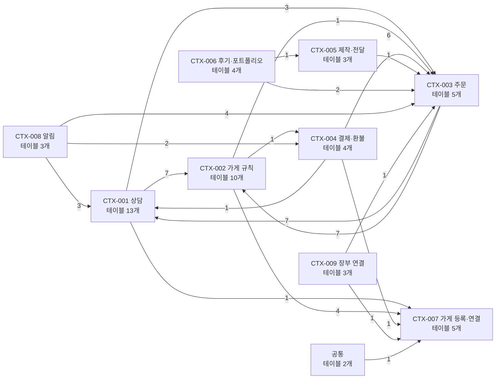
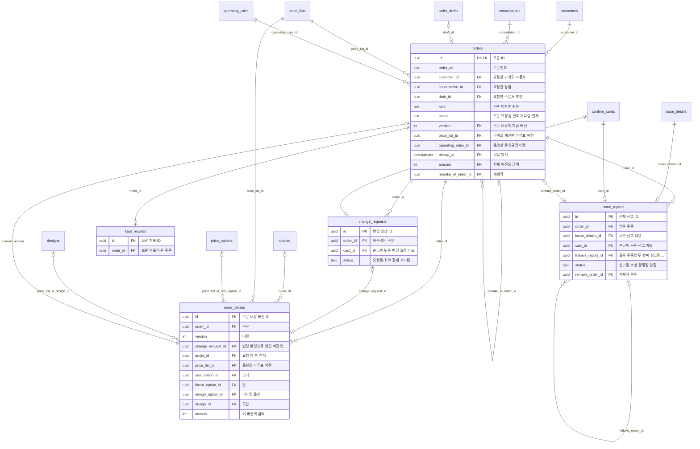
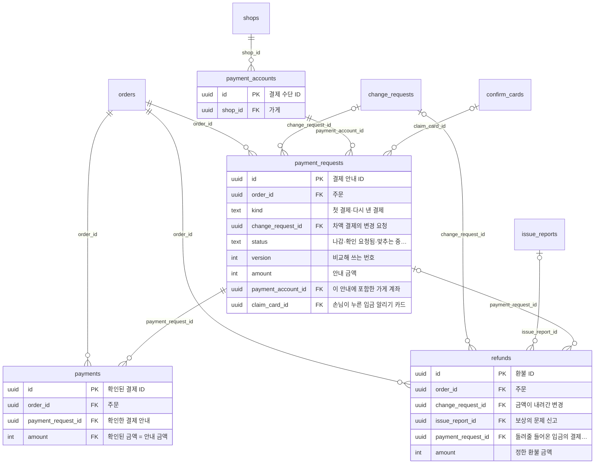
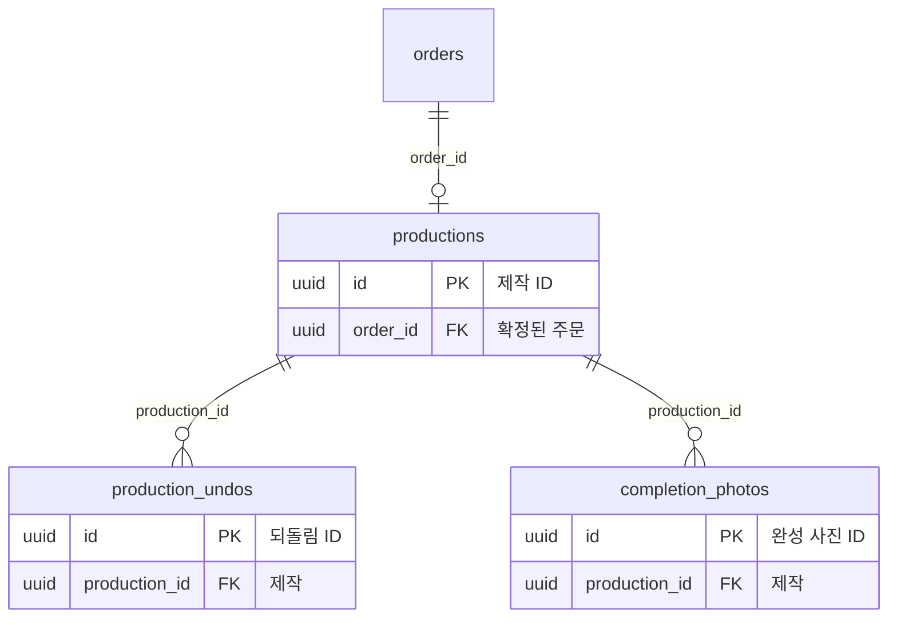
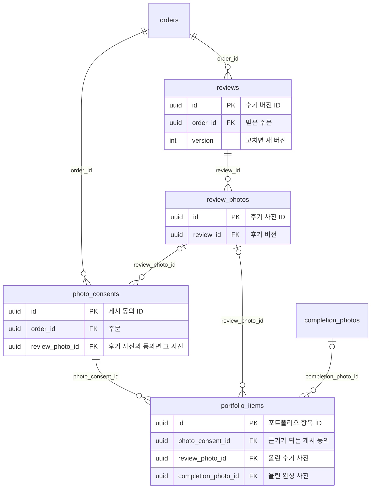
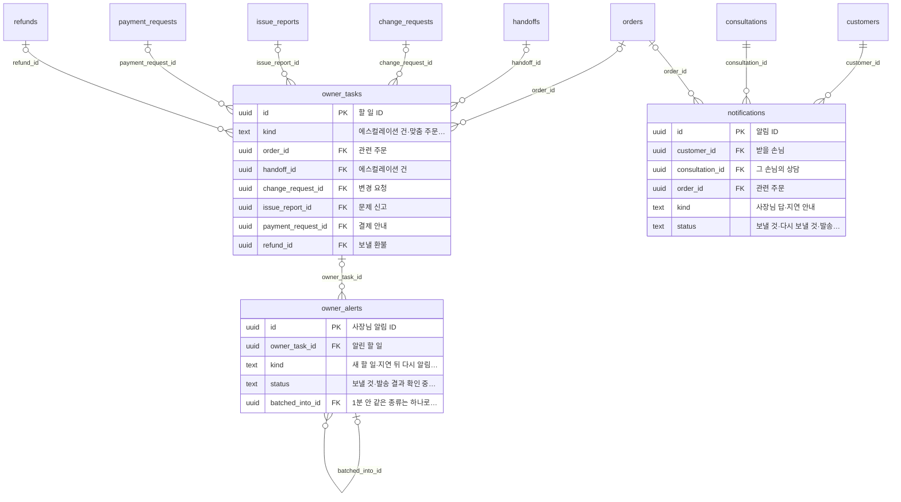
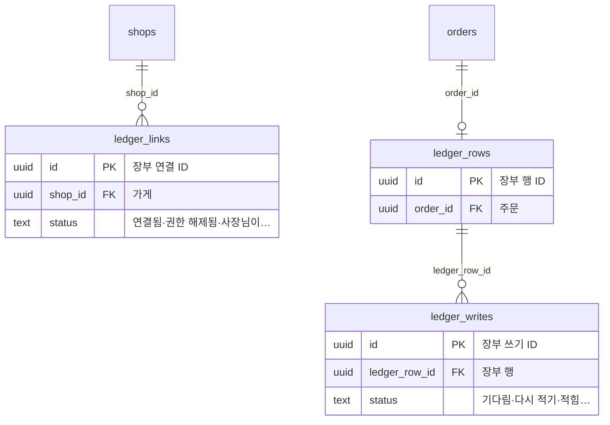
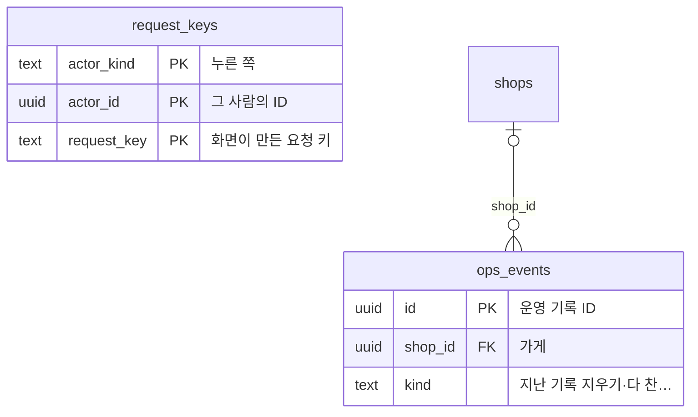

# 05단계 ERD: 수제케이크 주문제작 데이터베이스

상태: 확정(2026-11-12 11:56 동희님 '추천대로 굳힘', 10절). 2026-11-13 설계 재검토의 환불 길(H1·H2)을 마이그레이션 0002로 고쳤습니다(11절). 원본은 [`db/schema.sql`](../../db/schema.sql)이고, 사람이 보는 곳은 ERD Editor로 여는 [`db/schema.erd.json`](../../db/schema.erd.json)입니다(`truth: source`). 이 문서의 표 목록과 다이어그램은 같은 원본에서 `build_erd.py`가 만듭니다.

## 1. 한눈에

- 테이블 51개(TBL-001~051), 컬럼 611개입니다. 외래 키 107개, CHECK 304개, UNIQUE 71개, EXCLUDE 1개로 DB가 지키는 규칙을 적었고, 제약 밖 인덱스는 49개(그 가운데 부분 인덱스 36개)입니다.
- 기능 명세 SPEC-001~072가 읽고 쓰는 데이터 764건을 테이블.컬럼 388개에 하나씩 이었습니다([`erd_map.py`](../../research/cake-erd-2026-11/erd_map.py)). 모든 SPEC에 대응이 있고, 쓰이지 않는 테이블은 없습니다.
- 용어집 TERM-001~074가 모두 자리를 가집니다. 애그리거트·읽기 모델 31개는 테이블 헤더 주석(16개)이나 '테이블 없음' 행(15개)에, 상태·값 이름 23개는 컬럼 설명에 TERM 번호로 있습니다.
- PostgreSQL 16.15의 빈 DB에 `db/schema.sql`과 마이그레이션 `0001_init.sql`·`0002_refund_path.sql`·`0003_order_input_lock.sql`·`0004_kakao_event_path.sql`을 각각 만들어 카탈로그가 같음을 봤고, 규칙 테스트 113개가 모두 막혔습니다(늦은 쓰기 3개는 0행). 두 세션이 같은 주문을 동시에 쓰면 잠금 번호가 늦은 쓰기를 막음도 봤습니다(8절 D5).
- ERD Editor 다이어그램은 MCP 서버(1.2.0)로 이 원본을 들여와 만들었고, 2026-11-13의 바꿈은 편집 도구로 더했습니다(`erd_editor_sync.py`). 다이어그램의 DDL을 빈 DB에 만들어 견주면 CHECK 304개 말고는 같습니다(9절).
- 체크포인트: 2026-11-12 11:56 동희님이 이 작업 대화의 결정 카드에서 '추천대로 굳힘'을 고르셔서, 이 스키마와 5절의 결정 사항 E1~E14를 추천대로 확정했습니다. SPEC-021을 좁혀 읽은 E5(카드번호는 끝 4자리만 남김)도 함께 정해졌습니다.

## 2. 읽은 것과 만든 것

| 읽은 것 | 버전 | 쓴 것 |
| --- | --- | --- |
| [`docs/04-functional-spec/spec.md`](../04-functional-spec/spec.md) | 04단계 확정(2026-11-12 09:57 동희님 '추천대로 확정'), 커밋 ddb9c85. 2026-11-13 SPEC-070~072를 더하고 환불 길·주문자 정보·카카오 먼저 보내기와 채널 연결을 고침(spec.md 8절) | SPEC-001~072의 데이터, 상태 머신 1-1~1-8, 공통 규칙 G1~G9, 요구사항 해석 R2~R21, AI-1 |
| [`docs/02-prd/requirements.md`](../02-prd/requirements.md) | 05단계를 확정했을 때는 버전 3(REQ-001~163, 유효한 161), 커밋 ddb9c85. 지금은 버전 5(REQ-001~184, 유효한 179) | 컬럼 설명과 제약에 단 REQ 번호 |
| [`docs/01-domain/domain.md`](../01-domain/domain.md) | 커밋 dc7dfae | CTX-001~009, TERM-001~074와 이름, 애그리거트 규칙(3-1), 읽기 모델(5-2) |
| [`docs/03-user-flow/`](../03-user-flow/) | FL-001~014, 커밋 ddb9c85. 2026-11-13 FL-001·002·005·008·009·010·011을 고침 | 플로우의 순서(한 트랜잭션으로 써야 하는 곳) |

| 만든 것 | 무엇 |
| --- | --- |
| [`db/schema.sql`](../../db/schema.sql) | 원본 DDL. 테이블마다 `-- TBL-번호 이름 (컨텍스트) ← SPEC 목록 \| terms: 용어` 헤더 주석과 TBL 번호로 시작하는 테이블 설명, 컬럼마다 설명 |
| [`db/migrations/0001_init.sql`](../../db/migrations/0001_init.sql) | 첫 마이그레이션(확정할 때의 `schema.sql` 사본). 한 번 적용한 뒤에는 고치지 않고 0002부터 더함 |
| [`db/migrations/0002_refund_path.sql`](../../db/migrations/0002_refund_path.sql) | 환불 길(설계 재검토 H1·H2)의 바꿈(11절). 0001 위에 적용하면 `schema.sql`과 같은 카탈로그(D2) |
| [`db/migrations/0003_order_input_lock.sql`](../../db/migrations/0003_order_input_lock.sql) | 주문자 정보 카드와 잠금 번호(설계 재검토 H11·H12)의 바꿈(11절) |
| [`db/migrations/0004_kakao_event_path.sql`](../../db/migrations/0004_kakao_event_path.sql) | 카카오 먼저 보내기 길과 버튼 블록 ID(설계 재검토 H7·H8)의 바꿈(11절). 0001~0004를 차례로 적용하면 `schema.sql`과 같은 카탈로그(D2) |
| [`db/schema.erd.json`](../../db/schema.erd.json) | ERD Editor 다이어그램. 컨텍스트마다 색 그룹, 맨 위 메모 |
| [`research/cake-erd-2026-11/`](../../research/cake-erd-2026-11/) | `build_erd.py`(헤더 주석 SPEC 목록·컬럼 설명·이 문서의 표와 다이어그램을 만듦), `erd_map.py`(SPEC → 테이블.컬럼 대응), `check_erd.py`(검사), `rule_tests.sql`(규칙 테스트), `erd_editor_build.py`(ERD Editor 다이어그램 만들기와 견주기), `erd_editor_sync.py`(마이그레이션 0002부터의 바꿈을 ERD Editor 편집 도구로 다이어그램에 옮김) |

다시 만들고 검사하는 법(저장소 맨 위에서):

```sh
python3 -B research/cake-erd-2026-11/build_erd.py . --write
python3 -B research/cake-erd-2026-11/erd_editor_sync.py . --write
python3 -B research/cake-erd-2026-11/check_erd.py . --db "host=… port=… user=…"
python3 -B research/cake-erd-2026-11/erd_editor_build.py . --compare --db "host=… port=… user=…"
```

`check_erd.py`의 `--db`는 검사용 PostgreSQL 서버입니다. 검사용 DB(`erd_check_*`)를 만들고 끝나면 지우니 운영 서버에는 쓰지 않습니다.

## 3. 테이블과 다이어그램

### 3-1. 이름과 형식을 정한 방식

- 이름은 영어 snake_case, 테이블은 복수형이고 용어집의 코드 이름에서 땄습니다. 상태 값도 영어로 두고 한국어 이름은 컬럼 설명에 적었습니다.
- 기본 키는 모두 uuid입니다. 손님에게 보이는 번호는 주문번호(`orders.order_no`, 무작위) 하나뿐입니다(G6).
- 시각은 `timestamptz`(UTC로 저장, 계산은 가게 시간대, G8), 날짜만 쓰는 자리·목록은 가게 시간대의 `date`입니다. 돈은 원 단위 정수입니다.
- 외래 키는 모두 `ON DELETE RESTRICT`입니다. 기록은 지우기 작업(6절)이 딸린 행부터 직접 지웁니다.
- 이전 버전(가격표·운영규정·주문 내용·후기)은 지우지 않고 행으로 남깁니다(REQ-027).
- 시크릿(토큰·키·비밀번호)은 어느 테이블에도 없고 시크릿 저장소의 이름만 둡니다(REQ-135).

### 3-2. 테이블 목록

'읽고 쓰는 SPEC'은 `erd_map.py` 대응에서 만듭니다. 테이블 순서는 만드는 순서(참조되는 테이블이 먼저)라 컨텍스트가 섞입니다.

<!-- build_erd:tables:begin -->
| TBL | 테이블 | 이름 | 컨텍스트 | 읽고 쓰는 SPEC | 용어 |
| --- | --- | --- | --- | --- | --- |
| TBL-001 | `owners` | 사장님 | CTX-007 | 001, 067 | TERM-044 |
| TBL-002 | `operators` | 운영자 | CTX-007 | 001, 003 | TERM-074 |
| TBL-003 | `shops` | 가게 | CTX-007 | 001, 002, 003, 009, 010, 011, 017, 024, 025, 052, 053, 068 | TERM-053 |
| TBL-004 | `kakao_channels` | 카카오톡 채널 연결 | CTX-007 | 008, 010, 011, 017, 066, 068 | TERM-053 |
| TBL-005 | `privacy_policies` | 가게 개인정보 처리방침 | CTX-007 | 010, 011, 018 | 없음 |
| TBL-006 | `price_lists` | 가격표 버전 | CTX-002 | 004, 010, 011, 013, 027 | TERM-047 |
| TBL-007 | `price_options` | 가격표 옵션 | CTX-002 | 004, 011, 013 | TERM-047 |
| TBL-008 | `price_option_rules` | 옵션 규칙 | CTX-002 | 004, 013 | TERM-047 |
| TBL-009 | `designs` | 도안 | CTX-002 | 004, 011, 013 | TERM-020 |
| TBL-010 | `operating_rules` | 운영규정 버전 | CTX-002 | 005, 010, 013, 016, 029, 032, 040, 041, 042, 043, 058 | TERM-017 |
| TBL-011 | `rule_clauses` | 운영규정 조문 | CTX-002 | 005, 016, 026, 028, 041, 046, 047 | TERM-017 |
| TBL-012 | `refund_tiers` | 단계별 환불 | CTX-002 | 005, 016, 040 | TERM-017 |
| TBL-013 | `business_calendars` | 영업 캘린더 설정 | CTX-002 | 007, 010, 011, 012, 014, 024, 052, 061 | TERM-048 |
| TBL-014 | `calendar_days` | 영업 캘린더 날짜 행 | CTX-002 | 007, 011, 012, 014, 015 | TERM-048 |
| TBL-015 | `payment_accounts` | 결제 수단 | CTX-004 | 006, 032 | 없음 |
| TBL-016 | `customers` | 손님 | CTX-001 | 017, 022, 029, 040, 065, 066, 068, 069 | TERM-043 |
| TBL-017 | `consultations` | 상담 | CTX-001 | 017, 018, 022, 023, 025, 029, 065, 068 | TERM-046 |
| TBL-018 | `messages` | 상담 대화 | CTX-001 | 017, 018, 019, 020, 021, 022, 065, 066 | TERM-046 |
| TBL-019 | `masked_values` | 마스킹 원본 값 | CTX-001 | 021, 022, 049, 065, 068 | 없음 |
| TBL-020 | `order_drafts` | 주문서 초안 | CTX-001 | 013, 019, 020, 025, 027, 028, 029, 065, 072 | TERM-003, TERM-057 |
| TBL-021 | `reference_photos` | 참고 사진 | CTX-001 | 013, 019, 031, 065 | TERM-019 |
| TBL-022 | `quotes` | 견적 | CTX-001 | 013, 020, 025, 027, 028, 031 | TERM-013, TERM-058 |
| TBL-023 | `orders` | 주문 | CTX-003 | 013, 016, 025, 029, 030, 031, 034, 036, 037, 038, 039, 040, 041, 045, 046, 047, 048, 050, 052, 054, 055, 056, 060, 061, 062, 064, 065, 068, 070 | TERM-001 |
| TBL-024 | `confirm_cards` | 손님 확인 카드 | CTX-001 | 028, 029, 033, 040, 041, 046, 057, 058, 063, 065, 069, 072 | 없음 |
| TBL-025 | `change_requests` | 변경 요청 | CTX-003 | 041, 042, 043, 044, 045, 046, 048, 065, 070 | TERM-001 |
| TBL-026 | `order_details` | 주문 내용 | CTX-003 | 029, 031, 033, 045, 050, 054, 059, 060, 064, 065 | TERM-004 |
| TBL-027 | `handoffs` | 에스컬레이션 건 | CTX-001 | 014, 015, 017, 020, 021, 022, 023, 025, 026, 029, 030, 040, 053, 056, 065 | TERM-008, TERM-018 |
| TBL-028 | `issue_details` | 신고 내용 | CTX-001 | 057, 058, 059, 065 | TERM-032 |
| TBL-029 | `issue_photos` | 신고 사진 | CTX-001 | 057, 059, 065 | TERM-032 |
| TBL-030 | `issue_reports` | 문제 신고 | CTX-003 | 058, 059, 060, 061 | TERM-031 |
| TBL-031 | `payment_requests` | 결제 안내 | CTX-004 | 006, 015, 016, 029, 030, 031, 032, 033, 034, 035, 036, 037, 038, 039, 043, 044, 046, 047, 048, 059, 065, 068, 070, 071 | TERM-049 |
| TBL-032 | `payments` | 확인된 결제 | CTX-004 | 016, 034, 035, 036, 040, 043, 046, 047, 059, 070 | TERM-049, TERM-014 |
| TBL-033 | `refunds` | 환불 | CTX-004 | 016, 035, 036, 045, 046, 047, 048, 049, 059, 065, 070, 071 | TERM-049 |
| TBL-034 | `slot_holds` | 그날 자리 | CTX-002 | 011, 012, 014, 015, 029, 030, 031, 033, 036, 037, 038, 045, 046, 048, 060, 070 | TERM-007 |
| TBL-035 | `productions` | 제작 | CTX-005 | 016, 036, 045, 050, 051, 053, 054, 055, 058, 060, 061, 070 | TERM-050 |
| TBL-036 | `production_undos` | 제작 표시 되돌린 기록 | CTX-005 | 051 | TERM-050 |
| TBL-037 | `completion_photos` | 완성 사진 | CTX-005 | 011, 053, 063 | TERM-050 |
| TBL-038 | `reviews` | 후기 | CTX-006 | 062 | TERM-051 |
| TBL-039 | `review_photos` | 후기 사진 | CTX-006 | 011, 062, 063 | TERM-051 |
| TBL-040 | `photo_consents` | 사진 게시 동의 | CTX-006 | 028, 029, 062, 063 | TERM-051 |
| TBL-041 | `portfolio_items` | 포트폴리오 | CTX-006 | 011, 063 | TERM-052 |
| TBL-042 | `owner_tasks` | 사장님 할 일 | CTX-008 | 003, 007, 022, 023, 024, 029, 031, 033, 034, 035, 036, 037, 041, 042, 045, 046, 047, 048, 049, 058, 059, 064, 065, 067, 071 | TERM-059 |
| TBL-043 | `owner_alerts` | 사장님 알림 | CTX-008 | 003, 022, 024, 044, 046, 048, 050, 057, 058, 064, 065, 067 | TERM-035 |
| TBL-044 | `notifications` | 알림 | CTX-008 | 022, 023, 024, 029, 031, 032, 035, 036, 039, 042, 044, 045, 047, 048, 052, 053, 059, 061, 065, 066, 070 | TERM-054 |
| TBL-045 | `ledger_links` | 장부 연결 | CTX-009 | 009, 064 | TERM-028 |
| TBL-046 | `ledger_rows` | 장부 행 | CTX-009 | 060, 064 | TERM-055 |
| TBL-047 | `ledger_writes` | 장부 쓰기 | CTX-009 | 009, 036, 039, 045, 046, 047, 048, 054, 055, 060, 064, 070 | TERM-055 |
| TBL-048 | `ai_calls` | AI 호출 기록 | CTX-001 | 017, 020, 021, 068 | TERM-045 |
| TBL-049 | `ai_tool_calls` | AI 도구 호출 기록 | CTX-001 | 013, 014, 020, 021, 026, 040, 065 | 없음 |
| TBL-050 | `request_keys` | 요청 키 | 공통 | 002, 003, 004, 005, 007, 031, 034, 038, 039, 042, 047, 048, 051, 054, 059, 070, 071 | 없음 |
| TBL-051 | `ops_events` | 운영 기록 | 공통 | 008, 010, 017, 029, 065 | 없음 |
| TBL-052 | `kept_records` | 보관 기록 | CTX-003 | 065 | 없음 |
<!-- build_erd:tables:end -->

### 3-3. 컨텍스트별 다이어그램

전체 다이어그램은 ERD Editor에서 봅니다. 아래는 컨텍스트마다 키와 상태 열만 보이는 요약입니다.

<!-- build_erd:diagrams:begin -->
### 컨텍스트 사이 (화살표: 참조하는 쪽 → 참조되는 쪽, 숫자는 외래 키 수)



### CTX-001 상담

테이블: TBL-016 `customers`, TBL-017 `consultations`, TBL-018 `messages`, TBL-019 `masked_values`, TBL-020 `order_drafts`, TBL-021 `reference_photos`, TBL-022 `quotes`, TBL-024 `confirm_cards`, TBL-027 `handoffs`, TBL-028 `issue_details`, TBL-029 `issue_photos`, TBL-048 `ai_calls`, TBL-049 `ai_tool_calls`. 컬럼은 기본 키(PK)·외래 키(FK)와 상태·종류·버전·금액만 보입니다. 다른 컨텍스트의 테이블은 이름만 나옵니다.

```mermaid
erDiagram
  customers {
    uuid id PK "손님 ID"
    uuid kakao_channel_id FK "메시지를 보낸 가게 채널"
  }
  consultations {
    uuid id PK "상담 ID"
    uuid customer_id FK "손님"
    text status "열림·사장님 답 기다림·문의…"
  }
  messages {
    uuid id PK "메시지 ID"
    uuid consultation_id FK "상담"
    text kind "글·사진·확인 카드·받지 않는…"
  }
  masked_values {
    uuid id PK "마스킹한 값 ID"
    uuid consultation_id FK "상담"
    text kind "전화번호·계좌번호·카드번호…"
  }
  order_drafts {
    uuid id PK "초안 ID"
    uuid consultation_id FK "상담"
    text status "채우는 중·주문 요청됨"
    uuid price_list_id FK "옵션을 고른 가격표 버전"
    uuid size_option_id FK "크기"
    uuid flavor_option_id FK "맛"
    uuid design_option_id FK "디자인 옵션"
    uuid design_id FK "고른 도안"
  }
  reference_photos {
    uuid id PK "사진 ID"
    uuid draft_id FK "붙인 주문서 초안"
    uuid message_id FK "사진이 온 메시지"
  }
  quotes {
    uuid id PK "견적 ID"
    uuid draft_id FK "계산한 주문서 초안"
    uuid price_list_id FK "계산한 가격표 버전"
    uuid operating_rules_id FK "유효 기한을 정한 운영규정…"
    int amount "금액"
  }
  confirm_cards {
    uuid id PK "카드 ID"
    uuid consultation_id FK "카드를 보낸 상담"
    uuid customer_id FK "카드를 받은 사용자"
    text kind "주문 요청·입금 알리기·변경…"
    uuid draft_id FK "주문 요청·주문자 정보 카드의…"
    uuid order_id FK "대상 주문"
  }
  handoffs {
    uuid id PK "에스컬레이션 건 ID"
    uuid consultation_id FK "상담"
    uuid source_message_id FK "에스컬레이션한 손님 말"
    uuid order_id FK "관련 주문"
    text status "열림·답함"
  }
  issue_details {
    uuid id PK "신고 내용 ID"
    uuid consultation_id FK "상담"
    uuid order_id FK "받은 주문"
    text status "모으는 중·신고됨·그만둠"
  }
  issue_photos {
    uuid id PK "신고 사진 ID"
    uuid issue_details_id FK "신고 내용"
    uuid message_id FK "사진이 온 메시지"
  }
  ai_calls {
    uuid id PK "AI 호출 ID"
    uuid consultation_id FK "대화 ID"
  }
  ai_tool_calls {
    uuid id PK "도구 호출 ID"
    uuid ai_call_id FK "도구를 호출한 AI 호출"
    uuid consultation_id FK "대화 ID"
  }
  kakao_channels ||--o{ customers : "kakao_channel_id"
  customers ||--o{ consultations : "customer_id"
  consultations ||--o{ messages : "consultation_id"
  consultations ||--o{ masked_values : "consultation_id"
  consultations ||--o{ order_drafts : "consultation_id"
  price_lists |o--o{ order_drafts : "price_list_id"
  price_options |o--o{ order_drafts : "price_list_id_size_option_id"
  designs |o--o{ order_drafts : "price_list_id_design_id"
  order_drafts ||--o{ reference_photos : "draft_id"
  messages ||--o{ reference_photos : "message_id"
  order_drafts ||--o{ quotes : "draft_id"
  price_lists ||--o{ quotes : "price_list_id"
  operating_rules ||--o{ quotes : "operating_rules_id"
  consultations ||--o{ confirm_cards : "consultation_id"
  customers ||--o{ confirm_cards : "customer_id"
  order_drafts |o--o{ confirm_cards : "draft_id"
  orders |o--o{ confirm_cards : "order_id"
  consultations ||--o{ handoffs : "consultation_id"
  messages ||--o| handoffs : "source_message_id"
  orders |o--o{ handoffs : "order_id"
  consultations ||--o{ issue_details : "consultation_id"
  orders |o--o{ issue_details : "order_id"
  issue_details ||--o{ issue_photos : "issue_details_id"
  messages |o--o{ issue_photos : "message_id"
  consultations ||--o{ ai_calls : "consultation_id"
  ai_calls ||--o{ ai_tool_calls : "ai_call_id"
  consultations ||--o{ ai_tool_calls : "consultation_id"
```



### CTX-002 가게 규칙

테이블: TBL-006 `price_lists`, TBL-007 `price_options`, TBL-008 `price_option_rules`, TBL-009 `designs`, TBL-010 `operating_rules`, TBL-011 `rule_clauses`, TBL-012 `refund_tiers`, TBL-013 `business_calendars`, TBL-014 `calendar_days`, TBL-034 `slot_holds`. 컬럼은 기본 키(PK)·외래 키(FK)와 상태·종류·버전·금액만 보입니다. 다른 컨텍스트의 테이블은 이름만 나옵니다.


### CTX-003 주문

테이블: TBL-023 `orders`, TBL-025 `change_requests`, TBL-026 `order_details`, TBL-030 `issue_reports`, TBL-052 `kept_records`. 컬럼은 기본 키(PK)·외래 키(FK)와 상태·종류·버전·금액만 보입니다. 다른 컨텍스트의 테이블은 이름만 나옵니다.



### CTX-004 결제·환불

테이블: TBL-015 `payment_accounts`, TBL-031 `payment_requests`, TBL-032 `payments`, TBL-033 `refunds`. 컬럼은 기본 키(PK)·외래 키(FK)와 상태·종류·버전·금액만 보입니다. 다른 컨텍스트의 테이블은 이름만 나옵니다.



### CTX-005 제작·전달

테이블: TBL-035 `productions`, TBL-036 `production_undos`, TBL-037 `completion_photos`. 컬럼은 기본 키(PK)·외래 키(FK)와 상태·종류·버전·금액만 보입니다. 다른 컨텍스트의 테이블은 이름만 나옵니다.



### CTX-006 후기·포트폴리오

테이블: TBL-038 `reviews`, TBL-039 `review_photos`, TBL-040 `photo_consents`, TBL-041 `portfolio_items`. 컬럼은 기본 키(PK)·외래 키(FK)와 상태·종류·버전·금액만 보입니다. 다른 컨텍스트의 테이블은 이름만 나옵니다.



### CTX-007 가게 등록·연결

테이블: TBL-001 `owners`, TBL-002 `operators`, TBL-003 `shops`, TBL-004 `kakao_channels`, TBL-005 `privacy_policies`. 컬럼은 기본 키(PK)·외래 키(FK)와 상태·종류·버전·금액만 보입니다. 다른 컨텍스트의 테이블은 이름만 나옵니다.

```mermaid
erDiagram
  owners {
    uuid id PK "사장님 ID"
  }
  operators {
    uuid id PK "운영자 ID"
  }
  shops {
    uuid id PK "가게 ID"
    uuid owner_id FK "가게 주인"
    uuid license_reviewed_by FK "마지막으로 확인·보류한 운영자"
  }
  kakao_channels {
    uuid id PK "채널 연결 ID"
    uuid shop_id FK "채널을 묶은 가게"
    text status "연결 확인 중·연결됨·연결 안…"
  }
  privacy_policies {
    uuid id PK "처리방침 버전 ID"
    uuid shop_id FK "처리방침의 가게"
    int version "버전"
  }
  owners ||--o| shops : "owner_id"
  operators |o--o{ shops : "license_reviewed_by"
  shops ||--o{ kakao_channels : "shop_id"
  shops ||--o{ privacy_policies : "shop_id"
```



### CTX-008 알림

테이블: TBL-042 `owner_tasks`, TBL-043 `owner_alerts`, TBL-044 `notifications`. 컬럼은 기본 키(PK)·외래 키(FK)와 상태·종류·버전·금액만 보입니다. 다른 컨텍스트의 테이블은 이름만 나옵니다.



### CTX-009 장부 연결

테이블: TBL-045 `ledger_links`, TBL-046 `ledger_rows`, TBL-047 `ledger_writes`. 컬럼은 기본 키(PK)·외래 키(FK)와 상태·종류·버전·금액만 보입니다. 다른 컨텍스트의 테이블은 이름만 나옵니다.



### 공통

테이블: TBL-050 `request_keys`, TBL-051 `ops_events`. 컬럼은 기본 키(PK)·외래 키(FK)와 상태·종류·버전·금액만 보입니다. 다른 컨텍스트의 테이블은 이름만 나옵니다.


<!-- build_erd:diagrams:end -->

## 4. 앱이 지키는 규칙

DB는 한 행 안의 규칙(CHECK), 행 사이의 관계(외래 키·UNIQUE), '하나만 열림'(부분 UNIQUE), 기간 중복(EXCLUDE)을 지킵니다. 아래는 여러 행을 세거나 상태 전이를 봐야 해서 앱(06·11단계)이 지키고 12단계 테스트로 보는 규칙입니다.

| 번호 | 규칙 | 근거 | 앱이 하는 일 |
| --- | --- | --- | --- |
| A1 | 확정은 결제 확인으로만 | REQ-060, 1-2 | 주문을 `confirmed`로 바꾸는 쓰기는 `payments` 행을 남기는 같은 트랜잭션에서만 합니다. DB는 확정 시각이 있는지만 봅니다 |
| A2 | 환불 합은 받은 금액을 넘지 않음 | REQ-165(REQ-086을 넓힘) | 주문 행을 잠그고(`SELECT … FOR UPDATE`) 그 주문 결제 안내의 들어온 금액(`payment_requests.arrived_amount`) 합과 `refunds` 합을 셉니다. 보상이 아닌 환불이 계산값보다 낮은 쓰기는 `refunds_floor_chk`가 막습니다(REQ-170) |
| A3 | 하루 최대 개수를 넘지 않음 | G3 | `calendar_days`의 (가게, 날짜) 행을 없으면 만들고 잠근 뒤, 그날 가예약된 자리와 확정된 자리를 세고 잡습니다. 마감 후 추가 수락은 사장님이 추가 수락한 날(R10)에만 |
| A4 | 픽업 날짜 | G8 | `orders.pickup_day`는 가게 시간대(`shops.time_zone`)로 본 `pickup_at`의 날짜이고, 유효한 자리의 날짜와 같습니다 |
| A5 | 결제 안내 금액 | REQ-076, R13 | 첫 결제는 수락한 버전(기본 디자인은 요청한 버전)의 금액, 차액 결제는 변경 요청의 추가 금액입니다 |
| A6 | 상태가 가는 길과 동시 쓰기 | 1-1~1-8, G3, 설계 재검토 H12 | DB는 상태와 시각의 쌍만 봅니다. 어느 상태에서 어디로 갈 수 있는지는 앱의 상태 머신이 지킵니다. 주문·변경 요청은 읽은 잠금 번호와 같을 때만 쓰고 하나 올립니다(`UPDATE … SET …, lock_version = lock_version + 1 WHERE id = … AND lock_version = 읽은 값`). 0행이면 그 사이 다른 쓰기가 있었던 것이라 다시 읽어 지금 상태로 판단합니다(5절 E15, 8절 D5). 결제 안내는 `payment_requests.version`(비교해 쓰는 번호)이 같은 일을 합니다. 2026-11-13 전에는 내용 버전(`version`)을 견줬는데, 상태만 바꾸는 쓰기에서 오르지 않아 늦은 쓰기를 막지 못했습니다(11절) |
| A7 | 손님 확인 카드 | G9 | 누른 사용자가 카드의 손님이고, 30분 안이고, 묶인 버전이 현재 버전일 때만 명령합니다 |
| A8 | 손님 명령은 그 손님만 | REQ-062, G1 | 변경·취소·신고는 말한 손님이 `orders.customer_id`일 때만 받습니다 |
| A9 | 모든 읽기·쓰기는 그 가게 것만 | G1, SPEC-068 | 채널로 찾은 가게 ID로 거릅니다. DB의 복합 외래 키(E1)는 가게가 섞인 행을 막을 뿐, 다른 가게 행을 읽는 것은 막지 않습니다 |
| A10 | 예약 링크를 낼 조건 | SPEC-010 | 영업 신고 확인됨은 DB가(`shops_booking_needs_license`), 현재 버전 가격표·운영규정·영업 캘린더·채널 연결·처리방침 국외 이전 항목은 앱이 봅니다 |
| A11 | 사진 장수 | SPEC-019, SPEC-053, SPEC-057, SPEC-062 | 신고·완성·후기 사진은 순서 컬럼이 1~5라 DB가 막고, 참고 사진의 상담마다 10장은 앱이 셉니다 |
| A12 | 먼저 보내는 안내 | G5 | 채널 친구에게만, 정해진 시각 안내는 가게 시간 08:00~20:50에만 보냅니다 |
| A13 | AI 비용 한도 | REQ-163 | `ai_calls`의 가게 하루 `cost_krw` 합이 `shops.daily_ai_cost_limit_krw`에 닿으면 그날 남은 질문을 에스컬레이션합니다 |
| A14 | 장부에 적는 값 | 1-8, R21 | 적을 때 그 주문의 지금 값으로 적어 옛 이벤트가 새 값을 덮지 않게 합니다. 재제작 주문은 원래 주문의 행에 적습니다 |
| A15 | 마스킹한 값 | SPEC-021, REQ-137 | AI·로그로는 `messages.body_masked`만 보내고, 원래 값(`masked_values`)은 그 가게 사장님 화면에만 보입니다 |
| A16 | 지난 기록 지우기 | SPEC-065 | 6절의 순서대로 지웁니다 |
| A17 | 결제 확인 취소 | REQ-169, SPEC-070 | 제작을 시작하지 않은 주문만 받습니다. 한 트랜잭션으로 결제에 취소 시각·사유를 남기고, 결제 안내는 나감으로(들어온 금액 지움), 주문은 결제 기다림으로, 자리는 가예약으로 되돌리고, 제작 행을 지웁니다 |
| A18 | 환불 보내기 | REQ-172, REQ-173 | 돌려줄 금액이 있는 환불을 정하는 트랜잭션에서 할 일 '환불 보내기'(`refund_send`)를 열고, 보내지 않은 채 24시간이 지나면 한 번 다시 알립니다(`realerted_at`). '보냄'을 남기는 트랜잭션에서 할 일을 닫고 손님 안내와 장부 쓰기를 남깁니다 |
| A19 | 채널 연결 확인 | REQ-179, SPEC-008 | '연결 확인'을 누른 뒤 10분 안에 온 테스트 메시지의 사용자 키를 `test_user_key`로 두고, 그 사용자가 누른 시험 버튼이 우리 스킬(확인 카드·주문자 정보·입금자 이름·후기)에 닿을 때마다 그 블록을 `verified_blocks`에 더합니다. 넷이 모두 닿아야 연결됨으로 씁니다(데이터베이스는 `kakao_channels_blocks_chk`로 블록 ID 넷과 닿은 블록 넷을 봄) |
| A20 | 먼저 보내기와 발송 결과 | REQ-180, REQ-181, REQ-182, G5 | 연결된 뒤 `test_user_key`로 시험 안내를 한 번 보내 그 결과로 `event_status`를 됨·안 됨으로 씁니다. 안 됨인 가게는 손님 안내를 보내지 않고 다음 대화 때 전함으로 둡니다. 보낼 때는 카카오가 받은 taskId와 시각을 남기고 '발송 결과 확인 중'(`confirming`)으로 두었다가 1분·5분·30분 뒤 결과를 조회해, 닿았으면 보냄(`sent_at`), 친구가 아님(101)이면 다음 대화 때 전함과 손님의 친구 아님, 가게 설정 오류면 `event_status`를 안 됨과 사장님 알림, 월렛 잔액이 모자라면 운영자 알림, 30분 뒤에도 모르면 `fail_code = 'unknown'`으로 다음 대화 때 전함으로 둡니다. 사장님 알림(`owner_alerts`)도 같은 길이고 받는 곳은 `owners.kakao_account_id`입니다 |
| A21 | 주문 요청 카드에 들어가는 규정 글 | REQ-184, SPEC-005, SPEC-028 | 운영규정 버전을 저장할 때 취소·환불 조문으로 주문 요청 카드의 규정 글(머리 줄, 조문마다 한 줄, 청약철회 제한 문장)을 만들어 1,000자 말풍선 둘에 들어가지 않으면 저장하지 않습니다. 카드는 저장된 버전의 글을 자르지 않고 보입니다 |

## 5. 이 단계의 결정 사항

스키마를 확정할 때 함께 정한 결정 사항입니다(2026-11-12 11:56 확정, 10절). 바꾸면 테이블이나 컬럼이 달라지므로 바꿀 때는 새 마이그레이션과 함께 다시 확인 요청합니다.

| 번호 | 결정 사항 | 사유 | 대안과 그 결과 |
| --- | --- | --- | --- |
| E1 | 가게에 딸린 테이블은 모두 `shop_id`를 갖고, 다른 테이블을 `(shop_id, 대상_id)` 복합 외래 키로 참조함 | 한 가게의 행이 다른 가게의 행을 참조하는 일을 DB가 막음(G1, SPEC-068). 규칙 테스트 G1 2개 | `id`만으로 참조함: 컬럼과 인덱스가 줄지만 가게가 섞인 행을 앱만 막음 |
| E2 | 주문 내용은 버전마다 한 행(`order_details`), 주문 행은 현재 버전의 금액·픽업 일시·가격표 버전을 함께 가짐. 둘이 늘 같음을 지연 외래 키(`orders_current_details_fk`)로 트랜잭션 끝에 확인 | 목록·전날 안내가 주문 행만 읽어도 되고, 이전 버전은 남음(REQ-027). 규칙 테스트 E2 2개 | 현재 버전을 주문 행에 두지 않음: 읽을 때마다 마지막 버전을 찾아야 함 |
| E3 | 인도 시각·미수령 시각은 `productions`에만 두고 주문 행에는 상태만 | 같은 시각을 두 곳에 두지 않음 | 주문 행에도 둠: 둘이 어긋날 수 있음 |
| E4 | 확인된 결제는 `(결제 안내, 주문, 금액)`으로 결제 안내를 참조함(`payments_match_fk`), 결제 안내마다 하나. 2026-11-13부터 결제 확인을 취소한 것은 빼고 하나(`payments_one_live_per_request`, 11절) | 확인된 결제가 안내한 주문·금액과 다를 수 없음(REQ-081, REQ-153) | 결제 안내 ID만: 금액이 다른 결제를 DB가 받음 |
| E5 | 상담에서 마스킹한 카드번호는 끝 4자리만 남김(`masked_values_card_last4_chk`) | 손님이 실수로 보낸 카드번호 전체는 사장님에게도 쓸모가 없고, 남기면 새어 나갈 때 피해가 큼. 전화번호·계좌번호는 원래 값을 그대로 둠 | SPEC-021을 글자 그대로: 카드번호 전체를 그 가게 사장님 화면에만 보임. 반론: 끝 4자리만으로는 사장님이 손님에게 어느 카드인지 되물을 때 덜 분명함 |
| E6 | 잡힌 자리는 결제 안내를 참조해야 함(`slot_holds_held_chk`). 그래서 기본 디자인 주문 요청은 주문·첫 버전·동의·결제 안내·자리를 한 트랜잭션으로 쓰고, 맞춤 주문은 수락 때 결제 안내와 자리를 함께 씀 | 자리는 결제 기한까지 잡는데(R13) 그 기한이 결제 안내에 있음. R11의 '한 트랜잭션'을 테이블로 옮김 | 자리에 기한을 따로 둠: 결제 안내와 기한이 어긋날 수 있음 |
| E7 | 퀵 여부 컬럼(`courier_pickup`)을 주문서 초안과 주문 내용에 더함. 말이 없으면 매장 픽업 | REQ-092 오늘 픽업 목록이 퀵 여부를 보이는데 SPEC에 받는 필드가 없었음 | 인도할 때만 고름(`productions.handover_kind`): 오늘 목록에 미리 보이지 않음 |
| E8 | '입금 알리기'는 결제 안내마다 한 번. 사장님이 '미입금'을 고른 시각(`claim_rejected_at`)을 남겨 다시 받지 않음 | SPEC-033과 R14: 거짓 알림으로 자리를 계속 붙잡지 못하게 | 여러 번 받음: 기한이 지나도 자리가 풀리지 않을 수 있음 |
| E9 | 사장님 할 일 목록(TERM-059, 용어집은 CTX-001)을 알림 컨텍스트(CTX-008)의 `owner_tasks` 테이블로 둠 | 에스컬레이션 건만이 아니라 결제·환불·장부·영업 신고·영업 캘린더까지 모으는 목록이라 여러 컨텍스트가 씀. 검사에서 이 하나만 예외로 둠 | 상담(CTX-001)에 둠: 상담이 결제·장부 일까지 알게 됨 |
| E10 | 운영자 알림(이미 다른 가게에 묶인 채널, 처리방침 국외 이전 항목 빔, AI 실패 몰림)은 운영 기록(`ops_events`)의 종류로 둠 | 운영자 화면이 하나뿐이고 손님·주문 기록을 보이지 않음(G1). 건수만 남김 | 운영자 알림 테이블을 따로 둠: 테이블이 늘지만 읽음 표시 등을 둘 수 있음 |
| E11 | AI-1의 '우리 로그는 마스킹한 대화만, 30일 보관'은 도구 호출 기록(`ai_tool_calls`, 마스킹한 인자)에 씀: 30일 지난 행을 지움. AI 호출 기록(`ai_calls`)은 숫자와 종류만이라 남겨 상담·가게별 비용을 셈(REQ-150, REQ-163). 대화(`messages`)는 SPEC-065를 따름 | 비용 기록에는 대화 글이 없어 지울 이유가 없음 | `ai_calls`도 30일 뒤 지움: 상담별 비용을 30일 넘게 볼 수 없음 |
| E12 | 가게 규칙이 '안 됨'을 준 견적(마감된 날, 맞지 않는 옵션)은 `quotes`에 남기지 않음. 견적 행은 금액이 있는 것만 | 견적은 금액·유효 기한을 손님에게 안내한 기록(TERM-013) | 안 된 견적도 남김: 견적 행 대부분이 비게 됨 |
| E13 | 영업 신고 확인은 마지막 상태·이유·운영자·시각만 `shops`에 둠 | 첫 버전 범위(SPEC-003). 운영자가 예약 링크를 회수하는 기능(M7)도 첫 버전에 없음 | 확인 이력 테이블을 둠: 다음 버전에서 마이그레이션으로 더할 수 있음 |
| E14 | 픽업 장소(`shops.pickup_address`)를 더하고 비워 둘 수 있게 둠 | SPEC-052 전날 안내가 가게 위치를 포함하는데 가게 등록 필드(SPEC-002)에 없음. 등록 플로우를 바꾸지 않고 가게 설정에서 받음 | 등록 때 꼭 받음: SPEC-002가 바뀜. 비었을 때 예약 링크를 막을지는 06단계 API에서 정함 |
| E15 | 주문(`orders`)과 변경 요청(`change_requests`)에 잠금 번호(`lock_version`)를 두고 그 행을 쓸 때마다 하나 올림. 쓰기는 읽은 잠금 번호와 같을 때만 하고, 0행이면 다시 읽어 지금 상태로 판단함(4절 A6). 06단계 주문·변경 요청의 `revision`(DEC-05, 명령의 `baseRevision`과 견줌)이 이 값. 2026-11-13 설계 재검토 H12로 더함(11절) | 내용 버전(`version`)은 상태만 바뀌는 쓰기(결제 확인·취소·받음)에서 오르지 않아, 같은 버전을 읽은 결제 확인과 손님 취소가 둘 다 조건에 맞아 늦은 쪽이 덮어썼음(RC-01, 8절 D5가 재현). 쓸 때마다 오르는 값은 화면·카드가 읽어 둔 값과 견줄 수 있어 DEC-05와 같은 값을 쓰고, PostgreSQL은 같은 행의 늦은 쓰기를 먼저 쓴 쪽의 커밋까지 기다렸다가 조건을 새 행으로 다시 보아 0행으로 끝냄(D5) | 행 잠금(`SELECT … FOR UPDATE`)만 씀: 한 요청 안의 읽기와 쓰기는 차례가 되지만, 화면이나 카드가 예전에 읽은 상태로 보낸 요청은 막지 못하고(잠금은 요청이 끝나면 풀림) DEC-05가 견줄 값이 없음. 여러 행을 함께 쓰는 곳(A2 환불 합, A3 하루 최대 개수)은 지금처럼 행 잠금도 함께 씀 |
| E16 | 가게 봇의 버튼 블록 ID 넷을 `kakao_channels`의 text 컬럼 넷(`card_block_id`·`orderer_block_id`·`depositor_block_id`·`review_block_id`)에 두고, 시험 버튼으로 닿은 블록은 이름 배열(`verified_blocks`)로 둠. 연결됨이면 넷이 모두 있고 모두 닿음(`kakao_channels_blocks_chk`). 2026-11-13 설계 재검토 H8로 더함(11절) | 카드 버튼의 블록 ID는 봇마다 달라 가게마다 받아야 하고(RD-04), 버튼이 넷으로 정해져 있음. 컬럼이면 넷 모두 있음을 CHECK가 보고 06단계 입력의 필드와 하나씩 맞음 | 블록 ID를 JSON 하나에 둠: 넷 모두 있음을 데이터베이스가 보지 못함. 블록 테이블을 따로 둠: 블록이 늘 넷이라 행 사이 규칙만 늘어남 |
| E17 | 사장님 알림 받는 곳을 `owners.kakao_account_id`(카카오 로그인 사용자 번호, Event API의 appUserId)로 하고, 채울 길이 없던 `alert_user_key`를 지움. 친구 여부(`alert_channel_friend`)는 로그인 때의 채널 관계 조회와 발송 결과로 고치고 본 시각(`alert_friend_checked_at`)을 둠. 2026-11-13 설계 재검토 H7로 바꿈(11절) | 우리 서비스 채널의 사용자 키는 우리 채널 봇이 스킬 요청을 받아야 알 수 있는데 그 길이 없었음(RD-10). 우리 앱에 연결한 우리 채널은 카카오 로그인 사용자 번호로 보낼 수 있어 로그인 때 이미 받은 값을 씀(카카오 비즈니스 도움말 Event API, 2026-11-13 다시 읽음) | 사장님이 우리 채널에 코드를 보내 사용자 키를 잇게 함: 할 일이 하나 늘고 그 스킬 API가 새로 필요함. 알림을 할 일 목록에만 둠: 사장님이 알림을 받지 못함(이 길은 친구가 아닐 때의 대안으로 남김) |
| E18 | 손님 안내(`notifications`)와 사장님 알림(`owner_alerts`)에 카카오 taskId·요청 시각·결과 조회 시각·전하지 못한 사유를 두고, '발송 결과 확인 중'(`confirming`)을 거쳐 닿음을 확인한 뒤에만 보냄으로 씀. 확인 중·보냄이면 taskId가 꼭 있음(`*_kakao_task_chk`). 2026-11-13 설계 재검토 H7로 더함(11절) | Event API는 요청을 받았다는 답(taskId)만 바로 주고, 친구가 아니어서 못 받은 것은 결과 조회로만 알 수 있음. 받음을 보냄으로 쓰면 친구가 아닌 손님의 안내가 다음 대화 때 전해지지 않음(RD-01) | 받은 답만 보고 보냄으로 씀: 못 받은 안내를 놓침. 결과 조회 기록을 따로 둠: 첫 버전은 마지막 조회만 있으면 돼 컬럼으로 둠 |

## 6. 지난 기록 지우기의 순서 (SPEC-065)

외래 키가 모두 `RESTRICT`라 참조하는 행부터 지웁니다. 하루 한 번 03:00에 돌고, 두 번 돌아도 결과가 같고, 중간에 멈추면 다음 날 이어서 지웁니다.

주문 없이 종료된 상담(`consultations.status = 'dropped'`, `dropped_at`이 30일 지남, 그 상담의 `orders` 행 없음, 열린 에스컬레이션 건 없음)마다 한 트랜잭션으로:

1. 그 상담의 에스컬레이션 건을 참조하는 `owner_alerts` → `owner_tasks`
2. `handoffs`
3. `confirm_cards`(주문이 없는 상담이라 주문자 정보·주문 요청 카드뿐)
4. `quotes`
5. `reference_photos`(저장소의 사진 파일도 지움)
6. `issue_photos`(파일 포함) → `issue_details`(주문이 없어 신고로 전환되지 않은 것)
7. `order_drafts`
8. `masked_values`
9. `notifications`(사장님 답을 담은 안내 포함)
10. `ai_tool_calls`
11. `messages`
12. 상담 행은 내용 없이 남김: `status = 'deleted'`, `deleted_at` 기록. 같은 손님이 다시 오면 새 상담이 열리고 고지를 다시 보냄(SPEC-018)
13. 지운 건수를 `ops_events`(`purge_run`)에 내용 없이 남김

이 순서는 `build_erd.py`가 읽은 외래 키 그래프로 거꾸로 참조가 없음을 확인했습니다. 주문으로 전환된 상담은 이 지우기에 들지 않으므로, 주문 쪽 테이블(`orders`, `order_details`, `change_requests`, `issue_reports`, `payment_requests`)가 이 행들을 참조해 막는 일은 없습니다. 실제 지우기 SQL은 11단계에서 쓰고 12단계에서 테스트합니다.

주문 기록의 개인정보(이름·연락처·대화·사진·알레르기, 환불 계좌)는 법정 보존 기간 뒤 지웁니다. 보존 기간이 법률 검토 전까지 정해지지 않아(SPEC-065) 지금은 지우지 않으며, 지울 때는 `order_details`·`order_drafts`의 이름·연락처·알레르기와 `refunds`의 계좌를 비우고, 사진·대화 행을 위 순서로 지운 뒤 `orders.personal_data_purged_at`을 남깁니다.

## 7. AI 호출 기록

05 계약이 요구하는 AI 호출 기록 컬럼과 이 스키마의 컬럼입니다. 대화 글·개인정보·시크릿은 두지 않습니다.

| 계약의 필드 | 테이블.컬럼 |
| --- | --- |
| 보낸 시각, 모델, 프롬프트 버전 | `ai_calls.sent_at`, `provider`, `model`, `prompt_version` |
| 토큰 수 | `ai_calls.input_tokens`, `output_tokens` |
| 첫 토큰까지·끝까지 시간 | `ai_calls.first_token_ms`, `total_ms` |
| 결과(성공·실패·한도) | `ai_calls.result`(`success`, `failure`, `timeout`, `limit_reached`), `error_kind` |
| 요청 추적 ID | `ai_calls.trace_id`(+ `attempt`), `messages.trace_id`로 대화와 연결 |
| 멈춘 사유 | `ai_calls.stop_reason` |
| 캐시 읽기·쓰기 토큰 | `ai_calls.cache_read_tokens`, `cache_write_tokens` |
| 추론 설정 | `ai_calls.reasoning` |
| 도구 호출(이름·결과·대화 ID·대상 ID·마스킹한 인자) | `ai_tool_calls.tool_name`, `result`, `consultation_id`, `target_id`, `args_masked` |
| 정해진 문장을 쓴 이유 | `ai_calls.fallback_reason` |
| 비용(REQ-150, REQ-163) | `ai_calls.cost_usd`, `cost_krw`, `cost_basis` |

프롬프트와 답 글은 남기지 않습니다. 손님에게 간 답은 상담 대화(`messages`)에 마스킹한 글로만 있습니다.

## 8. 검사 결과

2026-11-14 01:32 KST, PostgreSQL 16.15, `check_erd.py . --db ...` 출력 그대로입니다(설계 재검토 H7·H8을 고친 뒤, 11절). E1의 시각은 다이어그램 파일을 마지막으로 커밋한 시각(이 PR에서 다이어그램을 마지막으로 고친 커밋)이라, 합친 뒤 main에서는 합친 커밋의 시각으로 보입니다. 2026-11-13 23:42 검사(H11·H12를 고친 뒤)는 컬럼 593, CHECK 287, 규칙 테스트 105개로 15개 모두 통과였고, 2026-11-13 22:42 검사(H1·H2를 고친 뒤)는 컬럼 591, CHECK 285, 규칙 테스트 99개로 14개 모두 통과였고, 2026-11-12 11:48 검사는 컬럼 585, 외래 키 105, CHECK 275, 규칙 테스트 87개로 14개 모두 통과였습니다.

```text
통과 S1 TBL 번호 51개(TBL-001~TBL-051), 테이블 이름 중복 없음
통과 S2 헤더 주석 컨텍스트가 CTX-001~009나 공통
통과 S3 헤더 주석 SPEC 목록이 erd_map.py 대응과 같음
통과 S4 SPEC 72개 모두 대응 있음: 데이터 764건 → 컬럼 388개(전체 컬럼 611개)
통과 S5 쓰이지 않는 테이블 없음(51개 모두 SPEC 대응에 나옴)
통과 S6 컬럼 611개 모두 설명 있음
통과 S7 애그리거트 13개·읽기 모델 18개 용어가 테이블 헤더 주석 16개·'테이블 없음' 행 15개에 한 번씩, 나머지 용어 23개는 컬럼·테이블 설명에. 용어집 74개 모두 자리 있음. 컨텍스트 예외 TERM-059→owner_tasks
통과 S8 테이블 설명이 테이블마다 하나이고 헤더 주석과 같은 TBL 번호로 시작
통과 S9 build_erd.py로 만든 부분(헤더 주석 SPEC·컬럼 설명·README 표와 다이어그램)이 최신
통과 D1 db/schema.sql을 빈 DB에 한 트랜잭션으로 적용(PostgreSQL 16.15)
통과 D2 마이그레이션 4개(0001_init.sql, 0002_refund_path.sql, 0003_order_input_lock.sql, 0004_kakao_event_path.sql)로 빈 DB에서 다시 만든 카탈로그가 schema.sql과 같음(column 611, constraint 534, extension 1, index 172, table 51)
통과 D3 DB 테이블 51개 모두 기본 키와 TBL 설명, 대응 컬럼 모두 있음(기본 키 51, 외래 키 107, CHECK 304, UNIQUE 71, EXCLUDE 1)
통과 D4 규칙 테스트 113개 가운데 기대한 제약에 막힘(늦은 쓰기 3개는 0행) 113개, 안 막힘 0개
통과 D5 두 세션이 같은 주문에 결제 확인과 손님 취소를 같은 값을 읽고 동시에 씀: 옛 방식은 늦은 취소가 확인을 덮어쓰고(문제 재현), 잠금 번호는 늦은 취소가 먼저 쓴 쪽의 커밋을 기다린 뒤 0행이라 결제 확인이 남음
      옛 방식(내용 버전 version 비교): 결제 확인 1행, 손님 취소 1행(기다림 1.4초) → cancelled, 잠금 번호 1
      잠금 번호(lock_version 비교): 결제 확인 1행, 손님 취소 0행(기다림 1.5초) → confirmed, 잠금 번호 2
통과 E1 ERD Editor 파일(2026-11-13T16:32:23+00:00)의 테이블 51개·컬럼 611개·관계 107개·인덱스 71개와 컨텍스트 그룹이 스키마와 같음. 다이어그램이 담지 못하는 부분·식 인덱스 37개와 EXCLUDE는 after 스크립트에, CHECK는 schema.sql에만

검사 15개: 통과 15, 실패 0, 미확인 0
```

- 규칙 테스트(`rule_tests.sql`)는 한 트랜잭션 안에서 가게 둘과 주문 다섯의 정상 플로우를 먼저 쓰고(지연 외래 키 확인 포함), 막아야 할 쓰기 110개가 각각 기대한 이름의 제약에 막히는지, 같은 잠금 번호를 읽고 늦게 쓴 쓰기 3개가 0행인지(`expect_stale`) 봅니다. 1부의 주문·변경 요청 쓰기는 앱처럼 잠금 번호를 올립니다. 끝에 되돌려 아무것도 남기지 않습니다. 이름의 앞머리로 묶으면 SPEC 행 42개, REQ 문장 35개, 공통 규칙 G1~G9 11개, 상태 머신 1-2~1-7 8개, 요구사항 해석 R2~R21 5개, AI-1 4개, 지연 외래 키(E2) 2개, 상담마다 채우는 초안 하나 1개, 설계 재검토 H12 5개입니다.
- PostgreSQL은 한 행의 CHECK를 이름 차례로 보고 처음 어긋난 것 하나로 막습니다. 그래서 규칙 테스트는 기대한 제약 말고는 모두 맞는 행을 씁니다. 새 CHECK를 더하면 그 이름이 앞서는 테스트가 다른 제약에 막히지 않는지 함께 봅니다(11절의 SPEC-035 10배 테스트).
- D2와 E1이 차이를 잡는지는 일부러 다르게 만든 사본으로 봤습니다(마이그레이션에 컬럼을 더하고 제약을 지운 사본, 컬럼 설명과 인덱스를 바꾼 사본). 둘 다 실패와 그 행을 보였습니다.
- D5는 검사용 데이터베이스에 주문 한 행을 외래 키 트리거 없이 만들고(`session_replication_role = replica`, CHECK는 그대로 봄), 두 psql 세션으로 사장님 결제 확인(먼저 쓰고 1.5초 뒤 커밋)과 손님 취소(같은 값을 읽은 채 늦게 씀)를 동시에 돌립니다. 내용 버전(`version`)을 견주는 옛 방식은 늦은 취소가 기다린 뒤에도 조건이 맞아 확인을 덮어쓰고(RC-01 재현), 잠금 번호를 견주면 늦은 취소가 같은 시간을 기다린 뒤 0행이라 결제 확인이 남습니다. 옛 방식이 덮어쓰지 않으면 시험이 헛돈 것으로 보아 실패로 셉니다.
- 보지 못한 것: 앱이 지키는 규칙(4절)은 앱이 없어 테스트하지 못했습니다. A19~A21(시험 버튼, 발송 결과 조회, 카드 글 길이)도 같습니다. A6의 잠금 번호는 D4·D5가 데이터베이스 쪽 동작만 봤고, 앱이 모든 쓰기에서 잠금 번호를 올리는지는 10단계 뒤 앱 테스트로 봅니다. 지우기 순서(6절)는 외래 키 그래프로만 봤고 실제로 지워 보지는 않았습니다.

## 9. ERD Editor

- 여는 법: VS Code의 ERD Editor 확장 4.0.0 이상(또는 JetBrains·Obsidian 플러그인 1.0.0 이상)으로 `db/schema.erd.json`을 엽니다. 그룹은 CTX-001부터 위에서 아래로 쌓여 있고 맨 위 노란 메모에 이 다이어그램의 한계를 적었습니다.
- 만든 법: `erd_editor_build.py --build`가 ERD Editor MCP 서버(`@dineug/erd-editor-mcp` 1.2.0, headless)로 `db/schema.sql`을 들여오고(`erd_import_sql`), 데이터베이스를 PostgreSQL로 맞추고, 컨텍스트 그룹과 배치, 메모를 도구로 더했습니다. JSON은 손으로 쓰지 않았습니다.
- 고친 법(마이그레이션 0002부터): `erd_editor_sync.py --write`가 `db/schema.sql`과 다이어그램의 차이(E1이 견주는 것)를 찾아 ERD Editor MCP 편집 도구(`erd_batch` 안의 `erd_add_column`·`erd_move_column`·`erd_change_column_comment`·`erd_set_column_unique`·`erd_link_columns`·`erd_change_relationship_on_delete`·`erd_add_index`, `erd_set_ddl_script`, `erd_change_memo_value` 등)로 옮기고 `erd_save`로 저장합니다. 마이그레이션 0003부터는 컬럼 기본값도 견주어 `erd_change_column_default`로 옮깁니다. 들여오기(`erd_import_*`)와 `--build`는 쓰지 않아 배치와 그룹이 그대로 남습니다. 다이어그램 파일은 ID를 찾으려고 읽기만 합니다. 쓰기 없이 돌리면 바꿀 편집만 보입니다.
- 다이어그램이 담지 못하는 것: CHECK 304개(다이어그램에 자리가 없음), 부분 인덱스 36개의 WHERE 조건, 식 인덱스 1개(`operators_email_uq`), EXCLUDE 1개, 지연 외래 키 설정 1개. 부분 인덱스는 들여오면 조건 없는 인덱스가 되어 '가게마다 가격표 하나'처럼 실제보다 센 규칙으로 보이므로 다이어그램의 인덱스에서 빼고, 이것들을 모두 DDL의 after 스크립트에 원본 그대로 옮겼습니다. 외래 키와 UNIQUE의 이름은 다이어그램이 다시 지어 원본과 다릅니다.
- 견준 결과(`--compare`, 2026-11-14 편집 도구로 고친 다이어그램, 02:29 KST 출력): 다이어그램의 DDL 108,676자를 빈 DB에 만들어 원본 DB와 뜻으로 견주면 컬럼 611·기본 키 51·외래 키 107·고유 92·인덱스 28·EXCLUDE 1·테이블 설명과 컬럼 설명이 모두 같고(`db/schema.sql에만 0줄, 다이어그램에만 0줄`), 다른 것은 CHECK(원본 304개, 다이어그램 0개)뿐입니다(설계 재검토 H7·H8을 고친 뒤). H11·H12를 고친 뒤에는 105,657자, 컬럼 593, CHECK 287개였고, H1·H2를 고친 뒤에는 104,900자, 컬럼 591, CHECK 285개였고, 2026-11-12에는 102,991자, 컬럼 585·외래 키 105·고유 92, CHECK 275개였습니다.
- 주의: ERD Editor의 DDL은 외래 키를 인덱스보다 먼저 쓰는데, 복합 UNIQUE가 인덱스로 바뀌어 그 순서로는 PostgreSQL에 적용되지 않습니다(견줄 때는 인덱스를 앞에 둠). 그래서 DB는 늘 `db/schema.sql`과 마이그레이션으로 만들고, 다이어그램의 DDL로 만들지 않습니다.
- 그래서 `truth`는 `source`입니다(계약: 들여와 견줄 때 잃는 것이 있으면 `source`를 유지). 확정한 뒤 바꿀 때는 `db/schema.sql`과 새 마이그레이션을 먼저 고치고, 같은 변경을 ERD Editor 편집 도구로 다이어그램에 더한 뒤(`erd_editor_sync.py --write`) `check_erd.py`의 E1로 맞는지 봅니다. 다시 들여오면 배치가 지워지므로 확정한 뒤에는 들여오지 않습니다.
- 보지 못한 것: 이 작업 환경에 VS Code가 없어 다이어그램을 화면으로 열어 보지는 못했습니다. 그룹 사이 중복이 없고 테이블이 모두 자기 그룹 안에 있음은 파일의 좌표로 봤습니다.

## 10. 체크포인트

- 질문(2026-11-12 11:52 무렵, 이 작업 대화의 결정 카드): "ERD 표 51개와 정한 것 14개를 추천대로 굳힐까요?" 고를 것은 추천대로 굳힘, E5만 바꿈(카드번호를 SPEC-021 글자대로 전체 남김), 고칠 것 말씀이었습니다.
- 결정: 2026-11-12 11:56 동희님이 '추천대로 굳힘'을 고르셨습니다. 테이블 51개(TBL-001~051)와 5절의 E1~E14를 이대로 확정하고 `db/migrations/0001_init.sql`을 첫 마이그레이션으로 둡니다. 확인 요청한 뒤 PR #6에 댓글과 리뷰는 없었습니다.
- 확정한 뒤: 06단계 API 계약을 이 테이블과 컬럼으로 씁니다. 바꿈은 `db/schema.sql`과 새 마이그레이션(0002부터)으로 하고, 이미 보이는 데이터나 보내는 요청을 깨는 바꿈은 다시 확인 요청합니다.

## 11. 확정한 뒤 고친 것

2026-11-13 설계 독립 재검토([research/design-review-2026-11](../../research/design-review-2026-11/README.md))의 높음 묶음 H1(RB-01, RC-05, RD-02, RA-15)과 H2(RA-01, RE-02, RE-03, RE-04)를 동희님 2026-11-13 20:59 결정 카드 '추천안대로 (추천)'에 따라 고쳤습니다. 요구사항은 버전 5(REQ-165~174, REQ-086·REQ-151 제외), 기능 명세는 SPEC-070·071을 더하고 환불 길의 행을 고쳤습니다(spec.md 8절). 바꿈은 새 마이그레이션 [`0002_refund_path.sql`](../../db/migrations/0002_refund_path.sql) 하나이고 `0001_init.sql`은 그대로입니다.

| 무엇 | 테이블.컬럼·제약 | 근거 |
| --- | --- | --- |
| 받은 금액을 결제 안내의 들어온 금액 합으로 셈 | `payment_requests.arrived_amount`, `arrived_at` 더함. 확인됨은 안내 금액 이상, 맞추는 중은 다르게 들어온 금액과 같음, 나감·확인 요청됨은 없음, 안내 금액의 10배까지(`payment_requests_arrived_chk`, `_arrived_amount_chk`, `_arrived_status_chk`, `_arrived_paid_chk`, `_arrived_mismatch_chk`) | REQ-165(REQ-086을 넓힘), 4절 A2 |
| 결제로 확인하지 않은 들어온 입금 남기기 | 닫힘·기한 지남 결제 안내에 들어온 금액을 남김. 환불 원인 `over_received`(더 들어온 금액·기한 뒤 차액) 더함. `refunds.payment_request_id` 더하고 취소 뒤 들어온 입금·더 들어온 금액이면 꼭 있게 함(`refunds_request_fk`, `refunds_request_chk`, 참조용 `refunds_shop_scope`) | REQ-166, SPEC-071 |
| 결제 확인 요청 중 손님 취소 | 할 일 종류 '들어온 입금 대조'(`owner_tasks.kind = 'arrival_check'`, 결제 안내를 꼭 참조) | REQ-167 |
| 잘못 누른 결제 확인 취소 | `payments.voided_at`, `void_reason` 더함(`payments_void_chk`). 결제 안내마다 하나는 `payments_one_per_request`(UNIQUE)에서 취소한 것을 뺀 부분 UNIQUE `payments_one_live_per_request`로 바꿈(5절 E4). 손님 안내 `payment_corrected`, 장부 쓰기 `payment_voided` 더함 | REQ-169, SPEC-070, 4절 A17 |
| 환불은 계산값보다 낮게 정하지 못함 | `refunds_floor_chk`: 보상이 아니면 환불 금액이 계산값 이상. '환불 없음'은 계산값이 0일 때만 | REQ-170 |
| 환불 보내기 할 일과 보냄 안내 | 할 일 종류 '환불 보내기'(`owner_tasks.kind = 'refund_send'`)와 보낼 환불(`owner_tasks.refund_id`, `owner_tasks_refund_fk`). 손님 안내 `refund_sent`, 장부 쓰기 `refund_sent` 더함 | REQ-172, REQ-173, 4절 A18 |

- 마이그레이션 0002: 컬럼과 제약을 더하고, 종류 CHECK(`refunds_cause_check`, `owner_tasks_kind_check`, `owner_tasks_subject_chk`, `notifications_kind_check`, `ledger_writes_event_kind_check`)는 지우고 다시 만듭니다. 이미 확인됨·맞추는 중인 결제 안내의 들어온 금액은 안내 금액·다르게 들어온 금액으로 채운 뒤 제약을 더합니다(운영 데이터는 아직 없음). 컬럼 설명은 `schema.sql`과 같은 줄을 옮겨 D2가 같음을 봅니다.
- 다이어그램: `erd_editor_sync.py`를 새로 만들어 편집 도구로 옮겼습니다(9절). 1단계 테이블·컬럼 편집 41개, 2단계 관계 2개·인덱스(`refunds_shop_scope`) 편집 7개, 3단계 메모(CHECK 285개)와 after 스크립트 2개. 첫 실행에서 새 관계 2개의 지울 때 동작이 'none'으로 들어가, 외래 키 읽기를 고치고 `erd_change_relationship_on_delete` 2개로 `restrict`로 맞췄습니다. 그 뒤 낱말을 고치며 컬럼 설명 편집 3개(`erd_change_column_comment`: 할 일 이름 '들어온 입금 대조', `refunds.cause`, `owner_tasks.kind`)를 더 했습니다. 마지막 쓰기 없는 실행은 편집 0개입니다.
- 규칙 테스트 87개 → 99개. 정상 플로우에 주문 하나를 더해 결제 확인 취소 → 입금했다고 알린 뒤 손님 취소 → 들어온 입금 남기기 → 환불 → 환불 보내기를 쓰고, 차액 결제에서 더 들어온 금액을 환불(`over_received`)로 돌려줍니다. 새 테스트 12개: REQ-165 3개, REQ-167 1개, REQ-169 2개, REQ-170 2개, REQ-173 1개, SPEC-035 1개, SPEC-071 2개.
- 바뀐 테스트 3개: 'REQ-153 결제 안내 하나에 확인된 결제 둘'은 기대 제약이 `payments_one_live_per_request`로, 'SPEC-035 다르게 들어온 금액이 10배를 넘음'은 맞추는 중의 들어온 금액도 같이 넘게 써서 이름이 앞서는 `payment_requests_arrived_amount_chk`가 막음(전에는 `payment_requests_mismatch_amount_chk`), 'SPEC-047 계산값과 다른 금액에 사유 없음'은 낮은 금액을 `refunds_floor_chk`가 먼저 막으므로 '계산값보다 높은 금액에 사유 없음'으로 바꿈(기대 제약 `refunds_override_chk` 그대로).
- 설명 낱말: 할 일 종류 `paid_after_cancel`의 설명 이름을 '취소 뒤 들어온 입금'으로, 환불 원인 `over_received` 설명을 '안내 금액을 넘은 몫, 기한 뒤 차액'으로 적었습니다(`db/schema.sql`과 0002의 COMMENT, 다이어그램 컬럼 설명). 0001은 그대로 둡니다.
- 검사: 8절. 14개 모두 통과, `--compare` 차이 0줄.

2026-11-13 같은 재검토의 높음 묶음 H11(RB-02, RD-16), H12(RC-01), H6(RD-08)도 같은 결정 카드('추천안대로 (추천)')에 따라 고쳤습니다. 요구사항 버전 5에 REQ-175~178을 더하고, 기능 명세에 SPEC-072(주문자 이름·연락처 받기)를 더했습니다(spec.md 8절). 바꿈은 새 마이그레이션 [`0003_order_input_lock.sql`](../../db/migrations/0003_order_input_lock.sql)입니다. H6(제작 목록에 알레르기 답·빼야 할 재료·더하는 옵션)는 `order_details`에 이미 있는 컬럼이라 테이블은 그대로 두고 SPEC-050의 대응만 더했습니다.

| 무엇 | 테이블.컬럼·제약 | 근거 |
| --- | --- | --- |
| 쓸 때마다 오르는 잠금 번호 | `orders.lock_version`, `change_requests.lock_version` 더함(1부터, `orders_lock_version_check`, `change_requests_lock_version_check`). 주문·변경 요청은 읽은 잠금 번호와 같을 때만 쓰고 하나 올림. 내용 버전(`orders.version`)은 그대로 주문 내용의 버전 | 설계 재검토 H12(RC-01), 4절 A6, 5절 E15, 06단계 DEC-05 |
| 주문자 정보 카드 | 카드 종류 `orderer_info` 더함(`confirm_cards_kind_check`). 주문 요청 카드처럼 초안과 고친 번호에 묶이고 주문은 아직 없음(`confirm_cards_draft_chk`, `confirm_cards_order_chk`를 다시 만듦) | REQ-175, SPEC-072 |
| 주문자 이름·연락처와 입금자 이름의 출처 | 컬럼은 그대로 두고 설명만 고침. 초안의 `customer_name`·`customer_phone`은 주문 요청 확인 카드 전에 AI를 거치지 않는 입력으로 받고, `payment_requests.depositor_name`은 결제 확인 요청 때 받으며 따로 넣지 않으면 주문자 이름. 셋 다 AI로 보내지 않음 | REQ-175, REQ-176, REQ-178 |
| 제작 목록이 보이는 것 | 테이블은 그대로. SPEC-050의 대응에 `order_details`의 디자인 옵션·더하는 옵션·알레르기 답·빼야 할 재료를 더함 | 설계 재검토 H6(RD-08), REQ-177 |

- 마이그레이션 0003: 잠금 번호 컬럼 둘을 기본값 1로 더하고(운영 데이터가 아직 없어 옛 행은 1부터), 카드 종류 CHECK와 초안·주문 CHECK를 지우고 다시 만듭니다. 컬럼 설명 8줄은 `schema.sql`과 같은 줄을 옮겨 D2가 같음을 봅니다. 내용 버전(`orders.version`) 설명에 '상태만 바꾸는 쓰기에는 오르지 않아 동시 쓰기는 잠금 번호로 견줌'을 더했습니다.
- 잠금 번호와 행 잠금 가운데 잠금 번호를 고른 이유와 대안은 5절 E15에 적었습니다. 06단계 DEC-05의 `revision`이 주문·변경 요청에서는 이 값입니다.
- 규칙 테스트 99개 → 105개. 1부의 주문·변경 요청 쓰기 11곳이 앱처럼 잠금 번호를 올리고, 주문자 정보 카드를 하나 더 씁니다. 새 테스트 6개: 잠금 번호 0 막힘 2개(`orders_lock_version_check`, `change_requests_lock_version_check`), 초안 없는 주문자 정보 카드 1개(`confirm_cards_draft_chk`), 같은 잠금 번호를 읽은 늦은 쓰기 3개(결제 확인 뒤 손님 취소, 손님 취소 뒤 결제 확인, 변경 수락 뒤 취소로 닫기). 늦은 쓰기는 새 도우미 `expect_stale`이 0행인지 보고 D4가 함께 셉니다.
- 두 세션 동시 쓰기 D5를 `check_erd.py`에 더했습니다(8절). 옛 방식(내용 버전 비교)으로 문제를 재현하고 잠금 번호로 막히는지를 함께 봅니다.
- 다이어그램: `erd_editor_sync.py --write`로 컬럼 2개 더함(이름·타입·NOT NULL·설명)과 컬럼 설명 6개, 메모(CHECK 수) 1개를 옮겼습니다. 그 뒤 `--compare`가 새 컬럼의 기본값(1)이 다이어그램에 없다는 2줄 차이를 보여, `erd_editor_sync.py`가 컬럼 기본값도 견주어 `erd_change_column_default`로 옮기게 고치고 2개를 더했습니다(9절). `--compare` 차이 0줄.
- 검사: 8절. 15개 모두 통과(D5 새로).

2026-11-13 같은 재검토의 높음 묶음 H7(RD-01, RD-10, RA-10)과 H8(RD-04)도 같은 결정 카드('추천안대로 (추천)')에 따라 고쳤습니다. 요구사항 버전 5에 REQ-179~184를 더하고 REQ-115를 REQ-183으로 바꿨습니다(requirements.md 11절). 기능 명세는 SPEC-001·005·008·028·066·067을 고쳤습니다(spec.md 8절). 바꿈은 새 마이그레이션 [`0004_kakao_event_path.sql`](../../db/migrations/0004_kakao_event_path.sql)입니다. H9(RD-03, 주문 요청 카드의 규정 글)는 테이블을 바꾸지 않고 앱 규칙 A21로 적었습니다.

| 무엇 | 테이블.컬럼·제약 | 근거 |
| --- | --- | --- |
| 사장님 알림 받는 곳 | `owners.alert_user_key`와 `owners_alert_user_key_uq`를 지움. 받는 곳은 `owners.kakao_account_id`(appUserId). 친구 여부를 본 시각 `owners.alert_friend_checked_at` 더함 | REQ-183(REQ-115를 바꿈), SPEC-001, SPEC-067, 5절 E17 |
| 버튼 블록 ID와 시험 버튼 | `kakao_channels`에 `card_block_id`·`orderer_block_id`·`depositor_block_id`·`review_block_id`(1~100자), `verified_blocks`(넷 가운데 닿은 것), `test_user_key` 더함. 연결됨이면 블록 ID 넷과 닿은 블록 넷(`kakao_channels_blocks_chk`) | REQ-179, SPEC-008, 4절 A19, 5절 E16. PR B가 남긴 '주문자 정보'·'입금자 이름' 블록 ID도 여기 |
| 먼저 보내기 시험 | `kakao_channels.event_status`(아직 안 봄·시험 중·됨·안 됨), `event_task_id`, `event_checked_at`, `event_fail_reason`. 안 됨에는 사유, 시험 중에는 taskId, 결과에는 받은 시각, 시험은 연결된 뒤(`kakao_channels_event_chk`) | REQ-180, REQ-181 |
| 발송 결과 확인 | `notifications`·`owner_alerts`의 상태에 `confirming` 더함. `kakao_task_id`, `requested_at`, `delivery_checked_at`, `fail_code` 더함. 확인 중·보냄이면 taskId와 요청 시각(`notifications_kakao_task_chk`, `owner_alerts_kakao_task_chk`). 조회할 행의 부분 인덱스 `notifications_confirming_idx`, `owner_alerts_confirming_idx` | REQ-182, SPEC-066, SPEC-067, 4절 A20, 5절 E18 |

- 마이그레이션 0004: `alert_user_key`와 그 UNIQUE를 지우고, 컬럼을 먼저 더한 뒤 여러 컬럼을 보는 제약을 더합니다. 상태 CHECK 둘(`owner_alerts_status_check`, `notifications_status_check`)은 지우고 다시 만듭니다. 운영 데이터가 아직 없어 연결된 채널·보낸 안내가 없습니다. 테이블·컬럼 설명 25줄은 `schema.sql`과 같은 줄을 옮겨 D2가 같음을 봅니다.
- 대응(`erd_map.py`): SPEC-001에 친구 여부와 본 시각, SPEC-008에 새 컬럼 10개, SPEC-066에 발송 결과 컬럼 넷과 가게의 먼저 보내기, SPEC-067의 '알림 받는 곳'을 `owners.kakao_account_id`로 바꾸고 발송 결과 컬럼 넷을 더했습니다(데이터 742건 → 764건, 컬럼 370개 → 388개).
- 규칙 테스트 105개 → 113개. 1부의 연결된 채널은 블록 ID 넷이 모두 닿고 먼저 보내기가 됨, 연결 확인 중인 채널은 확인 카드 블록만 닿음으로 쓰고, 보낸 손님 안내·사장님 알림에 taskId와 요청 시각을 씁니다. 새 테스트 8개: 블록 ID 없이 연결됨과 닿지 않은 블록으로 연결됨(`kakao_channels_blocks_chk`), 모르는 블록 이름(`kakao_channels_verified_blocks_check`), 사유 없는 안 됨과 연결 전 시험 안내(`kakao_channels_event_chk`), taskId 없는 확인 중 안내(`notifications_kakao_task_chk`)와 보낸 사장님 알림(`owner_alerts_kakao_task_chk`), 모르는 전하지 못한 사유(`notifications_fail_code_check`).
- 다이어그램: `erd_editor_sync.py --write`로 1단계 편집 106개(컬럼 19개 더함·1개 뺌, 컬럼 설명 24개, 기본값 2개, NOT NULL 2개, 테이블 설명 1개), 2단계 0개, 3단계 메모(CHECK 수)와 after 스크립트(새 부분 인덱스 둘) 2개를 옮겼습니다. 그 뒤 낱말을 고치며 컬럼 설명 편집 1개(`kakao_channels.depositor_block_id`: '결제 확인 요청 카드 버튼이 부름')를 더 했습니다. 마지막 쓰기 없는 실행은 편집 0개, `erd_editor_build.py --compare` 차이 0줄입니다.
- 검사: 8절. 15개 모두 통과.
