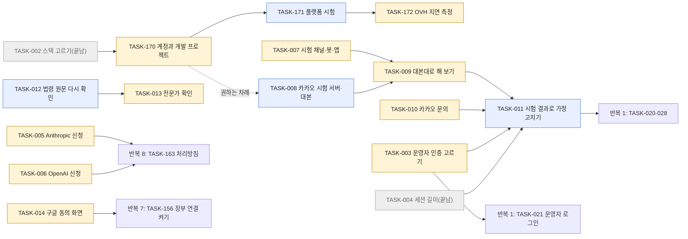

# 반복 0 안내서: 동희님 몫의 차례와 하는 법

상태: 2026-11-15 작성. 반복 0에서 맡은 이가 동희님인 작업 12개 가운데 끝난 2개(TASK-002·004, 5절)를 뺀 10개의 차례와 하는 법입니다. 작업 이름·앞선 작업·끝난 조건의 원본은 [`wbs.md`](wbs.md)와 [README](README.md) 5절이고, 이 안내서의 차례 제안과 시간 어림은 Claude의 것입니다.

- 작업마다 ① 무엇을·왜 ② 차례 ③ 하는 법 ④ 걸리는 시간(Claude 어림) ⑤ 끝나면 Claude에게 넘길 것 ⑥ 막히면을 적었습니다.
- 하는 법의 화면 이름과 누를 곳은 공식 문서에 적힌 만큼만 옮겼습니다. 문서에 없는 것은 '공식 문서에 없음', 찾지 못했거나 열지 못한 것은 '확인 못 함'으로 적었습니다. 공식 문서는 모두 2026-11-15에 열었고, 대괄호 번호(예: [C1])는 7절 출처입니다.
- 화면에 보이는 이름은 그 회사 화면의 글자 그대로 `이렇게` 적었습니다.
- 끝나면 채팅에 "TASK-170 끝"처럼 알려 주세요. 키·비밀번호·토큰·연결 문자열 같은 비밀 값은 채팅에 붙이지 말고 3절의 비밀 저장소에 두신 뒤, 둔 곳과 이름만 알려 주세요(REQ-135).

## 1. 한눈에

| 차례 | 작업 | 시작할 수 있는 때 | 동희님 손이 가는 시간(어림) | 기다리는 것 |
| --- | --- | --- | --- | --- |
| 1 | TASK-170 Cloudflare·Supabase 계정과 개발 프로젝트 | 지금 | 40분~1시간 | 없음 |
| 2 | TASK-007 카카오 시험 채널·봇·앱 | 지금 | 약 1시간 | 먼저 보내기까지 시험하면 카카오 심사(영업일 3~5일씩) |
| 3 | TASK-003 운영자 인증 서비스 고르기 | 지금 | 10분(결정 카드) | 없음 |
| 4 | TASK-010 카카오에 스킬 요청의 출처 IP·서명 문의 | 지금 | 15분 | 카카오의 답(기간은 공식 문서에 없음) |
| 5 | TASK-005 Anthropic에 보관 안 함 신청 | 지금 | 15분 | 영업팀의 답(기간은 공식 문서에 없음) |
| 6 | TASK-006 OpenAI에 보관 안 함 신청 | 지금 | 15분 | 영업팀의 답(기간은 공식 문서에 없음) |
| 7 | TASK-014 구글 클라우드 프로젝트와 OAuth 동의 화면 | 지금 | 30분 | 검증이 필요하면 구글의 검토(기간 확인 못 함) |
| 8 | TASK-009 시험 채널에서 대본대로 보내고 누르기 | TASK-007과 Claude의 TASK-008 뒤 | 1~2시간 | 없음 |
| 9 | TASK-172 OVH 서버에서 지연 측정 | Claude의 TASK-171 뒤 | 20~30분 | 없음 |
| 10 | TASK-013 법률 질문을 전문가에게 확인 | Claude의 TASK-012 뒤 | 약 1시간(보내기와 답 옮기기) | 전문가의 답 |

- 1~7은 오늘 할 수 있고 서로 기다리지 않습니다. 다른 작업을 먼저 풀어 주는 것부터 놓았습니다. TASK-170이 끝나야 Claude가 플랫폼 시험(TASK-171)을 하고, 카카오 시험 서버(TASK-008)를 올릴 곳이 생깁니다. 문의·신청(TASK-010·005·006)은 답을 기다리는 시간이 길어 일찍 보내 두면 좋습니다.
- 손이 가는 시간을 더하면 약 5~7시간입니다. 작업 크기(wbs의 0.5일·1일)는 기다림과 여유를 넣은 값이라 이보다 큽니다.

## 2. 차례

### 2-1. 그림

노란 상자는 동희님, 파란 상자는 Claude, 회색은 끝난 작업입니다. 실선은 wbs의 앞선 작업이고, 점선(TASK-170 → TASK-008)은 wbs에 없는 Claude의 권하는 차례입니다.

- 점선의 이유: Claude는 카카오 시험 서버를 TASK-170의 Cloudflare 개발 계정에 Worker로 올리려 합니다. 카카오가 보낸 스킬 요청에 몇 초 안에 답하는지도 운영과 같은 플랫폼에서 함께 잴 수 있기 때문입니다(tech-stack.md 8-1). TASK-170 전이라면 동희님의 OVH 서버에서 Cloudflare Quick Tunnel(계정 없이 받는 임시 주소, 시험·개발용 [C7])로 돌리는 길도 있지만, 그때는 동희님이 그 서버에서 명령을 돌려야 합니다.

### 2-2. 카카오 시험의 차례(TASK-007·008 → TASK-009 → TASK-011)

| 단계 | 누가 | 할 일 | 다음 단계로 가는 때 |
| --- | --- | --- | --- |
| 1 | 동희님(TASK-007) | 시험 채널·봇·디벨로퍼스 시험 앱을 만들고, 봇에 개발 채널을 연결하고, 앱 키·클라이언트 시크릿·스킬 헤더 값을 3절의 비밀 저장소에 둠(4-2) | 채팅에 "TASK-007 끝" |
| 1 | Claude(TASK-008, 같은 때) | 시험 대본([`kakao-test-script.md`](kakao-test-script.md), 보낼 말·누를 버튼·볼 값)과 시험 서버([`research/kakao-test-2026-11/`](../../research/kakao-test-2026-11/README.md), 받은 스킬 요청 본문을 손님 값은 마스킹해 남김)를 만들어 시험 주소에서 돌림. 대본과 서버 코드는 저장소에 있고, 시험 주소에 올리는 것은 TASK-170 뒤 | 대본과 시험 주소를 채팅으로 드림. 주소는 비밀이 아니지만 저장소·기록에는 적지 않음 |
| 2 | 동희님 | Claude가 준 주소를 봇과 앱에 넣음: 스킬의 `URL`·`Test URL`·헤더값, 대본이 말하는 블록에 스킬 잇기, 콜백을 쓰는 블록의 `Callback 설정`, 디벨로퍼스 앱의 리다이렉트 URI(4-8의 ③ 1~3) | Claude가 시험 서버에서 첫 스킬 요청을 확인함 |
| 3 | 동희님(TASK-009) | 휴대폰 카카오톡에서 시험 채널로 대본대로 보내고 누름. 항목마다 날짜와 화면 사진(4-8) | 대본의 모든 항목에 날짜와 결과가 있음 |
| 4 | Claude(TASK-011) | 서버에 남은 요청과 사진으로 04·05·06의 확인 전 가정을 고치고 06의 열린 질문을 닫는 PR | 반복 1의 TASK-020(사장님 카카오 로그인)·TASK-028(카카오 스킬 받기)이 풀림 |

- TASK-011은 TASK-010(카카오 문의)과 TASK-003(운영자 인증)도 기다립니다. TASK-010은 문의한 날과 '답 기다림'만 남겨도 끝나므로(끝난 조건), 카카오의 답이 늦으면 TASK-011은 OPEN-10만 '답 기다림'으로 두고 나머지를 닫습니다(Claude 제안).

## 3. 비밀 값: 두는 곳과 넘기는 법(REQ-135)

- 비밀 값(키·비밀번호·토큰·연결 문자열·클라이언트 시크릿)은 저장소·기록·채팅에 두지 않습니다. 기록에는 만든 날·이름·리전·플랜 이름만 남기고, 계정 ID·프로젝트 ID·봇 ID·채널 ID·서버 주소도 적지 않습니다(TASK-007·170·172의 끝난 조건, tech-stack.md 5-2).
- Claude가 써야 하는 값은 이 작업 세션이 쓰는 Claude Code 클라우드 환경에 둡니다. 여는 곳은 세션 제목 뒤의 꺾쇠 → `Edit cloud environment`이고, 두는 곳이 둘입니다 [AC1].
  - `Environment variables`: `이름=값`을 한 줄에 하나씩 넣고 `Save changes`. 세션의 명령이 읽는 환경 변수가 됩니다. 이 환경을 쓰는 사람은 누구나 값을 읽을 수 있고, 공식 문서는 프록시가 요청에 붙일 수 있는 키라면 `Network secrets`를 쓰라고 권합니다 [AC1].
  - `Network secrets`: 값이 세션 안에 들어오지 않고, 정한 호스트로 가는 요청에 프록시가 헤더로 붙입니다. `Add secret` → `Allowed websites`에 호스트 → `Custom headers`의 `Value`에 키 → `Add`. 저장한 뒤에는 값을 다시 볼 수 없고, Pro·Max·Ultra·Team·Enterprise 플랜에서 됩니다 [AC1].
  - 이번 값들은 아래 표처럼 환경 변수로 두길 권합니다(Claude 판단). Claude가 값을 읽어 Hyperdrive 설정이나 시험 Worker의 비밀(`wrangler secret put` [C9])로 옮겨야 하고, Cloudflare API 토큰은 wrangler가 환경 변수로 읽기 때문입니다 [C8]. 토큰을 `Network secrets`(호스트 `api.cloudflare.com`)에만 두고 wrangler를 돌리는 길은 확인 못 함입니다. 대신 토큰이 닿는 자원을 이 프로젝트 계정 하나로 좁혀 만듭니다(4-1의 ③ 4). 이 환경을 다른 사람과 함께 쓰시면 Claude에게 먼저 알려 주세요.
  - 이미 열린 세션은 VM이 다시 시작될 때 새 값을 읽습니다. Claude가 일하지 않는 동안 몇 분이 지나면 세션이 쉬고, 다음 메시지로 다시 시작될 때 새 값을 읽습니다 [AC1]. 그래서 값을 넣고 몇 분 뒤에 "TASK-170 끝"처럼 보내 주세요.
- Claude는 값을 출력하지 않고, 배포한 Worker에는 `wrangler secret put`으로만 옮깁니다 [C9].
- 동희님만 쓰는 비밀번호와 복구 코드는 동희님의 비밀번호 관리 앱에 둡니다.

| 값 | 만드는 작업 | 환경 변수 이름(제안) | Claude가 쓰는 곳 |
| --- | --- | --- | --- |
| Cloudflare API 토큰 | TASK-170 | `CLOUDFLARE_API_TOKEN` | wrangler로 시험 Worker·Hyperdrive·Queues 만들기(TASK-008·171). wrangler가 읽는 이름입니다 [C8] |
| Cloudflare 계정 ID | TASK-170 | `CLOUDFLARE_ACCOUNT_ID` | wrangler가 계정을 고를 때 [C8] |
| Supabase 개발 데이터베이스 연결 문자열(직결, 비밀번호 포함) | TASK-170 | `SUPABASE_DEV_DB_URL` | Hyperdrive 설정과 마이그레이션 시험(TASK-171) |
| Supabase 세션 풀러 연결 문자열(비밀번호 포함) | TASK-170 | `SUPABASE_DEV_POOLER_URL` | 직결(IPv6)이 안 될 때의 마이그레이션 시험 |
| 카카오 시험 앱 REST API 키 | TASK-007 | `KAKAO_TEST_REST_API_KEY` | 카카오 로그인 PKCE 시험(OPEN-11) |
| 카카오 시험 앱 클라이언트 시크릿 | TASK-007 | `KAKAO_TEST_CLIENT_SECRET` | 같은 시험의 토큰 받기 |
| 시험 스킬 헤더 값(동희님이 만든 긴 무작위 글자) | TASK-007 | `KAKAO_TEST_SKILL_KEY` | 시험 서버가 스킬 요청의 헤더를 확인 |

## 4. 작업별 안내

### 4-1. TASK-170 Cloudflare·Supabase 계정과 개발 프로젝트 만들기(추천안 기준)

- ① 무엇을·왜: Cloudflare 계정에 Workers 유료 플랜(월 5달러)을 켜고, Supabase에 서울 리전 개발 프로젝트를 무료 등급으로 만듭니다. 결정한 스택([`tech-stack.md`](tech-stack.md))을 실제로 올릴 곳이고, Claude가 여기서 플랫폼 시험(TASK-171)을 하고 카카오 시험 서버(TASK-008)를 올립니다.
- ② 차례: 앞선 작업 TASK-002가 끝나 바로 할 수 있습니다. 끝나면 TASK-171(반복 0)·TASK-174(반복 1)·TASK-175(반복 8)가 풀립니다.
- ③ 하는 법
  1. Cloudflare 계정 [C1]. 둘 가운데 하나를 고르세요.
     - 새로 가입: https://dash.cloudflare.com/sign-up 에서 `Email`과 `Password`를 넣고 `Create Account`. 가입하면 이메일 확인 메일이 옵니다.
     - 이미 쓰시는 Cloudflare 사용자로 이 프로젝트 전용 계정을 하나 더 만들기: 대시보드 `Accounts` → `Create Account` → 계정 이름 → `Create Account`. 조건은 사용자를 만든 지 7일이 넘었고, 기존 계정에서 `Super Administrator`이고, 더 만드는 무료 계정은 5개까지입니다.
     - 추천(Claude): 이 프로젝트 전용 계정. Claude에게 드릴 API 토큰이 다른 프로젝트의 Worker에 닿지 않게 계정을 나눕니다. 반론: Workers 유료 플랜은 계정마다 월 최소 5달러라 [C2], 이미 유료인 계정에 함께 두면 월 5달러가 덜 듭니다.
  2. 2단계 인증 [C3]: `My Profile` → `Authentication` → `Mobile App Authentication`이나 `Security Key Authentication` 옆의 `Add`. 이메일 확인을 마친 계정에서만 켜집니다.
  3. Workers 유료 플랜(Workers Paid, 계정마다 월 최소 5달러) [C2]: 켜는 화면의 차례는 공식 문서에서 찾지 못했습니다(확인 못 함). 결제와 구독은 `Manage Account` → `Billing`에 있고, 켠 구독은 `Manage Account` → `Billing` → `Subscriptions`에서 봅니다 [C4].
  4. Claude가 쓸 API 토큰 [C5]: `My Profile` → `API Tokens` → `Create Token` → 토큰 이름 → 템플릿 `Edit Cloudflare Workers`로 시작 → 권한에 Hyperdrive와 Queues를 더함 → 자원은 이 프로젝트 계정 하나만 → `Continue to summary` → `Create Token`.
     - `Edit Cloudflare Workers` 템플릿에는 Workers 스크립트·KV·R2·Routes 권한은 있지만 Hyperdrive·Queues 권한은 없습니다 [C6]. 두 권한이 목록에서 어떤 이름으로 보이는지는 확인 못 함입니다.
     - 토큰 값은 한 번만 보입니다 [C5]. 바로 3절의 `CLOUDFLARE_API_TOKEN`에 넣으세요. 계정 ID는 `CLOUDFLARE_ACCOUNT_ID`에 넣습니다. 계정 ID를 찾는 화면은 [C5]가 가리키는 문서에 있지만 열지 않았습니다(확인 못 함).
  5. Supabase 계정: 가입 화면의 안내는 열지 않았습니다(확인 못 함). 가입한 뒤 계정 설정에서 TOTP 2단계 인증을 켜고, 백업 인증 수단을 하나 더 등록하세요. 인증 수단을 모두 잃으면 Supabase가 계정 접근을 되돌려 주지 못한다고 적혀 있습니다 [S1].
  6. Supabase 개발 프로젝트: 무료 등급, 리전은 `Specific regions`의 `Northeast Asia (Seoul)`(`ap-northeast-2`)입니다 [S2].
     - 주의: 문서는 대부분의 프로젝트에 general region을 권하지만, general의 `APAC`은 싱가포르로 갑니다 [S2]. 우리는 서울이어야 하므로 꼭 specific region에서 서울을 고르세요.
     - 무료 프로젝트는 Owner·Administrator로 있는 모든 조직을 합쳐 2개까지이고 [S3], 일주일 동안 쓰지 않으면 멈춥니다. 멈춘 프로젝트는 개수에 세지 않고 다시 켤 수 있습니다 [S4].
     - 프로젝트 만들기 화면의 필드와, 만든 뒤 리전을 바꿀 수 있는지는 확인 못 함입니다. 만들 때 서울을 고르세요.
     - 데이터베이스 비밀번호는 비밀번호 관리 앱에 둡니다.
  7. 연결 문자열 [S5]: 프로젝트 화면 위쪽의 `Connect` → 연결 방식 고르기 → 문자열 복사 → `[YOUR-PASSWORD]`를 데이터베이스 비밀번호로 바꿈(`&`·`#`·`?`·빈칸 같은 글자는 퍼센트 인코딩). 직결은 IPv6이고, 공유 풀러는 IPv4만 됩니다 [S5]. 직결 문자열은 `SUPABASE_DEV_DB_URL`, 세션 풀러 문자열은 `SUPABASE_DEV_POOLER_URL`에 넣으세요.
- ④ 걸리는 시간: 40분~1시간(카드 결제 포함).
- ⑤ 넘길 것: 채팅에 "TASK-170 끝", Cloudflare 계정을 어떻게 했는지(새로 가입·더 만든 계정·이미 있던 계정), 3절의 환경 변수 네 개를 넣었는지. 기록에는 만든 날, 리전 `ap-northeast-2`, 플랜 이름(Workers Paid, Supabase Free)만 남깁니다.
- ⑥ 막히면
  - `Create Account`가 없거나 막히면 사용자 7일과 `Super Administrator` 조건을 보세요 [C1]. 안 되면 새로 가입하는 길로 갑니다.
  - Supabase 무료 프로젝트 2개가 이미 차 있으면 쓰지 않는 프로젝트를 멈추거나(멈춘 것은 세지 않음), 그 조직을 Pro(월 25달러부터)로 올립니다 [S3][S4]. 어느 쪽으로 할지 채팅으로 알려 주세요.
  - Cloudflare 결제가 실패하고 5일 안에 해결하지 않으면 무료 플랜으로 내려갑니다 [C4].

### 4-2. TASK-007 카카오 시험 채널·오픈빌더 봇·카카오 디벨로퍼스 시험 앱 만들기

- ① 무엇을·왜: 06의 열린 질문(메시지 ID·콜백·사진·빈 응답·봇 ID·후기 extra·PKCE·먼저 보내기)은 실제 카카오에서 해 봐야 답이 나옵니다. 그 시험에 쓸 채널·봇·앱을 만듭니다. 카카오 계정이 동희님 것이라 동희님 몫입니다.
- ② 차례: 앞선 작업이 없어 바로 할 수 있습니다. Claude의 TASK-008과 같은 때에 하고, 둘이 끝나면 TASK-009로 갑니다(2-2).
- ③ 하는 법
  1. 카카오비즈니스 가입 [K1]: 카카오 계정으로 로그인 → 카카오비즈니스 가입(약관에 동의 → 정보 입력 → 가입 완료). 한 번 가입하면 카카오톡 채널, `챗봇 관리자센터`, 카카오 디벨로퍼스를 함께 씁니다 [K1].
  2. 시험 채널 [K3]: 카카오비즈니스 파트너센터에서 `+새 비즈니스 만들기` → 비즈니스 유형 → 사업자 등록번호. 번호가 없으면 `아니오, 나중에 할게요.`를 누릅니다. 번호 없이도 일반 채널로 만들 수 있지만, 일반 채널에는 '사업자 정보가 확인되지 않은 채널'이라는 주의 문구가 보입니다 [K3]. 채널은 누구나 무료로 만듭니다 [K3]. 시험 채널의 비즈니스 유형을 무엇으로 할지는 공식 문서에 없음입니다(식품·음식처럼 인허가가 필요한 유형은 서류를 붙여야 한다고 적혀 있음 [K3]).
  3. 봇 [K1][K4]: `챗봇 관리자센터`(https://i.kakao.com [K8])에 들어가 가입 → `봇 만들기`. 크롬에서만 됩니다 [K2]. 봇 이름은 특수 기호 없이 20자까지입니다 [K4].
  4. 개발 채널 연결 [K4]: 봇의 `설정` → `개발 채널 연결`에서 2의 시험 채널을 고릅니다. 개발 채널은 배포하기 전에 저장한 상태의 봇을 시험하는 채널이고, 운영 채널은 한 번 배포해야 연결됩니다 [K4]. 이번 시험은 개발 채널로만 하고 배포하지 않습니다.
  5. 카카오 디벨로퍼스 시험 앱 [D1][D2]: https://developers.kakao.com 에 같은 카카오 계정으로 로그인 → 앱 만들기(앱을 만드는 버튼의 이름은 이번에 연 문서에서 찾지 못함, 확인 못 함) → `앱 이름`·`회사명`·`카테고리`(모두 필수) [D1]. 이어서 `카카오 로그인` → `사용 설정` → `상태`를 `ON`(꺼져 있으면 KOE004 오류) [D2]. 리다이렉트 URI는 Claude가 TASK-008에서 드릴 주소를 2-2의 2단계에서 넣습니다.
  6. 앱 키 두 개 [D2]: REST API 키와 클라이언트 시크릿은 `앱` → `플랫폼 키` → `REST API 키`에 있습니다. 클라이언트 시크릿은 켜진 채로 만들어집니다 [D2]. 3절의 `KAKAO_TEST_REST_API_KEY`·`KAKAO_TEST_CLIENT_SECRET`에 넣으세요.
  7. 시험 스킬 헤더 값: 비밀번호 관리 앱으로 긴 무작위 글자를 하나 만들어 3절의 `KAKAO_TEST_SKILL_KEY`에 넣으세요. 2-2의 2단계에서 스킬의 `헤더값 입력`·`테스트 헤더값 입력`에 같은 값을 넣습니다 [K5]. 헤더 이름은 `Siljang-Skill-Key`입니다([대본](kakao-test-script.md) 1절).
  8. 먼저 보내기(Event API, OPEN-9)까지 시험하려면 아래가 더 필요합니다.
     - 비즈니스 인증 채널과, 같은 사업자 정보로 비즈 앱이 된 디벨로퍼스 앱을 연결: 디벨로퍼스 `앱` → `추가 기능 신청` → `신청 자격 확인` → `카카오톡 채널 연결`의 `신청`(심사 영업일 3~5일). 비즈니스 채널 심사도 영업일 약 3~5일입니다 [D3].
     - 디벨로퍼스 앱의 카카오 로그인 ON [K6].
     - 월렛을 만들어 봇에 연결: `봇 설정` → `지불 정보` → `월렛 연결하기`. 개인 월렛이나 사업자 월렛이고, 충전은 1천 원부터입니다 [K7].
     - 메시지 1건에 15원(VAT 별도)이고 개발 채널에서 보내도 과금됩니다. 광고성 메시지는 채널을 친구로 추가한 사람에게만 가고, 디벨로퍼스 앱 사용자 ID(`appUserId`)로는 개발 채널에 보낼 수 없습니다 [K6].
     - 사업자등록번호가 없는 개인 개발자 비즈 앱은 비즈니스 채널을 연결할 수 없습니다 [D1]. 이때는 먼저 보내기 시험을 하지 않고, 06 OPEN-9과 REQ-181대로 '다음 대화 때 전함'으로 시작합니다.
     - 카카오 디벨로퍼스 문서에 "카카오톡 채널은 같은 사업자가 소유한 앱만 연결 가능합니다"라는 문장이 있습니다 [D3]. 가게 채널(가게 사업자)을 우리 앱(우리 사업자)에 잇는 OPEN-9의 첫 질문은 이 문장으로는 '안 됨' 쪽입니다(Claude 판단, TASK-011에서 닫음). 동희님 한 사업자로 만든 채널과 앱으로는 이 질문의 답이 나오지 않으므로, 먼저 보내기 시험은 사업자등록번호가 있고 메시지 값이 괜찮을 때만 권합니다.
- ④ 걸리는 시간: 약 1시간(가입·채널·봇·앱). 먼저 보내기까지 하면 심사 두 번(영업일 3~5일씩)과 월렛 충전이 더해집니다.
- ⑤ 넘길 것: 채팅에 "TASK-007 끝", 사업자등록번호가 있는지(먼저 보내기 시험을 할지), 3절의 환경 변수 세 개를 넣었는지. 채널 ID·봇 ID·앱 ID는 채팅과 기록에 적지 않습니다. 기록에는 만든 날과 이름만 남깁니다.
- ⑥ 막히면
  - 문의처: `챗봇 관리자센터`와 오픈빌더는 카카오 `고객센터`의 https://cs.kakao.com/helps?service=169&category=582 (카카오 직원이 데브톡에 올린 '서비스 유형별 문의처' 글 [K8]), 카카오 디벨로퍼스 API는 데브톡 https://devtalk.kakao.com [D4], 비즈니스 채널 심사는 카카오비즈니스 파트너센터 `고객센터`입니다 [D3].
  - `챗봇 관리자센터`가 열리지 않으면 크롬인지 보세요 [K2].
  - 막힌 화면의 사진을 채팅에 올려 주시면(ID·키가 보이면 마스킹해서) Claude가 다음 수를 찾습니다.

### 4-3. TASK-003 운영자 인증 서비스 고르기(비밀번호·2단계 인증을 맡길 곳)

- ① 무엇을·왜: 운영자 로그인(06 API-004: 이메일·비밀번호·2단계 인증, 15분에 5번 실패하면 잠시 막음, 세션 12시간)을 어느 서비스에 맡길지 고릅니다(06 OPEN-6). 반복 1의 운영자 로그인(TASK-021)과 시험 결과 반영(TASK-011)이 이 답을 기다립니다.
- ② 차례: 앞선 작업 TASK-001이 끝나 바로 고를 수 있습니다.
- ③ 하는 법: Claude가 결정 카드로 확인 요청을 드립니다. 아래 표를 보고 고르시면 됩니다.

  | | Supabase Auth(이메일·비밀번호 + TOTP 2단계 인증) | Cloudflare Access(Zero Trust) |
  | --- | --- | --- |
  | 비용 | TOTP 2단계 인증 API는 무료이고 모든 Supabase 프로젝트에 기본으로 켜져 있음 [S6] | Zero Trust에 무료 등급이 있음 [C10]. 무료 등급의 사용자 수는 확인 못 함 |
  | 06 API-004와 | 우리 로그인 화면이 Supabase Auth를 부르는 꼴이라 계약을 거의 그대로 둠(Claude 판단) | Access가 자기 로그인 화면을 써서 API-004를 그 플로우로 바꿈(06 OPEN-6) |
  | 더 필요한 것 | TASK-170의 Supabase 프로젝트 | Cloudflare에 올린 도메인, 로그인 방법(신원 공급자) 설정 [C11] |
  | 써 본 적 | 없음 | 동희님의 다른 프로젝트에서 씀(tech-stack.md 2절) |

  - 추천(Claude): Supabase Auth + TOTP. 06 API-004 계약을 지키고, 도메인 없이 개발 프로젝트에서 바로 시험할 수 있습니다.
  - 반론: Access는 로그인하지 않은 요청을 우리 Worker 앞에서 막아 노출이 작고, 동희님이 이미 써 보셨습니다. 운영자는 몇 명뿐입니다.
  - tech-stack.md 8-3에 남긴 Zero Trust 무료 등급의 사용자 수는 이번에도 확인 못 함입니다. 요금제 페이지 [C10]의 표는 페이지를 연 뒤 스크립트로 그려져, 내려받은 글에 숫자가 없었습니다. Access를 고르시면 Cloudflare 대시보드의 요금제 화면에서 함께 확인합니다.
- ④ 걸리는 시간: 10분(카드 답).
- ⑤ 넘길 것: 카드에서 고른 답. Claude가 말 그대로 기록합니다.
- ⑥ 막히면: 고르기 어려우시면 카드에 생각을 적어 주세요. Claude가 더 볼 것을 정리해 다시 확인 요청을 드립니다. 반복 1의 TASK-021을 시작하기 전까지는 바꿀 수 있습니다.

### 4-4. TASK-010 카카오에 스킬 요청의 출처 IP·서명 문의

- ① 무엇을·왜: 오픈빌더 문서(2026-11-12 확인)에 스킬 요청의 서명이나 출처 IP가 없어, 봇 ID와 스킬 키를 아는 사람이 꾸민 요청을 우리 서버가 카카오의 요청과 가를 수 없습니다(06 OPEN-10). 카카오가 서명이나 출처 IP 목록을 주는지 묻습니다.
- ② 차례: 앞선 작업이 없어 바로 할 수 있습니다. 답은 TASK-011(Claude)에 들어갑니다. 답이 늦어도 개발은 06의 지금 대책(스킬 키 확인, 연결 문구, 키를 바로 끊고 바꾸기)으로 시작합니다.
- ③ 하는 법: 문의처는 카카오 `고객센터`의 https://cs.kakao.com/helps?service=169&category=582 입니다. 카카오 직원이 데브톡에 올린 '서비스 유형별 문의처' 글(2025-12-09 고침)이 `챗봇 관리자센터`(오픈빌더 포함) 문의를 이곳으로 보냅니다 [K8]. 오픈빌더 안내서는 `'카카오톡 채널 챗봇' 고객센터로 문의`라고만 적고 주소는 없습니다 [K4]. 문의 화면의 필드는 열지 않았습니다(확인 못 함). 보낼 글 초안:

  > 카카오톡 채널 봇(오픈빌더)의 스킬 서버를 만들고 있습니다. 스킬 서버가 받은 요청이 카카오에서 보낸 것인지 확인할 방법이 있는지 문의드립니다. (1) 스킬 요청에 서명(예: HMAC)을 붙이는 기능이 있는지, (2) 스킬 요청을 보내는 카카오 서버의 출처 IP 목록을 받을 수 있는지, (3) 둘 다 없다면 스킬의 헤더값 입력 말고 권하시는 방법이 있는지 알려 주세요.

- ④ 걸리는 시간: 15분. 답을 기다리는 기간은 공식 문서에 없음.
- ⑤ 넘길 것: 문의한 날과 받은 답의 글(없으면 '답 기다림')을 채팅으로. 계정 정보와 문의 번호는 적지 않아도 됩니다.
- ⑥ 막히면: 답이 오래 없으면 TASK-011은 OPEN-10을 '답 기다림'으로 두고 06의 지금 대책으로 갑니다. 다른 창구에 다시 물을지는 그때 Claude가 확인 요청을 드립니다.

### 4-5. TASK-005 Anthropic에 보관 안 함(Zero Data Retention) 신청

- ① 무엇을·왜: 상담 대화에는 손님 이름·전화·알레르기 답 같은 개인정보가 들어갑니다. AI 회사가 이를 보관하지 않게 신청합니다(04 AI-1, 06 DEC-25, REQ-266). Anthropic API의 기본은 입력·출력을 받은 때부터 30일 안에 지우는 것이고(예외 있음) [A2], 허가 전에는 처리방침에 30일 보관으로 적습니다(04 AI-1).
- ② 차례: 앞선 작업이 없어 바로 할 수 있습니다. 답은 반복 8의 처리방침 국외 이전 항목(TASK-163)에 들어가고, 두 회사 가운데 쓸 모델을 고르는 일(TASK-162)에도 걸립니다.
- ③ 하는 법: 공식 안내는 영업팀 문의입니다. "To request ZDR for your organization, contact the Anthropic sales team" → https://claude.com/contact-sales [A1]. 문의 화면의 필드는 열지 않았습니다(확인 못 함). 알아 둘 것 [A1]:
  - 조직마다 켭니다. 새 조직은 따로 켜야 합니다.
  - Batch·Files API·코드 실행 같은 기능은 보관 안 함에 들지 않습니다. 모델 호출 모듈(TASK-026)은 이런 기능을 쓰지 않게 만듭니다(Claude 제안).
  - Anthropic이 'Covered Models'로 정한 일부 모델은 30일 보관이 필요해, 따로 허가하지 않으면 보관 안 함 조직에서 쓸 수 없습니다. 모델 고르기(TASK-162)에서 이 목록을 봅니다.
  - 보관 안 함 조직은 브라우저에서 API를 바로 부를 수 없습니다(CORS 거부). 우리는 서버에서 부르므로 상관없습니다.
  - 보관 안 함이어도 법이 요구하거나 자동 안전 검사에 걸린 대화는 최대 2년 보관될 수 있습니다.

  보낼 글 초안(영어):

  > We are building a small B2B service in Korea: an AI assistant that answers customer chats for independent cake shops on KakaoTalk, calling the Claude API (Messages API only) from our server. Chats can include customers' names, phone numbers and allergy answers. We would like to request Zero Data Retention for our API organization. Could you tell us the eligibility, requirements and expected timeline?

- ④ 걸리는 시간: 15분. 답을 기다리는 기간은 공식 문서에 없음.
- ⑤ 넘길 것: 신청한 날과 받은 답(허가·거절·기다림), 허가되면 어느 조직 이름에 켜졌는지. 조직 ID와 계약서는 채팅과 기록에 두지 않습니다.
- ⑥ 막히면: 거절이나 답이 없으면 처리방침에 30일 보관(04 AI-1)을 적고, OpenAI의 답과 견주어 TASK-162에서 고릅니다(REQ-266은 배포 설정으로 한 회사만 씀).

### 4-6. TASK-006 OpenAI에 보관 안 함(Zero Data Retention) 신청

- ① 무엇을·왜: TASK-005와 같은 이유로 OpenAI에 신청합니다. OpenAI API는 기본으로 남용 감시 로그를 최대 30일 보관합니다(법이 요구하면 더 길게) [O1].
- ② 차례: 앞선 작업이 없어 바로 할 수 있습니다. TASK-005와 같이 TASK-163·TASK-162에 들어갑니다.
- ③ 하는 법: 공식 안내는 영업팀 문의입니다. 보관 안 함(Zero Data Retention)과 남용 감시 줄이기(Modified Abuse Monitoring)는 "subject to prior approval by OpenAI and acceptance of additional requirements"이고, "Get in touch with our sales team ... inquire about eligibility" → https://openai.com/contact-sales [O1]. 문의 화면의 필드는 열지 않았습니다(확인 못 함).
  - 허가되면 `Settings` → `Organization` → `Data controls`에 `Data Retention` 탭이 생기고, 조직과 프로젝트 단위로 고릅니다 [O1].
  - 보관 안 함이 켜져도 일부 엔드포인트·기능은 상태를 남길 수 있다는 표가 있습니다 [O1]. 모델 호출 모듈(TASK-026)은 그 표에서 보관 안 함이 되는 것만 쓰게 만듭니다(Claude 제안).
  - 보낼 글 초안: TASK-005의 영어 글에서 'the Claude API (Messages API only)'를 'the OpenAI API'로 바꿔 씁니다.
- ④ 걸리는 시간: 15분. 답을 기다리는 기간은 공식 문서에 없음.
- ⑤ 넘길 것: TASK-005와 같습니다.
- ⑥ 막히면: TASK-005와 같습니다.

### 4-7. TASK-014 구글 클라우드 프로젝트와 OAuth 동의 화면(장부 연결) 만들기와 검증이 필요한지 확인

- ① 무엇을·왜: 사장님이 고르면 켜는 장부 연결(05 TBL-045)은 사장님 구글 계정의 허락(OAuth)을 받아 사장님의 구글 시트에 씁니다. 그 바탕인 구글 클라우드 프로젝트와 동의 화면을 만들고, 쓸 범위(scope)에 구글의 앱 검증이 필요한지 확인합니다.
- ② 차례: 앞선 작업이 없어 바로 할 수 있습니다. 반복 7의 TASK-156(장부 연결 켜기)이 기다립니다. 급하지 않지만, 검증이 필요하면 시간이 걸려 일찍 해 두길 권합니다.
- ③ 하는 법
  1. 프로젝트 [G1]: 구글 클라우드 콘솔 `Menu` → `IAM & Admin` → `Create a Project` → `Project Name` → (고치려면) `Project ID`(나중에 바꿀 수 없음) → `Location` → `Create`.
  2. 동의 화면 [G2]: `Menu` → `Google Auth platform` → `Branding` → (처음이면) `Get Started` → `App Information`의 `App name`과 `User support email` → `Next` → `Audience`에서 `External`(사장님은 우리 조직 밖) → `Next` → `Contact Information`의 이메일 → `Next` → `Finish`에서 Google API Services User Data Policy에 동의 → `Continue` → `Create`. 한 번 만든 동의 화면은 지울 수 없습니다 [G2].
  3. 시험 사용자 [G2][G3]: `Audience` → `Test users` → `Add users` → 이메일 → `Save`. 시험(Testing) 상태에서는 시험 사용자가 100명까지이고, 시험 사용자의 허락은 리프레시 토큰까지 7일 뒤 끝납니다 [G3]. 사장님이 쓰려면 `Publish app`으로 운영(In production) 상태로 바꿉니다 [G3].
  4. 범위 [G2][G4]: `Data Access` → `Add or Remove Scopes`.
     - 추천(Claude): `https://www.googleapis.com/auth/drive.file`. 이 앱으로 쓰는 파일만 보고 고치는 범위로, 구글 표에서 권함(Recommended)·민감하지 않음(Non-sensitive)입니다 [G4]. 장부로 쓸 구글 시트는 사장님이 구글 Picker로 고르게 합니다 [G5].
     - 반론: `https://www.googleapis.com/auth/spreadsheets`는 모든 구글 시트를 보고 고치는 민감(Sensitive) 범위라 [G4] 앱 검증을 거쳐야 하고 [G6], 검증 전에는 '확인되지 않은 앱' 경고가 뜨고 새 사용자가 100명으로 묶입니다 [G3]. 대신 Picker 없이 구글 시트 주소만 받으면 됩니다.
  5. 검증 [G6]: 민감하지 않은 범위만 쓰면 앱 검증은 필수가 아닙니다. 다만 동의 화면에 앱 이름과 로고를 보이려면 더 가벼운 브랜드 검증(brand verification)이 필요합니다 [G6]. 검증에 걸리는 기간은 확인 못 함입니다.
  6. OAuth 클라이언트(클라이언트 비밀 포함)는 반복 7의 TASK-156 때 만들면 됩니다. 지금은 만들지 않아도 됩니다(Claude 제안).
- ④ 걸리는 시간: 30분(검증을 신청하면 그 기다림은 따로).
- ⑤ 넘길 것: 만든 날, 프로젝트 이름, 고른 범위, 검증 상태(필요 없음·신청함·허가). 프로젝트 ID와 번호는 채팅과 기록에 적지 않습니다.
- ⑥ 막히면: `Google Auth platform not configured yet`가 보이면 `Get Started`부터 합니다 [G2]. 범위를 고르기 어려우시면 추천(drive.file)으로 두고 채팅에 알려 주세요.

### 4-8. TASK-009 시험 채널에서 대본대로 보내고 누르기

- ① 무엇을·왜: 06 열린 질문 8개를 실제 요청으로 확인합니다. OPEN-1(메시지 ID), OPEN-2(콜백 시간), OPEN-3(사진이 오는 꼴), OPEN-4(빈 응답), OPEN-8(봇 ID), OPEN-9(먼저 보내기 권한, 4-2의 ③ 8을 할 때만), OPEN-11(카카오 로그인 PKCE), OPEN-12(후기 extra)입니다. 이 결과로 Claude가 04·05·06의 확인 전 가정을 고칩니다(TASK-011). 카카오가 보낸 스킬 요청에 시험 서버가 몇 초 안에 답하는지도 함께 봅니다(tech-stack.md 8-1).
- ② 차례: 앞선 작업은 TASK-007(동희님)과 TASK-008(Claude)입니다. 2-2의 2단계를 마친 뒤 합니다. 끝나면 TASK-011이 풀립니다.
- ③ 하는 법
  1. 스킬 등록(2-2의 2단계) [K5]: `챗봇 관리자센터`의 스킬 `생성`에서 `스킬명`을 넣고, `URL`과 `Test URL`에 Claude가 준 시험 주소를 넣습니다. `URL`은 필수(운영 채널용)이고, `Test URL`은 `챗봇 관리자센터`의 시험과 개발 채널에서만 부르는 주소입니다. `헤더값 입력`·`테스트 헤더값 입력`에 `KAKAO_TEST_SKILL_KEY`와 같은 값을 넣고, 대본이 말하는 블록에 스킬을 잇습니다. 넣을 블록·파라미터·주소는 [카카오 시험 대본](kakao-test-script.md) 1절에 있습니다.
  2. 콜백을 쓰는 블록 [K9]: 블록 상세 → `더보기(...)` → `Callback 설정`을 활성화하고, 응답을 기다리는 동안 보일 문구를 적습니다.
  3. 리다이렉트 URI [D1]: 카카오 디벨로퍼스 앱의 `앱` → `플랫폼 키` → `REST API 키` → `카카오 로그인 리다이렉트 URI`에 Claude가 준 주소 → `저장`(주소가 맞지 않으면 KOE006 오류 [D2]).
  4. 휴대폰 카카오톡에서 시험 채널을 열고, [대본](kakao-test-script.md) 3절을 위에서부터 보내고 누릅니다. 항목마다 날짜·시각과 화면 사진을 남깁니다. 콜백(K-05)과 먼저 보내기(K-10)는 봇 배포가 필요할 수 있어, 그때 Claude가 확인 요청을 드립니다(대본 K-05·K-10). 사진 메시지 항목에는 사람 얼굴과 이름이 없는 사진을 씁니다.
  5. `챗봇 관리자센터`의 `봇테스트`(Ctrl+E)에서도 스킬 요청 전문(`Request`)과 응답 오류를 볼 수 있습니다 [K10].
- ④ 걸리는 시간: 1~2시간(대본 길이에 따라).
- ⑤ 넘길 것: 대본 항목마다 해 본 날·시각과 결과, 화면 사진. 사진은 채팅에 올려 주세요. 카카오톡 이름이나 프로필 사진이 보이면 마스킹해서 올려 주시면 좋습니다. Claude는 사진 원본을 저장소에 올리지 않고 항목·날짜·결과만 기록에 옮깁니다(Claude 제안). 시험 서버에 남은 요청은 Claude가 직접 봅니다.
- ⑥ 막히면: 스킬 응답이 없으면 `봇테스트`의 `Request`와 `응답오류`를 사진으로 보내 주세요 [K10]. 스킬은 5초 안에 답해야 하고 이 시간은 바꿀 수 없습니다 [K5]. 콜백 주소는 5분 동안 한 번만 쓸 수 있습니다 [K9]. 한 항목이 막히면 그 항목에 '막힘'과 사진만 남기고 다음 항목으로 가세요. TASK-011에서 Claude가 다룹니다.

### 4-9. TASK-172 OVH 서버(뭄바이·싱가포르)에서 지연 측정 스크립트 돌리기(추천안 기준)

- ① 무엇을·왜: 1분 외부 감시(REQ-148, TASK-016)를 동희님의 OVH 서버에 둘지 고르려고, 그 서버에서 서울의 Supabase와 Cloudflare까지 왕복 시간을 잽니다(tech-stack.md 5절). 이 지연은 아직 재지 않았습니다.
- ② 차례: 앞선 작업은 TASK-171(Claude)이고, TASK-171은 TASK-170을 기다립니다. 이 작업을 기다리는 작업은 없지만, 결과로 TASK-016의 감시 위치를 고릅니다.
- ③ 하는 법: Claude가 TASK-171 끝에 스크립트 한 파일과 돌리는 명령을 채팅으로 드립니다. 두 서버에 SSH로 들어가 그대로 돌리고 출력을 채팅에 붙여 주세요. 스크립트는 개인정보를 다루지 않고 상태 코드와 시간만 냅니다(tech-stack.md 5-2). OVH 화면에서 할 일은 없어 공식 문서도 보지 않았습니다.
- ④ 걸리는 시간: 20~30분.
- ⑤ 넘길 것: 두 서버의 출력(왕복 시간). 서버 주소·호스트 이름·계정은 지우고 붙여 주세요(끝난 조건). 기록에는 리전(뭄바이·싱가포르)과 시간만 남깁니다.
- ⑥ 막히면: 오류가 나면 오류 글을 그대로 붙여 주세요(주소는 지우고). Claude가 고친 스크립트를 드립니다. 서버에 무엇을 설치해야 하면 Claude가 설치 명령을 드리고 확인 요청을 합니다.

### 4-10. TASK-013 법률 질문 목록을 전문가에게 확인(02 5-2와 tech-stack.md 8-2)

- ① 무엇을·왜: 02 5-2의 법률 질문 10개와 tech-stack.md 8-2의 호스팅 질문 3개를 변호사 같은 전문가에게 확인합니다. 02 5-2는 현금 선결제와 결제대금예치, 통신판매중개자인지, 환불 기본값과 약관, 알레르기 답이 민감정보인지, 국외 모델로 보내기, 사진 동의 방식, 주문 기록 보존 기간, 퀵 기사에게 케이크를 건네는 것과 식품위생법, AI 생성물 표시, 후기 부탁이 광고성 정보인지입니다. 답으로 바뀌는 요구사항은 Claude가 고칩니다.
- ② 차례: 앞선 작업은 TASK-012(Claude, 법령 원문 다시 확인)입니다. Claude가 조문 번호와 시행일을 다시 대조해 고친 뒤, 질문 13개를 한 문서로 묶어 드립니다. 이 작업을 기다리는 작업은 아직 없지만, 02 5-2는 '출시 전' 질문이라 반복 8(출시 준비) 전에 답이 있어야 합니다.
- ③ 하는 법: Claude가 드린 질문 문서를 전문가에게 보내고, 질문 번호마다 답을 받습니다. 전문가를 찾는 방법과 비용은 이 안내서에서 확인하지 않았습니다(확인 못 함).
- ④ 걸리는 시간: 손이 가는 시간은 약 1시간(보내기와 답 옮기기). 전문가의 답을 기다리는 기간은 모릅니다.
- ⑤ 넘길 것: 질문마다 전문가의 답과 날짜. 답 문서를 채팅에 올려 주시면 Claude가 답으로 바뀌는 요구사항 목록을 만들어 고칩니다. 전문가의 이름은 동희님이 원하실 때만 적습니다.
- ⑥ 막히면: 비용 때문에 질문을 줄여야 하면, 출시를 막는 질문부터 고르도록 Claude가 차례를 드립니다.

## 5. 끝난 작업

| ID | 작업 | 끝난 때와 답 |
| --- | --- | --- |
| TASK-002 | 기술 스택·배포 환경 고르기 | 2026-11-15 18:31 무렵 결정 카드 "추천안대로 (추천)"([README](README.md) 9-3) |
| TASK-004 | 세션 길이 정하기 | 2026-11-15 17시 무렵 결정 카드 "제안대로 (추천)"(06 DEC-26) |

## 6. 확인 못 한 것과 새로 안 것

- 공식 문서에 없음: 카카오와 두 AI 회사의 답을 기다리는 기간, 시험 채널의 비즈니스 유형.
- 확인 못 함
  - Cloudflare: Workers 유료 플랜을 켜는 화면의 차례, API 토큰에서 Hyperdrive·Queues 권한이 보이는 이름, 계정 ID를 찾는 화면, Zero Trust 무료 등급의 사용자 수(tech-stack.md 8-3과 같음).
  - Supabase: 가입 화면, 프로젝트 만들기 화면의 필드, 만든 뒤 리전을 바꿀 수 있는지.
  - 카카오: 디벨로퍼스에서 앱을 만드는 버튼의 이름, 문의 화면의 필드.
  - Anthropic·OpenAI: 영업팀 문의 화면의 필드.
  - 구글: 앱 검증과 브랜드 검증에 걸리는 기간.
  - 법률 전문가를 찾는 방법과 비용.
- 이번에 문서에서 새로 안 것
  - 카카오 디벨로퍼스 문서: "카카오톡 채널은 같은 사업자가 소유한 앱만 연결 가능합니다" [D3]. 06 OPEN-9의 첫 질문(가게 채널을 우리 앱에 잇기)은 이 문장으로는 '안 됨' 쪽입니다(Claude 판단, TASK-011에서 닫음).
  - Supabase는 대부분의 프로젝트에 general region을 권하지만, general의 `APAC`은 싱가포르라 우리는 specific region의 서울을 골라야 합니다 [S2].

## 7. 출처(2026-11-15 확인)

| 번호 | 문서 | 주소 |
| --- | --- | --- |
| AC1 | Claude Code: Configure cloud environments | https://code.claude.com/docs/en/cloud-environments |
| A1 | Anthropic: API and data retention | https://platform.claude.com/docs/en/manage-claude/api-and-data-retention |
| A2 | Anthropic Privacy Center: How long do you store my organization's data? | https://privacy.claude.com/en/articles/7996866-how-long-do-you-store-my-organization-s-data |
| O1 | OpenAI: Data controls in the OpenAI platform | https://developers.openai.com/api/docs/guides/your-data |
| C1 | Cloudflare: Create account | https://developers.cloudflare.com/fundamentals/account/create-account/ |
| C2 | Cloudflare Workers: Pricing | https://developers.cloudflare.com/workers/platform/pricing/ |
| C3 | Cloudflare: Two-factor authentication | https://developers.cloudflare.com/fundamentals/user-profiles/2fa/ |
| C4 | Cloudflare: Billing FAQ | https://developers.cloudflare.com/billing/understand/faq/ |
| C5 | Cloudflare: Create API token | https://developers.cloudflare.com/fundamentals/api/get-started/create-token/ |
| C6 | Cloudflare: API token templates | https://developers.cloudflare.com/fundamentals/api/reference/template/ |
| C7 | Cloudflare Tunnel: Quick Tunnels | https://developers.cloudflare.com/tunnel/get-started/quick-tunnels/ |
| C8 | Wrangler: System environment variables | https://developers.cloudflare.com/workers/wrangler/system-environment-variables/ |
| C9 | Cloudflare Workers: Secrets | https://developers.cloudflare.com/workers/configuration/secrets/ |
| C10 | Cloudflare 요금제(SASE / Zero Trust) | https://www.cloudflare.com/plans/zero-trust-services/ |
| C11 | Cloudflare Access: Publish a self-hosted application to the Internet | https://developers.cloudflare.com/cloudflare-one/access-controls/applications/http-apps/self-hosted-public-app/ |
| S1 | Supabase: Multi-factor authentication(계정) | https://supabase.com/docs/guides/platform/multi-factor-authentication |
| S2 | Supabase: Regions | https://supabase.com/docs/guides/platform/regions |
| S3 | Supabase: Billing on Supabase | https://supabase.com/docs/guides/platform/billing-on-supabase |
| S4 | Supabase: Pricing | https://supabase.com/pricing |
| S5 | Supabase: Connect to your database | https://supabase.com/docs/guides/database/connecting-to-postgres |
| S6 | Supabase Auth: TOTP | https://supabase.com/docs/guides/auth/auth-mfa/totp |
| K1 | 카카오비즈니스 가이드: 준비하기 | https://kakaobusiness.gitbook.io/main/tool/chatbot/start/prepare |
| K2 | 카카오비즈니스 가이드: 기타(크롬만) | https://kakaobusiness.gitbook.io/main/tool/chatbot/other |
| K3 | 카카오비즈니스 가이드: 채널 만들기 | https://kakaobusiness.gitbook.io/main/channel/start |
| K4 | 카카오비즈니스 가이드: 봇 설정 | https://kakaobusiness.gitbook.io/main/tool/chatbot/main_notions/bot_setting |
| K5 | 카카오비즈니스 가이드: 스킬 만들기 | https://kakaobusiness.gitbook.io/main/tool/chatbot/skill_guide/make_skill |
| K6 | 카카오비즈니스 가이드: Event API | https://kakaobusiness.gitbook.io/main/tool/chatbot/main_notions/event-api |
| K7 | 카카오비즈니스 가이드: 월렛 | https://kakaobusiness.gitbook.io/main/tool/chatbot/main_notions/wallet |
| K8 | 카카오 데브톡: 서비스 유형별 문의처(카카오 직원 글, 2025-12-09 고침) | https://devtalk.kakao.com/t/topic/116028 |
| K9 | 카카오비즈니스 가이드: 콜백 | https://kakaobusiness.gitbook.io/main/tool/chatbot/skill_guide/ai_chatbot_callback_guide |
| K10 | 카카오비즈니스 가이드: 봇테스트 | https://kakaobusiness.gitbook.io/main/tool/chatbot/main_notions/bot_test |
| D1 | 카카오 디벨로퍼스: 앱 설정 | https://developers.kakao.com/docs/ko/app-setting/app |
| D2 | 카카오 디벨로퍼스: 카카오 로그인 설정하기 | https://developers.kakao.com/docs/ko/kakaologin/prerequisite |
| D3 | 카카오 디벨로퍼스: 카카오톡 채널 | https://developers.kakao.com/docs/ko/kakaotalk-channel/common |
| D4 | 카카오 디벨로퍼스: 시작하기(데브톡) | https://developers.kakao.com/docs/ko/getting-started/kakao-developers |
| G1 | Google Workspace: Create a Google Cloud project | https://developers.google.com/workspace/guides/create-project |
| G2 | Google Workspace: Configure the OAuth consent screen | https://developers.google.com/workspace/guides/configure-oauth-consent |
| G3 | Google Cloud 도움말: Manage App Audience | https://support.google.com/cloud/answer/15549945 |
| G4 | Google Sheets API: Scopes | https://developers.google.com/workspace/sheets/api/scopes |
| G5 | Google Drive API: API-specific authorization(Google Picker) | https://developers.google.com/workspace/drive/api/guides/api-specific-auth |
| G6 | Google Cloud 도움말: OAuth App Verification Help Center | https://support.google.com/cloud/answer/13463073 |
