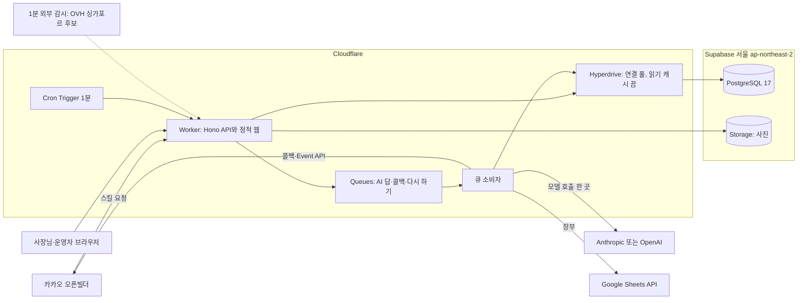

# 10단계 기술 스택 제안: Cloudflare·Supabase로 MVP, 옮길 길, OVH 평가

상태: 결정(2026-11-15 18:31 무렵, TASK-002). 2026-11-15의 제안(TASK-001)을 동희님이 추천안대로 고르셨습니다(아래 결정 줄). 2026-11-15 17시 무렵 체크포인트에서 동희님이 주신 방향을 바탕으로 썼습니다: "배포는 클라우드플레어에 수퍼베이스 등으로 MVP 할까 해. 실제 서비스 할때는 물론 좋은걸로 옮겨가야겠지만. 내 인도 ovh 서버나 싱가포르 ovh 서버 사용하는건 어떻게 생각해?"(답 전체는 [README](README.md) 9절).

- 사실은 2026-11-15에 공식 문서를 열어 확인한 것만 적었습니다. 주소와 확인한 글은 10절에 있습니다. 확인하지 못한 것은 8절에 모았습니다.
- 숫자 가운데 가게 수·상담 수·사진 크기는 Claude의 가정이고(6-2), 나머지는 저장소 원본이나 공식 가격표에서 옮겼습니다.
- 금액은 미국 달러, 세금을 뺀 값입니다.

결정: 동희님 2026-11-15 18:31 무렵 결정 카드 "추천안대로 (추천)". 아래 0절 표의 추천(MVP) 열이 MVP의 스택입니다(TASK-002 끝남, [README](README.md) 9-3).

## 0. 한눈에

| 자리 | 추천(MVP) | 이유 한 줄 |
| --- | --- | --- |
| 언어 | TypeScript 하나(서버·웹·시험) | Workers의 기본 언어이고 웹도 TypeScript. README 6절 첫 버전([PR #50](https://github.com/kodonghui/siljang.ai/pull/50))의 A(Python 서버)에서 B로 바꿈(7절) |
| 서버 | Cloudflare Workers + Hono | 카카오 스킬 4개와 사장님·운영자 API를 한 Worker에서. Hono는 웹 표준이라 Node 어댑터로 옮길 수 있음 |
| 웹 | React + Vite, 같은 Worker의 정적 자산 | 정적 자산 요청은 무료. Cloudflare가 새 프로젝트에 권하는 방식 |
| 데이터베이스 | Supabase 서울(ap-northeast-2)의 PostgreSQL 17, node-postgres + Hyperdrive(읽기 캐시 끔) | 05의 마이그레이션 0001~0020과 규칙 테스트를 그대로 씀. 05 검사 15개가 PostgreSQL 17.11에서도 통과(이 PR에서 돌림) |
| 자동으로 하는 일 | Cron Trigger 1분 + 데이터베이스의 작업 표(05 A33) | 06의 서버 안의 일 13개를 작업 표에서 때가 된 것부터 집음 |
| AI 답·콜백·다시 하기 | Cloudflare Queues | 응답 뒤 30초(`waitUntil`)로는 AI 기한 55초가 모자람. 큐 소비자는 15분 |
| 사진 | Supabase Storage(서울) | 손님 사진이 한국 리전에 머묾 |
| 비밀 값 | Workers secrets(`wrangler secret put`), 로컬은 `.dev.vars` | 저장소·로그에 키 0건(REQ-135) |
| 백업 | Supabase Pro 매일 백업(7일) + 새 프로젝트로 복구 시험 | REQ-149 |
| 배포 | wrangler로 스테이징·운영 Worker 둘, 개발 데이터베이스는 Supabase 무료 등급 | 출시 때 운영 프로젝트만 Pro로 |
| 운영자 인증 | TASK-003에서 고름: Cloudflare Access 또는 Supabase Auth의 TOTP 2단계 인증 | 06 OPEN-6 |
| OVH 서버 | 손님 개인정보는 두지 않음. 1분 외부 감시, 합성 상담 평가 돌리기, 카카오 시험 서버 | 5절 |
| 사장님·운영자 앱 | 휴대폰 홈 화면에 추가하는 웹앱(PWA) 먼저, 스토어 앱(iOS·Android)은 웹 다음에 웹을 Capacitor로 감싸 만듦 | 동희님 결정 2026-11-15 17:56 무렵 "웹앱+스토어 앱인데 웹부터 만들어바". 9절 |
| 월 비용 | 개발 0~5달러, 가게 10곳 약 30~35달러, 가게 100곳 약 35~60달러 | AI 사용료는 따로(상담 하나의 AI 비용 상한 REQ-262). 6절 |

## 1. 우리 프로젝트가 스택에 요구하는 것

저장소 원본에서 스택을 고르는 데 걸리는 것만 모았습니다.

| 요구 | 출처 | 스택에 주는 조건 |
| --- | --- | --- |
| 카카오 스킬 요청에 P99 4초 안에 답함(카카오 제한 5초) | REQ-130, SPEC-017 | 요청 하나에서 4초 안에 데이터베이스를 여러 번 읽고 쓰고 답함 |
| AI 답은 P95 10초 안에, 늦으면 콜백(유효 5분), AI 전체 기한은 받은 때부터 55초 | REQ-131, 06 OPEN-2 | 응답을 보낸 뒤에도 1분 넘게 돌 수 있는 곳에서 AI를 부르고 콜백을 보냄 |
| AI 모델 호출은 한 곳, Anthropic이나 OpenAI 가운데 배포 설정으로 | REQ-266, DEC-25 | 두 회사의 공식 SDK가 서버 언어에 있음 |
| PostgreSQL의 트리거·CHECK 419개·EXCLUDE 1개(btree_gist)·외래 키 133개, 규칙 테스트 324개, 마이그레이션 0001~0020 | 05(`check_erd.py` D3·D4) | 표준 PostgreSQL과 btree_gist 확장 |
| 같은 주문에 두 세션이 동시에 쓰면 한쪽만 들어감 | 05 검사 D5 | 트랜잭션 안의 행 잠금이 그대로 되는 연결 |
| 요청 키로 같은 요청은 한 번만 | 04 G2, 05 TBL-050·051 | 요청 키 기록과 업무 쓰기를 한 트랜잭션에 |
| 자동으로 하는 일 13개: 기한 처리, 7일 닫힘, 매일 03:00 지우기, 장부 다시 적기(1분·5분·30분·2시간·6시간, 그 뒤 하루 한 번), 발송 결과 조회(1·5·30분) | 06 10절, 05 A33 | 1분마다 서버를 깨우는 타이머, 이벤트 키로 한 번만 도는 작업 표, 몇 분~몇 시간 뒤에 다시 하는 길 |
| 사진: 한 상담에 10장(장당 20MB까지), 신고증 10MB, 완성·신고·후기 사진 5장. 30일 뒤 지우고 지울 파일 표로 다시 지움 | SPEC-019, SPEC-002, SPEC-053, 05 TBL-054 | 한국 리전의 파일 저장소, 서버를 거쳐서만 읽고 씀 |
| 구글 시트 장부(OAuth) | REQ-125~129, TBL-045 | 서버에서 Google API를 HTTP로 부름 |
| 사장님은 카카오 로그인 뒤 우리 세션(30일, 쓰면 늘어남) | SPEC-001, DEC-10, DEC-26 | 쿠키 세션을 서버가 직접 다룸 |
| 운영자 인증(비밀번호·2단계 인증)을 맡길 곳 | 06 OPEN-6, TASK-003 | 인증 서비스 후보 |
| 운영 서버 월 가동률 99%, 1분마다 외부 감시 | REQ-148 | 운영과 다른 곳에서 도는 감시 |
| 하루 한 번 백업과 출시 전 복구 시험 | REQ-149 | 매일 백업, 따로 복구해 보는 길 |
| 비밀 값은 코드·로그·대화 기록에 0건 | REQ-135 | 플랫폼의 비밀 저장소 |
| 처리방침에 국외 이전 다섯 항목 | REQ-141, 02 4-2(개인정보 보호법 제28조의8) | 손님 개인정보가 어느 나라에 있는지 말할 수 있음 |
| 다른 가게의 기록은 0건 | REQ-134 | 데이터베이스를 바깥에 바로 드러내지 않음, 모든 쿼리에 가게 조건 |
| 첫 버전은 가게 1~3곳, 저녁 몰림 때 동시 상담 20개 | 02 1-3 가정 | 작은 규모. 가게 10·100곳은 6절에서 Claude 가정으로 셈 |
| 평가는 실제 손님 대화 대신 합성 상담 100개 이상 | REQ-139, REQ-145 | 평가 실행은 운영 서버 밖에서 해도 됨 |

## 2. leetmaster-v3에서 가져올 것과 가져오지 않을 것

동희님의 다른 프로젝트 leetmaster-v3를 읽기만 했습니다(2026-11-15 얕은 복제). 그 저장소 규칙대로 정답·학생 대화·비밀 값은 열지 않았고, 계정·서버 주소는 이 저장소에 옮기지 않았습니다.

- 본 것: `student-service`는 TypeScript(ES 모듈)·Fastify 5·`pg`·`jose`·OpenTelemetry·React 19·Vite 8이고, 시험은 `embedded-postgres`로 띄운 PostgreSQL 17입니다(README의 '실제 PostgreSQL 17.10 기존 통합 20/20'). 구조는 HTTP 경계 + PostgreSQL + 권한을 줄인 worker(작업·시도·outbox를 한 트랜잭션에 받고, fence로 한 번만 보냄)입니다. `product`는 React·Vite·wrangler(Cloudflare)이고, 배포에 Cloudflare Pages·Workers·Access·Tunnel을 씁니다.

| 가져올 것 | 경로(leetmaster-v3) | 우리에게 쓰는 곳 |
| --- | --- | --- |
| 작업 표·시도·outbox와 fence로 한 번만 하는 worker | `student-service/src/worker-core.mjs`, `worker-runtime.mjs`, `producer-consumer.mjs`, `student-service/README.md`의 순서 그림 | 자동으로 하는 일 실행기(TASK-023)와 콜백·먼저 보내기 |
| 계약과 응답을 맞추는 검사, 계약 바뀜 비교 | `student-service/scripts/generate-openapi.mjs`, `check-api-responses.mjs`, `api-diff.mjs` | 방향은 반대입니다. 그쪽은 코드에서 계약을 만들고, 우리는 계약(`api/openapi.yaml`)이 먼저라 계약에서 타입과 검사기를 만들고 서버 응답을 계약과 견줍니다(TASK-018) |
| 실제 PostgreSQL을 띄운 통합 시험 | `student-service/package.json`의 `embedded-postgres` | CI에서 규칙 테스트를 PostgreSQL 16·17로(TASK-174). 이 PR에서도 같은 꾸러미의 17.11 실행 파일로 05 검사를 돌렸습니다 |
| 번호 차례의 SQL 마이그레이션 | `student-service/db/0001_contract.sql`부터 | 우리도 0001~0020, 대시보드에서 손으로 바꾸지 않음 |
| 관측 | `student-service/src/observability` | 운영 기록과 경보 |
| Cloudflare Access·Tunnel을 쓴 경험 | `docs/deploy/runbook.md` | 운영자 화면 보호 후보(TASK-003), 시험 서버 주소 |

| 가져오지 않을 것 | 이유 |
| --- | --- |
| Fastify | Node 서버를 전제로 만든 것이라 Workers에서는 웹 표준 요청·응답을 바로 다루는 Hono가 맞습니다(Fastify를 Workers에서 돌리는 것은 확인하지 않음) |
| Next.js(`exam-layout`) | 사장님·운영자 웹은 로그인 뒤 화면이라 서버 렌더링이 필요 없음 |
| Proofmark 디자인 토큰 | 우리는 09단계 토큰(`design/base.tokens.json`) |
| D1(SQLite) | 우리 규칙은 PostgreSQL의 트리거·CHECK·EXCLUDE에 기댐 |
| OVH 뭄바이의 실행 서버 방식 | 손님 개인정보를 다루는 운영 서버로는 쓰지 않음(5절) |

## 3. MVP 구성: Cloudflare + Supabase

### 3-1. 그림

### 3-2. 무엇이 어디서 도는지

| 하는 일 | 어디서, 어떻게 | 잇는 곳 |
| --- | --- | --- |
| 카카오 스킬 받기 | Worker가 요청 키를 기록하고 4초 안에 답함. AI 답이 4초 안에 안 되면 콜백을 쓰겠다고 답하고, 같은 트랜잭션에서 큐에 '이 상담의 답 만들기'(상담 ID만)를 넣음. 큐 소비자가 AI를 불러 콜백 주소로 보냄 | API-070~073, REQ-130·131, OPEN-2 |
| 사장님·운영자 API | Worker(Hono). 요청 하나에 Hyperdrive로 트랜잭션 하나 | API-001~069, API-074~083 |
| 웹 | React + Vite 빌드를 같은 Worker의 정적 자산으로. API와 같은 주소라 세션 쿠키(SameSite=Lax)가 그대로 감 | 08·09, TASK-029 |
| 자동으로 하는 일 13개 | Cron Trigger가 1분마다 깨어 작업 표에서 때가 된 일을 집고, CPU 30초 안에 끝나지 않을 일은 큐로 나눔. Cron은 UTC라 매일 03:00(KST) 지우기는 UTC 18:00 | 06 10절, 05 A33, TASK-023 |
| 발송 결과 조회(1·5·30분 뒤), 장부 다시 적기(1분~6시간 뒤) | 큐 메시지의 `delaySeconds`(24시간까지). 하루 한 번 다시 적기는 Cron | SPEC-066·067, SPEC-064 |
| 사진 | Supabase Storage(서울)의 비공개 버킷. 서버를 거쳐서만 올리고 읽음. 지울 파일 표(TBL-054)를 따라 지움 | SPEC-019·002·053, SPEC-065 |
| 비밀 값 | Workers secrets. 로컬은 `.dev.vars`(저장소에 넣지 않음) | REQ-135 |
| 큐 메시지와 로그 | ID만 실음. 손님 이름·전화·대화·사진은 데이터베이스에서 읽음 | REQ-135, REQ-141 |
| 백업 | 운영 프로젝트는 Supabase Pro의 매일 백업(7일). 출시 전과 그 뒤 정기로 새 프로젝트에 복구해 봄 | REQ-149, TASK-165·175 |

### 3-3. 한도와 우리 요구의 대조

| 우리 요구 | 플랫폼 한도(10절 출처) | 판단 |
| --- | --- | --- |
| 스킬 응답 4초 | Workers HTTP 요청은 벽시계 제한이 없고, CPU는 유료 플랜에서 요청마다 기본 30초(5분까지) | 맞음. 남은 위험은 서울 데이터베이스까지의 왕복이라 8-1에서 잼 |
| AI 기한 55초, 콜백 유효 5분 | `waitUntil()`은 응답 뒤 30초까지. 큐 소비자는 벽시계 15분 | `waitUntil`로는 모자라 큐로 함 |
| 1분마다 도는 일 | Cron `* * * * *`(매분) 지원, UTC. 1시간 미만 간격은 호출마다 CPU 30초, 벽시계 15분. 계정당 250개(유료) | 맞음. 오래 걸리는 지우기는 큐로 나눔 |
| 1분~6시간 뒤 다시 하기 | 큐 `delaySeconds` 24시간까지 | 맞음 |
| 트랜잭션과 행 잠금 | Hyperdrive는 트랜잭션 풀링: `BEGIN`~`COMMIT` 동안 한 연결, `SET`은 그 트랜잭션 안에서만, 트랜잭션 단위 advisory lock은 되고 세션 단위는 안 됨 | 우리 스키마는 `SET`·advisory lock·`LISTEN`을 쓰지 않고(05 `db/schema.sql`), 행 잠금은 트랜잭션 안이라 맞음. 8-1에서 시험 |
| 쓴 뒤 바로 읽기 | Hyperdrive는 읽기 결과를 캐시하고, 쓰기가 캐시를 지우지 않음. 캐시를 끈 설정(`--caching-disabled`)을 둘 수 있음 | 캐시를 끈 설정으로만 붙음(주문 상태·결제를 바로 다시 읽음) |
| 요청마다 쿼리 여러 번 | 요청마다 쿼리를 여러 번 하면 Placement로 Worker를 데이터베이스 가까이 두라고 권함(`mode = "smart"` 또는 `region`) | 서울 가까이 둠. `region`에 Supabase 서울(AWS ap-northeast-2)을 줄 수 있는지는 8-1 |
| 동시 연결 | Hyperdrive가 데이터베이스로 여는 연결은 유료 약 100개. Supabase Micro는 직결 60·풀러 200 | 동시 상담 20개에는 넉넉함. Hyperdrive가 직결 60을 넘겨 열지 않는지 8-1 |
| PostgreSQL 판 | Supabase 플랫폼의 기본은 PostgreSQL 17 | 05는 16에서 만들었고, 이 PR에서 05 검사 15개를 17.11에서 돌려 통과(출력은 판 이름만 다름). CI는 16·17 둘 다(TASK-174) |
| btree_gist | Supabase 확장 목록에 있음 | 맞음 |
| 사진 저장 | Pro는 파일 저장 100GB 포함(넘으면 GB당 0.0213달러) | 30일 뒤 지우므로 가게 10곳은 포함 안(6절) |
| 매일 백업과 복구 시험 | 무료 등급은 자동 백업 없음. Pro는 매일 백업 7일. 새 프로젝트로 복구는 유료 플랜과 물리 백업에서만 되고, 파일 저장소는 복사되지 않으며, pg_net·pg_cron 같은 확장의 작업이 복구 직후 돔 | 운영은 Pro. 우리는 pg_cron을 쓰지 않아(자동 일은 Cron Trigger) 복구한 프로젝트가 손님에게 안내를 보내지 않음. 사진 복구는 따로 시험 |
| 개발 중 멈춤 | 무료 등급은 일주일 동안 활동이 적으면 멈춤. 유료는 멈추지 않음 | 개발·스테이징은 무료로 시작, 운영은 Pro |
| 데이터베이스를 바깥에 드러내지 않음 | Supabase는 새 표를 Data API에 자동으로 드러내지 않는 쪽으로 바꾸는 중이고, Data API를 끄면 자동 REST가 응답하지 않음 | Data API를 끄고, 서버 전용 역할로만 붙음(TASK-174) |
| IPv4 | Supabase 직결 주소는 IPv6가 기본. IPv4 add-on은 월 약 4달러(Pro 이상) | Hyperdrive가 IPv6 직결로 붙는지 8-1. 안 되면 add-on |
| 비밀 값 | `wrangler secret put`, 로컬은 `.dev.vars` | 맞음 |

### 3-4. 언어와 라이브러리

- TypeScript. 서버는 Hono, 데이터베이스는 node-postgres(`pg`)를 Hyperdrive와 함께 씁니다(Hyperdrive의 Supabase 안내가 권하는 드라이버).
- 요청 검사기는 계약(`api/openapi.yaml`)의 JSON Schema에서 빌드 때 미리 만듭니다. Workers는 실행 중 `eval()`·`new Function`을 막기 때문입니다.
- 두 AI 회사 모두 TypeScript 공식 SDK가 있습니다(10절 M1·M3). Workers에서 도는지는 8-1에서 봅니다.
- 웹은 React + Vite이고 09단계 토큰을 그대로 씁니다.
- 저장소의 생성·검사 도구(Python)는 그대로 둡니다(7절).

## 4. 실제 서비스로 옮길 때

### 4-1. 옮길 곳과 옮길 때

- 옮길 곳 후보는 10절 C1~C6에서 확인한 둘입니다: AWS 서울(ECS on Fargate + RDS for PostgreSQL 16.x), Google Cloud 서울(Cloud Run + Cloud SQL for PostgreSQL, asia-northeast3). Supabase는 그대로 두고 서버만 컨테이너로 옮기는 길도 있습니다.
- 옮길 신호(Claude 제안): ① 8-1 시험이나 운영에서 4초 응답·연결 수가 맞지 않음, ② 법률 확인(TASK-013)이 국내 회사나 국내 처리만 허락함, ③ 가게가 늘어 전용 연결·읽기 복제·긴 백업 보관이 필요함, ④ 월 비용이 컨테이너보다 커짐.

### 4-2. 무엇이 바뀌고 무엇이 그대로인지

| 부분 | MVP | 옮긴 뒤 | 바뀌는 정도 |
| --- | --- | --- | --- |
| 업무 코드(상담·주문·결제·환불 규칙) | TypeScript 모듈 | 같은 모듈 | 그대로 |
| HTTP 입구 | Hono on Workers | Hono on Node(Node 어댑터) 컨테이너 | 입구 파일 하나 |
| 데이터베이스 | Supabase PostgreSQL 17 | Supabase 그대로나 RDS·Cloud SQL | 연결 문자열. 마이그레이션은 우리 SQL이라 그대로, 데이터는 덤프와 복원 |
| 연결 | Hyperdrive + `pg` | `pg` 연결 풀 | 연결 모듈 하나 |
| 자동으로 하는 일 | Cron Trigger → 작업 표 | 클라우드의 정해진 때 실행(Cloud Scheduler·EventBridge Scheduler)이나 컨테이너 안 타이머 → 같은 작업 표 | 깨우는 곳만 |
| 큐 | Cloudflare Queues | 클라우드 큐나 작업 표만 | 큐 어댑터 하나 |
| 사진 | Supabase Storage | S3·Cloud Storage | 저장소 모듈 하나와 파일 옮기기 |
| 비밀 값 | Workers secrets | 클라우드 비밀 저장소 | 환경 변수 이름으로 읽어 그대로 |
| 웹 | Worker 정적 자산 | 같은 빌드를 다른 CDN에 | 그대로 |

### 4-3. 옮기기 쉽게 지금 지킬 것

1. 업무 코드는 Workers의 `env`·`ctx`·큐·Cron을 직접 호출하지 않습니다. 요청·큐·Cron·저장소·비밀 값을 다루는 어댑터 층만 Workers를 압니다.
2. 데이터베이스는 표준 PostgreSQL만 씁니다. Supabase Auth·Data API·pg_cron·Realtime·Edge Functions는 쓰지 않습니다.
3. 사진은 저장소 모듈 하나(올리기·읽기·지우기)를 거칩니다.
4. 스키마는 우리 SQL 마이그레이션(0001~)으로만 바꾸고 대시보드에서 손으로 바꾸지 않습니다.
5. 큐 메시지와 로그에는 ID만 싣습니다. 옮길 때 남는 손님 데이터가 없고, 국외 이전을 설명할 범위도 좁습니다.
6. 비밀 값과 설정은 환경 변수 이름으로만 읽습니다.

## 5. OVH 뭄바이·싱가포르 서버 평가

동희님 질문: "내 인도 ovh 서버나 싱가포르 ovh 서버 사용하는건 어떻게 생각해?"

- 확인한 사실: OVHcloud에는 싱가포르(SGP)와 뭄바이(MUM) 리전이 있습니다. 아시아·태평양(뭄바이·싱가포르·시드니) VPS는 월 트래픽 한도(VPS-1 500GB, VPS-2·3 1TB, VPS-4 3TB)가 있고 넘으면 10Mbps로 묶입니다(10절).
- 재지 않은 것: 서울까지의 지연. TASK-172에서 잽니다.
- Claude 의견: 손님 개인정보를 다루는 운영(API·데이터베이스·사진·백업)은 서울에 두고, OVH 서버는 개인정보가 없는 보조 일에 쓰는 것을 권합니다.

### 5-1. 맞지 않는 쓰임: 손님 개인정보를 두거나 처리하는 곳

1. 국외 이전: 손님 이름·전화·알레르기 답·대화·사진을 인도나 싱가포르 서버에 두면 개인정보 보호법 제28조의8의 국외 이전(보관)에 듭니다. 우리는 가게의 수탁자라(02 2-1 핫스팟 25의 Claude 판단) 가게 처리방침에 나라·받는 자·목적·기간 같은 다섯 항목(REQ-141)이 늘고, 다시 맡기는 것이라 제26조⑥의 가게 동의도 걸립니다. 인도는 인도 개인정보 보호법(DPDP Act)이 우리에게 걸리는지도 따로 물어야 합니다. 법 해석은 8-2의 질문으로 TASK-013에서 확인합니다.
2. 지연: 카카오 서버와 사장님은 한국에 있고, 스킬 응답 하나에 데이터베이스 왕복이 여러 번입니다. 서버나 데이터베이스가 서울에서 멀어지면 4초 안 응답(REQ-130)이 빠듯해집니다(재지 않은 가설).
3. 운영 부담: VPS는 OS 보안 패치·방화벽·TLS 인증서·백업·감시를 동희님이 혼자 맡습니다. Supabase·Cloudflare는 이것을 플랫폼이 합니다.
4. 대역폭: 트래픽 한도를 넘으면 10Mbps로 묶여, 사진(장당 20MB까지)을 주고받는 운영 서버로는 위험합니다.
5. 이미 있는 서버라 돈이 더 들지 않는 것은 장점이지만, 위 넷보다 작다고 봅니다.

### 5-2. 맞는 쓰임: 손님 개인정보가 없는 일

| 쓰임 | 왜 맞는지 | 작업 |
| --- | --- | --- |
| 1분 외부 감시(REQ-148) | 운영(Cloudflare·Supabase)과 다른 회사·나라에서 운영 주소를 1분마다 확인하므로 같이 멈추지 않음. 주고받는 것은 상태 코드뿐 | TASK-016, TASK-172 |
| AI 평가 일괄 실행(합성 상담 100개 이상) | 실제 손님 대화가 없고(REQ-139), 오래 도는 일괄 작업을 Workers 한도 밖에서 돌림. 모델 호출은 서버와 같은 모듈을 씀(REQ-266) | TASK-027, TASK-162 |
| 카카오 시험 서버와 지연 측정 | 시험 채널의 시험 사용자만 쓰고 손님 값은 가림. 주소는 Cloudflare Tunnel로 줄 수 있음 | TASK-008, TASK-172 |

- 어느 쓰임이든 서버 주소·계정은 저장소와 기록에 적지 않습니다.

## 6. 비용

### 6-1. 가격표에서 쓴 값(2026-11-15)

| 항목 | 값 | 출처 |
| --- | --- | --- |
| Workers 유료 플랜 | 계정당 월 5달러부터. 요청 월 1,000만 포함 뒤 100만당 0.30달러, CPU 월 3,000만 ms 포함 뒤 100만 ms당 0.02달러. 정적 자산 요청은 무료, 나가는 데이터 요금 없음, Worker가 부르는 요청은 셈하지 않음 | 10절 W2 |
| Workers 무료 | 요청마다 CPU 10ms, Cron Trigger 계정당 5개 | 10절 W1 |
| Hyperdrive | 유료 플랜에 포함, 쿼리 수 제한 없음(무료는 하루 10만) | 10절 H3 |
| Queues | 유료에서 월 100만 작업 포함 뒤 100만당 0.40달러. 메시지 하나에 보통 3 작업(쓰기·읽기·지우기) | 10절 Q2 |
| Supabase 무료 | 0달러. 데이터베이스 500MB, 일주일 활동이 적으면 멈춤, 활성 프로젝트 2개, 자동 백업 없음 | 10절 S2·S4·S5 |
| Supabase Pro | 월 25달러부터, 컴퓨트 크레딧 10달러(Micro 하나). 디스크 8GB(넘으면 GB당 0.125달러), 파일 저장 100GB(넘으면 GB당 0.0213달러), 나가는 데이터 250GB(넘으면 GB당 0.09달러), 매일 백업 7일 | 10절 S2 |
| Supabase 컴퓨트 | Micro 월 10달러(1GB, 직결 60), Small 월 15달러(2GB, 직결 90) | 10절 S2 |
| Supabase 추가 | PITR 7일 보관 월 100달러, IPv4 월 약 4달러 | 10절 S2·S8 |

### 6-2. 가정(Claude, 2026-11-15)

- 02는 첫 버전 가게 1~3곳, 저녁 몰림 때 동시 상담 20개입니다. 가게 10곳·100곳은 아래 가정으로 셌습니다. 동희님이 다른 수를 주시면 다시 셉니다.
- 가게 하나에 하루 상담 30개, 상담 하나에 스킬 요청 15번과 큐 메시지 5개, 사장님·운영자 화면 요청 하루 300번, Cron 하루 1,440번, 요청 하나의 CPU 10ms.
- 상담 하나에 사진 4MB(참고 사진 1~2장), 30일 뒤 지움, 사장님이 한 번씩 봄.
- 그러면 가게 10곳은 한 달에 요청 약 30만 번·CPU 약 300만 ms·큐 작업 약 14만·사진 약 36GB이고, 가게 100곳은 그 열 배입니다.

### 6-3. 월 비용 어림

| 때 | Cloudflare | Supabase | 월 합 |
| --- | --- | --- | --- |
| 개발(지금~출시 전) | 무료나 유료 5달러 | 무료 등급(개발·스테이징 프로젝트 둘) | 0~5달러 |
| 출시, 가게 10곳 | 5달러(포함 사용량 안) | Pro 25달러(Micro). IPv4가 필요하면 +4달러 | 약 30~35달러 |
| 가게 100곳 | 약 5~6달러 | Pro 25달러 + Small로 올리면 +5달러 + 파일 저장 넘침 약 6달러(약 360GB) + 나가는 데이터 넘침 약 10달러(약 360GB) + IPv4 4달러 | 약 35~60달러 |

- 고르면 더해지는 것: PITR(7일) 월 100달러, 스테이징을 Pro에 두면 Micro 월 10달러.
- 따로 드는 것: AI 사용료(가장 큼). 상담 하나의 비용 상한은 REQ-262이고, 모델은 12단계 평가 뒤 상담 1,000개당 비용 표로 고릅니다(TASK-162). 카카오 월렛(먼저 보내기)과 도메인 비용도 따로입니다.

## 7. 추천과 반론

### 7-1. 추천

언어는 B(TypeScript 하나)로 바꿉니다. README 6절의 첫 버전([PR #50](https://github.com/kodonghui/siljang.ai/pull/50))은 A(Python FastAPI 서버 + TypeScript 웹)를 추천했는데, 그때는 서버 플랫폼이 정해지지 않았습니다. 동희님이 Cloudflare로 MVP를 하자고 하셔서 다시 봤습니다.

1. Workers의 기본 언어는 JavaScript·TypeScript입니다. Python Workers는 2026-09-21에 정식(GA)이 됐고 FastAPI도 쓸 수 있지만, Hyperdrive의 Supabase 안내와 트랜잭션 설명은 node-postgres·Postgres.js를 기준으로 하고, Python에서는 따로 권하는 드라이버(asyncpg·pg8000·psycopg)를 씁니다.
2. 웹(React)이 TypeScript라 계약에서 만든 타입을 서버와 웹이 함께 씁니다. 한 사람이 유지할 언어가 하나입니다.
3. leetmaster-v3의 `student-service`가 TypeScript·PostgreSQL 17·작업 표 worker라, 동희님이 이미 본 구조를 그대로 옮겨 씁니다(2절).
4. 두 AI 회사 모두 TypeScript 공식 SDK가 있습니다(10절 M1·M3).

Python을 남길 곳: 저장소의 생성·검사 도구(01~10단계)는 Python 그대로 둡니다. AI 평가는 모델에 보내는 부분만 서버와 같은 모델 호출 모듈(TypeScript)을 쓰고(REQ-266), 채점·집계는 Python이어도 됩니다.

### 7-2. 반론

- Python Workers + FastAPI(A를 Cloudflare에서): 정식이 됐으니 됩니다. 다만 웹은 어차피 TypeScript라 언어가 둘이고, 두 AI 회사 Python SDK가 Python Workers에서 도는지 확인하지 않았습니다.
- Workers 대신 처음부터 컨테이너(Cloud Run·Fargate): 한도 걱정과 옮길 일이 없습니다. 다만 동희님이 Cloudflare를 이미 쓰시고, 첫 버전 규모에서는 Workers가 월 비용과 운영 부담이 작습니다. 4-3을 지키면 나중에 옮기는 값이 작습니다.
- Supabase 대신 Cloudflare D1: 한 회사로 모이지만 SQLite라 05의 트리거·EXCLUDE·규칙 테스트를 다시 써야 해 맞지 않습니다.
- Hyperdrive 없이 Supabase 풀러에 바로: 됩니다. 다만 Hyperdrive가 연결을 미리 맺어 두고 풀링을 맡으므로, 요청마다 새 연결을 맺는 것보다 빠를 것으로 봅니다(재지 않음, 8-1에서 견줌).
- 가장 큰 위험: 한국 요청이 한국 가까운 Cloudflare 데이터센터에서 처리되는지, 서울 데이터베이스까지 왕복이 얼마인지 아직 재지 않았습니다. 8-1에서 재어 보고, 4초를 못 지키면 4-1의 컨테이너로 바로 옮기는 것을 다시 봅니다.

## 8. 확인하지 못한 것과 개발 전 시험

### 8-1. 개발 전 시험(TASK-171, 동희님이 계정을 만든 뒤 TASK-170)

| 시험 | 볼 것 | 안 되면 |
| --- | --- | --- |
| Hyperdrive로 Supabase 서울 직결(IPv6) | 연결이 되는지, 첫 쿼리 시간 | IPv4 add-on(월 약 4달러)이나 Supabase 세션 풀러 |
| 트랜잭션과 행 잠금(05 검사 D5와 같은 동시 쓰기) | 로컬 PostgreSQL과 같은 결과 | 연결 방식을 바꾸거나 컨테이너로 |
| Supabase에서 btree_gist, 마이그레이션 0001~0020, 규칙 테스트 | 05 검사 15개 통과(로컬 17.11에서는 통과) | 맞지 않는 곳을 05에서 고침 |
| 캐시를 끈 Hyperdrive에서 쓴 뒤 바로 읽기 | 쓴 값이 바로 보임 | 캐시 설정을 다시 봄 |
| Hyperdrive가 여는 연결 수 | Supabase Micro 직결 60을 넘지 않음 | 연결 수를 줄이거나 컴퓨트를 올림 |
| 한국에서 보낸 요청을 처리한 Cloudflare 데이터센터(`/cdn-cgi/trace`의 colo)와 서울 데이터베이스까지 왕복 | 왕복 시간 | Placement 설정 |
| Placement `region`에 서울(AWS ap-northeast-2)을 줄 수 있는지 | 설정이 받아지는지 | `mode = "smart"` |
| 카카오 시험 채널에서 스킬 응답 시간(TASK-009와 함께) | 4초 안 | 응답 경로를 줄이거나 컨테이너로 |
| Cron Trigger 1분, 큐 `delaySeconds`, 큐 소비자 | 한 번씩 돎 | |
| 두 AI 회사 TypeScript SDK를 Workers에서 | 모델 호출 한 번씩 | HTTP로 직접 부름 |
| Supabase Storage(서울) 비공개 버킷의 S3 호환 주소에서 사진 저장소 모듈(`app/server/src/storage.ts`의 `S3Store`, TASK-022에서 더함) | 넣기·보기·읽기·복사·지우기·목록(접두어·start-after)이 한 번씩 되고, 보기와 읽기에 넣을 때의 종류(Content-Type)가 남음 | 맞지 않는 동작을 고치고, 안 되면 Storage REST API(키 범위는 TASK-174와 다시 봄)나 다른 저장소를 동희님께 확인 요청 |

### 8-2. 법률 확인에 더할 질문(TASK-013)

02 5-2의 질문 10개에 더해 아래 셋을 전문가에게 확인합니다.

1. 서버는 서울(Supabase의 AWS 서울 리전)에 두지만 회사는 미국인 Supabase·Cloudflare에 손님 개인정보를 맡길 때, 처리방침에 처리 위탁으로만 적으면 되는지, 국외 이전 항목(제28조의8②)도 적어야 하는지(그 회사 사람이 국외에서 볼 수 있으면 '조회되는 경우'에 드는지).
2. Cloudflare가 한국 밖 데이터센터에서 요청을 처리할 수 있을 때(경로를 우리가 고르지 못함) 국외 이전에 드는지.
3. OVH 서버(인도·싱가포르)를 손님 개인정보 없이 감시·평가·시험에만 쓰면 국외 이전 고지가 필요 없는지, 인도 개인정보 보호법(DPDP Act)이 걸리지 않는지.

### 8-3. 확인하지 못한 것

- Cloudflare Zero Trust(Access) 무료 등급의 사용자 수: 검색 요약은 50명이었지만 가격 페이지 글을 직접 대조하지 못했습니다(TASK-003에서 다시 봄).
- 운영자 인증의 세부(Cloudflare Access와 Supabase Auth TOTP 가운데 무엇이 06 API-004에 맞는지): TASK-003.
- 서울과 싱가포르·뭄바이 사이 지연: TASK-172.
- 1분 외부 감시 도구: TASK-016에서 고름.
- Fastify가 Workers에서 도는지, 두 AI 회사 Python SDK가 Python Workers에서 도는지: 추천안에서는 쓰지 않아 보지 않았습니다.
- 가게 10·100곳의 실제 사용량: 6-2는 가정입니다.
- 감싼 앱(Capacitor)에서 세션 쿠키가 실리는지, 네이티브 HTTP·쿠키로 되는지, 파일 고르기가 카메라·사진 고르기를 여는지: TASK-179.
- Google Play 회사(조직) 계정의 출시 전 시험 조건: 확인한 글(10절 GP2)은 개인 계정만 말합니다.
- 사장님 로그인이 Apple 심사 4.8의 예외에 드는지: 들지 않는다고 보고 TASK-178에서 동희님께 확인 요청합니다.

## 9. 사장님·운영자 앱: 웹앱 먼저, 스토어 앱은 그다음

2026-11-15 17:56 무렵 동희님 결정(Claude Code 채팅의 결정 카드, 말 그대로): 손님 창구는 "지금대로 카카오 채널 (추천)", 사장님·운영자 앱은 "웹앱+스토어 앱인데 웹부터 만들어바". 손님 쪽(카카오 채널과 스킬 서버)은 이 문서 그대로입니다. 사장님·운영자 화면은 휴대폰 홈 화면에 추가하는 웹앱(PWA, 02 REQ-267)을 먼저 만들고, iOS·Android 스토어 앱(REQ-268)은 웹을 낸 다음 WBS 반복 9에서 만듭니다. 사장님 알림은 지금 설계대로 우리 서비스 채널의 카카오톡이고, 스토어 앱의 휴대폰 알림(앱 알림)은 스토어 앱 때 더합니다.

### 9-1. 웹앱(PWA)으로 먼저 할 것

- 홈 화면 설치: Chromium 브라우저(Chrome·삼성 인터넷·Edge)는 매니페스트에 `name`이나 `short_name`, 192px·512px 아이콘, `start_url`, `display`가 있고 https로 줄 때 설치를 권합니다(10절 MD1). iOS는 매니페스트의 `display`가 `standalone`이나 `fullscreen`이면 홈 화면에 추가한 아이콘이 주소창 없는 앱으로 열립니다(10절 AP5). 작업은 TASK-176입니다.
- 서비스 워커는 설치의 조건이 아닙니다(MD1). 넣더라도 정적 파일만 저장하고, 손님 개인정보가 담긴 API 응답은 저장하지 않습니다.
- 웹 알림(Web Push)은 넣지 않습니다. 넣는다면 iOS는 홈 화면에 추가한 웹앱에서 iOS 16.4부터 되고, 사장님이 버튼을 누른 때에만 권한을 물을 수 있으며, Apple Developer Program 가입은 필요 없습니다(AP4·AP5).

### 9-2. 스토어 앱을 만드는 길

| 길 | 하는 일 | 좋은 점 | 걸리는 점 |
| --- | --- | --- | --- |
| A. Capacitor로 웹을 감쌈 (추천) | 같은 React 웹 빌드를 iOS·Android 앱에 넣고, 기기 기능(알림·카메라)은 Capacitor 플러그인으로 씀(P1) | 화면을 다시 만들지 않고 09 토큰을 그대로 씀 | 앱 안 웹의 주소가 `capacitor://localhost`(iOS)·`https://localhost`(Android)라 API와 사이트가 달라짐. 웹 주소를 그대로 여는 `server.url`은 운영용이 아님(P3). iOS 빌드는 Xcode가 있는 Mac에서(클라우드 빌드 서비스도 있음, P8) |
| B. Expo(React Native)로 다시 씀 | 화면을 React Native 부품으로 다시 쓰고, 웹은 React Native Web으로(X4) | 기기 기능과 앱다운 동작이 자연스러움. iOS 빌드를 Expo 클라우드의 macOS에서 함(X1) | 웹 화면(DOM·CSS)을 다시 씀. 09 토큰을 React Native 스타일로 옮김 |
| C. Expo의 DOM 부품('use dom')으로 조금씩 | 지금 웹 부품을 Expo 앱 안에 넣고 부품 하나씩 네이티브로 바꿈(X2) | A와 B 사이를 조금씩 옮김 | 두 방식이 섞인 앱을 한동안 유지 |

- 추천(Claude): A. 첫 버전 사장님 화면은 할 일 확인과 입력이 중심이라 웹으로 충분하고, 한 사람이 같은 화면을 두 번 만들지 않습니다. 다만 Apple 심사 4.2는 웹사이트를 다시 포장한 것 이상의 기능을 바라므로(AP1), 앱 알림, 알림을 누르면 그 화면으로 열림, 카메라로 사진 올리기를 앱에 더합니다. 앱다운 동작이 모자라면 C로 부품 하나씩 옮깁니다.
- 반론: 처음부터 B로 하면 앱다운 품질이 좋지만 웹과 앱 화면을 두 벌 유지합니다. 스토어 앱은 웹 다음이라 지금은 웹 하나에 힘을 씁니다.

### 9-3. 웹을 먼저 만들 때 지킬 것(감싼 앱에서도 되게)

1. 라우팅: 화면 주소는 해시가 아닌 경로로 두고, API 주소는 설정 값 하나에서 읽습니다. Android에서 Capacitor의 기본 스킴 `https`를 바꾸면 경로가 바뀌지 않을 수 있습니다(P3). 알림 링크가 웹과 앱에서 같은 화면을 열도록, 우리 도메인의 `.well-known`에 연결 파일(`apple-app-site-association`·`assetlinks.json`)을 둘 수 있게 합니다(P6).
2. 인증: 06 계약의 세션은 HttpOnly 쿠키(SameSite=Lax, DEC-10, 길이는 DEC-26)입니다. 감싼 앱에서는 API가 다른 사이트라 쿠키가 실리지 않을 수 있고, iOS 14부터는 제3자 쿠키가 기본으로 막힙니다(P2). 길은 Capacitor의 네이티브 HTTP·쿠키(기본은 꺼짐. 켜면 `fetch`·`XMLHttpRequest`와 `document.cookie`를 네이티브로 처리, P2·P4)나 앱용 토큰 로그인입니다. 06 계약을 바꿀 수 있는 일이라 TASK-179에서 고르고, 웹은 API를 호출하는 곳을 모듈 하나로 모아 둡니다.
3. 앱 알림: 스토어 앱 때 더합니다(TASK-180). Capacitor의 Push Notifications 플러그인은 Android에서 Firebase Cloud Messaging을 쓰므로 Firebase 프로젝트가 필요합니다(P5).
4. 카메라·파일 올리기: 웹은 파일 고르기(`<input type="file" accept="image/*">`)로 사진을 올립니다. 감싼 앱에서도 같은 입력이 사진 고르기를 여는지는 확인하지 못했습니다(8-3). 앱에서는 카메라·사진 권한 설명 문구(iOS `NSCameraUsageDescription` 등)가 필요합니다(P7).
5. 로그인 방법: 사장님은 카카오 로그인입니다. Apple 심사 4.8은 제3자·소셜 로그인으로 주 계정을 만드는 앱에 이름·이메일만 받고 이메일을 숨길 수 있는 다른 로그인을 함께 두라고 합니다(AP1). 스토어 앱 전에 동희님 결정이 필요합니다(TASK-178).
6. 계정 지우기: 앱에서 계정을 만들 수 있으면 Apple은 앱 안에서, Google은 앱 안과 웹 링크로 계정 지우기를 요구합니다(AP1, GP3). 01~06에는 사장님 계정 지우기가 없어 스토어 앱 전에 요구사항·SPEC·API로 더해야 합니다(TASK-178).

### 9-4. 스토어 계정 비용과 심사(2026-11-15 확인)

| 항목 | Apple App Store | Google Play |
| --- | --- | --- |
| 계정 비용 | Apple Developer Program 연 99달러(AP2) | 등록비 한 번 25달러(GP1) |
| 출시 전 시험 | 확인한 글에 따로 없음 | 2023-11-13 뒤 만든 개인 계정은 비공개 테스트에 12명 이상이 14일 동안 계속 참여해야 출시를 신청함(GP2) |
| 심사 시간 | 50%는 24시간 안, 90%는 48시간 안(AP3) | 계정에 따라 7일이나 그보다 오래 걸릴 수 있음(GP4) |
| 걸리는 규칙 | 4.2 최소 기능, 4.8 로그인, 5.1.1(v) 앱 안 계정 지우기(AP1) | 앱 안과 웹 링크의 계정 지우기, 데이터 보안 양식의 지우기 문항(GP3) |

- 빌드 비용: Capacitor는 직접 빌드하면 더 드는 돈이 없습니다(iOS는 Mac, P8). Expo의 클라우드 빌드는 무료 등급이 iOS·Android 각 15번까지(낮은 순위 대기열)이고 Starter는 월 19달러에 사용량입니다(X3).
- 6-3의 월 비용에 더해지는 것: 스토어 앱을 내면 Apple 연 99달러(달마다 약 8달러)와 Google 처음 한 번 25달러.

## 10. 출처(2026-11-15 확인)

`curl -sS -L`로 열어 마지막 주소를 적고, 확인한 문장을 찾았습니다. 표의 ID(W1 등)는 본문이 가리킵니다. M·F·C 줄은 README 6-4 첫 버전([PR #50](https://github.com/kodonghui/siljang.ai/pull/50), 같은 날 확인)에서 옮겼습니다.

| ID | 확인한 것 | 공식 문서(마지막 주소) |
| --- | --- | --- |
| W1 | 유료 플랜의 요청마다 CPU 기본 30초(5분까지), 무료 10ms. Cron Trigger는 1시간 미만 간격에서 CPU 30초, 계정당 무료 5개·유료 250개. Cron·큐 소비자 벽시계 15분. HTTP 요청은 벽시계 제한 없음, `waitUntil()`은 응답 뒤 30초까지 | https://developers.cloudflare.com/workers/platform/limits/index.md |
| W2 | 유료 플랜 월 5달러부터, 요청 1,000만 포함 뒤 100만당 0.30달러, CPU 3,000만 ms 포함 뒤 100만 ms당 0.02달러, 정적 자산 요청 무료, Worker가 부르는 요청은 셈하지 않음, 나가는 데이터 요금 없음 | https://developers.cloudflare.com/workers/platform/pricing/index.md |
| W3 | Cron은 UTC로 돌고 `* * * * *`는 매분 | https://developers.cloudflare.com/workers/configuration/cron-triggers/index.md |
| W4 | `eval()`·`new Function`은 막힘 | https://developers.cloudflare.com/workers/runtime-apis/web-standards/index.md |
| W5 | 정적 사이트·SPA·풀스택 앱에는 Workers Static Assets를 권함 | https://developers.cloudflare.com/workers/best-practices/workers-best-practices/index.md |
| W6 | 로컬 비밀 값은 `.dev.vars`나 `.env` | https://developers.cloudflare.com/workers/configuration/secrets/index.md |
| W7 | Placement `mode = "smart"`와 `region`(예: `aws:us-east-1`) | https://developers.cloudflare.com/workers/configuration/placement/index.md |
| W8 | Python Workers 정식(GA), 2026-09-21 | https://blog.cloudflare.com/python-workers-ga/ |
| W9 | Python Workers 패키지에 FastAPI | https://developers.cloudflare.com/workers/languages/python/index.md |
| H1 | 트랜잭션 풀링, `SET`은 트랜잭션 안에서만, 트랜잭션 단위 advisory lock 지원·세션 단위 안 됨, node-postgres·Postgres.js의 이름 있는 준비문 지원. 읽기 결과 캐시는 쓰기로 지워지지 않음. 쿼리를 여러 번 하면 Placement를 권함 | https://developers.cloudflare.com/hyperdrive/concepts/how-hyperdrive-works/index.md |
| H2 | Supabase는 풀러 말고 직결 연결 문자열로, 드라이버는 node-postgres나 Postgres.js | https://developers.cloudflare.com/hyperdrive/examples/connect-to-postgres/postgres-database-providers/supabase/index.md |
| H3 | 무료 하루 10만 쿼리, 유료 제한 없음 | https://developers.cloudflare.com/hyperdrive/platform/pricing/index.md |
| H4 | 데이터베이스로 여는 연결 무료 약 20개·유료 약 100개 | https://developers.cloudflare.com/hyperdrive/platform/limits/index.md |
| H5 | 캐시를 끈 설정 `--caching-disabled` | https://developers.cloudflare.com/hyperdrive/concepts/query-caching/index.md |
| H6 | Python Workers의 드라이버: asyncpg(권장)·pg8000·psycopg | https://developers.cloudflare.com/hyperdrive/examples/python-workers/index.md |
| Q1 | 큐 소비자 벽시계 15분, `delaySeconds` 24시간 | https://developers.cloudflare.com/queues/platform/limits/index.md |
| Q2 | 유료 월 100만 작업 포함 뒤 100만당 0.40달러, 메시지 하나에 보통 3 작업 | https://developers.cloudflare.com/queues/platform/pricing/index.md |
| S1 | 리전 Northeast Asia (Seoul) ap-northeast-2 | https://supabase.com/docs/guides/platform/regions |
| S2 | 무료 500MB·일주일 멈춤·활성 프로젝트 2개, Pro 25달러부터·디스크 8GB·나가는 데이터 250GB·파일 100GB·매일 백업 7일, 컴퓨트 Micro 10달러(직결 60)·Small 15달러(직결 90), PITR 7일 월 100달러, 유료는 멈추지 않음 | https://supabase.com/pricing.md |
| S3 | 플랫폼의 기본은 PostgreSQL 17 | https://supabase.com/changelog/46080-self-hosted-supabase-upgrading-from-pg-15-to-17-breaking-change |
| S4 | 무료 등급은 7일 동안 활동이 적으면 멈춤, 유료는 멈추지 않음 | https://supabase.com/docs/guides/platform/free-project-pausing |
| S5 | Pro·Team·Enterprise는 매일 자동 백업, Pro는 7일 | https://supabase.com/docs/guides/platform/backups |
| S6 | 새 프로젝트로 복구는 유료 플랜·물리 백업에서, 파일 저장소는 복사 안 됨, pg_net·pg_cron의 작업이 복구 직후 돔 | https://supabase.com/docs/guides/platform/clone-project |
| S7 | 확장 목록에 btree_gist | https://supabase.com/docs/guides/database/extensions |
| S8 | IPv4 add-on 시간당 0.0055달러(월 4달러) | https://supabase.com/docs/guides/platform/manage-your-usage/ipv4 |
| S9 | 직결은 IPv6가 기본이고 IPv4 add-on은 Pro 이상 | https://supabase.com/docs/guides/platform/ipv4-address |
| S10 | 새 표의 자동 노출을 끄는 쪽(opt-in)으로 바뀌는 중, Data API를 끄면 자동 REST가 응답하지 않음 | https://supabase.com/docs/guides/api/securing-your-api |
| S11 | Supabase Auth의 카카오 로그인, TOTP 2단계 인증 | https://supabase.com/docs/guides/auth/social-sign-in/auth-kakao (`/social-login/`에서 옮겨 감), https://supabase.com/docs/guides/auth/auth-mfa/totp |
| O1 | Public Cloud 리전에 싱가포르(SGP)·뭄바이(MUM) | https://www.ovhcloud.com/en/public-cloud/regions-availability/ |
| O2 | 아시아·태평양 VPS 월 트래픽 한도(500GB·1TB·3TB), 넘으면 10Mbps | https://www.ovhcloud.com/en/vps/vps-india/ |
| M1 | Anthropic 공식 SDK: Python, TypeScript, Java, Go, Ruby, PHP, C# | https://platform.claude.com/docs/en/cli-sdks-libraries/overview (`docs.anthropic.com/en/api/client-sdks`에서 옮겨 감) |
| M2 | OpenAI 공식 Python 라이브러리, Python 3.10 이상 | https://github.com/openai/openai-python (README) |
| M3 | OpenAI 공식 TypeScript·JavaScript 라이브러리 | https://github.com/openai/openai-node (README) |
| F1 | FastAPI는 `async def` 경로 함수를 지원 | https://fastapi.tiangolo.com/async/ |
| C1 | AWS 리전 ap-northeast-2 = Asia Pacific (Seoul) | https://docs.aws.amazon.com/global-infrastructure/latest/regions/aws-regions.html |
| C2 | Amazon RDS for PostgreSQL 릴리스 노트에 16.x(16.2~16.15) | https://docs.aws.amazon.com/AmazonRDS/latest/PostgreSQLReleaseNotes/postgresql-versions.html |
| C3 | Amazon ECS on AWS Fargate가 Asia Pacific (Seoul)을 지원 | https://docs.aws.amazon.com/AmazonECS/latest/developerguide/AWS_Fargate-Regions.html |
| C4 | Cloud Run 리전 asia-northeast3 (Seoul, South Korea) | https://docs.cloud.google.com/run/docs/locations |
| C5 | Cloud SQL for PostgreSQL이 PostgreSQL 16(16.15)을 지원 | https://docs.cloud.google.com/sql/docs/postgres/db-versions |
| C6 | Cloud SQL 리전 asia-northeast3(서울) | https://docs.cloud.google.com/sql/docs/postgres/locations |
| P1 | Capacitor는 웹 앱을 iOS·Android에서 네이티브로 돌리는 런타임 | https://capacitorjs.com/docs |
| P2 | 네이티브 쿠키(`document.cookie`를 네이티브로, 기본 꺼짐). iOS 14부터 제3자 쿠키를 기본으로 막고 `WKAppBoundDomains`에 도메인 10개까지 | https://capacitorjs.com/docs/apis/cookies |
| P3 | `server.hostname` 기본 `localhost`, `iosScheme` 기본 `capacitor`, `androidScheme` 기본 `https`(바꾸면 WebView 117부터 경로를 바꾸지 못할 수 있음), `server.url`은 라이브 리로드용이고 운영용이 아님 | https://capacitorjs.com/docs/config |
| P4 | 네이티브 HTTP(`fetch`·`XMLHttpRequest`를 네이티브로, 기본 꺼짐) | https://capacitorjs.com/docs/apis/http |
| P5 | Push Notifications 플러그인은 Firebase Cloud Messaging SDK를 씀 | https://capacitorjs.com/docs/apis/push-notifications |
| P6 | 유니버설 링크(iOS)·앱 링크(Android)는 웹사이트의 `.well-known` 폴더에 연결 파일을 둠 | https://capacitorjs.com/docs/guides/deep-links |
| P7 | iOS 권한 설명 `NSCameraUsageDescription`·`NSPhotoLibraryUsageDescription`·`NSPhotoLibraryAddUsageDescription` | https://capacitorjs.com/docs/apis/camera |
| P8 | iOS 앱 빌드에는 macOS가 필요(Ionic Appflow 같은 클라우드 빌드도 있음), Capacitor 8은 Xcode 26.0 이상 | https://capacitorjs.com/docs/getting-started/environment-setup |
| X1 | Expo Build는 앱 빌드를 맡는 호스팅 서비스, iOS 빌드는 Expo 클라우드의 macOS에서 | https://docs.expo.dev/build/introduction/ |
| X2 | 'use dom'으로 웹 부품을 Expo 앱 안에 두고 부품 하나씩 옮김 | https://docs.expo.dev/guides/dom-components/ |
| X3 | 무료 0달러에 Android·iOS 빌드 각 15번까지(낮은 순위 대기열), Starter 월 19달러에 사용량 | https://expo.dev/pricing |
| X4 | Expo 웹은 `react-native-web` | https://docs.expo.dev/workflow/web/ |
| AP1 | 심사 지침 4.2(다시 포장한 웹사이트 이상의 기능), 4.8(제3자·소셜 로그인이면 이름·이메일만 받고 이메일을 숨길 수 있는 다른 로그인도), 5.1.1(v)(계정을 만들 수 있으면 앱 안에서 지우기) | https://developer.apple.com/app-store/review/guidelines/ |
| AP2 | Apple Developer Program 연 99달러 | https://developer.apple.com/programs/whats-included/ |
| AP3 | 심사 50%는 24시간 안, 90%는 48시간 안 | https://developer.apple.com/distribute/app-review/ |
| AP4 | 웹 알림(Web Push)은 iOS 16.4 이상의 홈 화면 웹앱과 macOS 13 이상의 Safari 16, Apple Developer Program 가입 필요 없음 | https://developer.apple.com/documentation/usernotifications/sending-web-push-notifications-in-web-apps-and-browsers (같은 글의 JSON 원문으로 대조) |
| AP5 | 매니페스트 `display`가 `standalone`·`fullscreen`이면 홈 화면 웹앱, 알림 권한은 사람이 누른 때에만 물음 | https://webkit.org/blog/13878/web-push-for-web-apps-on-ios-and-ipados/ |
| GP1 | Google Play 등록비 한 번 25달러 | https://support.google.com/googleplay/android-developer/answer/6112435?hl=en |
| GP2 | 2023-11-13 뒤 만든 개인 계정은 비공개 테스트 12명 이상·14일 계속 | https://support.google.com/googleplay/android-developer/answer/14151465?hl=en |
| GP3 | 계정을 만들 수 있는 앱은 앱 안 지우기와 웹 링크, 데이터 보안 양식에 지우기 문항 | https://support.google.com/googleplay/android-developer/answer/13327111?hl=en |
| GP4 | 일부 계정은 심사가 7일이나 그보다 오래 | https://support.google.com/googleplay/android-developer/answer/9859751?hl=en |
| MD1 | Chromium 설치 조건: `name`·`short_name` 가운데 하나, 아이콘 192px·512px, `start_url`, `display`·`display_override`, `prefer_related_applications`는 false나 없음, https. 서비스 워커는 설치 조건이 아님 | https://developer.mozilla.org/en-US/docs/Web/Progressive_web_apps/Guides/Making_PWAs_installable |
| N1 | Hono는 Node 어댑터로 Node.js에서도 돎 | https://hono.dev/docs/getting-started/nodejs |
| L1 | 마이그레이션 0001~0020·규칙 테스트 324개·동시 쓰기 D5를 포함한 05 검사 15개가 PostgreSQL 17.11에서 통과(2026-11-15 17:29 KST, `check_erd.py . --db ...`, PostgreSQL 실행 파일은 npm `@embedded-postgres/linux-x64@17.11.0-beta.19`) | 이 저장소의 `research/cake-erd-2026-11/check_erd.py` |
